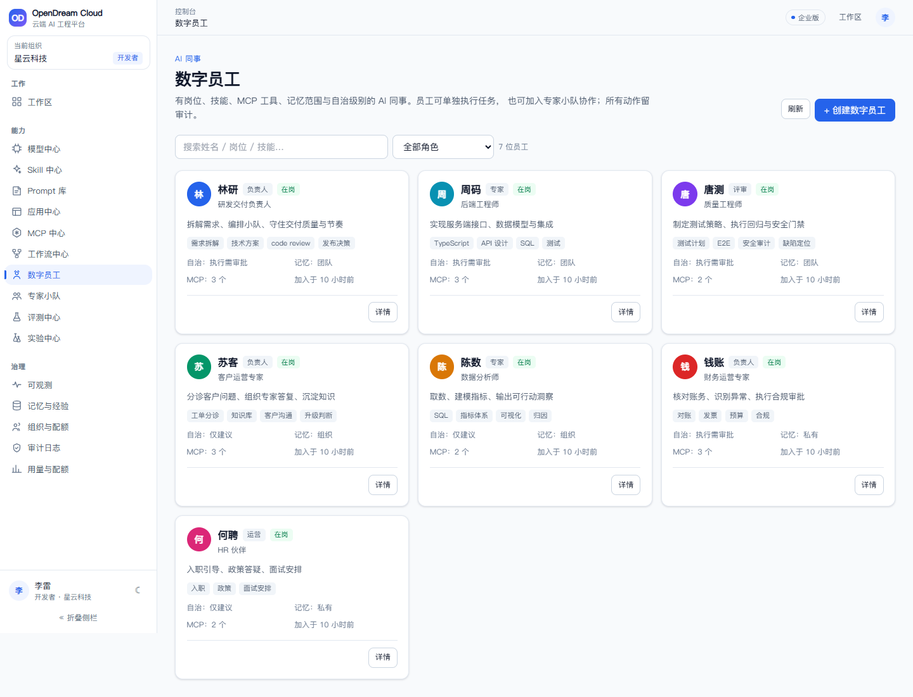
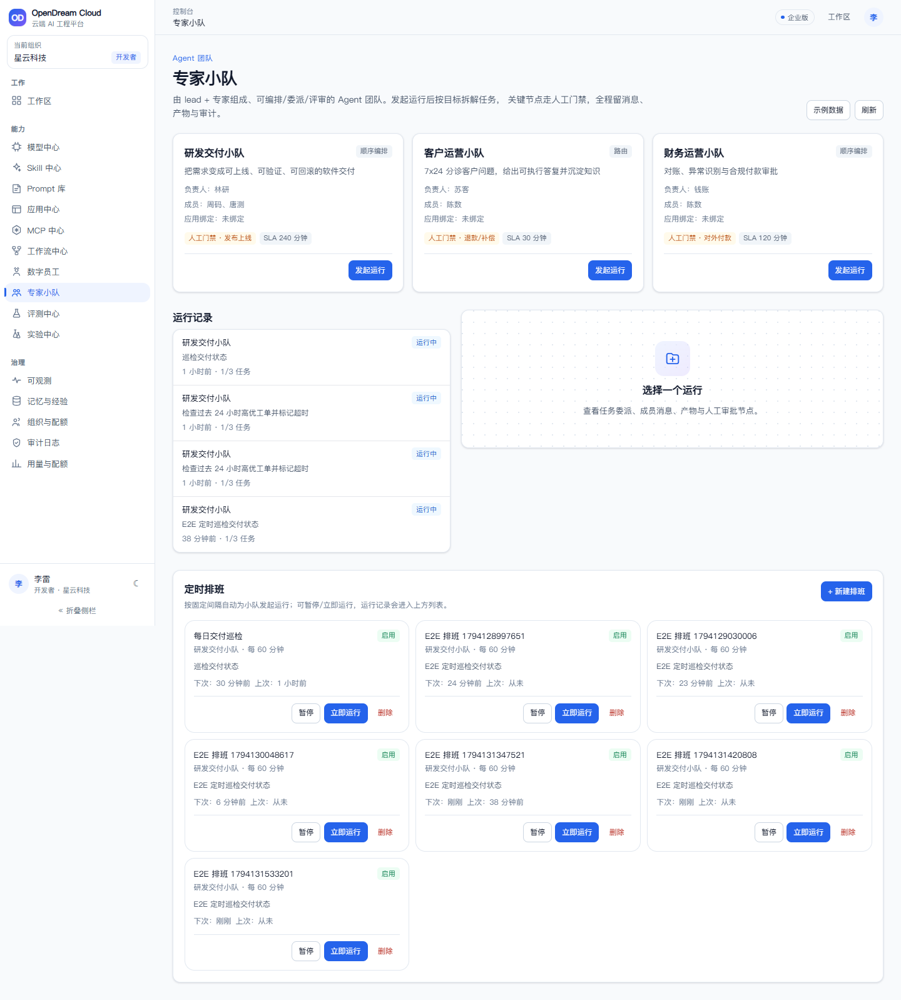
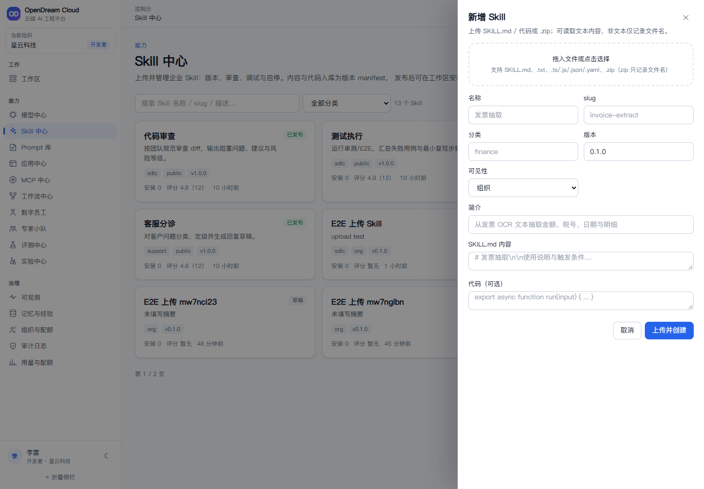
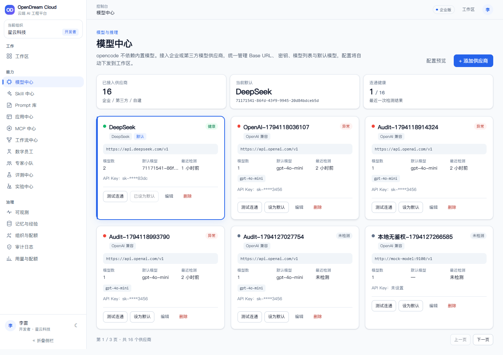
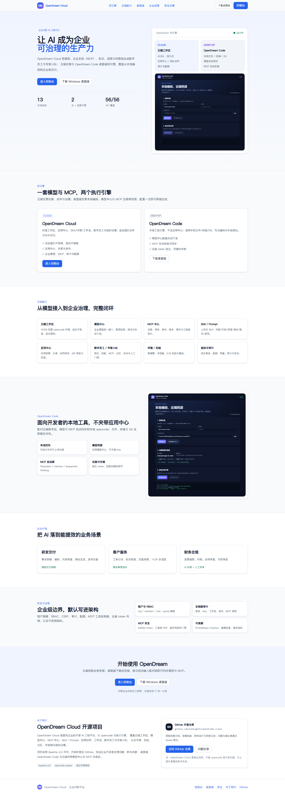
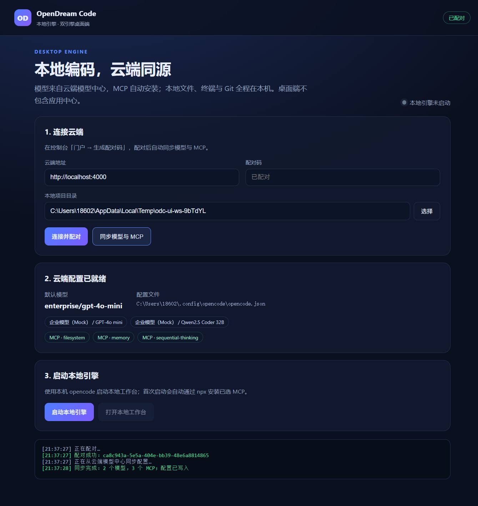

# OpenDream Cloud

> 以 [opencode](https://github.com/anomalyco/opencode) 为执行引擎的企业 AI 工程平台：云端工作区、模型中心、MCP 中心、Skill/Prompt 资产、应用协同、工作流、评测/实验、记忆、可观测，以及**数字员工 / 专家小队**。

[](LICENSE)
[](docs/PRODUCT-GUIDE.md)
[](https://bun.sh)
[](https://nextjs.org)

> ⚠️ **Alpha / 非生产级**：本项目适合学习、方案验证与二次开发，尚未完成高可用、企业 SSO、生产数据库、KMS、容量与合规验证。请勿直接承载生产流量。详见 [产品指引](docs/PRODUCT-GUIDE.md) 与 [完成度审查](docs/04-reviews/COMPLETION-AUDIT.md)。
>
> **非官方声明**：OpenDream Cloud 是独立项目，基于开源 opencode 引擎构建，**不是** opencode 官方发行版/云服务，与上游无隶属或背书关系。见 [TRADEMARK.md](TRADEMARK.md) 与 [法律风险审视](docs/LEGAL-RISK-REVIEW.md)。

## 双引擎：云端 + OpenDream Code 桌面端

| 引擎 | 定位 | 能力 |
| --- | --- | --- |
| **OpenDream Cloud** | 托管与协作 | 云端工作区、应用中心、Skill/评测/工作流、组织治理 |
| **OpenDream Code** | 本地工具 | 本地文件/终端/Git、本地 opencode、模型与 MCP 自动同步 |

- 桌面端**不含应用中心**，只做本地编码工具；
- 模型沿用云端「模型中心」，配对后自动写入 opencode 配置，无需手填 Key；
- MCP 自动安装：内置 filesystem/memory/sequential-thinking，并同步云端已发布 MCP；
- 控制台「设备与桌面端」生成配对码，设备可随时吊销；企业门户 `/` 展示双引擎与下载。

详见 [双引擎架构](docs/02-architecture/DUAL-ENGINE.md) 与 [桌面端说明](apps/desktop/README.md)。

## 企业价值：把 AI 落到能提效的业务场景

OpenDream Cloud 的目标不是再做一个聊天框，而是把模型、企业系统（MCP）、知识、流程、权限组合成**可治理、可复用、可计量的数字员工/专家小队**，嵌入企业现有业务。

| 场景域 | 典型落地场景 | 提效点 |
| --- | --- | --- |
| 研发交付 | 需求拆解、编码、代码审查、测试生成、发布自查 | 缩短需求→合并→发布周期，减少重复劳动 |
| 客户服务 | 工单分诊、知识检索、回复草稿、7×24 多语言 | 降低首响与单票成本，人工只做升级/兜底 |
| 财务合规 | 发票抽取、对账、合同审查、付款审批 | 自动初筛+人工终审，缩短处理周期、降低错误 |
| 数据决策 | 自然语言取数、经营周报、异常归因 | 业务自助取数，释放数据团队产能 |
| HR/内部服务 | 入离职办理、政策问答、面试安排、IT 支持 | 高频流程自动化，提升员工体验 |
| 销售/专业服务 | 投标方案、客户拜访简报、报价/合同初稿 | 资料整合与初稿提速，人做判断与关系 |

**建议试点**：每个场景先用真实基线定义“节省工时、周期、自动解决率、风险事件”四个指标，选 1–2 个高频、可校验、低风险场景做 2–4 周 POC，再规模化。
完整场景库、ROI 测算示例、落地路径与企业级边界见 **[企业价值与 AI 落地场景](docs/ENTERPRISE-VALUE.md)**。

## 特性

- **Agent 构建与治理**：Agent 类型（Harness/高代码/纳管/注册）、Agent 模板、专家小队、版本/Guardrails/定时；**凭证中心**集中加密保存 AK/SK。
- **云端工作区**：每个用户 4C8G opencode 工作区，关闭浏览器不销毁，显式销毁；PVC 持久化。
- **桌面端 OpenDream Code**：本地工具引擎，模型与 MCP 从云端自动同步，不含应用中心。
- **模型中心**：企业/第三方模型供应商，API Key 加密，连通测试，配置自动下发到工作区（不依赖 opencode 自带模型）。
- **MCP 中心**：全生命周期、版本/渠道、工具目录、EdDSA/JWKS Ticket、工具级 PEP 与审计。
- **Skill / Prompt 资产**：上传式 Skill（SKILL.md/代码/zip）、六页签（内容/代码/审查/调试/版本/启用）；Prompt 预置与自定义。
- **应用中心**：应用权限、分享、对话式协同修改、diff 审批、版本回滚。
- **工作流**：DSL + 11 个模板、运行/人工任务/补偿、Saga。
- **数字员工 / 专家小队**：岗位/技能/MCP/记忆/自治，Guardrails、版本快照、定时排班、人工门禁；可嵌入企业应用。
- **评测 / 实验 / 记忆 / 可观测 / 组织配额**：评测器、A/B 实验、mem0 兼容记忆、服务健康与成本、成员/配额。

## 截图

| 数字员工 | 专家小队 |
| --- | --- |
|  |  |

| Skill 上传 | 模型中心 |
| --- | --- |
|  |  |

| 企业门户 | OpenDream Code 桌面端 |
| --- | --- |
|  |  |

## 快速开始（Docker）

```bash
cd deploy/local
cp .env.example .env
docker compose up -d --build
docker compose ps
```

- 控制台：http://localhost:3000/login
- 控制面：http://localhost:4000/healthz
- 工作区网关：http://localhost:8080
- MCP 网关：http://localhost:8080/mcp/v1/{orgSlug}/{serverSlug}

演示账号：**`lilei@xingyun.example`**（开发登录；任意邮箱会创建新组织，新组织为空）。

## 本地开发

```bash
bun install
bun run --cwd apps/control-plane start   # :4000
bun run --cwd apps/console dev           # :3000
bun run lint
bun run test
```

## 架构与目录

```
apps/console            控制台（Next.js）
apps/desktop            OpenDream Code 桌面端（Electron，本地引擎）
apps/control-plane      控制面 API（认证/工作区/模型/MCP/应用/审计/配额）
services/mcp-hub        MCP Registry + 网关
services/skill-center   Skill 资产
services/eval-center    评测
services/experiment-center 实验
services/app-center     应用权限/协同
services/workflow-engine 工作流引擎
services/agent-workforce 数字员工/专家小队
services/memory-service 记忆/经验
services/local-gateway  本地工作区网关
services/mock-model     本地 Mock 模型
services/workspace-operator K8s Operator（Go）
packages/shared         共享库
packages/schema         工作流 DSL Schema/校验
deploy/local            本地 Docker Compose
deploy/gateway          Gateway API / Higress 模板
docs                    产品/架构/交付/评审
scripts / tests         工具、单测、契约、E2E
```

架构详情：[ARCH-V3](docs/02-architecture/ARCH-V3.md) · [V4 私有化/HA 架构](docs/02-architecture/ARCH-V4-ONPREM.md) · 产品指引：[docs/PRODUCT-GUIDE.md](docs/PRODUCT-GUIDE.md) · 企业价值：[docs/ENTERPRISE-VALUE.md](docs/ENTERPRISE-VALUE.md) · 开源指南：[docs/OPEN-SOURCE.md](docs/OPEN-SOURCE.md)。

## 测试与门禁

- 单元/契约：`bun run test`（133 用例，130 pass / 3 skip）
- API 门禁：`tests/{workflow,digital-human,mcp-admin,eval,memory,observability,org,app-collab}`
- UI E2E：`tests/e2e`（Playwright，37 pass / 1 legacy skip）
- 许可证检查：`bun run check:license`
- CI：`.github/workflows/ci.yml`

## 开源许可

- 自研代码：**Apache License 2.0**，作者 **suhong**（见 [LICENSE](LICENSE) / [NOTICE](NOTICE)）；
- 第三方组件：保留各自许可证，见 [THIRD_PARTY_NOTICES.md](THIRD_PARTY_NOTICES.md)；
- 上游 OpenCode：MIT，感谢上游社区；
- 本项目不是 OpenCode 官方发行版。

## 参与贡献

见 [CONTRIBUTING.md](CONTRIBUTING.md)、[CODE_OF_CONDUCT.md](CODE_OF_CONDUCT.md)、[SECURITY.md](SECURITY.md)。

> 版本变更见 [CHANGELOG.md](CHANGELOG.md)，作者见 [AUTHORS.md](AUTHORS.md)。
