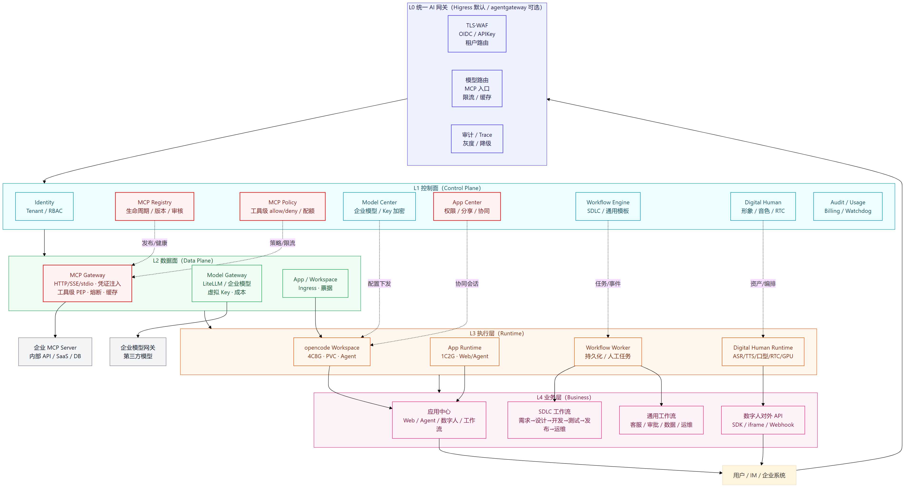
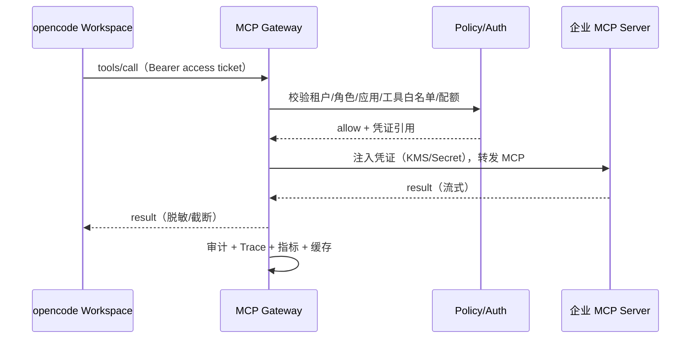
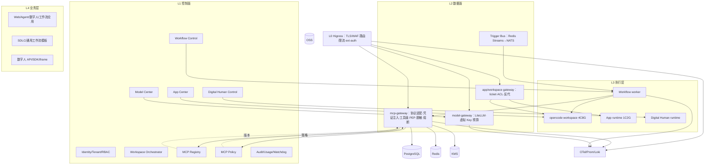
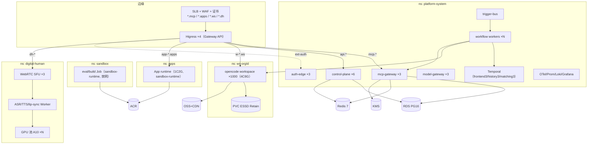
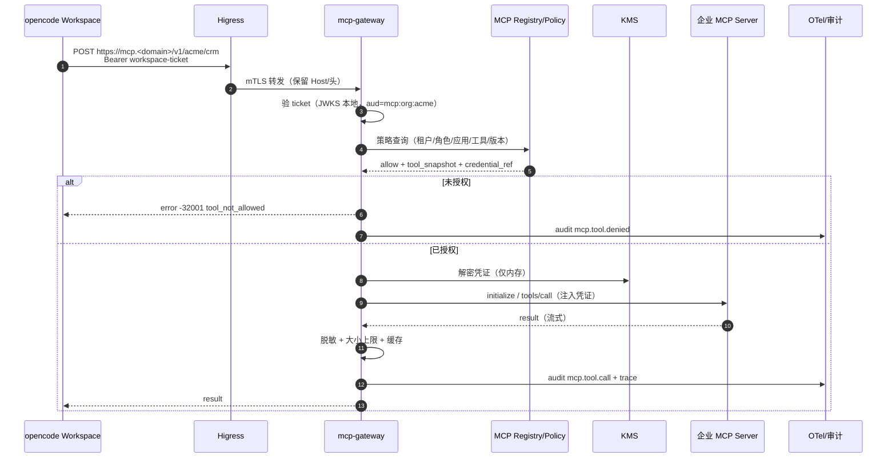
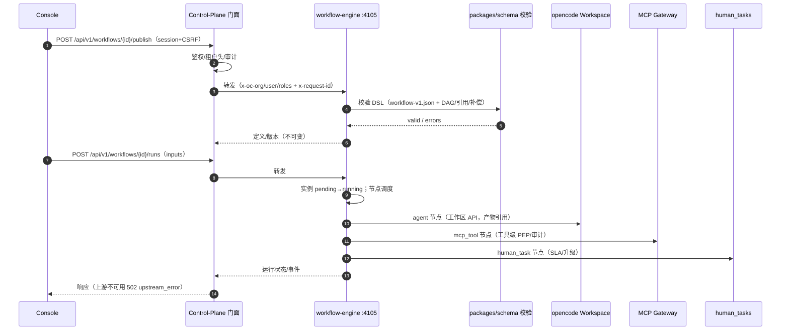
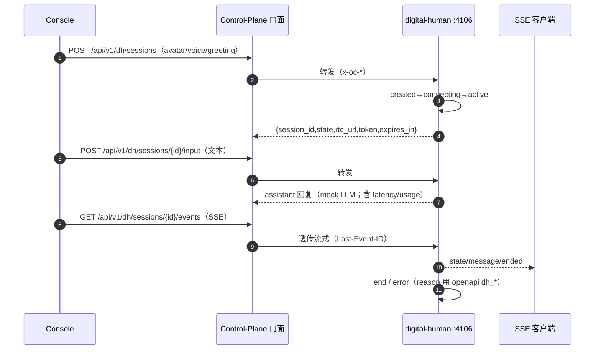
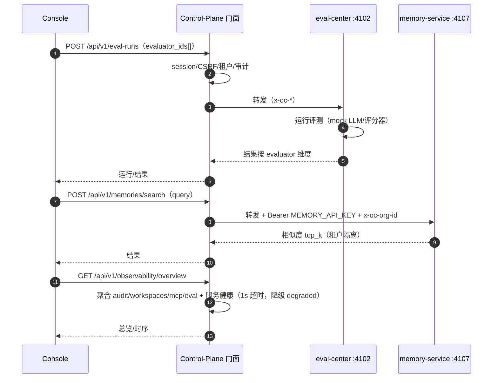

# OpenDream Cloud v3 总体架构（MCP 为核心）

- 版本：v0.1（Lead 草案，待 architect 评审补充）
- 日期：2026-11-08
- 目标：把「云工作区 + 四中心」升级为 **MCP 全生命周期管理 + 统一 AI 网关 + 应用协同 + 数字人 + 工作流** 的企业级 Agent 平台
- 关联：`PRODUCT-MODULE-PLAN.md`、`AGENTCORE-AGENTLOOP.md`、`ARCHITECTURE.md`（v2，历史）、`../05-delivery/LOCAL-DEPLOYMENT.md`



> 可编辑源：`diagrams/arch-v3-simple.mmd`；渲染脚本：`diagrams/render.mjs`（Mermaid → PNG/SVG）。

---

## 0. 一句话架构

> **MCP 是能力总线，统一 AI 网关是流量入口，opencode 工作区是执行单元，应用中心是交付形态，数字人与工作流是业务场景。**

```
用户/IM/企业系统
   │  HTTPS + SSO
   ▼
┌────────────────────────────── 统一 AI 网关（Higress / agentgateway）──────────────────────────────┐
│  TLS/WAF · OIDC/APIKey · 租户路由 · 模型路由 · MCP 协议入口 · 限流/缓存 · 审计/Trace               │
└───────────────┬───────────────────────┬───────────────────────┬──────────────────────────────┘
                │                       │                       │
        ┌───────▼────────┐      ┌───────▼────────┐      ┌───────▼────────┐
        │ MCP Gateway    │      │ Model Gateway  │      │ App / Workspace│
        │ （工具数据面）  │      │ （模型数据面）  │      │ Ingress        │
        │ 生命周期/策略   │      │ LiteLLM/企业模型│      │ 应用/工作区路由 │
        │ 凭证/审计/Trace │      │ 限流/成本       │      │ SSO/票据        │
        └───────┬────────┘      └───────┬────────┘      └───────┬────────┘
                │                       │                       │
┌───────────────▼───────────────────────▼───────────────────────▼──────────────────────────────┐
│                                     控制面（Control Plane）                                   │
│ Identity/Tenant · Workspace Orchestrator · MCP Registry/Lifecycle/Policy · Model Center      │
│ App Center（权限/分享/协同） · Workflow Engine · Digital Human Control · Audit/Usage/Billing  │
└───────────────┬───────────────────────┬───────────────────────┬──────────────────────────────┘
                │                       │                       │
┌───────────────▼────────┐      ┌───────▼────────┐      ┌───────▼────────┐
│ opencode Workspace     │      │ App Runtime    │      │ Workflow / DH  │
│ 4C8G · PVC · Agent     │      │ 1C2G · 容器    │      │ Worker / RTC   │
│ Skill/MCP/Model 配置   │      │ Web/Agent 应用 │      │ Temporal/GPU   │
└────────────────────────┘      └────────────────┘      └────────────────┘
```

---

## 1. 架构原则

1. **MCP 为中心**：任何外部能力（企业 API、数据库、SaaS、内部系统）优先以 MCP 暴露；opencode 只消费网关地址，不直连第三方凭证。
2. **控制面 / 数据面分离**：控制面故障不阻断已发布应用与工作区运行；数据面故障由网关降级/熔断。
3. **网关统一入口**：互联网流量只进 AI 网关（Higress/agentgateway），内部再路由到 MCP、模型、应用、工作区。
4. **默认拒绝 + 最小权限**：MCP 工具、应用分享、协同编辑全部显式授权；凭证只在网关/控制面注入。
5. **一切可审计**：MCP 调用、模型调用、应用发布、分享访问、协同 patch 100% 审计 + Trace。
6. **opencode 只读集成**：锁定 v2.2.5，配置/Skill/MCP/模型由平台下发；不 fork 上游。
7. **业务层可插拔**：SDLC 只是模板之一；工作流 DSL 同时支撑客服、审批、数据、运维、数字人。
8. **本地 / ACK 双模**：本地 Docker 用轻量网关验证；ACK 用 Higress + Operator + HPA 生产化。

---

## 2. 分层架构

### L0 接入层（Unified AI Gateway）

| 能力 | 说明 | 选型 |
| --- | --- | --- |
| 统一入口 | 域名/证书/WAF、灰度、灰度 Header | Higress（默认） |
| 租户路由 | `w-*.ws`、`app-*.apps`、`mcp.<domain>`、`api.<domain>` | Higress HTTPRoute/Gateway API |
| 身份 | OIDC/SSO、API Key、工作区 access ticket | control-plane auth-edge + 网关 ext-auth |
| 模型路由 | 多供应商、权重/灰度、语义缓存、Token 限流 | Higress AI 插件 / LiteLLM |
| MCP 入口 | streamable HTTP/SSE、REST→MCP、工具目录 | MCP Gateway（见 §4） |
| A2A | 多 Agent 互调（可选） | agentgateway（可选数据面） |
| 观测 | Access log、Trace、指标、审计 | OTel → CMS/Prometheus |

**选型结论（ADR-GW-01）**：生产默认 **Higress on ACK**（CNCF、阿里云 SOFA 实践、MCP 代理/REST-to-MCP/AI 路由成熟），agentgateway 作为可选数据面（A2A/MCP 原生、多云）；两者都走 Gateway API 抽象，避免锁定。本地 Docker 先由 `local-gateway` 承担最小路由，生产替换为 Higress。

### L1 控制面（Control Plane）

| 模块 | 职责 |
| --- | --- |
| Identity/Tenant | 用户/组织/团队、SSO、RBAC、API Key、配额 |
| Workspace Orchestrator | 4C8G 工作区生命周期、快照、票据、配置下发（CRD/Operator） |
| **MCP Registry** | 服务注册、版本、来源、可见性、审核发布、签名、健康 |
| **MCP Policy** | 工具级 allow/deny、租户/角色/应用维度、限流、预算 |
| Model Center | 企业/第三方模型连接、Key 加密、测试、默认切换、opencode 配置生成 |
| App Center | 应用 CRUD、构建发布、权限/分享、协同会话、版本 |
| Workflow Engine | 流程定义/实例、人工门禁、定时/事件触发 |
| Digital Human Control | 形象/音色/场景资产、会话编排、RTC 令牌 |
| Audit/Usage/Billing | 审计证据链、Token/资源计量、成本归因 |

### L2 数据面（Data Plane）

| 组件 | 职责 |
| --- | --- |
| **MCP Gateway** | 协议适配（HTTP/SSE/stdio→MCP）、凭证注入、工具级 PEP、限流/超时/重试/熔断、响应缓存、审计 Trace |
| Model Gateway | LiteLLM/企业网关，统一 OpenAI 兼容出口、虚拟 Key、预算、限流、成本 |
| App Runtime | 1C2G 容器、域名/证书、健康检查、灰度/回滚 |
| Workspace Runtime | opencode `serve`、PVC、Skill/MCP/模型配置、PTY/文件/Git |
| Workflow Worker | 持久化任务、人工任务、定时器、补偿 |
| Digital Human Runtime | ASR/TTS/lip-sync、RTC 推流、GPU 推理池 |

### L3 执行层

- opencode 工作区（4C8G，Guaranteed）；
- 应用容器（1C2G）；
- 工作流 Worker（按队列扩缩）；
- 数字人 GPU 推理（TTS/口型/渲染）。

### L4 业务层

- **应用中心**：Web 应用 / Agent 应用 / 数字人应用 / 工作流应用，统一权限与分享；
- **SDLC 工作流**：需求→设计→开发→测试→发布→运维；
- **通用工作流**：客服、审批、数据分析、运维值班、数字人接待；
- **数字人对外 API**：嵌入企业门户/IM/客服系统。

---

## 3. MCP 全生命周期（核心）

```
draft ──提交审核──▶ review ──通过──▶ published ──新版本──▶ published(v2)
  ▲                    │                 │
  └────驳回────────────┘                 ├──弃用──▶ deprecated ──下线──▶ offline
                                         └──紧急下线──▶ offline
```

| 阶段 | 动作 | 产物/约束 |
| --- | --- | --- |
| draft | 注册（URL/stdio 镜像/OpenAPI 导入）、填元数据 | 仅 owner 可见；不可被工作区引用 |
| review | 安全扫描（SSRF/命令注入/权限）、人工审批 | 审批记录、风险评分 |
| published | 发布版本（semver）、可见性（org/team/public） | 签名、工具清单快照、健康检查 |
| deprecated | 标记弃用、通知使用方 | 保留只读；禁止新绑定 |
| offline | 下线、吊销凭证 | 进行中调用优雅终止；审计 |

**版本与回滚**：每次发布生成不可变 `server_version`（工具 schema 哈希 + 镜像 digest/URL 版本）；回滚 = 切换指针 + 通知订阅方热更新。

**健康检查**：`initialize` + `tools/list` + 可选 `tools/call` 冒烟；连续失败自动降级/摘除并告警。

---

## 4. MCP 网关（数据面）设计

### 4.1 统一端点

```
https://mcp.<domain>/v1/{orgSlug}/{serverSlug}          # streamable HTTP
https://mcp.<domain>/v1/{orgSlug}/{serverSlug}/sse      # SSE（兼容旧客户端）
stdio 由 sidecar/本地代理转为 HTTP，白名单镜像
```

### 4.2 请求链路



### 4.3 工具级策略（PEP）

- 维度：tenant / org / team / user / app / workspace / server / tool / version；
- 规则：allow/deny、参数 schema 校验、敏感字段脱敏、结果大小上限、超时/重试/熔断；
- 默认拒绝：未在 `published` 版本工具清单内的工具不可调用；
- 限流：租户/工具维度 RPM/TPM/并发，超限 429 + `Retry-After`。

### 4.4 凭证与 SSRF

- 凭证只存 KMS/Secret，网关运行时注入；响应/日志/审计中脱敏；
- egress 白名单 + 私网阻断（默认禁止 169.254/10/172.16/192.168 段，企业 MCP 需显式放行）；
- 支持 mTLS / OAuth2 client credentials / API Key / 自定义 header。

### 4.5 与 opencode 集成

```jsonc
// 平台生成，写入工作区 opencode 配置
{
  "mcp": {
    "servers": {
      "crm": {
        "type": "remote",
        "url": "https://mcp.example.com/v1/org/crm",
        "headers": { "Authorization": "Bearer <ticket>" }
      }
    }
  }
}
```

- 工具变更/发布新版本 → 控制面计算新配置 → 工作区热更新；
- 未授权工具在 `tools/list` 阶段过滤（网关侧），opencode 不可见；
- 每次工具调用带 `workspace_id/app_id/session_id` 关联 Trace。

### 4.6 可观测与审计

- 指标：QPS、P50/P95、错误率、工具维度耗时、限流命中、缓存命中；
- Trace：`mcp.server` → `mcp.tool` span，关联 opencode session；
- 审计：调用者、工具、参数摘要（脱敏）、结果状态、耗时、成本；
- 证据链：审计写 WORM/哈希链，支持回放。

### 4.7 错误码与 endpoint 契约（QA 冻结项）

| HTTP | code | 场景 |
| --- | --- | --- |
| 401 | `unauthenticated` | 无/过期 ticket |
| 403 | `tenant_mismatch` | ticket 租户与 endpoint 不符 |
| 403 | `tool_not_allowed` | 工具不在策略/发布清单 |
| 404 | `server_not_found` / `tool_not_found` | 未发布/不可见/已下线 |
| 409 | `version_conflict` | 发布/下线并发版本冲突 |
| 413 | `result_too_large` | 响应超过租户上限 |
| 429 | `rate_limited` | RPM/TPM/并发超限（`Retry-After`） |
| 504 | `upstream_timeout` | 上游超时（可重试标记） |
| 502 | `upstream_error` | 上游 5xx/协议错误 |
| 503 | `circuit_open` | 熔断打开 |

Endpoint（MVP，canonical）：`POST /v1/{orgSlug}/{serverSlug}`（streamable HTTP）、`GET /v1/{orgSlug}/{serverSlug}/sse`（兼容）；工具列表与调用均须带 binding ticket。**与 MCP-GATEWAY §6.3 一致（QA ARCH-QA-01 已闭合）。**

**Binding ticket（canonical：EdDSA/Ed25519 + JWKS；本地 dev 可用 HMAC 兼容同一 claims）**：

```jsonc
{
  "iss": "control-plane",
  "aud": "mcp:org:<orgSlug>",
  "sub": "<user_id>",
  "org": "<org_uuid>",
  "ws": "<workspace_uuid>",
  "app": "<app_uuid|null>",
  "binding_id": "<uuid>",
  "server_id": "<uuid>",
  "server_version": 3,
  "scope": ["mcp:call", "tool:crm.contact.get"],
  "scope_hash": "sha256(canonical(scope + server_version))",
  "jti": "<uuid>",
  "exp": 1799999999,
  "iat": 1799999699
}
```

- **TTL 300s**，非一次性（同 binding 可复用至过期）；续签由工作区/agent 提前刷新；
- 吊销：binding 状态 / `jti` denylist，生产 ≤5s、本地 ≤30s 生效；
- 网关校验：签名（JWKS）、iss/aud（`mcp:org:<orgSlug>`）、org/ws 匹配、binding 状态、版本 = 当前 stable、工具 ∈ scope 且 ∈ 发布清单；
- 错误三态：未认证 401、越权/跨租户 403、不存在 404（不泄露内部原因）；
- `/mcp` 与 `/rest` 为**等价别名**，与 canonical 共用同一中间件栈，行为逐字节等价（QA GW-14 验证）。

**本地入口等价路径**：`local-gateway:8080/mcp/v1/{orgSlug}/{serverSlug}` → 原样转发 `mcp-hub:4104/v1/{orgSlug}/{serverSlug}`（去 `/mcp` 前缀）；生产 Higress 同一路径转发 MCP Gateway。入口层不做工具策略，PEP 始终在 MCP Gateway。

---

## 5. 应用中心：权限 + 在线协同

### 5.1 应用类型

| 类型 | 说明 | 运行 |
| --- | --- | --- |
| Web App | 静态/SSR 前端 | 1C2G 容器 |
| Agent App | opencode Agent + 对话 UI | 工作区/Agent Runtime |
| Digital Human App | 数字人 + 知识库/MCP | RTC + GPU |
| Workflow App | 工作流实例入口 | Workflow Worker |

### 5.2 权限矩阵

| 角色 \ 动作 | view | use | edit | share | deploy | rollback | delete |
| --- | --- | --- | --- | --- | --- | --- | --- |
| owner | ✓ | ✓ | ✓ | ✓ | ✓ | ✓ | ✓ |
| admin | ✓ | ✓ | ✓ | ✓ | ✓ | ✓ | ✗ |
| editor | ✓ | ✓ | ✓ | ✗ | ✗ | ✗ | ✗ |
| operator | ✓ | ✓ | ✗ | ✗ | ✓（发布） | ✓ | ✗ |
| viewer | ✓ | ✗ | ✗ | ✗ | ✗ | ✗ | ✗ |

- 分享：public / org / team / user；链接有效期、密码可选、SSO 强制、访问审计；
- 分享 token：`sst_<base64url(payload)>.<hmac>`，payload 含 app_id/scope/exp/非对称签名；过期/撤销返回 **410**，签名不符 403，SSO 未登录回跳登录页并保留 `return_to`；
- 分享链接走统一网关 → 应用路由 → SSO/票据 → 应用；
- 权限变更实时生效（缓存 TTL ≤30s，敏感动作强一致）。

### 5.3 在线协同（对话式修改应用）

```
用户在应用详情打开「协同修改」
  → 创建 collab session（绑定 app_id + base_version）
  → 对话：用户描述修改 → opencode 读取应用仓库/文件
  → 生成 patch 提案（diff + 影响范围 + 测试建议）
  → 审批人 diff 预览 → 批准/拒绝/要求修改
  → 批准后：构建 → 预览环境 → 发布新版本（可回滚）
```

- 并发：每个提案携带 `base_version`（应用版本号 + 内容 hash）；提交/批准时校验，落后返回 **409 `version_conflict`**，前端提示 rebase/重新生成；
- **base_version 规范**：`{version: int, content_hash: "sha256:<hex>"}`；content_hash = 对应用目录白名单文件按路径排序后 `path\0sha256(content)` 拼接再 sha256；提案创建时记录，批准/发布时与当前 head 比较，任一不一致返回 409；
- 安全：patch 只允许应用目录白名单（`src/`, `public/`, `package.json` 等），禁止 `.git/`、CI 配置、密钥文件；删除/重命名需审批；
- 审计：每条消息/提案/审批/发布留痕，可回放；
- 实时：WebSocket/SSE 推送会话与提案状态。

---

## 6. AI 网关：Higress / agentgateway

| 维度 | Higress | agentgateway |
| --- | --- | --- |
| 定位 | CNCF AI/API 网关，MCP 代理 + REST-to-MCP + AI 路由 | Solo 开源，MCP/A2A/LLM 连接 |
| 模型路由 | 权重/灰度/语义缓存/Token 限流 | LLM provider 路由 |
| MCP | MCP server 托管/代理、REST→MCP | MCP/A2A 原生 |
| 部署 | K8s Gateway API / 独立 | standalone/K8s |
| 生态 | 阿里云 SOFA 商用实践、WAF/可观测 | 多云、Agent 互操作 |
| 结论 | **默认生产数据面** | **可选/A2A 场景** |

统一网关拓扑：

```
Internet → WAF/TLS → Higress
  ├─ /mcp/*      → MCP Gateway（工具数据面）
  ├─ /v1/*       → Model Gateway（LiteLLM/企业模型）
  ├─ /api/*      → control-plane
  ├─ w-*.ws/*    → workspace
  ├─ app-*.apps  → app runtime
  └─ dh-*.dh/*   → digital human RTC/API
```

关键：网关只做**入口与流量治理**；MCP 的**工具级授权/凭证/审计**在 MCP Gateway（独立 PEP），避免把复杂策略塞进网关插件。

**local-gateway 与 Higress 契约等价性**：本地 `local-gateway` 必须实现与生产网关相同的路由/鉴权/Header 语义子集（`/v1/{orgSlug}/{serverSlug}`、ticket 校验、429/504 错误码、SSE 直通），同一套 API 测试可在两种数据面上跑；差异仅限插件能力（语义缓存/WAF/模型路由）并显式标注。

---

## 7. DeepSeek Super-agent 映射

参考 DeepSeek Harness Super-agent：双层 Router/Worker、事件 Trigger、Thread 订阅直通、异步 ReAct Loop、存算分离、外部 Watchdog。

| Super-agent 概念 | 我们的实现 |
| --- | --- |
| Router 层 | control-plane 的「会话路由/协调器」+ 应用协同会话；只分派不干活 |
| Worker 层 | 每个 opencode 工作区/Agent Runtime 独立执行，上下文隔离 |
| Trigger | IM/GitHub/CI/Webhook/定时器/应用事件 → 工作流引擎事件总线 |
| Thread 订阅直通 | 事件按 thread_id 直投对应 worker session；Router 只处理新任务 |
| 异步 ReAct | opencode session 异步工具/PTY；平台侧事件驱动推送 |
| 存算分离 | 会话日志/状态在控制面 DB；执行在 workspace Pod（可漂移） |
| Watchdog | 24/7 运维 Agent：健康检查、卡死检测、自动重启、目标偏移告警 |
| 多信道 | Web 控制台 + 钉钉/飞书/企微 + API/Webhook |

**落地策略**：先做「工作区即 Worker + 应用协同会话」；再做 Trigger/事件总线与 Watchdog；Router 用轻量协调器 + 规则/LLM 混合。

---

## 8. 数字人模块（并行详细设计）

- **应用形态**：App Center 的一种类型（Digital Human App），可分享/嵌入；
- **实时链路**：ASR → LLM/Agent → TTS → lip-sync/动作 → RTC（WebRTC/RTMP）；
- **资产**：形象（2D/3D）、音色、动作库、知识库、人格；
- **API**：创建会话、推流地址、文本/语音输入、事件回调、嵌入 SDK/iframe；
- **企业集成**：SSO、API Key、Webhook、IM、企业门户；
- **运行**：GPU 推理池、TTS/口型服务、RTC 集群、7x24；
- **与 MCP**：数字人调用 CRM/订单/知识库等 MCP 工具，完成业务闭环。

详细设计：[services/DIGITAL-HUMAN.md](services/DIGITAL-HUMAN.md)（pm-research + infra-devops）。

---

## 9. SDLC / 通用工作流业务层

- **DSL**：节点（Agent/MCP 工具/人工审批/条件/并行/子流程/延时/Webhook/脚本）+ 变量 + 错误/重试/补偿 + 版本；
- **SDLC 模板**：需求→设计→开发→测试→发布→运维；每阶段 Agent 角色、门禁（评审/测试/安全）、产物（PRD/ADR/代码/报告）、Git/CI/MCP 集成；
- **通用模板**：客服工单、审批、数据分析、运维值班、数字人接待；
- **引擎**：推荐 Temporal（持久化/重试/人工任务），MVP 可用轻量状态机；7x24、定时/事件触发、人工介入、审计；
- **与 App Center**：工作流应用 = 可分享的 App；与 opencode 工作区协作执行开发类节点。

详细设计：[services/WORKFLOW.md](services/WORKFLOW.md)（pm-research + architect）。

---

## 10. 部署架构

- **本地 Docker（当前）**：control-plane / console / workspace / four centers / gateway / mock-model；验证 MCP/模型/应用/协同 MVP。
- **ACK 生产**：Higress（Ingress/AI/MCP）+ MCP Gateway 多副本 + control-plane（PG/Redis）+ Operator + workspace Pod（4C8G）+ App 容器（1C2G）+ 数字人 GPU 池 + OTel/日志/审计。
- **7x24**：多 AZ、HPA/KEDA、PDB、Watchdog、备份恢复、灰度回滚、限流降级。

---

## 11. WBS（本轮并行）

| ID | 工作流 | Owner | 交付 | 依赖 |
| --- | --- | --- | --- | --- |
| A1 | 总体架构/图/ADR | architect | ARCH-V3 + diagrams | — |
| A2 | MCP 生命周期+网关 | capability-centers 设计 / platform-backend 实现 | MCP-GATEWAY.md + MVP | A1 |
| A3 | 应用权限+协同 | platform-backend API / web-console UI | APP-COLLAB.md + MVP | A1 |
| A4 | AI 网关/7x24 | infra-devops | AI-GATEWAY.md + 配置 | A1 |
| A5 | 数字人详细设计 | pm-research + infra-devops | DIGITAL-HUMAN.md | A1 |
| A6 | SDLC/通用工作流 | pm-research + architect | WORKFLOW.md | A1 |
| A7 | QA 门禁 | qa-reviewer | V3-TEST-PLAN + G-V3 gate | A2/A3 |

**里程碑**
- M1（本轮）：架构 v0.1 + 图 + WBS 评审 ← 现在
- M2：MCP 网关 MVP（生命周期/代理/工具策略/审计）+ App 权限/协同 MVP
- M3：数字人/工作流详细设计评审 + Higress 接入模板
- M4：本地端到端 + QA 门禁 PASS；ACK 生产化

---

## 12. 风险与开放问题

1. Higress vs agentgateway 的最终形态：先用 Gateway API 抽象，避免锁定；
2. MCP 工具级策略的性能：PEP 缓存 + 本地决策，避免每 call 远程鉴权；
3. 协同 patch 的并发/安全：base_version 乐观锁 + 目录白名单 + CI 门禁；
4. 数字人实时延迟/GPU 成本：分档（实时/半实时/离线）；
5. 工作流引擎选型：Temporal 运维成本 vs 自研状态机；
6. 7x24 Watchdog 误报/自愈边界：先只读诊断 + 人工确认，再逐步自动修复；
7. 真实模型/第三方 MCP 凭证与合规。

---

# 附录（architect 增补，2026-11-08）

> 以下 §13–§22 为 architect 对 v0.1 的增补：C4 视图、部署图、5 条关键数据流、容量模型、失败模式、安全边界、契约版本化、与 v0.1 的冲突清单。
> 图源在 `diagrams/*.mmd`，渲染产物同名 `.svg` / `.png`（`node diagrams/render-all.mjs` 重建）；Mermaid 源同时嵌入正文，便于 PR 评审。
> ADR：`adr/ADR-V3-01-mcp-gateway.md`（本 ADR 签署）、`ADR-V3-02-collab-editing.md`、`ADR-V3-03-digital-human-realtime.md`、`ADR-V3-04-workflow-engine.md`、`ADR-V3-05-mcp-lifecycle-contract.md`。

## 13. C4-L1 系统上下文视图

```mermaid
flowchart TB
  classDef person fill:#fef3c7,stroke:#d97706,color:#78350f
  classDef sys fill:#dbeafe,stroke:#2563eb,color:#1e3a8a
  classDef ext fill:#f3f4f6,stroke:#6b7280,color:#111827
  classDef store fill:#fef9c3,stroke:#ca8a04,color:#713f12
  U1["开发者 / 平台管理员<br/>Web 控制台"]:::person
  U2["应用使用者 / 观众<br/>分享链接、数字人会话"]:::person
  U3["企业系统 / IM<br/>钉钉·飞书·企微·Webhook"]:::person
  S["OpenDream Cloud v3<br/>MCP 能力总线 + 统一 AI 网关<br/>工作区/应用/数字人/工作流"]:::sys
  E1["企业 IdP<br/>OIDC"]:::ext
  E2["模型供应商<br/>DeepSeek·通义·OpenAI·Kimi"]:::ext
  E3["企业 MCP Server<br/>CRM·订单·知识库·工单"]:::ext
  E4["Git / CI<br/>GitHub·GitLab"]:::ext
  E5["RTC / GPU 基础设施<br/>ACK·GPU 池"]:::ext
  D1[("PostgreSQL / Redis / OSS / KMS")]:::store
  U1 -->|HTTPS + SSO| S
  U2 -->|分享链接 SSO / WebRTC| S
  U3 -->|Webhook / APIKey / MCP| S
  S -->|OIDC 授权码 PKCE| E1
  S -->|OpenAI 兼容（经 Model Gateway）| E2
  S -->|MCP streamable HTTP/SSE（经 MCP Gateway）| E3
  S -->|PR / Check / 构建上下文| E4
  S -->|WebRTC SFU / GPU 推理| E5
  S -->|持久化/密钥/审计| D1
```



> 渲染：`diagrams/c4-l1-context.svg` / `.png`

**边界**：平台**不**自建模型推理；**不**直连企业数据库（一律经 MCP）；数字人音视频默认不落盘；互联网匿名访问禁止（分享仍要求 SSO/token）。

## 14. C4-L2 容器视图（分层）

`diagrams/c4-l2-containers.svg` / `.png`（源见 `diagrams/c4-l2-containers.mmd`，与 §2 分层一致但补出组件与数据存储）。



**关键容器职责边界（与 v2 一致的部分不重复）**

| 容器 | 负责 | 明确不负责 |
| --- | --- | --- |
| Higress | 边缘 TLS/WAF、租户路由、全局限流、灰度、ext-auth 回调、access log | 工具级授权、凭证注入、响应脱敏 |
| mcp-gateway | MCP 会话、`tools/list` 过滤、工具级 PEP、凭证注入、超时/重试/熔断/缓存、审计/Trace | 边缘路由、模型调用 |
| MCP Registry/Policy | 生命周期、版本签名、可见性、策略编译、健康 | 承载调用流量 |
| model-gateway | 模型路由、预算、虚拟 Key、成本 | 工具调用 |
| app/workspace gateway | ticket 验签、ACL、子域反代、SSE/WS 透传 | 业务逻辑 |
| Workflow Control/Worker | DSL/实例/人工任务/触发、执行 Activity | LLM/工具副作用（走 Activity） |
| Digital Human Control/Runtime | 资产/编排/RTC token、ASR/TTS/lip-sync/SFU | 持上游凭证 |

## 15. 部署视图（ACK + 本地双模）

`diagrams/deploy-ack.svg` / `.png`（源 `diagrams/deploy-ack.mmd`）。



**部署约束（硬）**

1. **命名空间 canonical**：`platform-system` / `ws-<orgId>`（每组织）/ `apps`（共享，Pod 带 `tenant` 标签）/ `sandbox` / `digital-human`；ResourceQuota 按组织配额缩放。
2. **mcp-gateway 仅集群内**：Service 类型 ClusterIP + mTLS；公网只能经 Higress；禁止 NodePort/LoadBalancer。
3. **GPU 节点池**：`dedicated=digital-human:NoSchedule`，KEDA 按 `dh_sessions_active` 扩缩；镜像/模型预热（warm pool）避免冷启动 >30s。
4. **Temporal**：独立 DB schema + 每日备份 + PDB；仅内网；worker 按队列分部署（见 ADR-V3-04）。
5. **本地 Docker 双模**：`local-gateway` 承担 L0 子集（路由 + ticket + `/v1/{orgSlug}/{serverSlug}`）；**必须通过同一套契约测试**（§6 等价性），差异（WAF/语义缓存/模型路由）显式标注 DEGRADED。
6. **数据驻留**：单地域多 AZ；审计/PG/OSS 同地域；跨境/多地域为 P2。

## 16. 关键数据流

> 5 条链路均出图：`diagrams/flow-*.svg` / `.png`；每图 Mermaid 源见同名 `.mmd`。

### 16.1 MCP 调用（`flow-mcp-call`）



**关键约束**：`tools/list` 在网关侧按 binding 过滤（未授权工具对 opencode 不可见）；工具调用**默认不重试**（非幂等），仅连接层可重试 1 次；错误码见 §4.7 与 §20 映射。

### 16.2 应用发布与分享（`flow-app-release`）

要点：工作区导出构建上下文 → BuildKit（sandbox）→ ACR（不可变 `rev-uuid` + digest）→ 1C2G Runtime → 分享 ACL（Redis 主动失效 ≤5s）→ 使用者经 SSO + `sst_` 分享 token / app access-ticket 进入。安全：镜像 digest 只认扫描通过；分享 token 过期/撤销 410、签名错 403、未登录 `return_to` 回跳。

### 16.3 协同编辑（`flow-collab`）

要点：collab session 绑定 `base_version`（应用版本 + 内容 hash）→ Agent 在 `collab/<session>` 分支产出 patch → 提案（diff/风险/测试建议）→ 审批（高风险强制双人）→ rebase 合并 → CI 门禁 → 预览环境 → 发布。并发：`base_version` 不匹配 409 `version_conflict`；同一 app 同时仅一个 pending proposal 可合并。

### 16.4 数字人实时会话（`flow-digital-human`）

要点：控制面签发 RTC token（≤5min）→ SFU room → 流式 ASR → Agent（可调 MCP）→ **首句优先**流式 TTS → GPU 口型/合成 → SFU 下行；降级顺序 3D→2D→纯音频→文本+HLS；水印 + 内容审核 + 会话审计。

### 16.5 工作流（`flow-workflow`）

要点：Trigger（IM/Git/CI/Webhook/定时）→ Trigger Bus（`thread_id` 保序 + `event_id` 幂等）→ Router（只分派）→ Runtime（MVP 状态机 / Temporal）→ 节点：agent（工作区）/mcp_tool（网关）/human（human_tasks）/render（数字人）/script（受限沙箱）→ 发布节点（App Center）；状态与补偿见 ADR-V3-04。

## 17. 容量模型（MCP 为核心）

**假设**（`[推断]`，需 1000 工作区压测校准）：1,000 工作区 × 30% 同时活跃 = 300；单活跃工作区 MCP 工具调用峰值 0.5 calls/s → 均值 150 calls/s，**峰值 450 calls/s**（3× 突发）。

| 层 | 组件 | 副本 | 单副本能力 | 目标峰值 | 余量 |
| --- | --- | --- | --- | --- | --- |
| L0 | Higress | 4 | 5,000 RPS / 10k 连接 | 3,000 RPS | 6× |
| L2 | **mcp-gateway** | 3（HPA 3–9） | 1,200 calls/s（PEP 命中，P95 +8ms） | 450 calls/s | 8× |
| L2 | model-gateway | 3 | 500 RPS | 450 RPS | 3× |
| L1 | control-plane | 6 | 500 RPS | 250 RPS | 12× |
| L1 | MCP Registry/Policy | 2 | 5k 策略查询/s（缓存） | 450/s | 10× |
| L1 | Workflow workers | 5 队列 ×4 | 200 actions/s | 80/s | 2.5× |
| L1 | Temporal | 3+3+3 | 5k workflow/s（理论） | 20 start/s、1,000 并发实例 | 50× |
| L3 | Digital Human GPU | 14 × A10 | 8–12 路 720p/卡 | 100 路 Realtime | 1.5× |
| L3 | WebRTC SFU | 3 | 500 participant/副本 | 100 会话 | 10× |
| 数据 | RDS PG16 | 8c32g 主+只读 | 5k TPS 读/1.5k 写 | 1,200 TPS | 2× |
| 数据 | Redis 8G 主从 | — | 100k OPS | 20k OPS | 5× |

- **mcp-gateway 单调用开销预算**：ticket 验签（JWKS 本地）≈0.3ms + 策略匹配 ≈0.2ms + 凭证解密 ≈0.5ms + 审计异步 → **决策开销 P95 ≤5ms**（策略缓存命中；冷启动 ≤20ms），缓存命中率目标 ≥99%（QA ARCH-QA-10 已闭合）。
- **存储**：MCP 调用审计 180 天（约 1.2 亿行/年 → 分区 + 归档）；workflow history 1,000 实例 × 1MB ≈ 1GB，retention 30d 后归档 OSS；数字人录制仅可选（默认关）。
- **带宽**：入口 0.3–0.9 Gbps；MCP/模型内网 100–300 Mbps；RTC 100 会话 × 2 Mbps ≈ 200 Mbps（GPU 节点网卡 ≥10G）。
- **成本量级**（`[推断]`）：v2 计算 ≈64 万/月 + mcp-gateway/Temporal/网关 ≈6–10 万 + GPU（14×A10 按需/预留）≈12–20 万 → **总量级 82–95 万/月**（不含模型 token 与 RTC 流量）。**成本开关**：数字人分档（Realtime 配额）、MCP 缓存、workflow 并发上限。

## 18. 失败模式与降级

| # | 故障 | 检测 | 影响面 | 降级/恢复 | SLO |
| --- | --- | --- | --- | --- | --- |
| F-V3-01 | Higress 全挂 | SLB 探针 | 全部入口不可用 | 多副本 + 跨 AZ；DNS 切换；恢复后无数据丢失（控制面/数据面独立） | MTTR ≤10min |
| F-V3-02 | **mcp-gateway 全挂** | 健康检查/错误率 | 工具调用全失败；会话/模型/文件仍可用 | opencode 工具列表降级为空（软失败）；恢复后自动重连；**不重试工具调用**避免重复副作用 | MTTR ≤10min |
| F-V3-03 | MCP Registry/Policy 挂 | 5xx/策略查询失败 | 新策略/新绑定不可用；已有策略缓存继续 | 策略本地缓存（TTL 5min）+ 熔断；变更排队；**默认拒绝**新工具（安全优先） | MTTR ≤10min |
| F-V3-04 | KMS 不可用 | 解密失败率 | 凭证无法注入 → 工具调用失败 | 短期内存缓存（≤5min，按调用命中）；告警；**不落明文兜底** | MTTR ≤15min |
| F-V3-05 | 单个企业 MCP Server 挂 | 健康检查/连续失败 | 该 server 工具不可用 | 自动摘除（degraded）+ 通知 owner；其他工具不受影响 | 自动摘除 ≤60s |
| F-V3-06 | 供应商模型故障 | LiteLLM 错误率 | 部分模型不可用 | Model Gateway fallback 链；模型策略灰显 | MTTR ≤10min |
| F-V3-07 | Temporal 不可用 | 前端探针 | 新工作流无法启动；运行中实例暂停 | Trigger 事件在 Bus/outbox 积压不丢；恢复后继续；人工任务仍可审批（库内） | MTTR ≤30min |
| F-V3-08 | Trigger Bus 积压 | lag 指标 | 触发延迟 | 消费扩容（KEDA）；超出阈值降级为"仅高优事件"；告警 | lag ≤10k |
| F-V3-09 | App Runtime 崩溃 | 探针 | 单应用不可用 | 重启 + 回滚上一版本（≤2min）；健康检查失败自动回滚 | RTO ≤2min |
| F-V3-10 | 协同合并冲突风暴 | 409 率 | 编辑体验下降 | 合并队列 + rebase 提示 + 自动重生成；限流 | 409 ≤5% |
| F-V3-11 | SFU 故障 | 会话断连率 | 数字人会话中断 | 多副本 + 会话迁移/重连 ≤5s；降级为音频 | RTO ≤5s |
| F-V3-12 | GPU 池耗尽 | 排队长度 | 新数字人会话排队 | 排队 + 降级档位（Near-real-time/音频）；配额阻断 | 排队 ≤60s |
| F-V3-13 | opencode 工作区故障 | 探针 | 单用户不可用 | Pod 重建（≤90s）；数据在 PVC | RTO ≤90s |
| F-V3-14 | PG/Redis 故障 | 连接失败 | 控制面写失败；MCP 审计积压 | 读缓存；审计本地 WAL/OSS 回放；**MCP 调用不依赖 PG**（策略缓存） | MTTR ≤15min |
| F-V3-15 | 审计管道背压 | 队列深度 | 审计延迟 | 采样 + 本地缓冲；**不得丢审计**（WORM 前落盘） | 延迟 ≤5min |
| F-V3-16 | MCP 结果注入（prompt injection） | 规则/模型检测 | Agent 被诱导执行危险工具 | 工具输出标注"不可信数据"、危险工具需审批、输出截断/脱敏；审计告警 | 见 §19 |

**降级总原则**：① **默认拒绝**新授权（安全 > 可用）；② 工具/模型失败是**软失败**（会话仍可用）；③ 不自动重试非幂等调用；④ 所有降级在 UI 明示（DEGRADED 标记）。

## 19. 安全边界（v3 增量）

| # | 边界 | 威胁 | 控制 |
| --- | --- | --- | --- |
| S-V3-01 | **工具级 PEP** | 越权调用工具/跨租户 | ticket `aud=mcp:org:<id>` 与 endpoint 租户强校验；策略 deny 优先；`tools/list` 过滤；跨租户 404 |
| S-V3-02 | **Confused deputy** | 网关用高权限凭证替低权限用户执行 | 凭证按 binding 绑定（`binding_id`），不共享；每次调用校验 subject→binding；审计含 binding |
| S-V3-03 | **凭证外泄** | 日志/响应/工作区泄露 | 凭证只在 mcp-gateway 内存；日志/审计正则脱敏；工作区只持 workspace-ticket（短 TTL、单次） |
| S-V3-04 | **SSRF** | MCP URL/企业 API 指向内网/元数据 | egress 代理 + 域名/IP 白名单；默认阻断私网 + 169.254/100.100；DNS rebinding 二次校验 |
| S-V3-05 | **MCP 结果注入** | 工具返回恶意指令诱导 Agent | 结果标记为 data、系统提示隔离；高危工具（写/删除/支付）需人工审批；输出上限；审计异常 |
| S-V3-06 | **版本供应链** | 恶意/被篡改 MCP 版本 | 发布签名（registry ed25519）+ 网关验签 tool_snapshot_hash；版本不可变；紧急下线 |
| S-V3-07 | **数字人合规** | 未授权肖像/声音、深度伪造 | 授权声明 + 组织可见；默认水印；内容审核；对外调用审计；禁止未授权真人仿冒 |
| S-V3-08 | **协同 patch** | 越目录/删保护文件/绕过 CI | 目录白名单、保护文件禁改、强制 CI 门禁、双人审批高风险、每次 patch 审计 |
| S-V3-09 | **分享 token** | 泄露/枚举/重放 | `sst_` HMAC + 过期 + 可选密码 + SSO 强制；410/403 区分；访问审计 |
| S-V3-10 | **工作流脚本节点** | RCE | `script` 节点在 sandbox-runtime 禁网执行；白名单语言/超时/资源上限；默认关闭 |
| S-V3-11 | **多租户数据** | 跨租户读 | 控制面 RLS/仓储层强制 org_id；MCP/模型/工作流全部带 tenant 维度；审计隔离 |
| S-V3-12 | **成本型 DoS** | 高频工具/GPU 滥用 | 租户/工具/会话配额 + 预算 + 熔断；GPU 排队与降级；告警 |

## 20. 契约版本化（v2 FROZEN 不动，v3 增量走 1.1.0）

- **v2 `openapi.yaml`（FROZEN，96 paths / 131 ops）不改**；v3 的控制面新增（MCP 生命周期/版本/渠道/审批/工具策略/绑定扩展、App 协同、数字人会话、工作流定义/实例/人工任务）**进入 `openapi.yaml` 的 `1.1.0`**，走：ADR → changelog（README §5.1）→ 通知 qa/backend/capability。
- **数据面 MCP 端点**（`/v1/{orgSlug}/{serverSlug}` + `/sse`）**不属于资源 API**，由 `MCP-GATEWAY.md` 定契约 + 网关自身 OpenAPI 片段；`/internal/*` 不进 SDK。
- **两层错误码映射**（v0.1 §4.7 的产品码 → 契约字段）：`code` 仍为 16 个通用值；§4.7 的 `tenant_mismatch/tool_not_allowed/version_conflict/result_too_large/upstream_timeout/upstream_error/circuit_open/server_not_found/tool_not_found` 作为 **`reason`** 扩展（`1.1.0` 增补 `ErrorReason`），HTTP 状态按 §4.7 表。**冲突**：§4.7 的 `401 unauthenticated` 对应契约 `code=unauthorized` + `reason=auth_session_expired|ticket_invalid`；`409 version_conflict` 对应 `code=conflict` + `reason=version_conflict`。
- **分享 token**：`sst_` 是**应用分享** token（不是 API 凭证），不进 openapi 安全方案；其校验在 app-gateway，语义（410/403/return_to）写进 `SECURITY.md` 与网关契约测试。
- **版本兼容**：v3 增量只加不改；v2 客户端不受影响；`Sunset` 头仅用于未来废弃。

## 21. 与 v0.1 的冲突 / 修正建议（逐条）

| # | v0.1 位置 | 冲突/问题 | 修正（已在本附录或 ADR 落地） |
| --- | --- | --- | --- |
| C-01 | §2 L0 表把「MCP 入口 → MCP Gateway」列在**接入层** | 与 §6「MCP Gateway 是独立数据面 PEP」矛盾，易导致职责错配 | 统一：Higress = L0；**mcp-gateway = L2**；L0 只做入口路由（§14、ADR-V3-01） |
| C-02 | §5.2 权限矩阵引入 `editor/operator` | 与平台 RBAC（owner/admin/member/viewer）不兼容，无映射则无法实现 | 建议：**App 级 ACL 角色**与 org 角色映射表（owner↔owner、admin↔admin、member↔editor、viewer↔viewer；`operator` = 服务身份/CI 的 deploy-only 角色，不给人类用户）；待 A3 落表 |
| C-03 | §4.7 错误表用产品码 | 与 v2 两层错误模型（`code` 16 + `reason` 23）未对齐 | §20 映射：产品码 → `reason`；`code` 不变；openapi `1.1.0` 增补 |
| C-04 | §3 生命周期只写"签名" | 未定义签名/验签点与密钥管理 | ADR-V3-01：registry 签名 tool_snapshot + gateway 验签；KMS 托管密钥 |
| C-05 | §10 "Higress（Ingress/AI/MCP）" | 易被读成 Higress 承载 MCP 服务 | 改为"Higress 代理到 mcp-gateway；MCP server 由 registry 管理"（§15） |
| C-06 | §8 数字人"RTC（WebRTC/RTMP）" | RTMP 单向下行，不能支撑双向对话 | ADR-V3-03：**WebRTC SFU 主路径**，RTMP/HLS 仅 Offline/降级 |
| C-07 | §9 "引擎推荐 Temporal" | 缺 MVP/迁移契约 | ADR-V3-04：同一 `WorkflowRuntime` Port + 同表；MVP 状态机 → Temporal 替换适配器 |
| C-08 | §4.5 配置示例 `type:"remote"` | 与 opencode v2.2.5 实际 schema 需核对（`mcp.servers` 字段） | 以 `schema/src/config/mcp.ts` 为准；`1.1.0` 契约回归时校验（不阻塞） |
| C-09 | 全文 | 缺 `/v1/{orgSlug}/{serverSlug}` 的**鉴权 audience 与错误码** | 本附录 §16.1 + §20：`aud=mcp:org:<id>`、`reason` 扩展 |
| C-10 | 全文 | 缺 v3 SLO/容量/成本 | §17/§18 已补（可被 QA 引用为验收基线） |
| C-11 | §10 本地 Docker | 未说明 `local-gateway` 与 Higress 差异 | §15 约束 5：同一契约测试；差异标 DEGRADED |
| C-12 | §12 风险 2（PEP 性能） | 风险已可量化 | §17 给出 P95 ≤10ms 预算与 3 副本 8× 余量 |

## 22. 图表与 ADR 索引

| 类型 | 文件 |
| --- | --- |
| C4-L1 上下文 | `diagrams/c4-l1-context.mmd` / `.svg` / `.png` |
| C4-L2 容器 | `diagrams/c4-l2-containers.mmd` / `.svg` / `.png` |
| 部署（ACK） | `diagrams/deploy-ack.mmd` / `.svg` / `.png` |
| 数据流：MCP | `diagrams/flow-mcp-call.mmd` / `.svg` / `.png` |
| 数据流：应用发布分享 | `diagrams/flow-app-release.mmd` / `.svg` / `.png` |
| 数据流：协同编辑 | `diagrams/flow-collab.mmd` / `.svg` / `.png` |
| 数据流：数字人 | `diagrams/flow-digital-human.mmd` / `.svg` / `.png` |
| 数据流：工作流 | `diagrams/flow-workflow.mmd` / `.svg` / `.png` |
| ADR | `adr/ADR-V3-01-mcp-gateway.md`（MCP 网关选型）、`ADR-V3-02-collab-editing.md`、`ADR-V3-03-digital-human-realtime.md`、`ADR-V3-04-workflow-engine.md`、`ADR-V3-05-mcp-lifecycle-contract.md` |

> 渲染命令：`node docs/02-architecture/diagrams/render-all.mjs`（Playwright + Chrome + mermaid CDN）。
> 若离线渲染不可用，`.mmd` 源可直接在 GitHub/IDE/Mermaid Live 渲染；`ARCH-V3.md` 正文内嵌同一份源码。

---

## 23. QA 评审回写（ARCH-QA-01…11，2026-11-08）

> 来源：qa-reviewer 对 v0.2 的完整性评审；以下为 architect 裁决，**01/02/03/04 为 P1 阻塞项，已在本节闭合**。

| QA ID | 裁决 | 落地位置 |
| --- | --- | --- |
| **ARCH-QA-01** 数据面 endpoint 不一致 | **canonical：`POST /v1/{orgSlug}/{serverSlug}`（streamable HTTP）+ `GET /v1/{orgSlug}/{serverSlug}/sse`**；`{tenant}` 全部改为 `{orgSlug}`。ARCH §4.1/§4.7 已改，与 MCP-GATEWAY §6.3 一致 | §4.1、§4.7、§16.1 |
| **ARCH-QA-02** 票据 claims（**C2：以 lead 最终裁决为准**） | **Binding ticket = EdDSA/Ed25519 JWT + JWKS**（本地 dev 允许 HMAC 但 claims 相同）：`iss=control-plane`；`aud=mcp:org:<orgSlug>`；`sub`；`org`；`ws`；`app`；`binding_id`；`server_id`；`server_version`；`scope[]`；`scope_hash=sha256(canonical(scope+server_version))`；`jti`；`iat/exp`。**TTL 300s、非一次性**（同 binding 可复用至过期，agent 提前刷新）；吊销：binding 状态 + `jti` denylist，生产 ≤5s/本地 ≤30s；网关校验：签名(JWKS)/iss/aud/org/ws/binding 状态/版本=当前 stable/工具∈scope∧发布清单；三态：401 未认证、403 越权/跨租户、404 不存在（不泄露内部原因）。 | §4.7（lead 已更新）、§16.1、§20、§23.3、ADR-V3-05 §3 |
| **ARCH-QA-03** 角色×动作缺 API 强制点 | 见下方 §23.1 矩阵→API→错误码；敏感动作（share/deploy/rollback/delete）**强一致**（不缓存），普通读缓存 TTL ≤30s；`operator` 仅允许 deploy/rollback（服务身份/CI，不授予人类）；v2 ACL（view/use/edit）保留为分享角色，映射见 §23.1 | §23.1、ADR-V3-02 |
| **ARCH-QA-04** `base_version` 未定义 | **`base_version = { app_version:int, content_hash:"sha256:<hex>" }`**，落库字段 `app_proposals.base_version_id`（uuid，指向不可变版本快照）+ `app_versions.content_hash`；**三处校验**：① 创建提案（记录 base）；② 批准合并前（与当前 head 比较）；③ 发布前（最终校验）；不一致 → **409 `conflict` + `reason=version_conflict`**，`details={expected,actual,rebase_hint}` | §5.3、ADR-V3-02 §实现要点 |
| ARCH-QA-05 share token 撤销/密码/return_to | `sst_v1.<payload>.<hmac>`；payload 含 `jti`；撤销 = Redis `sst:revoked:<jti>` + `app_share_epoch`（bump 即全量失效）；密码分享 `pwd=true` + `pwd_hash`（HMAC，不存明文）；`return_to` 仅允许同 registrable domain 的 console 路径白名单（防开放重定向）；错误矩阵：410 过期/撤销、403 签名/密码错、404 跨租户/不可见 | §5.2、`SECURITY.md` |
| ARCH-QA-06 审计一致性级别 | **MVP：at-least-once**（mcp-gateway 内存队列 + 重试 ≤5 + `audit_dropped_total` 指标 + 5s p95；网关崩溃可能丢最后 ≤N 条，**不阻断调用**）。**生产：本地 WAL + 1h 补投 + WORM/哈希链（P2）**；承诺不因审计失败拒绝业务调用，但丢审计必须告警 | §16.1、§18 F-V3-15 |
| ARCH-QA-07 策略快照 TTL/fail 策略 | 策略快照 TTL **300s**，变更 pub/sub 主动失效（目标 ≤30s 生效）；快照失效：**deny 类 fail-closed**（新工具默认拒绝），**allow/只读 fail-open 60s 并审计**；工具清单过滤按"已发布快照" | §16.1、ADR-V3-01 |
| ARCH-QA-08 灰度/canary 范围 | **MVP 不在范围（P2）**；MCP server 版本灰度用 `channel`（canary/stable）在 Registry 层表达，MVP 只做 stable；网关流量灰度 P2 | §3、MCP-GATEWAY |
| ARCH-QA-09 数字人/工作流最小契约 | 已补：DH 会话状态机 `created→connecting→active→degraded(audio_only)→ended/error`；`/api/v1/dh/sessions`、`/dh/embed-tokens`、Webhook 验签规范（±300s + event_id 去重）见 `services/DIGITAL-HUMAN.md §3.3/§7`；WF DSL/Runtime Port/实例状态机见 `services/WORKFLOW.md §3/§4` + ADR-V3-04 | §24、ADR-V3-03/04 |
| ARCH-QA-10 PEP 性能 NFR | **决策开销 P95 ≤5ms**（缓存命中）、冷态 ≤20ms、缓存命中率 ≥99%、超阈值降级为"保守拒绝 + 告警" | §17（已改） |
| ARCH-QA-11 HTTP↔JSON-RPC 错误映射 | 见 §23.2（`403 tool_not_allowed↔-32001`、`429↔-32002`、`504↔-32003`、`502↔-32004`、`503↔-32005`、`404 server↔-32006`、`404 tool↔-32007`、`413↔-32008`） | §23.2 |

### 23.1 角色 × 动作 → API 强制点 → 错误码

| 动作 | API | 允许角色 | 拒绝返回 | 缓存/一致性 |
| --- | --- | --- | --- | --- |
| view | `GET /apps/{id}`、GET 分享页 | owner/admin/editor/operator/viewer | 不可见 404 / 同租户无权 403 | TTL ≤30s |
| use | `POST /apps/{id}/access-ticket`、应用交互 | owner/admin/editor/operator | 403 `authz_forbidden` | TTL ≤30s |
| edit | `PATCH /apps/{id}`、`POST /apps/{id}/builds`、collab session | owner/admin/editor | 403 | 强一致 |
| share | `POST/PATCH/DELETE /apps/{id}/shares` | owner/admin | 403 | 强一致 |
| deploy | `POST /apps/{id}/deployments`、`POST /apps/{id}/sleep\|wake` | owner/admin/operator | 403 | 强一致（审计） |
| rollback | `POST /apps/{appId}/deployments/{deploymentId}/rollback` | owner/admin/operator | 403 | 强一致 |
| delete | `DELETE /apps/{id}` | owner（admin 需审批） | 403 | 强一致 |

> **v2→v3 映射**：v2 分享角色 `view/use/edit` 保留；`editor` ≈ edit+use+view；`operator` 仅 deploy/rollback（建议绑定服务账号/CI，不授予人类）；org 角色 owner/admin/member/viewer 与 App 角色通过"创建者默认 owner + 共享时显式授予"解耦，**不隐式继承**（避免越权）。

### 23.2 HTTP ↔ JSON-RPC 错误映射（数据面）

| HTTP | `reason` | JSON-RPC code | 语义 |
| --- | --- | --- | --- |
| 401 | `unauthenticated` | -32000 | 无/过期 ticket |
| 403 | `tenant_mismatch` | -32009 | ticket 租户 ≠ endpoint |
| 403 | `tool_not_allowed` | -32001 | 策略/发布清单拒绝 |
| 404 | `server_not_found` | -32006 | 未发布/不可见/下线 |
| 404 | `tool_not_found` | -32007 | 工具不存在/未在快照 |
| 409 | `version_conflict` | -32010 | 版本/并发冲突 |
| 413 | `result_too_large` | -32008 | 响应超上限 |
| 429 | `rate_limited` | -32002 | RPM/TPM/并发超限（Retry-After） |
| 504 | `upstream_timeout` | -32003 | 上游超时（可重试标记） |
| 502 | `upstream_error` | -32004 | 上游 5xx/协议错 |
| 503 | `circuit_open` | -32005 | 熔断打开 |

> **传输层 vs JSON-RPC 层（2026-11-08 核对注）**：认证/租户校验在 **HTTP 层**（401 `unauthenticated` / 403 `tenant_mismatch|tool_not_allowed`），不进入 JSON-RPC body；JSON-RPC `error.code` 仅覆盖**会话内**错误（-32001…-32007 已实现）。`-32008 result_too_large`（HTTP 413 先拦截）、`-32010 version_conflict`（管理 API 用 HTTP 409）在数据面不产生——实现/测试按此口径，不得据此判失败。

### 23.3 跨文档冲突收敛（C1–C4，唯一权威）

> 背景：qa 复核发现 ARCH-V3 与 `centers/MCP-GATEWAY.md v0.3`、lead 11-08 裁决、infra 端口约定存在 4 处不一致。以下为**唯一权威值**，相关文档必须按此回写；qa 可据此冻结 G-V3。

| # | 权威值（冻结） | 需要回写的文档 |
| --- | --- | --- |
| **C1 endpoint** | **canonical = `POST/GET /v1/{orgSlug}/{serverSlug}` + `GET .../sse`（不含 `/mcp` 后缀）**；`/mcp`、`/rest/{toolName}` 仅为**兼容别名**（同一中间件栈、逐字节等价）。参数名统一 **orgSlug**（不用 tenant）。 | `centers/MCP-GATEWAY.md` §4.1/§6.3 把 `/mcp` 从 canonical 改为别名；`{tenant}`→`{orgSlug}` |
| **C2 MCP ticket** | **EdDSA/Ed25519 JWT + JWKS（lead 最终裁决）**：claims `iss/aud=mcp:org:<orgSlug>/sub/org/ws/app/binding_id/server_id/server_version/scope[]/scope_hash/jti/iat/exp`；**TTL 300s**、非一次性；吊销 binding+jti denylist（生产 ≤5s/本地 ≤30s）；三态 401/403/404；**HMAC 仅本地 dev 兼容，claims 相同**（ed25519 为生产唯一形态）。 | lead 已在 ARCH §4.7 定稿；本文件 QA-02 行已同步；`MCP-GATEWAY.md` ticket 章节按 §4.7 写（勿另立 HMAC-only 模型）；ADR-V3-01/05 已同步 |
| **C3 JSON-RPC code** | **以 §23.2 为准**：`-32000` unauthenticated、`-32001` tool_not_allowed、`-32002` rate_limited、`-32003` upstream_timeout、`-32004` upstream_error、`-32005` circuit_open、`-32006` server_not_found、`-32007` tool_not_found、`-32008` result_too_large、`-32009` tenant_mismatch、`-32010` version_conflict | `MCP-GATEWAY.md §6.4` 全量改；实现以 `error.data.code` canonical 字符串断言优先（数字码仅兼容映射） |
| **C4 端口/入口** | **`mcp-hub` 监听 4104**（lead 冻结）；`local-gateway:8080` 挂载 `/mcp/*` 并**剥离前缀重写**到 `4104/v1/{orgSlug}/{serverSlug}`；生产 `https://mcp.<domain>/v1/{orgSlug}/{serverSlug}`（Higress 直接路由，无额外前缀）。**只允许 4104 一个端口，禁止 4200**（历史值作废）。 | `MCP-GATEWAY.md` §4.1/§12（4200→4104）；`deploy/AI-GATEWAY.md`；infra 的 local-gateway 路由表 |

> **测试口径（qa 可直接冻结）**：① endpoint 断言用 canonical 无 `/mcp` 形式，别名仅做等价性测试；② ticket 断言 **EdDSA/Ed25519 JWT + JWKS**（`kid` 轮换、`jti` denylist、TTL 300s、三态 401/403/404）；本地 dev 的 HMAC 形态**只能**通过同一 claims 契约测试，不得作为生产断言；③ JSON-RPC 代码用 §23.2 表；④ 端口 **4104**，出现 `4200` 即测试失败。

### 23.4 v3 ErrorReason 词表（待 openapi `1.1.0` 落库，v2 FROZEN 不改）

> 规则：`reason` = lower_snake + 域前缀；`code` 仍用 v2 的 16 个通用分类。以下为 **v3 新增 reason 的权威词表**（实现/测试按此断言；`1.1.0` 出稿时一次性写入 openapi）。

| 域 | reason（HTTP） | 语义 |
| --- | --- | --- |
| MCP | `tenant_mismatch`(403)、`tool_not_allowed`(403)、`version_conflict`(409)、`result_too_large`(413)、`upstream_timeout`(504)、`upstream_error`(502)、`circuit_open`(503)、`server_not_found`(404)、`tool_not_found`(404) | 数据面错误（见 §4.7/§23.2） |
| 协同 | `collab_base_moved`(409)、`collab_patch_denied`(403)、`collab_proposal_conflict`(409) | ADR-V3-02 |
| 分享 | `share_link_expired`(410)、`share_password_required`(401)、`share_password_invalid`(403) | `sst_` token |
| 数字人 | `dh_session_active`(409)、`dh_concurrency_exceeded`(429)、`dh_gpu_budget_exceeded`(429)、`dh_avatar_unavailable`(409)、`dh_voice_unauthorized`(403)、`dh_rtc_unavailable`(503)、`dh_tts_unavailable`(503)、`dh_lipsync_failed`(502)、`dh_content_blocked`(403)、`dh_embed_token_invalid`(401) | DIGITAL-HUMAN §7.6（pm 提出，**批准**） |
| 工作流 | `wf_dsl_invalid`(400)、`wf_trigger_invalid`(400)、`wf_run_not_found`(404)、`wf_version_immutable`(409)、`wf_concurrency_exceeded`(429)、`wf_quota_exceeded`(429)、`wf_node_failed`(500)、`wf_human_task_expired`(409)、`wf_script_denied`(403)、`wf_compensation_failed`(500) | WORKFLOW §9.4（pm 提出，**批准**） |

- **命名裁决**：`dh_*` 10 个与 `wf_*` 10 个全部接受，不重命名（域前缀 + 语义清晰）。
- **落库时机**：随 `openapi 1.1.0` 一次性写入；**在此之前实现只能用字符串常量**，不得私改 v2 openapi。
- **测试**：断言 `error.reason` canonical 字符串 + `error.code` 通用分类；两者组合唯一。

## 24. 对 DIGITAL-HUMAN.md / WORKFLOW.md 的架构评审

> 结论：两文档**与 ARCH-V3 分层及 ADR 对齐**（App 类型复用、MCP/模型经网关、human_tasks 统一、Temporal+MVP 双实现、Router 不调 LLM、SFU 主路径）——**可进入实现设计**。以下为需修正/补强的点。

| ID | 位置 | 级别 | 问题 | 建议 |
| --- | --- | --- | --- | --- |
| ARCH-DH-01 | `DIGITAL-HUMAN.md:212` vs `ADR-V3-03` 延迟预算 | **P1** | 文档 P50 ≤1.2s / P95 ≤1.8s；ADR 原写 P50 ≤800ms / P95 ≤1.5s → 两处不一致，测试无法冻结 | **以文档为准**：P50 ≤1.2s / P95 ≤1.8s（含网络抖动）；ADR-V3-03 已同步修订预算（ASR 200 + LLM 首 token 500 + TTS 150 + 口型 120 + 网络 80 ≈1.05s→P50 1.2s） |
| ARCH-DH-02 | `DIGITAL-HUMAN.md:18/47`（App 类型） | P2 | 复用 App Center 权限/分享，但未给"DH 动作 ↔ App 角色"映射（创建会话/渲染/管理资产） | 补映射：`start_session`=use；`render/asset_edit`=edit；`share/deploy`=share/deploy（同 §23.1） |
| ARCH-DH-03 | `DIGITAL-HUMAN.md:24/354-355/389` | P2 | 两类 token 混用风险：embed token（≤10min）与 RTC token（建议 ≤5min） | 明确：**embed token 只用于换取 RTC token + 建立会话**，不能直接操作 API；RTC token 一次一 room，TTL ≤5min、绑 session+user |
| ARCH-DH-04 | `DIGITAL-HUMAN.md:408` §7.6 | P2 | 新增 `dh_*` 领域 reason 未进契约 | 走 openapi `1.1.0` 的 `ErrorReason` 扩展（`dh_session_not_found`/`dh_quota_exceeded`/`dh_token_expired`/`dh_content_blocked` 等，lower_snake + 域前缀）；ADR-V3-03 §验证 引用 |
| ARCH-WF-01 | `WORKFLOW.md:180-186` WF-ADR-01…07 | **P1** | 使用"WF-ADR-xx"编号，与权威 ADR 目录形成双 ADR 体系，后续裁决会冲突 | 改名为 **"设计决策 D-WF-01…"**，并指向 `adr/ADR-V3-04-workflow-engine.md`（唯一 ADR 权威）；文档头部已声明"以 ADR 为准"需保留 |
| ARCH-WF-02 | `WORKFLOW.md:171` 任务队列 | **P1** | 队列命名 6 类（Agent/Tool/Human/Timer/Script/Render）与 ADR-V3-04 原写 5 类不一致；平台任务队列归属未定 | **冻结 6 队列**：`wf-agent`/`wf-tool`/`wf-human`/`wf-timer`/`wf-script`/`wf-render`；平台任务（Watchdog/计费）在 `platform-system` namespace 用 `wf-platform`；ADR-V3-04 已同步 |
| ARCH-WF-03 | `WORKFLOW.md:369` Runtime Port | P2 | Port 接口比 ADR 多 `replay` 方法 | 采纳：Port 增加 `replay(runId, fromSeq)`（回放基于 `workflow_events`，不依赖引擎）；ADR-V3-04 已同步 |
| ARCH-WF-04 | `WORKFLOW.md §9.4` 12 个 `wf_*` reason | P2 | 命名基本合理，但部分映射未定（`wf_human_task_expired` 是 409 还是 410？） | 规范：`wf_*` lower_snake；`wf_dsl_invalid/wf_trigger_invalid`=400；`wf_run_not_found`=404；`wf_version_immutable`=409；`wf_concurrency_exceeded/wf_quota_exceeded`=429；`wf_node_failed/wf_compensation_failed`=500；`wf_human_task_expired`=**409**（可重试/升级）；`wf_script_denied`=403；全部走 openapi `1.1.0` |
| ARCH-WF-05 | `WORKFLOW.md §10` 10 张表 | P2 | 与 `DATA-MODEL.md` 尚未合并（root 文档仍只有 v2 表） | 待 A6 收口：由 architect 在 DATA-MODEL 增补 `workflow_*`/`human_tasks`/`workflow_dead_letters`（含 org_id/RLS/保留期）；`human_tasks` 与 App/Collab 共用同一张表 |
| ARCH-WF-06 | `WORKFLOW.md §7.5` 数字人接待联动 | P3 | 与 DIGITAL-HUMAN 的会话/回调契约未交叉引用 | 双方互加链接：WF `render`/`digital_human` 节点 → DH `POST /dh/sessions`；DH webhook → WF Trigger |

---

## 13. 已确认决策（2026-11-08）

| # | 决策 | 说明 |
| --- | --- | --- |
| D1 | **AI 网关默认 Higress**，agentgateway 可选 | 生产数据面 Higress on ACK；agentgateway 用于 A2A/多云场景 |
| D2 | **MCP 工具级 PEP 在 MCP Gateway** | 网关只做入口/流量；工具授权/凭证/审计在独立数据面 |
| D3 | **高风险工具默认拒绝** | `destructive=true` 需 org admin 显式 allow + 审计 |
| D4 | **工作流引擎 Temporal 生产 + 轻量状态机 MVP** | 共用 Runtime Port；Saga 补偿；`human_tasks` 统一人工任务 |
| D5 | **数字人分档交付** | M2 只做 L1 文本/语音 MVP；M3 完整实时/离线；复用 App Center 权限/分享 |
| D6 | **私有化可选** | 标准 ACK/本地 Docker 优先；企业内网离线作为可选交付包 |
| D7 | **SDLC 首批 Git/CI：GitHub + 云效** | GitLab 第二批；5 个通用工作流模板并行 |
| D8 | **模板市场先 org 私有** | 公开市场放 M4 之后 |
| D9 | **数字人定价：并发包月 + 分钟超量** | MVP 先计量事件，不做账单 |
| D10 | **Wav2Lip 仅内部验证** | 商用默认 MuseTalk，许可风险需法务确认 |

> 详细设计：[DIGITAL-HUMAN.md](services/DIGITAL-HUMAN.md)、[WORKFLOW.md](services/WORKFLOW.md)；契约与 ADR：[adr/](adr/)、[centers/MCP-GATEWAY.md](centers/MCP-GATEWAY.md)、[deploy/AI-GATEWAY.md](deploy/AI-GATEWAY.md)。


---

## 25. M3 实现态增补：workflow-engine 与 digital-human（V4 收口，2026-11-08）

> 本节为 **M3 实现态**的架构落位（设计口径仍以 §9 / `ADR-V3-03/04` / `services/WORKFLOW.md` / `DIGITAL-HUMAN.md` 为准）。
> 新服务均为 **L1 控制面旁路的独立部署单元**，只允许控制面门面调用，不暴露公网。

### 25.1 容器（C4-L2 增量）

| 容器 | 端口 | 职责 | 存储（MVP） | 生产目标 |
| --- | --- | --- | --- | --- |
| `workflow-engine` | **4105** | DSL 校验（复用 `packages/schema/schemas/workflow-v1.json`）、定义/发布（版本不可变）、运行实例与节点状态机、人工任务、事件/审计、Saga 补偿 | 内存 store | PG（`DATA-MODEL §3.11` 10 表）+ Temporal（ADR-V3-04） |
| `digital-human` | **4106** | 资产（形象/音色）、会话状态机、消息/mock LLM、SSE 事件、Webhook 注册与 HMAC 签名 | 内存 store | PG/OSS + 真实 ASR/TTS/lip-sync + WebRTC SFU + GPU 池（ADR-V3-03） |
| `control-plane` 门面 | 4000 | `/api/v1/workflows*`、`/workflow-runs*`、`/workflow-templates`、`/human-tasks*`、**1.1 canonical** `/workflow-definitions*`、`/workflow-instances*`、`/workflow-versions*`、`/api/v1/dh*` 统一代理：session 校验、写操作 CSRF、租户头（`x-oc-*`）、审计、上游 502 降级、健康探测 | — | 同左（无业务状态） |

**调用边界（硬）**：公网/控制台 → **只允许 control-plane 门面** → workflow-engine / digital-human（集群内 Service，NetworkPolicy 仅放行 `platform-system` 门面）。两个上游**不直接对外**，不自行做用户会话鉴权（以 `x-oc-*` 头为准，RBAC 由控制面统一）。

### 25.2 关键数据流





### 25.3 部署位置（M3 实现态）

| 部署单元 | 本地（compose） | ACK 生产 | 资源（L1 MVP） | 说明 |
| --- | --- | --- | --- | --- |
| workflow-engine | `workflow-engine:4105` | `ns: platform-system` Deployment ×2（PDB） | 0.5C/512Mi → 2C/2Gi HPA | 无 GPU；内存 store 仅 MVP；生产接 PG/Temporal |
| digital-human | `digital-human:4106` | `ns: platform-system` Deployment ×2（PDB） | 0.5C/512Mi → 2C/2Gi HPA | L1 为 mock LLM/RTC 占位；GPU/SFU 属 M3-L2，独立节点池 |
| control-plane 门面 | 复用 control-plane | 同现有 | 无新增 | 仅转发；env `WORKFLOW_URL` / `DIGITAL_HUMAN_URL` |

**健康与降级**：上游 `GET /healthz`；门面聚合探测 `GET /api/v1/workflow-service/health`、`/api/v1/digital-human/health`（session 保护）；上游不可用 → **502 `upstream_error`**（不重试写操作，避免重复副作用）；门面审计 best-effort（失败不阻断）。


### 25.4 实现态（2026-11-08 复核）

- workflow-engine / digital-human 已落盘并运行（4105/4106，`/healthz` 200，version `0.1.0-m3`）。
- **canonical + MVP 别名双实现**：workflow-engine 同时提供 `/api/v1/workflow-definitions|instances|versions`（canonical）与 `/api/v1/workflows|workflow-runs|workflow-templates`（MVP 别名）；digital-human 同时提供 `/dh/sessions/{id}/input`/`DELETE /dh/sessions/{id}`（canonical）与 `/messages`、`/end`（别名）。
- 门面公开前缀与 canonical 一致；`advance` 等内部动作被 `BLOCKED_SEGMENTS` 拦截，不公开。
- 契约符合性：`G-V4-CONTRACT-CLOSURE.md`（241 路由 / 0 unexpected / known-gaps 26 全为 M2 台账）。


---

## 26. M5 实现态增补：评测 / 记忆 / 可观测 / 组织（V5 收口，2026-11-08）

> 契约口径见 `G-V5-CONTRACT.md`；本节只描述 L1 落位与数据流。

### 26.1 容器与端口

| 容器/组件 | 端口 | 职责 | 存储 | 部署 |
| --- | --- | --- | --- | --- |
| `eval-center`（已存在，M5 扩展） | **4102** | 数据集/运行/结果/报告 + **evaluators**（预置 correctness/faithfulness/task-completion/tool-usage） | 内存 store（MVP）→ PG | `platform-system` Deployment；门面 `/api/v1/eval-*` → `EVAL_CENTER_URL` |
| `memory-service`（新增） | **4107** | Memory（mem0 兼容 `/v1/memories*`，内部）+ Experience 库 | 内存 store（MVP）→ PG | `platform-system` Deployment；**仅门面可达**；外部只暴露 `/api/v1/memories*`、`/api/v1/experiences*` |
| `control-plane`（扩展） | 4000 | `/api/v1/eval-*`、`/api/v1/memories*`、`/api/v1/experiences*`、`/api/v1/observability/*`、`/api/v1/organizations/current*` 代理与聚合；observability 聚合查询；org/quota 迁移 0005 | SQLite（现有） | 同现有 |
| `console`（扩展） | 3000 | `/eval`、`/memory`、`/observability`、`/org` 四页面 | — | 同现有 |

### 26.2 关键数据流



### 26.3 部署与安全

- compose 新增 `memory-service:4107`；control-plane env：`EVAL_CENTER_URL`、`MEMORY_URL`、`MEMORY_API_KEY`（task-50）。
- NetworkPolicy：`memory-service` 仅允许 control-plane 访问；**禁止**把 `/v1/memories*` 注册到公网 Ingress。
- `observability` 只读、viewer 可读；`organizations/current*` 写操作 owner/admin；跨租户 404、同租户越权 403；审计沿用门面。
- M5 不新增 `ErrorReason`（1.2 收编后统一补）。
