# OpenDream Cloud · 总体架构（C4 四视图 / 关键数据流 / 容量与失败模式）

- 版本：v1.0
- Owner：architect（G2 主持）
- 关联：`PLAN.md`（E1–E10）、`OPENCODE-BASELINE.md`（上游盘点）、`DATA-MODEL.md`、`openapi.yaml`、`SECURITY.md`、`adr/`、`services/BACKEND.md`、`centers/CENTERS.md`、`deploy/DEPLOYMENT.md`
- 上游基线：opencode `2.2.5`，commit `4f271bcd150a31d7e5e5430df9fe05e9046e131d`（只读）
- 状态：**待 G2 评审**

> 本文所有"已核实"结论均可回溯到 `upstream/opencode/` 具体文件与行号，见 [附录 A](#附录-a上游待核实项关闭结论8-项)。
> 凡是**推断**（非代码证据）均在行内标注 `[推断]`。

---

## 0. 结论摘要（一页版）

| 维度 | 结论 |
| --- | --- |
| 运行形态 | **每用户一个 Pod（4C8G，requests=limits）跑 `opencode serve`**，PVC 挂载 `$HOME` 与 `/workspace`；上游只读集成，不 fork |
| 控制面/数据面 | 控制面（Fastify + PG + Redis + Operator，见 ADR-016）只做编排/治理/审计；数据面（工作区 Pod、LiteLLM、应用容器）承载用户流量；**工作区可用性不依赖控制面 DB** |
| 入口 | **每工作区子域名** `w-<id>.ws.<domain>` + wildcard 证书；**不用子路径反代**（上游 Web UI 资源为根绝对路径） |
| 鉴权 | 公网 → Ingress → **control-plane auth-edge（唯一 OIDC RP：code+PKCE，会话在 Redis）**；工作区/应用由**控制面签发 ed25519 access ticket（60s）** → gateway 本地验签 + host-only cookie 换票 → 上游注入 `Authorization: Basic`（服务密码存 K8s Secret，用户不可见） |
| 配置下发 | 三层：**强制托管** `/etc/opencode/opencode.json`（ConfigMap，最高优先级）> **全局** `$OPENCODE_CONFIG_DIR/opencode.json`（agent 可写）> 项目 `.opencode/`；文件监听热加载，无需重启 |
| 模型 | LiteLLM 统一出口；每工作区一个虚拟 Key（预算/限流/可撤销）；opencode `provider.baseURL` 指向 LiteLLM |
| Skill | 上游原生 URL 源：`{url}/index.json` + 按 skill 目录拉文件；**签名令牌必须放路径**（query 会被 URL 解析丢弃） |
| MCP | MCP Hub 生成 `mcp.servers`，远端一律指向 Hub 代理（凭证不出 Hub）；stdio 仅镜像白名单 |
| 状态机 | `provisioning → starting → ready → idle ⇄ ready → stopping → stopped → deleting → deleted`，任意态可 `error`；**退出不销毁**，显式销毁需二次确认 + 冷却期 |
| 计量 | **权威源 = LiteLLM**（按虚拟 Key 记账）；上游 `session/stats` 仅对账；差异 >2% 告警 |
| 规模 | 1000 并发工作区 ≈ 4000 vCPU / 8 TiB ≈ **160 台 32c128g 节点**（备选 374 台 16c64g，故障域更小）+ 20–50 TiB PVC；见 §9 |

---

## 1. 架构原则（不可协商）

1. **控制面 / 数据面分离**：控制面故障不得阻断已运行工作区的使用；数据面故障不得污染控制面状态（最终一致 + reconcile）。
2. **每用户单实例强隔离**：一人一 Pod、一 PVC、一网络策略、一模型虚拟 Key；不做多用户共享 server。
3. **声明式 + reconcile**：所有工作区状态由 CRD `OpencodeWorkspace` 表达，Operator 收敛；控制面只写期望态，不直接调 K8s 命令式接口。
4. **默认拒绝**：网络（NetworkPolicy）、权限（RBAC/ABAC）、模型（策略白名单）、技能（签名+审核）、MCP（目录+审批）全部默认拒绝。
5. **上游只读**：不 fork、不改 `upstream/`；能力缺口用"外围控制面 + 配置 + SDK/Plugin"补齐；升级走镜像 tag 金丝雀。
6. **一切可审计**：身份、模型调用、工作区生命周期、发布、分享、MCP 调用、密钥操作 100% 落审计。
7. **用户在浏览器里不接触任何平台密钥**：服务密码、虚拟 Key、MCP 凭证、SSO 令牌均在服务端注入。
8. **配置即代码**：托管配置、CRD、Helm values 全部版本化；手工 `kubectl edit` 视为漂移。

---

## 2. C4-L1：系统上下文视图

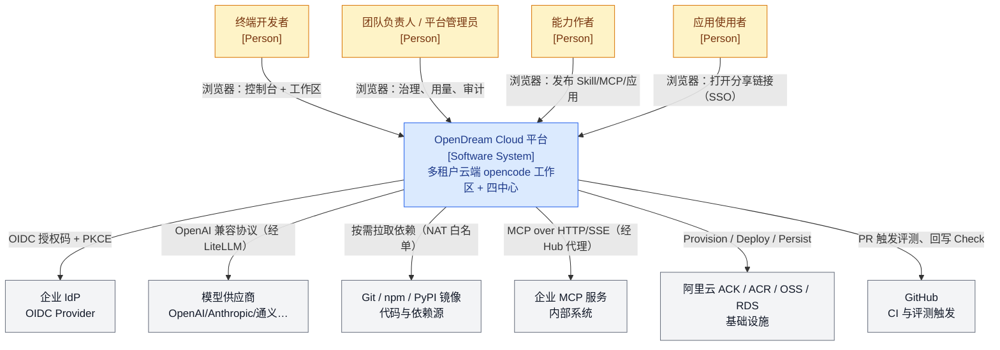

**边界说明**

- 平台**不**自建模型推理，所有推理经 LiteLLM 出网到供应商（PLAN §3.2）。
- 平台**不**做互联网匿名访问：应用分享的 `public` 语义是"平台内已登录用户"，不是"互联网公开"（见 §7.4 与 `SECURITY.md`）。
- 数据库、密钥、镜像仓库均为平台托管资产，用户不可直连。

---

## 3. C4-L2：容器视图

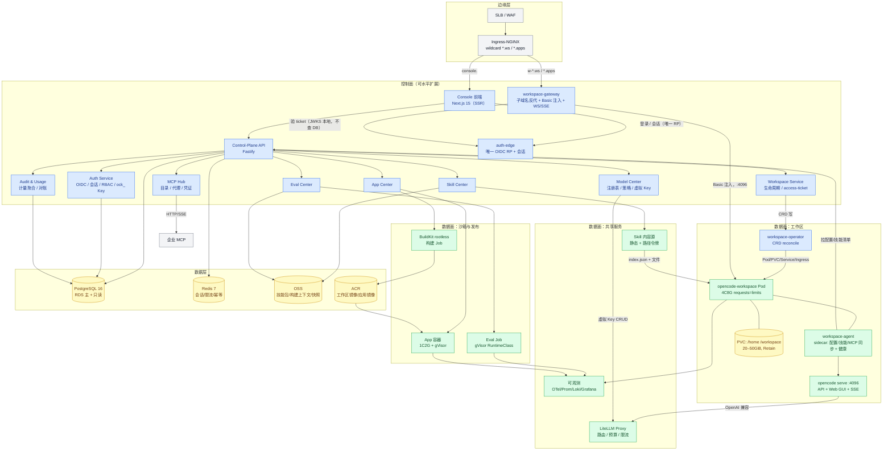

**容器职责与边界**

| 容器 | 职责 | 明确不做什么 |
| --- | --- | --- |
| Console（Next.js） | 控制台 UI/SSR，BFF 调用 `/api/v1` | 不持有任何平台密钥、不直连 K8s |
| Control-Plane API | 领域 API、RBAC、审计、幂等 | 不代理用户会话流量（用户流量走 gateway） |
| workspace-gateway | 子域名路由、SSO 校验、access-ticket 验签、Basic 注入、SSE/WS 透传 | **不查 DB**（DB 故障仍可放行已登录用户） |
| workspace-operator | reconcile CRD → Pod/PVC/Service/Ingress | 不生成用户配置内容（只挂载） |
| workspace-agent | 拉取/写入配置、同步 skills 与 mcp 片段、健康上报、快照协调 | 不执行用户代码、不代理用户网络流量 |
| opencode serve | 用户全部交互（API + Web GUI + SSE + PTY） | 不感知多租户 |
| LiteLLM | 模型路由、预算、限流、计量日志 | 不做业务鉴权（只认虚拟 Key） |
| MCP Hub | 目录、代理、凭证注入、审计、限流 | 不把凭证下发工作区 |
| Eval/App/Build | 沙箱执行、1C2G 部署、rootless 构建 | 不与工作区共享 namespace |

---

## 4. C4-L3：组件视图

### 4.1 控制面（Fastify 模块）

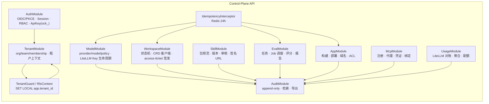

**关键组件契约**

- `TenantGuard`：从会话/JWT 取 `user_id`，解析 `org_id` 与角色；任何 repository 调用必须经 `RlsContext`，后者执行 `SET LOCAL app.user_id/app.tenant_id`（PG RLS 生效，见 `DATA-MODEL.md` §4）。
- `WorkspaceModule` 只写 `OpencodeWorkspace` 的 `spec`，读 `status`；状态推进由 Operator 回写 + Watch 映射为 `workspace_events`。
- `access-ticket` 签发：`ed25519` 私钥（KMS 托管）签 JWT，`aud=workspace:<id>`，TTL 60s，`jti` 一次性（Redis 记录已用，60s 过期）；**gateway 用 JWKS 公钥本地验签，不查 DB**。
- `ModelModule` 与 LiteLLM 通过管理 API 交互（`/key/generate`、`/key/update`、`/key/delete`、`/key/info`），虚拟 Key 只存引用与指纹，不落明文。

### 4.2 工作区 Pod 内部

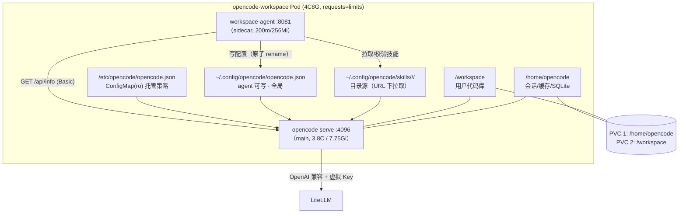

**为什么 sidecar 而不是 initContainer**：配置/技能/MCP 需要持续热更新（模型策略 ≤30s、技能安装 ≤2min），initContainer 只能跑一次。agent 以 200m CPU 运行，通过 `emptyDir` 共享配置目录，不占用户可用资源（容器级 requests 已拆分计算）。

---

## 5. C4-L4：部署视图（ACK）

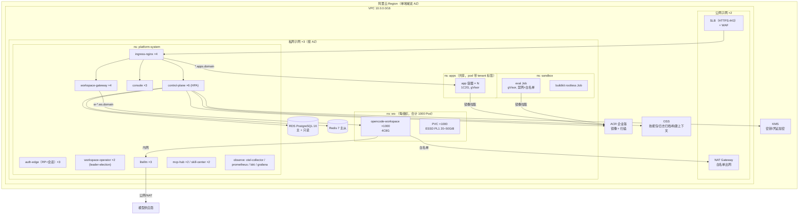

**节点池规划（`[推断]`，需 infra 按实际报价复核）**

| 节点池 | 规格 | 数量（1000 并发） | 承载 | 标签/污点 |
| --- | --- | --- | --- | --- |
| `pool-workspace-a/b/c` | **32c128g** × 3 AZ | **~160**（A/B/C 各 ~54） | 工作区 Pod（4C8G ×7/节点） | `dedicated=workspace:NoSchedule` |
| `pool-system` | 8c32g ×3 | 9 | 控制面/网关/可观测 | `dedicated=system:NoSchedule` |
| `pool-gateway` | 8c16g ×3 | 6 | ingress / workspace-gateway / auth-edge | `dedicated=gateway:NoSchedule` |
| `pool-app` | 8c32g ×3 | **≈32**（200 应用 ×1C2G → 7/节点 → 29×1.12） | 应用容器（1C2G，`sandbox-runtime`） | `dedicated=app:NoSchedule` |
| `pool-sandbox` | 16c64g ×3 | 3–6 | eval Job / buildkit | `dedicated=sandbox:NoSchedule` |

> 备选：`pool-workspace` 用 16c64g × 374（单节点故障域 3 用户，成本 +¥10.8 万/月）；见 §9.1 方案 B。
> CRD 契约（状态机/密码 Secret 名/销毁票据/URL/配额层）以 `services/BACKEND.md §5.2` 与 `deploy/DEPLOYMENT.md §3.10` 为准，本文不重复定义。

**关键部署约束**

1. PVC 与 Pod 必须**同 AZ**：PVC 由 `WaitForFirstConsumer` + 节点亲和决定，节点故障重建时可能等待 multattach 清理，需 SLO 兜底（§10）。
2. Ingress 需支持**通配符证书** `*.ws.<domain>`、`*.apps.<domain>`；证书由 cert-manager + DNS01 自动签发。
3. **命名空间口径（canonical，BK-03）**：`platform-system`（控制面/网关/可观测）、`ws-<orgId>`（**每组织一个**，工作区 Pod 与 PVC；1000 工作区按组织数均摊，如 100 个组织 → 平均 10 个 Pod/ns）、`apps`（共享，Pod 带 `tenant=<orgId>` 标签）、`sandbox`（共享，评测/构建）。**每个 `ws-<orgId>` 设 `ResourceQuota`（cpu/memory/pods/pvc，按组织配额缩放）与 `LimitRange`（默认 requests=limits=4C8G）**；平台级合计见 §9。
4. K8s ≥ 1.28（PLAN A1）；`RuntimeClass: sandbox-runtime`（gVisor 或 ACK Kata/runV）仅用于 `sandbox`/`apps` namespace 与高安全 org 的 workspace。
5. **CRD 准入**：`ValidatingAdmissionPolicy`（或 Kyverno）强制 ① 仅控制面与 operator ServiceAccount 可写 `spec`；② `spec` 中 `imageDigest/storage.retainPolicy/access.host/resources(4C8G)` **不可变**（`x-kubernetes-validations` 的 `self == oldSelf`）；③ 任何 spec 变更必须带 `configRevision` 递增与审计事件 `workspace.spec_changed`（手工 `kubectl edit` 视为漂移并告警）。

---

## 6. 关键数据流

### 6.1 F1：SSO 登录（含首次自动拉起）

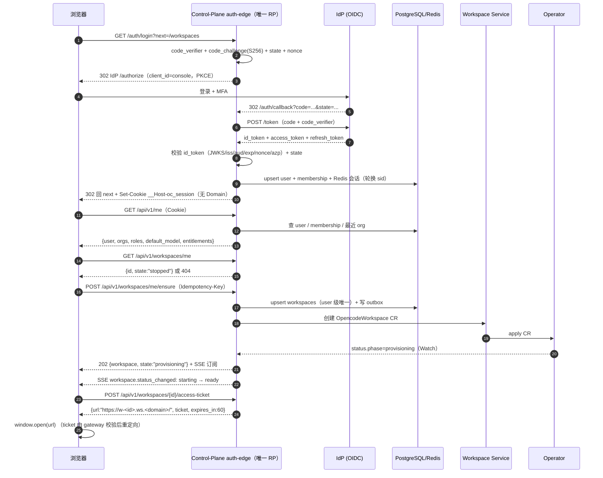

**失败分支**

| 失败点 | 处理 |
| --- | --- |
| IdP 不可用 | auth-edge 返回 502 定制页（`reason=idp_unavailable`）；已登录会话不受影响（Redis TTL 内继续可用）；已持有 ticket 的工作区进入不受影响（本地验签） |
| 用户无任何 org | 自动创建个人 org（`orgs.kind=personal`），`owner` 角色；需在 PRD 确认 |
| 工作区已 `stopped` | 直接 `POST /workspaces/{id}/start`（`ensure` 幂等语义覆盖） |
| 创建超时（>90s） | SSE 推 `error`，`error.reason=ws_launch_timeout`（枚举值，见 openapi `ErrorReason`），前端给"重试"，后台继续 reconcile（不自动删除） |

### 6.2 F2：自动拉起工作区（Operator reconcile）

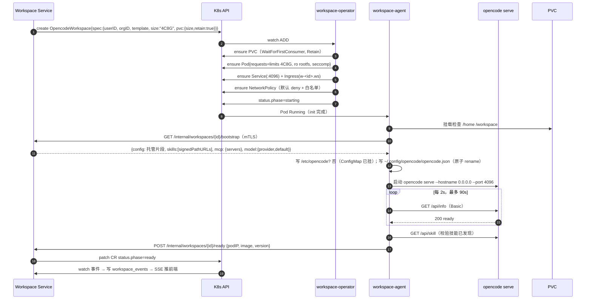

**关键点**

- `4C8G` 通过 **requests=limits** 强制（QoS=Guaranteed），节点回收时不会被驱逐到其他规格。
- `opencode serve` **必须显式 `--port 4096`**：上游在未指定端口时从 4096 起自增（`server/process.ts:155`），会导致探针/Service 端口漂移。
- `status.phase` 只由 Operator 写；控制面不直接 patch status（单一写者）。
- 就绪判定不只看 Pod Ready：必须 `GET /api/info` 返回 200（上游 ready 语义），否则 Web GUI 会 503。

### 6.3 F3：模型调用（LiteLLM + 虚拟 Key）

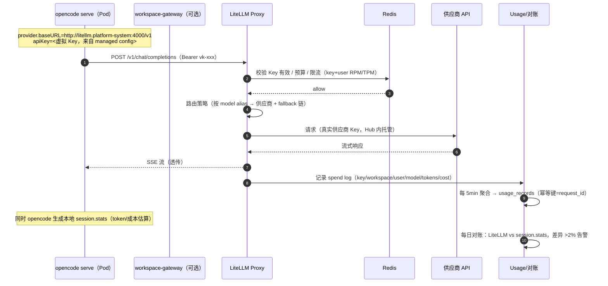

**决策**：`apiKey` 用**每工作区一个虚拟 Key**（而非每用户）。理由：工作区是计量与撤销的自然边界；用户多工作区时便于独立预算。Key 的 `metadata` 带 `{org_id, user_id, workspace_id}`，LiteLLM spend log 直接可聚。

**安全**：平台 Key（真实供应商）只存在于 LiteLLM 侧（KMS 解密），工作区只能看到 `sk-` 形态的虚拟 Key；轮换虚拟 Key 不影响用户（agent 热更新配置 + `openai` provider 重新读取）。

### 6.4 F4：Skill 安装

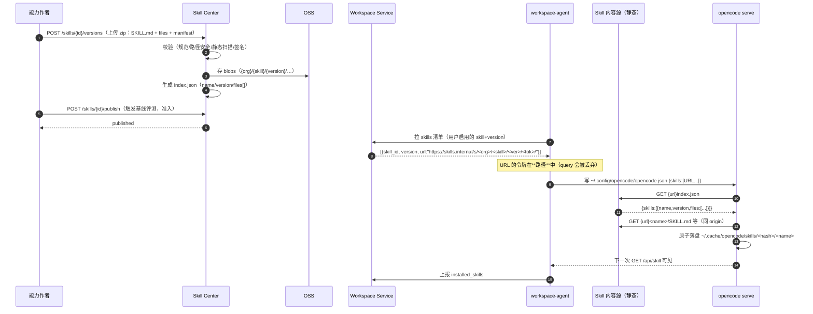

**安装时延**：配置写入 → 上游 watcher 触发 → URL 拉取（4 并发）→ 可见，实测目标 ≤2min（R4.3）。失败降级：URL 不可达时上游**保留上一次缓存**（discovery 的 staging/backup 机制），旧技能继续可用。

### 6.5 F5：应用发布

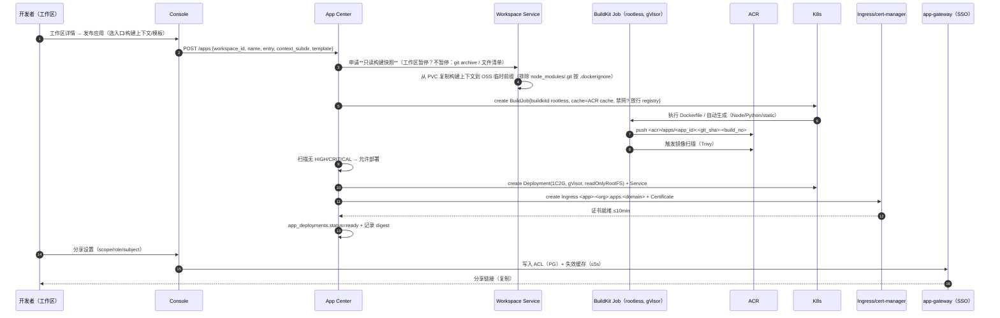

**分享鉴权**：`app-gateway` 校验 `__Host-oc_app`（由 `/apps/{id}/access-ticket` 换票得到，ticket 为控制面签发的 ed25519 JWT，绑定 user+app）→ 查 ACL（Redis 缓存 60s，变更主动失效）→ 通过则转发；无 ticket 时 302 到控制台登录（`next=` 回跳）。`public` 仅代表"平台内已登录用户"。

### 6.6 F6：MCP 调用

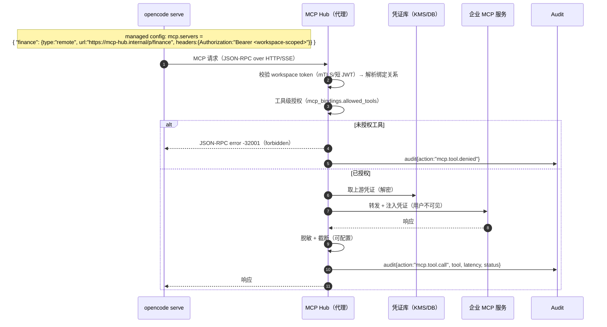

**故障降级**：Hub 不可达 → opencode 的 MCP server 连接失败，工具列表缺失但**会话/模型仍可用**（上游对 MCP 失败是软失败）；平台侧 `/api/mcp` 显示 `disconnected`，前端提示"企业工具暂不可用"。

---

## 7. 控制面 / 数据面分离与状态机

### 7.1 分离矩阵

| 能力 | 控制面依赖 | 数据面依赖 | 断链影响 |
| --- | --- | --- | --- |
| 已登录用户打开工作区 | gateway 验 ticket（**本地 JWKS**）、Redis（可选） | workspace Pod + Ingress | DB 故障**不影响** |
| 工作区内对话/改代码 | 无 | opencode + LiteLLM | 控制面全挂也不影响 |
| 模型调用 | 无（Key 已注入） | LiteLLM + 供应商 | 控制面无关 |
| 新建/销毁工作区 | 需要 | 需要 | 控制面故障时排队 |
| 技能安装 | Skill Center + agent | 内容源 | 控制面故障时保留旧版本 |
| 应用访问 | 无（ACL 缓存 60s） | app Pod + app-gateway | DB 故障时缓存内可用 |
| 审计/用量 | 需要 | LiteLLM 日志 | 异步补齐，不阻断 |

### 7.2 工作区状态机（唯一权威：`workspaces.state`）

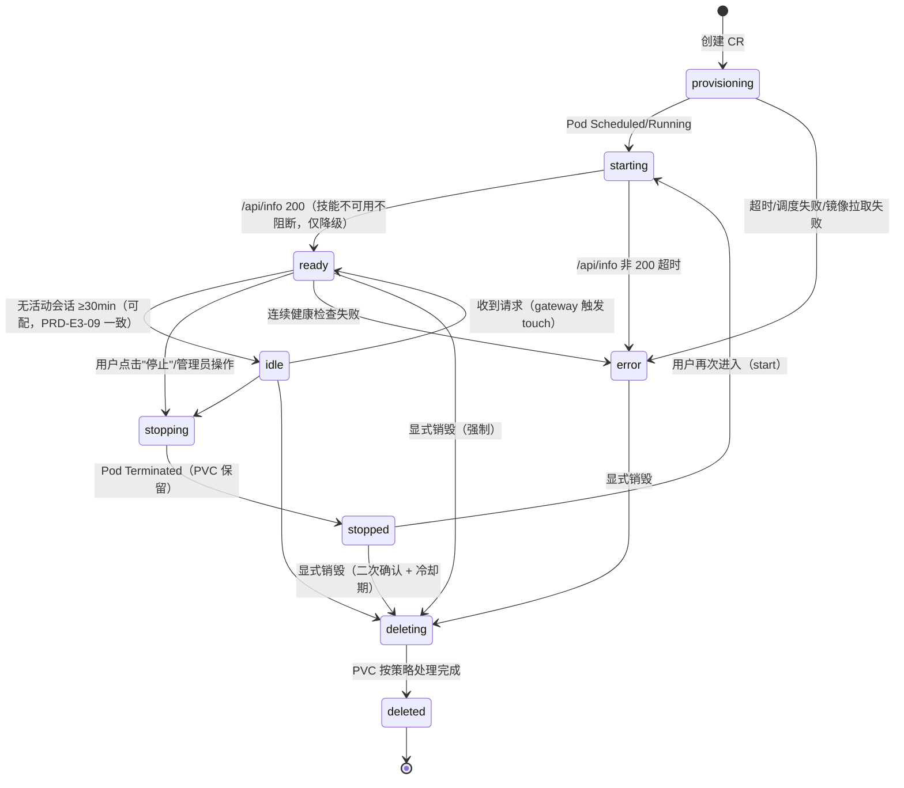

**语义约定（必须与前端/后端一致）**

- `ready` = 可交互；`idle` 是 `ready` 的**子态**（资源仍常驻，仅表示无活动会话，用于成本提示与可选休眠），**不改变可用性**。
- **退出不销毁**：关闭浏览器 / 会话过期 / gateway 断连，状态一律只可能从 `ready↔idle`，绝不自动进入 `stopping/deleting`。禁止任何"空闲超时销毁"默认策略。
- **显式销毁**（R3.3/PRD-E3-03）：`POST /api/v1/workspaces/{id}/destroy` 需请求体 `{"confirm_name":"<工作区名>","acknowledge_data_loss":true}`，返回 `202` 并进入 `pending_destroy` 冷却期（**默认 5min，可配 **0–168h（D17）**，默认 5min**，与 PRD-E3-03③ 的"5 分钟冷却撤销窗口"一致），期间可 `POST /workspaces/{id}/destroy/cancel`；冷却期结束才 `deleting`。
- **PVC 策略（两段式，消解"PVC 保留 24h"与"快照 30 天"）**：默认 `retain: true`；销毁时先打 VolumeSnapshot（`workspace_snapshots.snapshot_id`）再删 PVC。**PVC 保留 24h（快恢复：`stopped` 态可直接挂回）→ 之后仅保留快照 30 天（慢恢复：从快照重建 PVC）**。`deleted` 后 30 天内可恢复，是删除之外的唯一数据出口，必须审计。
- 状态迁移只允许上图边；非法迁移由 DB 触发器 + 服务层双重拒绝（审计 `workspace.transition_rejected`）。

### 7.3 进入工作区的鉴权链路（最终方案）

```
浏览器 → SLB/WAF → ingress-nginx（w-*.ws.domain）→ workspace-gateway
       1. 取 ?__ticket=（控制面签发的 ed25519 access-ticket，60s，一次性，aud=workspace:<id>，sub=userId）
       2. 验签（JWKS 本地缓存，ed25519）+ 校验 aud/jti/exp —— **不查 DB/Redis**
       3. 校验 ticket.sub 的 workspace 归属（ticket 内声明 `ws` 与 Host 一致）
       4. 设置 Set-Cookie: __Host-oc_ws=<opaque，gateway HMAC>（HttpOnly, Secure, SameSite=Lax, Path=/，**无 Domain**）
       5. 302 到 /（去掉 ticket，避免 Referer 泄露）
   后续请求：
   → 校验 __Host-oc_ws cookie → 注入 Authorization: Basic base64(opencode:<SECRET>)
   → 转发 upstream http://<podIP>:4096（保持 Host、Upgrade、SSE、query 原样）
```

**为什么需要 Cookie 中转**：上游 Web GUI 的 `fetch` 不会带自定义头，且若每次都带 `?__ticket=` 会进入静态资源 URL（泄露到日志/Referer）。Cookie 中转让 ticket 只出现一次。Cookie 名带 workspace id，天然支持多工作区并行。

**备选（ADR-005 已否决为主线）**：直接由控制面签发上游 `opencode_session` Cookie（HMAC 可从服务密码派生，技术上可行），但 TTL 固定 30 天不可缩短、泄露即长期有效；仅保留为紧急降级（gateway 不可用时的直连方案，默认关闭）。

### 7.4 配置下发（三层 + 优先级证据）

| 层 | 位置 | 写入方 | 优先级 | 内容 |
| --- | --- | --- | --- | --- |
| L1 托管（强制） | `/etc/opencode/opencode.json`（ConfigMap, ro） | 平台（Helm values 渲染） | **最高**（managedSettings 最后加载） | `policies`、`update:"disable"`、`provider` 骨架、默认 `model` |
| L2 全局（可写） | `$OPENCODE_CONFIG_DIR/opencode.json` 默认 `~/.config/opencode/` | workspace-agent | 中（高于 project/direct，低于 managed） | `providers.{litellm}.options.baseURL/apiKey`、`skills[]`、`mcp.servers`、`model` |
| L3 项目（用户态） | `/workspace/.opencode/opencode.json` | 用户/仓库 | 低 | 项目级 agents/commands/instructions |

> **证据**：`packages/core/src/config.ts` 的 `load()` 返回顺序为 `[...managedPolicies, ...integrated, ...wellknown, ...globalSupplementary, ...explicit, ...direct, ...projectSupplementary, ...content, ...managedSettings]`（低→高），注释明确 "Managed settings load last so they override everything" 与 "managed policies split off and load first to keep final file-based authority"。

**约束**：L1 的 `provider` 与 `model` 必须能压过 L2，否则用户/代理写入错误 baseURL 会绕过 LiteLLM。因此 `baseURL`、`apiKey` 只允许出现在 L1（ConfigMap 由 Secret 引用注入），L2 **不写** provider 凭证。

**热更新路径**：控制面修改策略 → 写 CR `spec.configRevision` → Operator 更新关联 ConfigMap → kubelet 异步同步（≤2min）→ 上游 watcher 重载。**若要 ≤30s**：agent 收到 `/internal/config/push`（SSE 长连）后直接写 L2 并触发 L1 的 `subPath` 不可变问题——因此 `baseURL` 变更走 L2 的 `providers` 覆盖字段（用户态允许被覆盖，但 `policies` 会拒绝非白名单 provider）。详见 `adr/ADR-009-config-injection.md`。

---

## 8. 技术选型决策表

| 层 | 选型 | 备选 | 决策理由（摘要） | ADR |
| --- | --- | --- | --- | --- |
| 引擎 | opencode `serve`（锁定 digest） | fork 核心 / 只用 SDK headless | 上游已具备 API+GUI+Skill+MCP；fork 成本与升级风险不可接受 | ADR-001 |
| 工作区隔离 | 每用户单 Pod（4C8G） | 共享多租户 server / 单 Pod 多用户 | 上游是单租户设计（单服务密码、单 SQLite）；共享无法证明隔离 | ADR-001 |
| 编排 | workspace-operator（Go, controller-runtime） | 控制面直连 K8s API | 声明式、可 reconcile 漂移、控制面故障不丢状态 | ADR-002 |
| 入口形态 | 每工作区子域名 + wildcard 证书 | 子路径反代 `/w/{id}/` | 上游资源为根绝对路径，子路径需全量重写且 Cookie 冲突 | ADR-003 |
| 鉴权 | **控制面为唯一 OIDC RP** + ed25519 access-ticket（60s）+ host-only cookie + Basic 注入 | oauth2-proxy 作 RP；签发上游 session cookie；用户自持 Basic | 单一会话/登出语义；工作区网关不依赖 SSO 会话与 DB；可离线验签 | ADR-004/005 |
| 模型网关 | LiteLLM Proxy | 自研网关 / 直连供应商 | OpenAI 兼容、虚拟 Key、预算、路由、spend log 开箱可用 | ADR-006 |
| 数据库 | PostgreSQL 16 + RLS | 每租户独立库 / 仅应用层过滤 | 单库多租 + RLS 双保险；运维成本低 | ADR-008 |
| 沙箱 | gVisor（eval/app） | Kata / Firecracker / 仅 seccomp | 兼容性好、标准 RuntimeClass；workspace 不使用（工具链风险） | ADR-007 |
| Skill 分发 | 上游 URL 源（index.json）+ 路径令牌 | OCI artifact / 自定义挂载 | 原生支持、热更新、无需改上游；见限制 | ADR-010 |
| 应用构建 | BuildKit rootless + ACR | Kaniko / 用户自带 Dockerfile 内构建 | 缓存、rootless、可扫描；与应用中心解耦 | ADR-011 |
| 存储 | PVC（ESSD）+ VolumeSnapshot | 对象存储同步 / NFS | 低延迟、快照一致、Retain 可控 | ADR-012 |
| 可观测 | OTel + Prometheus + Loki + Grafana | 云厂商 ARMS | 可移植、标准；云厂商可作为后端 | — |

完整 ADR 见 `adr/`（≥10 条，含备选与否决理由）。

---

## 9. 容量模型（1000 并发工作区）

### 9.1 计算资源

```
工作区需求: 1000 × (4 vCPU, 8 GiB) = 4,000 vCPU, 8,000 GiB
【方案 A，默认】32C128G 节点：allocatable ≈30.5 vCPU / 120 GiB
  按 CPU 装箱: floor(30.5 / 4) = 7 Pod/节点 → 4000 / 28 = 143 节点（CPU 瓶颈；内存 7×8=56GiB 仅占 47%）
  加 12% 冗余（滚动升级 + 故障域 + 碎片）: 143 × 1.12 ≈ **160 节点**
【方案 B，备选】16C64G 节点：allocatable ≈15.2 vCPU（< 4×4=16，**装不下 4 个 4C8G**）
  按 CPU 装箱: floor(15.2 / 4) = 3 Pod/节点 → 1000 / 3 = 334 节点
  加 12%: 334 × 1.12 ≈ **374 节点**（比方案 A 贵约 ¥10.8 万/月，但单节点故障域只影响 3 用户）
→ 默认 **方案 A（32C128G × 160）**：成本优先；方案 B 用于"故障域优先"或已有 16C 节点池的客户
```

| 项 | 方案 A（默认） | 方案 B（备选） | 说明 |
| --- | --- | --- | --- |
| 工作区节点 | **160 × 32c128g** | 374 × 16c64g | 3 AZ 均摊（A：54/53/53）；`requests=limits` 保证 QoS |
| 单节点工作区数 | 7 | 3 | 由 allocatable CPU 决定（4C/个） |
| 单节点故障影响 | 7 用户 | 3 用户 | 故障域与成本不可兼得，按客户偏好选择 |
| 月成本量级 | ≈¥64 万 | ≈¥74.8 万 | 按 infra 假设 ¥4,000/¥2,000 每节点；需按实际报价复核 |

### 9.2 存储

| 项 | 计算 | 量级 |
| --- | --- | --- |
| 工作区 PVC | 1000 × 20 GiB（默认）/ 50 GiB（大仓） | 20–50 TiB |
| 快照（日备 ×7 + 销毁前） | 增量 ~15% | +3–8 TiB |
| OSS（技能包/构建上下文/归档） | 技能包 ~50 MB × 500 版本 = 25 GB；构建上下文临时 100 GB | <1 TiB |
| PG（业务 + 用量） | 10k 用户；用量 20 万行/天 → 7300 万行/年（按月分区） | 首年 ~300 GB，含索引 500 GB |
| Redis | 会话 10k × 2 KB + 限流 + 幂等缓存 | 4–8 GB |

**PG 容量关键**：`usage_records` 是最大表。按天/月分区 + 90 天后降采样到小时聚合（`usage_hourly`），原始明细保留 180 天（合规）。见 `DATA-MODEL.md` §3.3。

### 9.3 网络与带宽

| 路径 | 估算 | 结论 |
| --- | --- | --- |
| 用户 → 工作区（SSE/WS/HTTP） | 活跃 300 并发 × 100–300 kbps | 峰值 90 Mbps；SLB 1 Gbps ×2 冗余 |
| 工作区 → LiteLLM | 300 活跃 × 平均 40 KB/s（流式） | ~100 Mbps 内网 |
| LiteLLM → 供应商 | 含 prompt 上行，峰值 200–400 Mbps | NAT/EIP 1 Gbps |
| 工作区 → 公网（依赖/镜像） | 拉取突发 | NAT 白名单 + 限速；镜像走 ACR VPC 端点 |
| Ingress 连接数 | 1000 SSE + 1000 WS 常驻 | 每 ingress 副本 ≥8k 连接，4 副本；`worker_connections` 调优 |

### 9.4 关键服务容量

| 服务 | 副本 | 单副本容量 | 峰值估算 | 余量 |
| --- | --- | --- | --- | --- |
| Control-Plane API | 6（HPA 3–12） | 500 RPS | 300 RPS（10k 用户，人均 0.03 RPS） | 10× |
| workspace-gateway | 4 | 2,000 并发连接 | 2,000 连接 | 4× |
| LiteLLM | 3（HPA 3–10） | 300–500 RPS | 500–1,000 RPS（含重试） | 3× |
| workspace-operator | 2（leader-election） | 1,000 CR watch + 50 reconcile/s | 1000 CR，日常 ~2/s | 25× |
| PG（RDS 8c32g） | 主+只读 | 5,000 TPS 读 / 1,500 TPS 写 | 800 TPS | 2–6× |
| Redis 4G 主从 | — | 100k OPS | 20k OPS | 5× |

### 9.5 成本量级（`[推断]`，仅量级，需按报价复核）

| 项 | 月成本量级（人民币） |
| --- | --- |
| 工作区计算（4,000 vCPU 常驻，32C128G×160） | **≈64 万**（16C64G×374 方案 ≈74.8 万） |
| 工作区存储（20 TiB ESSD） | 2–5 万 |
| 控制面/网关/可观测 | 3–6 万 |
| PG/Redis/OSS/ACR/SLB/NAT | 3–8 万 |
| 模型 token（外部供应商） | 按用量，独立核算 |
| **合计（不含模型）** | **约 72–83 万/月**（32C 方案）；16C 方案约 83–94 万 |

> **架构含义**：4C8G 常驻是成本主导项。因此必须（a）成本可见（R3.10）、（b）提供 `stopped`（Pod=0，PVC 保留）作为显式可选动作、（c）`idle` 只做提示不自动回收。**默认不自动销毁是产品红线，不允许用成本理由破坏。**

---

## 10. 失败模式与降级

| # | 故障 | 检测 | 影响面 | 降级策略 |
| --- | --- | --- | --- | --- |
| F-01 | **LiteLLM 全挂** | 探针 + 错误率 >5%（1min） | 新模型调用失败；会话/文件/终端仍可用 | ① 平台横幅"模型服务异常"；② LiteLLM router 内置供应商 fallback；③ 控制面**不**切换到直连供应商（会泄露真 Key）；④ 恢复后自动重试（opencode 侧用户重发）；⑤ 429/5xx 返回结构化 `model_gateway_unavailable`。SLO：MTTR ≤10min |
| F-02 | **LiteLLM 部分供应商挂** | router health | 部分模型不可用 | 模型策略自动摘除（`models.health=degraded`），UI 灰显并推荐替代模型；已有会话返回可读错误 |
| F-03 | **K8s API 故障** | operator 心跳丢失 | 无法创建/停止/销毁；**已运行工作区不受影响** | 控制面返回 `503 orchestrator_unavailable` + `retry_after`；写操作进 outbox 重试（指数退避，≤24h）；operator 用本地缓存继续 reconcile 已有对象 |
| F-04 | **PostgreSQL 故障** | 连接失败/延迟 | 控制面读写失败 | ① **已登录用户仍可进工作区**（gateway 本地 JWKS + Redis ACL 缓存 60s）；② 只读接口返回 `stale=true` + `X-Data-Staleness` 头（缓存 5min）；③ 写接口快速失败 `database_unavailable`（不排队，避免雪崩）；④ 审计事件先写本地 WAL/OSS，恢复后回放；⑤ RDS 多可用区自动切换（≤60s） |
| F-05 | **Redis 故障** | 连接失败 | 会话/限流/幂等失效 | ① 会话降级为签名 Cookie（JWT 自包含，不依赖 Redis）；② 限流降级为 gateway 本地令牌桶（近似，允许超发）；③ 幂等降级为 DB 唯一键（可能返回 409 而非重放）；④ **不 fail-open 到无限流**（模型预算保护优先） |
| F-06 | **单工作区 Pod 崩溃/节点故障** | kubelet/探针 | 该用户短时不可用 | 自动重调度（同 AZ PVC），目标 ≤90s；`workspace_events` 记 `restarted`；连续 3 次失败进 `error` 并告警；PVC 数据不丢（Retain） |
| F-07 | **PVC 挂载失败（multattach/满）** | Event + 用量 >85% | 工作区无法启动/写入失败 | 满：只读模式 + 前端提示清理；multattach：`ReadWriteOncePod` + 节点排水前先驱逐；>85% 提前告警 |
| F-08 | **Ingress/证书故障** | 5xx、证书到期告警 | 全部入口不可用 | 多副本 + wildcard 证书预签发（提前 30 天）；DNS 双线路；**保底**：工作区 Pod 仍在跑，恢复入口后数据无损 |
| F-09 | **IdP 故障** | 登录失败率 | 新登录失败 | 已登录会话（Redis/签名 Cookie，≤8h）继续可用；**不做**本地密码兜底（安全红线） |
| F-10 | **DB 与 LiteLLM 同时挂**（最坏） | — | 无法登录新设备、无法调模型 | 已登录 + 已开工作区的用户仍可编辑代码/终端；平台进入"维护模式"横幅 |
| F-11 | **Skill 内容源不可达** | agent 上报 | 新技能装不上 | 上游保留旧缓存（staging/backup）；已安装技能继续可用 |
| F-12 | **MCP Hub 不可达** | 健康检查 | 企业工具不可用 | 上游软失败（工具缺失，会话可用）；UI 明确提示 |
| F-13 | **配额/预算耗尽** | LiteLLM 预算 | 模型调用 429 | 返回 `quota_exceeded` + 申请提升入口；**不阻断**工作区访问（只阻断模型） |
| F-14 | **单可用区故障** | AZ 探针/节点 NotReady 比例 | 该 AZ 的工作区不可用（PVC 单 AZ，无法跨 AZ 漂移） | ① 节点池 3 AZ 均摊，每 AZ ≤54 台；② 故障 AZ 的工作区进入 `error`（数据在 PVC/快照，不丢）；③ 恢复后同 AZ 重建（≤90s）；④ 跨 AZ 恢复走快照重建（RPO ≤24h，见 ADR-015）；⑤ 控制面/网关 3 AZ 部署，入口不中断 |
| F-15 | **容量耗尽（节点不足）** | autoscaler Pending | 新工作区创建排队；已有工作区不受影响 | ① 创建 API 返回 `503 orchestrator_unavailable` + `Retry-After:30`；② CR 进 `Pending/Queued`，控制台显示排队位；③ 抢占 pause 占位 Pod；④ 配额优先级（付费/活跃用户优先）；⑤ 扩容上限告警（≤2×基线，防成本失控） |

**模型调用非幂等契约（BK-09，联合 infra）**：模型请求**不是**幂等操作 —— ① 平台/网关的重试只允许发生在**请求头返回之前**（连接建立/5xx 且未开始流式输出）；② LiteLLM `num_retries` 上限 **≤1**，禁止多层叠加重试（平台不再包一层）；③ 扣费与 `usage_records` 一律以 **LiteLLM 实际处理的 request** 为准（`request_id` 幂等去重，不按用户点击次数计）；④ **不承诺**用 `Idempotency-Key` 对模型调用去重 —— `Idempotency-Key` 仅用于控制面写操作（创建/发布/销毁等）。

**混沌演练清单（交 qa-reviewer）**：kill LiteLLM Pod / 断 PG 主库 / 杀工作区 Pod / 删 Ingress / 模拟 Redis 宕机 / 打满 PVC / 注入 5s 网络延迟 / 证书过期。

---

## 11. NFR 与 SLO

| 指标 | 目标 | 度量方式 |
| --- | --- | --- |
| 工作区就绪 p95 | ≤90s（含冷启动） | `workspace_events` 首末时间差 |
| 工作区就绪 p50 | ≤35s | 同上 |
| 控制台 LCP | <2.5s | RUM |
| API p95（读/写） | <300ms / <800ms | Prometheus histogram |
| 控制面可用性 | 99.9% | SLI = 非 5xx / 总请求 |
| 工作区可用性 | 99.5% | 探针成功率 |
| SSE 事件延迟 | ≤2s（R3.6） | 事件写入→推送时间戳差 |
| SSE 连续性 | **只承诺"可重连的可见连续性"**（5min 回放 + `Last-Event-ID`，超出则 `resync`）；**不保证断线期间事件不丢** | 断线/溢出以列表 + ETag 全量兜底 |
| 模型策略生效 | ≤30s（R2.6） | 策略变更→配置 revision 生效 |
| 权限变更生效 | ≤5s（R6.4） | ACL 缓存主动失效 |
| 审计写入成功率 | 100%（写操作） | 审计表 vs 操作计数对账 |
| 用量准确性 | ≥99%（对账抽样） | LiteLLM vs usage_records |

---

## 12. 与上游的集成边界（不 fork 的前提下）

| 需求 | 上游是否已具备 | 平台侧做法 |
| --- | --- | --- |
| 多用户/多租户 | ❌ 单租户单密码 | 每用户一实例 + 外围 SSO/网关 |
| 持久化 | ✅ PVC + SQLite | Operator 管 PVC 生命周期 |
| 模型统一配置 | ✅ `providers`/`model`/`policies` + 热加载 | 托管配置 + LiteLLM |
| Skill 分发 | ✅ URL/目录源 | Skill Center 出静态源 + 路径令牌 |
| MCP | ✅ `mcp.servers` + OAuth | Hub 生成片段 + 代理 |
| 评测 | ❌ | Eval Center 自研（Job） |
| 应用发布 | ❌ | App Center 自研（BuildKit） |
| 计量 | ⚠️ 仅 session.stats | LiteLLM 权威 + 对账 |
| 审计 | ⚠️ 内部事件流 | 平台侧审计表 + 上游事件旁路 |
| 多副本/HA | ❌（单进程） | 不做；用 Pod 重建替代 |

---

## 附录 A：上游待核实项关闭结论（8 项）

> 证据路径均相对 `upstream/opencode/`；行号以 commit `4f271bc` 为准。

| # | 事项 | 结论（已核实） | 证据 | 对平台的影响 |
| --- | --- | --- | --- | --- |
| 1 | `serve` 默认端口与健康检查 | **默认 4096**；未显式给 `--port` 时若被占用会 **+1 递增重试**（65535 上限）。健康检查为 **`GET /api/info`**（需鉴权）：200=ready，**503 + `retry-after:1`**=starting/stopping，**500**=failed；无免鉴权 `/health`。`GET /api/info` 服务启动未就绪时也可用（dispatch 特判）。 | `server/src/process.ts:150-160`（`next(4096)`、`EADDRINUSE` 递增）；`process.ts:dispatch/infoResponse/unavailable`；`protocol/src/groups/server.ts:45` | 容器入口**必须** `--port 4096`；K8s 探针走 workspace-agent `/healthz` 代查（避免 Secret 进 Pod spec）；就绪必须等 `/api/info` 200，不能只看 Pod Ready |
| 2 | Web GUI 子路径反代 | **不支持子路径**。`serve` 同时服务 API 与 Web UI：路径以 `/api`、`/api/`、`/auth/` 开头或 `/openapi.json` 走 API，**其余全部**走静态资源（找不到则回退 `index.html`）。静态资源键为 `_assets/*`、`icons/*`（Vite `assetsDir: "_assets"`，base 未设 → HTML 引用 `/_assets/...` **根绝对路径**）。 | `cli/src/services/web-ui.ts`（`handler`/`serveUI`）；`app/vite.config.*:50`（`assetsDir: "_assets"`） | **必须子域名** `w-<id>.ws.<domain>`；子路径需全量前缀重写（含 API/SSE/WS），且 `opencode_session` cookie `path=/` 会跨工作区冲突 → 否决 |
| 3 | URL 技能源索引格式 | **`GET {url}/index.json`** → `{"skills":[{"name","version?","files":["SKILL.md",...]}]}`。文件按 `{url}/{name}/` 相对拉取。**必须含 `SKILL.md` 或 `<name>.md`**；`name` 必须是安全路径段；`files` 必须是安全相对路径（**禁 `?`/`#`/绝对路径/URL**）；**所有文件 origin 必须与 index 相同**。`version` 相同→跳过；不同→staging 下载 + 原子 rename + 备份回滚，并写 `.opencode-version`。 | `core/src/skill/discovery.ts`（`Index`/`IndexSkill` schema、`isSafeSegment`、`isSafeRelativePath`、`resource.origin !== source.origin`、staging/backup 逻辑） | Skill Center 产出静态目录 + index.json；**签名令牌必须放路径**（`new URL(x, base)` 丢 query）；不能跨 CDN 域；版本号驱动升级 |
| 4 | managed policy 文件位置与优先级 | 系统目录：Linux **`/etc/opencode/`**、macOS `/Library/Application Support/opencode/`、Windows `%ProgramData%\opencode\`；文件名 `opencode.json` / `opencode.jsonc`。加载顺序（低→高）：`managedPolicies → integration → wellknown → global → explicit → direct → project → content → managedSettings`。**managedSettings 最后加载 = 压过一切**；`policies` 单独前置加载 = **策略求值最终权威**。另有 macOS MDM plist `ai.opencode.managed`（容器无关）。 | `core/src/config/discovery.ts:systemDirectory`；`core/src/config.ts` `load()` 返回数组与相关注释 | 强制项（baseURL/apiKey/policies/model/update）放 `/etc/opencode`（ConfigMap ro）；用户偏好放 `~/.config/opencode`。**必须用 managed 承载 provider**，否则用户文件可覆盖并绕过 LiteLLM |
| 5 | PTY/WS 经反代的 ticket | `POST /api/pty/:ptyID/connect-token`，需 header **`x-opencode-ticket: 1`** + Origin 校验，返回 `{ticket, expires_in}`（**单次使用**）；WS `GET /api/pty/:ptyID/connect?ticket=...&cursor=...&location[directory]=...`。同机制用于持久 PTY（`/api/experimental/persistent-pty/...`）与浏览器 MCP（`/api/experimental/client-mcp/token` + `?name=&ticket=`）。鉴权中间件对"带 ticket 的这 3 条路径"**跳过密码校验**，由 handler 自行校验。 | `schema/src/pty-ticket.ts`；`protocol/src/groups/pty.ts`（`PTY_CONNECT_TICKET_QUERY="ticket"`、`PTY_CONNECT_TOKEN_HEADER`）；`server/src/middleware/authorization.ts:78-92`；`handlers/pty.ts` | 网关**必须原样透传** `Upgrade`、`Connection`、`ticket` query、`location[*]` query；不得改写 WS URL；`connect-token` 依赖 Basic 注入（网关已做）；SSE/WS 需 `proxy-buffering off` + 长超时 |
| 6 | 多租户下服务端 SQLite 并发与备份 | **单文件 SQLite**：默认 `$XDG_DATA_HOME/opencode/opencode.db`（`OPENCODE_DB` 可覆盖），WAL + `synchronous=NORMAL` + `busy_timeout=5000` + 64MB cache，启动时迁移，文件 `0600`；每个文件一把进程内信号量防重复 bootstrap。**单写者模型**，性能依赖本卷 IOPS。 | `cli/src/database-path.ts`；`core/src/database/database.ts:38-52`（PRAGMA）与 `:94-104`（`restrictToOwner`） | 每 Pod 独立 DB，**控制面不直连**；备份**禁止 cp 活文件**（WAL 不一致）→ 用 `sqlite3 .backup`/`VACUUM INTO`（agent 执行）或 CSI VolumeSnapshot；ESSD PL1 起步，IOPS ≥5k |
| 7 | `usage` 事件能否作为计量来源 | **不能作为权威**。`GET /api/experimental/usage/limits` 只是**官方 OpenCode Console 预算透传**（需其 integration 凭证，且 403 时返回空），与平台无关。可用的是 `GET /api/experimental/session/stats?from&to&tools=` → `SessionStats.Info`（tokens 分项、`cost`、按模型聚合），但为**会话级聚合、非逐请求、可被用户会话删除影响**。 | `server/src/handlers/usage.ts`；`core/src/usage-limits.ts`（调用 `console/api/policies/current-budgets`）；`schema/src/session-stats.ts`；`schema/src/token-usage.ts` | **计量权威源 = LiteLLM spend log**（虚拟 Key 维度，含 cost）；`session/stats` 每 15min 拉取做**对账**，偏差 >2% 告警；`usage_records` 幂等键用 LiteLLM `request_id` |
| 8 | 能否关闭自动更新 | **能**。配置 `update: "disable"`（兼容旧键 `autoupdate: false`），或环境变量 **`OPENCODE_DISABLE_AUTOUPDATE=1/true`**；服务模式另有 `OPENCODE_LOCAL`。 | `schema/src/config.ts:39`（`update: Literals(["disable","notify","auto"])`）；`core/src/config/normalize.ts:55,73`；`cli/src/services/updater.ts:535,545` | 托管配置写 `update:"disable"` + 容器 env 双保险；镜像按 digest 锁定；升级由平台金丝雀控制，不允许 Pod 自更新（否则 node 侧行为漂移） |

### A.9 额外核实项（不在原 8 项，但影响设计）

| # | 事项 | 结论 | 证据 |
| --- | --- | --- | --- |
| 9 | 服务密码生成与鉴权开关 | 未提供密码时 `serve` **随机生成 32B 并打印**；密码为空/未设置时上游**完全不鉴权**（`ServerAuth.required()` 为 false → 中间件直通）。容器必须显式注入 `OPENCODE_SERVER_PASSWORD`。 | `cli/src/server-process.ts`（`randomBytes(32)`、`console.log("server password")`）；`server/src/auth.ts:required`；`middleware/authorization.ts:74` |
| 10 | 会话 Cookie 可伪造性 | Cookie = `expires.sign`，`sign=HMAC(HMAC(password,"opencode-session-v1"), expires)`，**知道服务密码即可为任意用户签发 30 天会话**；Cookie 名按 Host 端口后缀（无端口→`opencode_session`）；`SameSite=Lax`、`httpOnly`、`path=/`、`origin` 校验。 | `server/src/auth.ts`（`issueSession`/`verifySession`/`sessionCookieName`）；`handlers/server.ts`（pairing 换 cookie） |
| 11 | 配对链接可作应急通道 | `POST /api/pair` → `{code, expires_in:300}`；`GET /auth/connect/:code`（浏览器）→ **Set-Cookie 会话 + 302 `/`**；JSON 客户端 → `{token}`。可用于"网关故障时临时进入"，但需平台侧限制（见 SECURITY）。 | `server/src/pairing.ts`；`handlers/server.ts`；`protocol/src/groups/server.ts:56,67` |
| 12 | SSE 语义 | `GET /api/event`（`StreamSse`），**volatile**：慢消费者溢出会断流，断线期间事件丢失；支持 `?types=` 过滤；首帧 `server.connected`。 | `protocol/src/groups/event.ts` |
| 13 | 配置热加载 | `Config` 服务 watch 文件变化并重建；`PATCH /api/experimental/config` 可改全局配置（受 managed 压制）。 | `core/src/config.ts`（`changes`/`reconcileWatches`）；`protocol/src/groups/config.ts` |
| 14 | 上游 API 面 | `GET /openapi.json` 暴露完整 OpenAPI；路由含 `session/message/model/provider/config/skill/mcp/pty/permission/fs/agent/command/event` 等（见附录 B）。 | `server/src/routes.ts`（`openapiPath:"/openapi.json"`）；`protocol/src/groups/*` |
| 15 | 数据库路径与多实例 | `OPENCODE_DB` 可指定文件名；`:memory:` 支持；两实例同文件由进程内锁保护**但不跨 Pod**。 | `cli/src/database-path.ts`；`core/src/database/database.ts`（`locks` Map） |
| 16 | Web UI 嵌入能力 | 静态响应**未设置 `X-Frame-Options`**，CSP **未含 `frame-ancestors`** → 技术可被 iframe 嵌入；但为整页 SPA（含快捷键/终端），嵌入体验受限。 | `cli/src/services/web-ui.ts`（`csp()`/`serveUI` headers） |
| 17 | 配置注入替代通道 | `OPENCODE_CONFIG`（显式文件）、`OPENCODE_CONFIG_CONTENT`（内联 JSON）、`OPENCODE_CONFIG_DIR`（全局目录）三个环境变量可参与配置；`config` 目录可被 `Global.layerWith` 替换。 | `cli/src/server-process.ts`（`config.file/content/directory`）；`server/src/routes.ts`（`Config.configured`） |
| 18 | 数据库迁移与 v1 兼容 | 启动自动 `DatabaseMigration.apply`，另有 `V1Migration` 层；`POST /api/experimental/migration/v1` 可触发。升级镜像需回归迁移耗时（大数据量 PVC 可能拖慢启动）。 | `core/src/database/database.ts:44`；`server/src/routes.ts`（`V1Migration.layer`） |

---

## 附录 B：上游 API 关键端点（平台集成相关）

> 完整 OpenAPI 见工作区 `http://127.0.0.1:4096/openapi.json`（运行时）。下表只列平台会用到的。

| 分组 | 端点 | 用途 | 平台调用方 |
| --- | --- | --- | --- |
| server | `GET /api/info` | 就绪/版本/PID/URLs | workspace-agent（探针） |
| server | `POST /api/pair` / `GET /auth/connect/:code` | 应急会话签发 | 运维（默认关闭） |
| event | `GET /api/event` | SSE 事件流（volatile） | gateway（透传）/ 运维观测 |
| config | `GET /api/config` | 配置文档与优先级（调试用） | 平台诊断 |
| config | `PATCH /api/experimental/config` | 改全局配置 | **禁止**平台调用（用文件下发） |
| skill | `GET /api/skill` | 已发现技能 | workspace-agent（校验） |
| mcp | `GET /api/mcp` | MCP 连接状态 | agent/诊断 |
| mcp | `PUT/DELETE /api/experimental/mcp/:server` | 运行时增删（重启失效） | **仅调试**；权威用配置 |
| pty | `POST /api/pty/:id/connect-token` + WS `/connect` | 终端 | gateway（透传） |
| session | `POST /api/session/:id/prompt` | 对话 | Web GUI |
| session | `GET /api/experimental/session/stats` | 用量对账 | Usage Service |
| provider/model | `GET /api/provider` / `/api/model` | 模型目录（来自 LiteLLM/配置） | 平台展示校验 |
| usage | `GET /api/experimental/usage/limits` | **官方 Console 预算**（不适用） | 不使用 |
| openapi | `GET /openapi.json` | 契约导出 | 平台契约测试 |

---

## 附录 C：未决风险与开放问题

| # | 风险 | 级别 | 缓解 | Owner |
| --- | --- | --- | --- | --- |
| R-01 | 4C8G 常驻成本高（70–140 万/月量级） | 高 | 成本看板 + `stopped` 显式动作 + idle 提示；**不自动销毁** | infra + lead |
| R-02 | 单 Pod 单进程 SQLite，PVC 损坏即数据丢失 | 高 | VolumeSnapshot 日备 + 销毁前快照 + 快照恢复演练 | infra |
| R-03 | 上游升级（2.2.5 → 后续）破坏配置/技能格式 | 中 | 镜像 digest 锁定 + 升级回归门禁 + 配置契约测试 | architect |
| R-04 | Skill URL 令牌放路径可能与 CDN/缓存冲突 | 中 | 内部静态服务直连（不经 CDN）；Cache-Control: private, no-store | capability |
| R-05 | 子域名方案需要通配符证书与 DNS 权限 | 中 | cert-manager DNS01；提前申请 `*.ws` / `*.apps` | infra |
| R-06 | gVisor 对 workspace 工具链兼容性（已决定不用，但 eval/app 仍需验证） | 中 | eval/app 用 gVisor；workspace 用 seccomp + 非 root + ro rootfs | infra + qa |
| R-07 | 1000 工作区同时冷启动（如早高峰）压垮调度/镜像拉取 | 高 | 镜像预热（DaemonSet/预热快照）+ 创建队列 + 分批限流（并发 ≤50/s） | infra |
| R-08 | LiteLLM 单点（虽有 3 副本）与预算执行延迟 | 中 | 多副本 + Redis 共享限流 + 预算双写（网关侧本地桶） | backend |
| R-09 | 审计日志含敏感内容（prompt/代码） | 高 | 审计只存元数据与哈希，不存正文；见 SECURITY §7 | qa |
| R-10 | 用户删除后 30 天数据清理的自动化未定义 | 中 | 定时任务 + 删除证明报告 | backend |

**开放问题（阻塞 G2 之外的决策，不阻塞本文）**：IdP 选型、主域名、计费模式、是否 BYOK、多地域——均已在 `PLAN.md §10` 记录，本文按"单地域双 AZ + 平台统一模型 + 子域名"假设展开。

---

## 变更记录

| 版本 | 日期 | 变更 |
| --- | --- | --- |
| v0.1 | 2026-11-04 | 初稿：C4 四视图、6 条数据流、容量模型、失败模式、8+ 项上游核实结论 |
