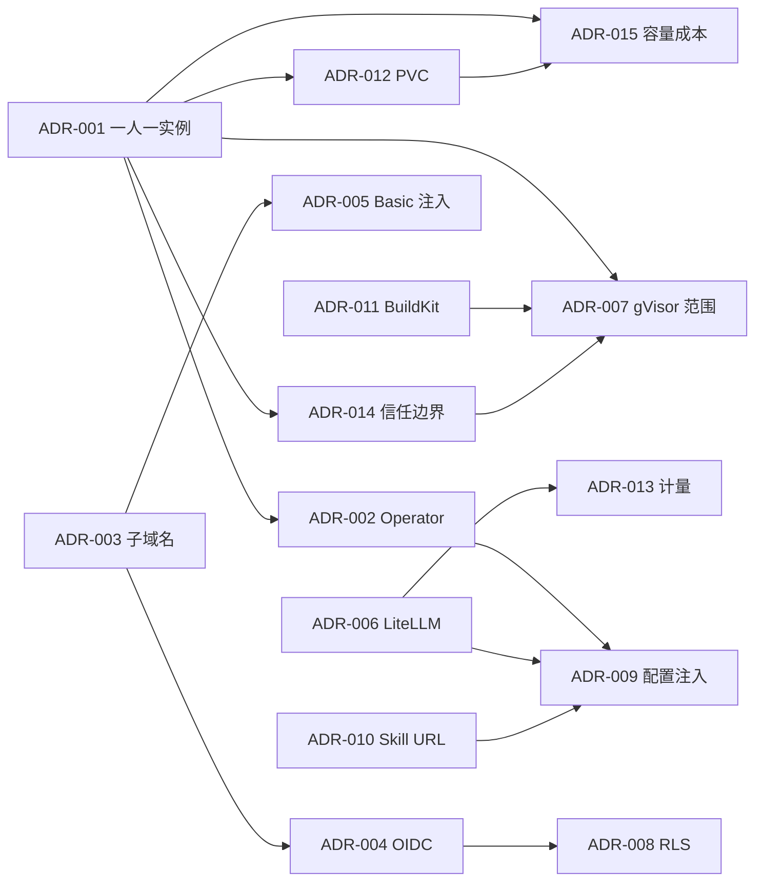

# 架构决策记录（ADR）索引

> 每条 ADR 记录：背景 → 决策 → 备选与否决理由 → 后果（正/负）→ 实现要点 → 验证 → 证据。
> 格式参照 MADR（Markdown ADR）。编号一经分配不复用；状态变更只追加历史，不改正文（除"替代"标注）。

| 编号 | 标题 | 状态 | 关键取舍 |
| --- | --- | --- | --- |
| [ADR-001](ADR-001-per-user-workspace.md) | 每用户单实例工作区（4C8G），而非共享多租户 server | Accepted | 隔离可证明 vs 成本高 |
| [ADR-002](ADR-002-operator-vs-direct-api.md) | 用 workspace-operator（CRD reconcile），而非控制面直连 K8s API | Accepted | 自愈/幂等 vs 多一个服务 |
| [ADR-003](ADR-003-subdomain-routing.md) | 每工作区子域名，而非 `/w/{id}/` 子路径反代 | Accepted | 上游零改造 vs 通配符证书 |
| [ADR-004](ADR-004-oidc-oauth2-proxy.md) | **控制面作为唯一 OIDC RP**（oauth2-proxy 仅可选，第三方 UI 用） | Accepted（Lead 裁决） | 单一会话/登出语义 vs 自研 RP 成本 |
| [ADR-005](ADR-005-gateway-basic-injection.md) | 网关向上游注入 Basic，而非签发上游 Session Cookie | Accepted | 用户零感知 vs gateway 持有密码 |
| [ADR-006](ADR-006-litellm-gateway.md) | LiteLLM 作为统一模型网关 | Accepted | 开箱能力 vs 关键路径依赖 |
| [ADR-007](ADR-007-gvisor-scope.md) | gVisor 只用于沙箱（eval/app/build），工作区不用 | Accepted | 沙箱强隔离 vs 工作区兼容性 |
| [ADR-008](ADR-008-postgres-rls.md) | PostgreSQL 单库多租 + RLS | Accepted | 运维简单 vs 需严格上下文纪律 |
| [ADR-009](ADR-009-config-injection.md) | 配置注入 = 托管 ConfigMap + 全局可写文件 + 热加载 | Accepted | 不可绕过 + ≤30s 生效 |
| [ADR-010](ADR-010-skill-distribution.md) | Skill 分发用上游原生 URL 源，而非 OCI | Accepted（附限制） | 零改造 vs 令牌必须放路径 |
| [ADR-011](ADR-011-buildkit-rootless.md) | 应用构建用 rootless BuildKit（Job 内），推 ACR | Accepted | 无特权 + 缓存 vs 上下文传输 |
| [ADR-012](ADR-012-pvc-retain-snapshot.md) | PVC 生命周期 = Retain + 快照 | Accepted | 不丢数据 vs 存储成本 |
| [ADR-014](ADR-014-workspace-trust-boundary.md) | 工作区信任边界（runc 半可信）与强隔离范围 | Accepted | 明确半可信边界 vs 内核 0day 残余风险 |
| [ADR-015](ADR-015-capacity-cost-strategy.md) | 容量与成本策略（默认常驻 + 可选休眠 + 分批 100→300→1000） | Accepted | 产品承诺不丢数据 vs 成本 ¥72 万/月量级 |
| [ADR-016](ADR-016-fastify-over-nestjs.md) | **MVP 控制面用 Fastify（非 NestJS）** + bun:sqlite 降级（G5 必须迁 PG+RLS） | Accepted（Lead 裁决） | 交付速度 vs 框架抽象/RLS |

## v3 ADR（MCP 为核心的架构 v3，2026-11-08）

| 编号 | 标题 | 状态 | 关键取舍 |
| --- | --- | --- | --- |
| [ADR-V3-01](ADR-V3-01-mcp-gateway.md) | MCP 网关选型：Higress 接入 + 自研 mcp-gateway 做工具级数据面（agentgateway 可选 A2A） | **Accepted / 已签署** | 策略集中可测 vs 多一层服务；凭证不进通用网关 |
| [ADR-V3-02](ADR-V3-02-collab-editing.md) | App 协同编辑：对话式 Patch + base_version 乐观锁 + 审批门禁（非 CRDT） | Accepted | 可审计/可回滚 vs 非字符级实时 |
| [ADR-V3-03](ADR-V3-03-digital-human-realtime.md) | 数字人实时链路：分层流式 + WebRTC SFU + GPU 池分档（P50 1.2s/P95 1.8s） | Accepted | 可控私有化 vs GPU 运维成本 |
| [ADR-V3-04](ADR-V3-04-workflow-engine.md) | 工作流引擎：Temporal 生产 + 轻量状态机 MVP，同一 Runtime Port/DSL/表 | Accepted | 交付速度 vs 长期事件溯源 |
| [ADR-V3-05](ADR-V3-05-mcp-lifecycle-contract.md) | MCP 生命周期与契约升级：v2 FROZEN 不动，v3 走 openapi 1.1.0 | Accepted | 只加不改 vs 需集中契约评审 |

## 决策之间的关系

## 待定 / 未来 ADR（P2）

| 候选 | 触发条件 |
| --- | --- |
| 高安全租户 workspace 强制 gVisor/Kata | 客户合规要求（ADR-007 已预留开关） |
| 用量迁移到 OLAP（ClickHouse） | 明细 >5 亿行/年或看板延迟 >5s |
| BYOK / 私有化模型 | 客户要求（PLAN 开放问题 4） |
| 多地域部署 | 数据驻留要求（PLAN §3.2 明确本期不做） |
| OCI 技能分发（企业内网/离线） | 离线环境或供应链强要求（ADR-010 备选 A） |
| 应用自定义域名 + 多租户 TLS | R6.6 实现阶段 |

- [ADR-017](ADR-017-csrf-endpoint.md)：CSRF 端点纳入契约（minor 1.1.0）
