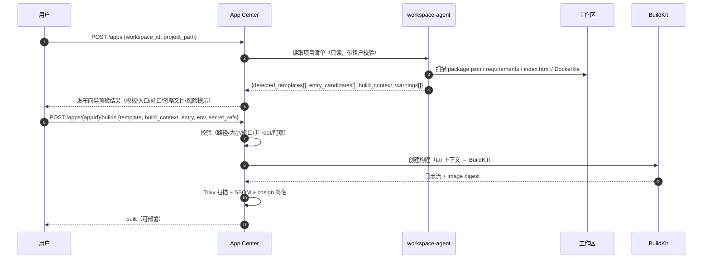
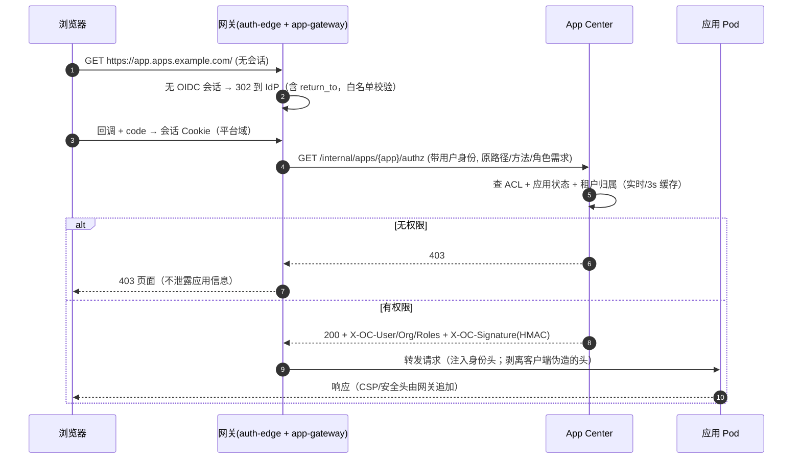

# 应用中心（App Center）设计

- 版本：v0.1（P2 架构 · 能力中心分册）
- Owner：capability-centers；评审：architect（G2）、infra-devops（构建/部署）、platform-backend（租户/SSO）、qa-reviewer
- 需求映射：R6.1–R6.8；实现目录：`services/app-center/`
- 上游依据：工作区（`opencode serve` + `/workspace` PVC）、BuildKit rootless、ACR、K8s Deployment/Service/Ingress、OIDC

---

## 1. 职责与范围

把"工作区里能跑的东西"变成**有域名、可分享、按权限访问**的云端应用，固定 1C2G。

| In Scope | Out of Scope |
| --- | --- |
| 从工作区创建应用（模板/入口/构建上下文识别） | 复杂 PaaS 编排（自动扩缩到多副本、蓝绿/金丝雀流量切分） |
| rootless BuildKit 构建 → 推 ACR | 用户自带 CI 的构建集群 |
| 1C2G Deployment + Service + Ingress | 数据库/中间件托管（应用自带或走平台外部服务） |
| 分享 ACL（公开/组织/团队/指定用户 × view/use/edit） | 互联网免登录公开访问（**明确禁止项**，R6.4） |
| 域名/证书（默认泛域名 + 自定义域名） | 邮件/短信等业务能力 |
| SSO 鉴权链路 + 应用级授权 | 应用内自有账号体系（可共存，但不走平台） |
| 版本、回滚、日志、指标、休眠 | 真实计费（只出用量事件） |

**硬约束**：每应用 `requests=limits` = **1 CPU / 2Gi**；无法通过任何用户输入突破（模板 + LimitRange + 准入校验三重保证）。

---

## 2. 概念模型

```
App（应用：所有者、代码来源、模板、运行配置）
 ├── AppSource（workspace + project_path + entry + build_context）
 ├── AppRevision（不可变：镜像 digest、构建参数、环境变量引用、端口、健康检查）
 ├── AppDeployment（Revision 的一次上线：replicas、状态、域名绑定）
 ├── AppDomain（默认子域 / 自定义域 + 证书状态）
 └── AppShare（ACL：主体 × 角色）
AccessTicket（短期访问票据，JWT，绑 user+session+app）
BuildRun（一次构建：BuildKit Pod、日志、产物 digest）
```

### 2.1 应用状态机

```
draft ──build──> building ──ok──> built ──deploy──> deploying ──ok──> running
  │                 └──fail──> build_failed          └──fail──> deploy_failed
  └──delete──> deleting ──> deleted              running ──sleep──> sleeping ──wake──> running
```
- `running` 只能指向一个 `AppRevision`（当前版本）；历史 revision 保留可回滚。
- `sleeping`：Deployment replicas=0，保留配置/域名/证书；唤醒 ≤30s（冷启动）。
- 构建与部署分离：`built` 状态可多次部署（换环境/回滚）。

### 2.2 模板与运行时

| 模板 | 识别信号 | 入口 | 生成 Dockerfile 要点 |
| --- | --- | --- | --- |
| `node` | `package.json`（`next`/`vite`/`express`/`hono`） | `npm/pnpm start` 或 `next start` | 多阶段：deps → build → runtime；`node:22-slim`（digest 固定）；非 root `node`；`PORT=8080` |
| `python` | `pyproject.toml`/`requirements.txt`/`uv.lock` | `uvicorn/gunicorn` 或 `python main.py` | `python:3.12-slim`；venv/uv；非 root；`PORT=8080`；无 gcc 时警告 |
| `static` | `index.html` 或构建产物目录 | `nginx` 静态托管 | `nginx:alpine`（digest 固定）；只读根 + `/tmp`；缓存头；SPA fallback 可配 |
| `custom` | 存在 `Dockerfile` | 由用户 Dockerfile 决定 | 平台只做校验（非 root、端口、无特权）、扫描、构建 |

- `build_context`：默认项目根；用户可指定子目录（如 `./web`）。服务端校验：必须在 `/workspace/<project>` 内、无 symlink 逃逸、≤ 512MB（压缩后）、文件数 ≤ 50,000。
- `entry`：可执行命令或 `start` 脚本覆盖；**禁止**包含 shell 元字符注入（以 argv 数组存储）。
- 端口：容器必须监听 `8080`（平台注入 `PORT=8080`）；健康检查 `GET /` 或用户指定 `health_path`。
- 环境变量：`env`（非敏感明文）与 `secret_refs`（KMS/Secret 引用，部署时注入，不回显）。
- 运行时能力：`writable_root=false`（只读根 + `/tmp` emptyDir）；如需持久化，显式挂 OSS（MVP 不提供 PVC，应用应无状态）。

---

## 3. 创建流程（R6.1、R6.8）

### 3.1 从工作区创建



- **预检**（R6.8）：不创建任何资源，只读扫描；输出可执行建议（"检测到 Next.js，建议入口 `pnpm start`，端口 3000 → 平台映射 8080"）。
- **构建上下文识别**：monorepo 场景提示选择子目录；自动生成 `.dockerignore` 建议（`node_modules/`、`.git/`、`.env*`、`dist/` 视模板而定）。
- **源码快照**：构建时对 `/workspace/<project>` 打 tar 快照（含 `git rev-parse HEAD` 若有），存 OSS 并与 revision 关联，保证"构建可追溯、可重建"。

### 3.2 发布向导校验清单（服务端强制）

| 检查 | 失败行为 |
| --- | --- |
| 路径在项目内、无 `..`/symlink 逃逸 | 400 |
| 上下文 ≤512MB、文件数 ≤50k | 413 |
| 入口为 argv、无 shell 注入 | 400 |
| 端口 8080 / health_path 合法 | 400 |
| 无硬编码密钥（扫描 `.env`、`sk-`、`AKID` 等） | 422（可加白名单） |
| Dockerfile（custom）非 root、无 `--privileged`、无 `ADD http://` | 422 |
| 组织应用配额（默认 10 个） | 402 `QUOTA_EXCEEDED` |

---

## 4. 构建：rootless BuildKit → ACR（R6.2）

### 4.1 架构

```
app-center ──(创建 Job)──> namespace: app-build
  Job/Pod: buildkitd(rootless, 非特权) + buildctl 客户端
     ├── 输入: OSS 预签名源码 tar（一次性 URL，5min）
     ├── 输出: ACR 镜像（digest 固定）
     └── 日志: stdout → 控制面 SSE（脱敏）
```

- **rootless BuildKit**：`--oci-worker-no-process-sandbox` 或 rootless 模式（`buildkitd` 以非 root 运行，`fuse-overlayfs`/`native` snapshotter）；**禁止**挂载 `docker.sock`、禁止 `--privileged`、`runAsNonRoot`、`seccomp RuntimeDefault`、只读根 + emptyDir。
- **构建网络**：默认走 egress-proxy 白名单（npm/pypi/maven 镜像源）；未声明的外网依赖直接失败（可配置"开放构建网络"但需管理员审批）。私有依赖走平台镜像源凭证（BuildKit `--secret`，绝不进层）。
- **BuildKit 缓存**：`registry` cache 后端（ACR 独立仓库 `cache/<app>`），跨构建复用；缓存不跨 org（前缀按 org 隔离）。
- **推送 ACR**：短期 STS/机器人账号，只授 `push` 指定仓库前缀。**命名与 tag 规范（对 architect/infra 的契约）**：
  - 仓库：`<acr>/oc/<env>/apps/<org_slug>/<app_slug>`（每 app 一仓库，便于保留策略与权限隔离）
  - tag：`rev-<revision_uuid>`（唯一、不可变）；可读别名 `git-<short_sha>` 仅作参考，**部署只认 digest**
  - 缓存仓库：`<acr>/oc/<env>/cache/<org_slug>/<app_slug>`（BuildKit `registry` cache）
  - 回传字段：`image_ref`（含 digest）、`image_digest`、`sbom_key`、`provenance`、`scan_report` 写入 `app_revisions`；控制面**只信 digest**，tag 可被覆盖
  - 保留：最近 20 个 revision 永久 + 其余 30 天；回滚目标 revision 不受清理影响
- **供应链**：Trivy 扫描（CRITICAL/HIGH 阻断）；Syft SBOM 存 OSS；cosign 签名（KMS key）；**基础镜像 digest 固定**；禁止 `:latest`；构建完成生成 `provenance.json`（BuildKit provenance）。
- **构建失败**：日志可查（保留 30 天）、可重试（同快照重建，幂等）；构建超时 20min；并发每 org 2。

### 4.2 构建安全

| 风险 | 控制 |
| --- | --- |
| 构建逃逸 | rootless + 非特权 + 独立命名空间 + PSA restricted + 无 hostPath/hostNetwork；buildkitd 与 buildctl 同 Pod |
| 供应链投毒 | 镜像/依赖扫描、基础镜像 digest、构建 provenance、cosign 准入校验 |
| 密钥泄露 | `--secret` 挂载（不落层）、构建日志脱敏、源码快照扫描 |
| 资源滥用 | 构建 Pod 4C8G/2h 上限、每 org 并发 2、日构建次数配额 |
| 上下文泄露 | OSS 预签名 URL 仅构建 Pod 可见；快照按 org 隔离、保留 30 天 |

---

## 5. 部署：1C2G + Service + Ingress（R6.3）

```yaml
apiVersion: apps/v1
kind: Deployment
metadata:
  name: app-<shortid>
  namespace: apps-<env>
  labels: { oc.io/org: "<org>", oc.io/app: "<app>", oc.io/revision: "<rev>" }
spec:
  replicas: 1
  strategy: { type: Recreate }          # 1C2G 下滚动会短暂 2 倍资源
  selector: { matchLabels: { oc.io/app: "<app>" } }
  template:
    metadata: { labels: { oc.io/app: "<app>", oc.io/revision: "<rev>" } }
    spec:
      automountServiceAccountToken: false
      enableServiceLinks: false
      securityContext:
        runAsNonRoot: true
        runAsUser: 10001
        fsGroup: 10001
        seccompProfile: { type: RuntimeDefault }
      containers:
        - name: app
          image: acr.../apps/<app>@sha256:<digest>
          ports: [{ containerPort: 8080 }]
          resources:
            requests: { cpu: "1", memory: "2Gi", ephemeral-storage: "1Gi" }
            limits:   { cpu: "1", memory: "2Gi", ephemeral-storage: "1Gi" }   # 强制 1C2G
          securityContext:
            allowPrivilegeEscalation: false
            readOnlyRootFilesystem: true
            capabilities: { drop: ["ALL"] }
          env: [{ name: PORT, value: "8080" }]
          envFrom: [{ secretRef: { name: app-<shortid>-env } }]   # 非敏感 env + KMS 解出的 secret
          readinessProbe: { httpGet: { path: /, port: 8080 }, periodSeconds: 5, failureThreshold: 6 }
          livenessProbe:  { httpGet: { path: /, port: 8080 }, initialDelaySeconds: 20, periodSeconds: 15 }
          volumeMounts: [{ name: tmp, mountPath: /tmp }]
      volumes: [{ name: tmp, emptyDir: { sizeLimit: 512Mi } }]
---
apiVersion: v1
kind: Service
metadata: { name: app-<shortid>, namespace: apps-<env> }
spec: { selector: { oc.io/app: "<app>" }, ports: [{ port: 80, targetPort: 8080 }] }
---
apiVersion: networking.k8s.io/v1
kind: Ingress
metadata:
  name: app-<shortid>
  namespace: apps-<env>
  annotations:
    cert-manager.io/cluster-issuer: platform-wildcard
    nginx.ingress.kubernetes.io/auth-url: "http://app-center.<ns>.svc/api/v1/internal/apps/<app>/authz"
    nginx.ingress.kubernetes.io/auth-response-headers: "X-OC-User,X-OC-Org,X-OC-Roles,X-OC-Signature"
spec:
  ingressClassName: nginx
  tls: [{ hosts: ["<slug>.apps.<domain>"], secretName: app-<shortid>-tls }]
  rules:
    - host: "<slug>.apps.<domain>"
      http: { paths: [{ path: /, pathType: Prefix, backend: { service: { name: app-<shortid>, port: { number: 80 } } } }] }
```

- **1C2G 强制三重**：① 模板固定值；② 命名空间 `LimitRange`（默认/最大 cpu=1, memory=2Gi）；③ 准入 webhook 校验（任何 Deployment 超过即拒绝）。OOM 由 `container_memory_working_set_bytes` 告警（超限即重启，事件可见）。
- `ephemeral-storage` 限额防写爆节点；应用无 PVC（无状态），需要存储走 OSS 预签名。
- 网络策略：入站仅允许 ingress-controller 与 app-center authz；出站仅 DNS + LiteLLM + egress-proxy（白名单）；**禁止**访问 K8s API、控制面、数据库、其他租户 Pod。
- 副本数：MVP 固定 1；可选 0（休眠）。不做 HPA（1C2G 下无意义且成本失控）。
- 应用访问模型的模型调用：应用需要 LLM 时**不直连** LiteLLM，而是走 `app-runtime` 代理（服务账号 token），按"访问者"归因与配额，防止应用盗用所有者 Key。详见 §7.3。

---

## 6. 分享 ACL（R6.4、R6.5）

### 6.1 角色与语义

| 角色 | 查看页面 | 发起交互（use） | 修改配置/发布/分享（edit） | 说明 |
| --- | --- | --- | --- | --- |
| `view` | ✅ | ❌（只读渲染/静态资源） | ❌ | 适用于展示型应用；写操作返回 403 |
| `use` | ✅ | ✅（提交/执行/调用） | ❌ | 默认分享角色 |
| `edit` | ✅ | ✅ | ✅ | 仅组织成员可授；= 协作管理者 |

- **主体类型**：`public`（平台内已登录用户，**不是互联网匿名**，PLAN R6.4 硬约束）、`org`（组织全员）、`team`（团队成员）、`user`（指定用户）。
- 组合规则：`edit > use > view`；多来源取最高；`org` 授权不覆盖 `public` 的"仅登录"语义（二者都要求登录）。
- 所有者（creator）与 org owner/admin 隐式 `edit`。
- 生效时限 ≤5s：授权判定在网关每次请求实时查询（Redis 缓存 ≤3s TTL + 变更主动失效）。

### 6.2 数据与接口

```sql
CREATE TABLE app_shares (
  id           uuid PRIMARY KEY DEFAULT gen_random_uuid(),
  org_id       uuid NOT NULL,
  app_id       uuid NOT NULL REFERENCES apps(id) ON DELETE CASCADE,
  subject_type text NOT NULL,             -- public|org|team|user
  subject_id   text,                      -- team_id/user_id；public/org 为 NULL
  role         text NOT NULL,             -- view|use|edit
  granted_by   uuid NOT NULL,
  expires_at   timestamptz,               -- 可选
  created_at   timestamptz NOT NULL DEFAULT now(),
  UNIQUE (app_id, subject_type, COALESCE(subject_id,'')),
  CHECK (subject_type IN ('public','org','team','user')),
  CHECK (role IN ('view','use','edit')),
  CHECK (role <> 'edit' OR subject_type IN ('org','team','user'))
);
```
- API：`GET/PUT /api/v1/apps/{appId}/shares`（PUT 全量替换，幂等）；`POST /api/v1/apps/{appId}/shares/preview`（**不落库、不返回 total**；返回 `resulting_shares/visible_users/invalid_subjects/conflicts`，`visible_users` 仅解析显式 subject，org 不展开）；`GET /api/v1/apps/{appId}/permissions`（当前用户 effective role）。
- 分享链接：`https://<slug>.apps.<domain>/s/<share_id>`，`share_id` = 128-bit 随机（不可枚举）；**链接本身不携带权限**，访问仍需 SSO 登录 + ACL 校验（防"链接即授权"）。
- 防遍历：① 不可猜测 ID；② 列表/详情接口不接受客户端传入的 app_id 直接查（必须经 ACL）；③ 统一 404（不泄露存在性）；④ 速率限制与异常枚举检测；⑤ `sitemap`/目录索引关闭；⑥ 应用容器不暴露目录列表。

### 6.3 访问判定链（fail-closed）


- 网关**必须剥离**客户端传入的 `X-OC-*` 头，再注入可信值（防伪造）；应用不信任这些头做敏感操作（文档明确：头仅用于展示/审计，授权以网关为准）。
- WebSocket/SSE：`auth-url` 在 upgrade 前执行；长连接期间权限变更在下一连接/心跳（≤60s）生效（与 R6.4 "≤5s" 的差异需在验收口径注明：HTTP 请求 ≤5s，长连接 ≤60s）。
- 匿名访问：**禁止**。`public` 也只对"平台内已登录用户"生效；未登录一律 302 SSO。

### 6.4 短期票据（Access Ticket）

用于应用内前端调用后端 API / 嵌入资源，避免把长期凭证放到页面：
- `POST /api/v1/apps/{appId}/access-ticket` → `{ticket, expires_at}`；**统一 EdDSA（Ed25519）、60s、`jti`**（与平台工作区 access ticket 同构，复用签发器）：`{sub:user, org, app, role, sid:session, jti, iat, exp(60s), aud:"app:<appId>"}`。
- 校验：应用侧可选校验（平台提供公钥/JWKS + SDK 片段）；网关对 `Authorization: Bearer oc_ticket` 同样校验。
- 防重放：`jti` 一次性使用（Redis SETNX，TTL=exp）；绑定 `app_id` 与 `user`；不放在 URL（防 Referer/日志泄露），仅 Header。
- 票据 ≠ 分享凭证：票据不能换取其他应用/API 权限。

---

## 7. SSO 与身份（R6.5）

### 7.1 链路

```
浏览器 → Ingress(nginx) → auth-edge(控制面唯一 OIDC RP) → access-ticket → app-gateway(验 ticket + ACL) → 应用容器
                        ↘ 无会话：302 IdP → code → 平台会话 Cookie `__Host-oc_session`（Secure, HttpOnly, SameSite=Lax, Path=/, **无 Domain 属性**）
```
- **Cookie 隔离（lead Q4 裁决，对齐 architect ADR-004）**：控制台会话名固定 `__Host-oc_session`（`__Host-` 前缀强制 Secure/Path=/ 且禁止 Domain）；**禁止**在父域 `.example.com` 设置会话 Cookie；应用域与控制台域使用**独立可注册域**或在同一父域下也绝不共享 Cookie，网关不得向应用域回写控制台 Cookie。应用 XSS 无法读取控制台会话。
- 复用平台 OIDC（Keycloak/IDaaS），应用侧零改造；应用可选读取 `X-OC-User` 展示"当前用户"。
- 会话续期：滑动过期；强制重新认证（敏感操作）；登出同时清平台会话与 `__Host-oc_app` ticket/cookie。`oauth2-proxy` 仅用于"非平台第三方 UI"的可选保护，**不在应用访问链路上**（ADR-004）。
- 应用自定义域名同样走同一 authz（域名不改变鉴权）；自定义域名的 OIDC 回调统一回平台域（避免每个域名注册回调）。

### 7.2 与应用内自有账号共存

- 平台只保证"能否进入应用"；应用内账号体系自行管理（如应用需要）。
- 若应用要区分平台用户，使用签名头/票据（不可伪造）。

### 7.3 应用调用模型（LLM）

- 应用容器获得 **app runtime token**（短命，绑 app+deployment，来自 K8s Secret，KMS 轮换）：仅可调用 `POST /internal/app-runtime/llm/chat`。
- app-center 校验 token + 应用状态 → 以**访问者身份归因**（`X-OC-User` 或票据）→ 调 LiteLLM（预算/限流按访问者或应用配额）→ 返回；禁止应用直连 LiteLLM。
- 目的：防止分享出去的应用盗用所有者模型额度；成本/审计可归因到真实使用者。

---

## 8. 域名与证书（R6.6）

| 类型 | 形态 | 证书 | 时限 |
| --- | --- | --- | --- |
| 默认子域 | `<slug>.apps.<domain>` | 泛域名证书（`*.apps.<domain>`），平台统一续期 | 创建即用 |
| 自定义域 | `app.customer.com` | cert-manager + ACME（HTTP-01 优先，DNS-01 可选） | 绑定→就绪 ≤10min |

- 自定义域名流程：`POST /apps/{appId}/domains {hostname}` → 返回 `TXT` 验证记录（`_oc-verify.<hostname>`）→ 校验归属 → 创建 Certificate/Ingress → `pending_verification → issuing → active`；失败原因可见（DNS 未生效/ACME 失败/占用冲突）。
- **用户依赖（lead Q3 裁决）**：中国大陆地域的自定义域名需用户完成 **ICP 备案** + DNS 解析配置；平台无法代备案，绑定页必须显式列出两项前置条件与预计生效时间，并在未满足时返回可操作错误（`domain_icp_required` / `domain_dns_not_ready`）。非大陆地域可跳过备案校验但仍需 DNS 归属验证。
- 域名占用：全局唯一校验（跨 org）；禁止平台保留域/其他租户已验证域。
- 证书私钥由 cert-manager 管理，不导出；吊销/轮换自动化。
- 安全头：HSTS、CSP（默认 `default-src 'self'`，可按应用放宽但需审计）、`X-Content-Type-Options`、`Referrer-Policy`。

---

## 9. 版本、回滚、日志、指标、休眠（R6.7）

| 能力 | 设计 |
| --- | --- |
| 版本 | `AppRevision` 不可变（镜像 digest + 配置 + 环境变量引用 + 源码快照 digest）；列表可查、可对比 |
| 回滚 | `POST /apps/{appId}/rollback {revision_id}` → 更新 Deployment 镜像（Recreate）→ 就绪即完成，目标 ≤2min；不重建镜像 |
| 日志 | 容器 stdout/stderr → Loki（按 app/rev 标签）；控制台提供检索（时间/关键字/级别），保留 7 天（可配）；脱敏（token/Authorization/邮箱可选） |
| 指标 | Prometheus：请求数/4xx/5xx/延迟 p50/p95/p99、CPU/内存（对比 1C2G 限额）、重启次数、OOMKilled 事件、冷启动时长 |
| 休眠 | 无请求 30min（可配）→ replicas=0；有请求（网关 503 触发唤醒钩子）→ 拉起，目标 ≤30s；休眠期间域名/证书/配置保留；控制台明确标注"已休眠/冷启动" |
| 删除 | 先删 Ingress/Deployment/Service/域名/Secret → 镜像保留 30 天 → 清理快照；二次确认 + 冷却期（复用工作区销毁策略） |

---

## 10. API 草案（tag: `app`）

| 方法 | 路径 | 说明 |
| --- | --- | --- |
| POST | `/api/v1/apps` | `{workspace_id, project_path, name}` → 预检可另调 |
| POST | `/api/v1/apps/{appId}/preflight` | 只读扫描，返回 `AppPreflight`（逐项 pass/warn/fail + hint） |
| GET | `/api/v1/apps` | 列表（`mine/shared/org`，cursor） |
| GET | `/api/v1/apps/by-slug/{slug}` | 按全局 slug 解析 **（P2；由 `/apps/public/{slug}` 覆盖）** |
| GET | `/api/v1/apps/{appId}` | 详情（状态、当前 revision、域名、effective role） |
| PATCH | `/api/v1/apps/{appId}` | 名称/描述/健康路径/环境变量（敏感走 secret_refs） |
| DELETE | `/api/v1/apps/{appId}` | 二次确认参数 `{confirm:"<slug>"}` |
| POST | `/api/v1/apps/{appId}/builds` | `{template, build_context, entry, env, secret_refs}` → `202 {build_id}` |
| GET | `/api/v1/apps/{appId}/builds` / `/builds/{buildId}` | 状态、日志（`?follow=1` SSE） |
| POST | `/api/v1/apps/{appId}/builds/{buildId}/retry` | 重试 |
| POST | `/api/v1/apps/{appId}/deployments` | `{build_id|revision_id}` → `202 {deployment_id}` |
| GET | `/api/v1/apps/{appId}/deployments` | 历史 |
| POST | `/api/v1/apps/{appId}/rollback` | `{revision_id}` |
| POST | `/api/v1/apps/{appId}/sleep`、`/wake` | 休眠/唤醒；**别名映射：`suspend`≡`sleep`（缩容 0），`wake`≡`start`（sleeping→running）**；三端点语义一致，避免重复实现 |
| GET/PUT | `/api/v1/apps/{appId}/shares` | ACL 全量读写 |
| GET | `/api/v1/apps/{appId}/permissions` | 当前用户 effective role **（P2）** |
| POST | `/api/v1/apps/{appId}/access-ticket` | 短期票据（≤5min） |
| GET/POST | `/api/v1/apps/{appId}/domains` | 域名绑定/列出 |
| GET | `/api/v1/apps/{appId}/certificates` | 证书状态 **（P2；域名响应含 `cert_ref`）** |
| GET | `/api/v1/apps/{appId}/logs` | 查询日志（Loki 代理，租户校验） |
| GET | `/api/v1/apps/{appId}/metrics` | 指标查询 **（P2；MVP 用监控外链 + `/logs`）** |
| GET | `/internal/apps/{appId}/authz` | **内部**：网关 authz（mTLS） |
| POST | `/internal/app-runtime/llm/chat` | **内部**：应用模型调用（app runtime token） |

错误码补充（wire lower_snake）：`build_failed`、`deploy_failed`、`domain_conflict`、`cert_pending`、`app_sleeping`（503 + 唤醒中）、`quota_exceeded`；域名前置依赖用 `domain_icp_required`/`domain_dns_not_ready`。

---

## 11. 数据模型（增量表）

```sql
CREATE TABLE apps (
  id uuid PRIMARY KEY DEFAULT gen_random_uuid(), org_id uuid NOT NULL, slug text NOT NULL,  -- slug 全局唯一（域名）
  name text NOT NULL, description text, owner_user_id uuid NOT NULL,
  workspace_id uuid, project_path text,
  status text NOT NULL DEFAULT 'draft',
  template text NOT NULL,                    -- node|python|static|custom
  current_revision_id text,
  visibility text NOT NULL DEFAULT 'private',
  last_accessed_at timestamptz, sleep_after_minutes integer,
  created_at timestamptz NOT NULL DEFAULT now(), updated_at timestamptz NOT NULL DEFAULT now(),
  UNIQUE (slug)
);
CREATE INDEX ON apps (org_id, status);

CREATE TABLE app_revisions (
  id uuid PRIMARY KEY DEFAULT gen_random_uuid(), app_id uuid NOT NULL REFERENCES apps(id) ON DELETE CASCADE,
  org_id uuid NOT NULL, build_id uuid NOT NULL,
  image_ref text NOT NULL, image_digest text NOT NULL,
  source_snapshot_key text, source_digest text,
  runtime_config jsonb NOT NULL,             -- 端口/健康路径/env 名/secret 引用/argv
  sbom_key text, provenance jsonb, scan_report jsonb,
  created_by uuid NOT NULL, created_at timestamptz NOT NULL DEFAULT now()
);

CREATE TABLE app_builds (
  id uuid PRIMARY KEY DEFAULT gen_random_uuid(), app_id uuid NOT NULL, org_id uuid NOT NULL,
  status text NOT NULL,                      -- queued|running|succeeded|failed|canceled
  template text NOT NULL, build_context text NOT NULL,
  k8s_job_name text, log_key text, image_digest text,
  scan_passed boolean, failure_reason text,
  started_at timestamptz, finished_at timestamptz,
  created_by uuid NOT NULL, created_at timestamptz NOT NULL DEFAULT now()
);

CREATE TABLE app_deployments (
  id uuid PRIMARY KEY DEFAULT gen_random_uuid(), app_id uuid NOT NULL, org_id uuid NOT NULL,
  revision_id uuid NOT NULL REFERENCES app_revisions(id),
  status text NOT NULL,                      -- pending|deploying|running|sleeping|failed|stopped（删除记 apps.status，不在此表）
  replicas integer NOT NULL DEFAULT 1,
  deployed_by uuid NOT NULL, deployed_at timestamptz NOT NULL DEFAULT now(),
  finished_at timestamptz, failure_reason text
);

CREATE TABLE app_domains (
  id uuid PRIMARY KEY DEFAULT gen_random_uuid(), app_id uuid NOT NULL, org_id uuid NOT NULL,
  hostname text NOT NULL, is_default boolean NOT NULL DEFAULT false,
  verify_token text, status text NOT NULL,   -- pending_verification|issuing|active|failed
  cert_secret_name text, last_error text,
  created_at timestamptz NOT NULL DEFAULT now(), UNIQUE (hostname)
);

CREATE TABLE app_secrets (
  id uuid PRIMARY KEY DEFAULT gen_random_uuid(), app_id uuid NOT NULL, org_id uuid NOT NULL,
  name text NOT NULL, ciphertext bytea NOT NULL, kms_key_version text NOT NULL,
  created_at timestamptz NOT NULL DEFAULT now(), UNIQUE (app_id, name)
);
-- app_shares 见 §6.2
```

> `app_builds.log_key` 指向 OSS/Loki；日志内容不入 PG。

---

## 12. 安全边界（逐条可测）

| # | 风险 | 场景 | 控制 | 验证 |
| --- | --- | --- | --- | --- |
| A1 | 构建逃逸 | Dockerfile 提权、挂载宿主、滥用 buildkit 漏洞 | rootless + 非特权 + 独立 ns + PSA restricted + 无 hostPath/hostNetwork/privileged；构建 Pod 无 SA token | 恶意 Dockerfile（`--privileged`、`/var/run/docker.sock`、hostPath）被拒绝 |
| A2 | 供应链 | 基础镜像/依赖投毒 | 固定 digest、Trivy 阻断、SBOM、cosign、构建 provenance、ACR 扫描 | 高危 CVE 构建失败；未签名镜像不可部署 |
| A3 | 1C2G 突破 | 用户改配置申请 4C8G | 模板固定 + LimitRange + 准入 webhook | 提交 4C8G Deployment → 拒绝 |
| A4 | 应用容器逃逸 | 应用漏洞 RCE 到宿主/他租户 | 非 root + 只读根 + drop caps + seccomp + NetworkPolicy + 每 app 独立 Pod；命名空间隔离（可升级为每 org 独立 ns） | 逃逸测试：读 SA token、访问 metadata、横向访问 DB 均失败 |
| A5 | SSRF | 应用被诱导访问内网/metadata | 出站白名单 + egress-proxy + 禁私网/链路本地；`169.254.169.254` 阻断 | 应用请求 metadata 超时/拒绝 |
| A6 | 分享越权（IDOR） | 改 URL 中 app_id / share_id | 每次请求 ACL 实时校验（fail-closed）；不可枚举 ID；统一 404 | 自动化：遍历 1000 个 ID 均 404；无权限访问他 org 应用 403 |
| A7 | 链接即授权 | 分享链接被转发给未授权用户 | 链接不含权限，必须登录 + ACL；可选"仅指定用户可打开" | 未授权登录用户打开链接 → 403 |
| A8 | 票据重放/泄露 | ticket 放 URL、重复使用 | Header-only、≤5min、jti 一次性、绑 app+user+session | 重放第二次 → 401 |
| A9 | 头伪造 | 客户端伪造 `X-OC-User` | 网关剥离并重注入 + HMAC 签名；应用文档明确不信任未签名头 | 伪造头被覆盖 |
| A10 | 密钥泄露 | env/构建日志/镜像层 | secret_refs KMS、构建 `--secret`、日志脱敏、层扫描 | 扫描镜像无密钥 |
| A11 | 模型额度盗用 | 分享应用刷所有者额度 | app runtime token + 按访问者归因 + 预算/限流 | 无 token 调 LLM → 401；超预算 → 429 |
| A12 | 域名劫持/证书 | 抢占他人域名、证书私钥外泄 | TXT 验证、全局唯一、cert-manager 管理私钥 | 未验证域名无法绑定 |
| A13 | 资源滥用 | 刷构建/部署/应用数 | org 配额（应用数/构建次数/休眠策略）+ 速率限制 | 超限 402/429 |
| A14 | 日志隐私 | 日志含用户输入/PII | 保留 7 天、访问控制、可选脱敏、导出审计 | 越权查他 app 日志 → 403 |
| A15 | 同站 Cookie 风险 | 应用与控制台同父域，应用 XSS 读到平台 Cookie | **`__Host-` 会话 Cookie（无 Domain 属性）**；apps 与控制台独立可注册域；网关不回写控制台 Cookie 到应用域；CSP | 应用页面 `document.cookie` 读不到控制台会话；浏览器策略验证 |

> A15 的最终域名方案见 architect ADR-004：控制台与应用使用独立可注册域 **或** `__Host-` Cookie + 严格 CSP；两种方案都禁止 `.parent-domain` 共享会话。G2 安全评审按 ADR-004 验收。

---

## 13. MVP 与迭代切分

| 切片 | 交付 | 验收 |
| --- | --- | --- |
| **M5.1** | 从工作区创建（node/python/static 模板）+ 预检；rootless BuildKit 构建 + ACR；1C2G 部署 + 默认域名；基础分享（public/org/user × view/use）+ SSO 网关；回滚 | 创建→构建→部署→分享链接 SSO 访问闭环；1C2G 强制；回滚 ≤2min |
| **M5.2** | ACL 细化（team/edit/expires）；authz 缓存 ≤5s；短期票据；自定义域名 + 证书；日志/指标；安全头/CSP；镜像签名与准入 | 权限变更 5s 生效；域名 10min 就绪；越权测试通过 |
| **M5.3** | 休眠/唤醒；A/B 部署（可选）；构建缓存优化；应用模板市场；成本看板；每 org 独立命名空间 | 休眠唤醒 ≤30s；成本可见；隔离增强 |

**MVP 不做**：多副本/HPA、蓝绿/金丝雀、应用内数据库、互联网匿名公开、应用市场（复用 Skill 中心模式，后置）。

---

## 14. 待对齐 / 风险

| # | 事项 | 影响 | 处理 |
| --- | --- | --- | --- |
| P1 | BuildKit 运行形态（独立 StatefulSet daemon vs 每构建 Pod） | 性能/隔离 | 默认每构建 Pod（隔离优先）；infra 确认节点池与缓存方案 |
| P2 | ACR 命名空间/仓库规划与凭证 | 推送权限 | 与 infra 对齐：每环境前缀 + 短期 STS |
| P3 | apps 域与控制台 Cookie 作用域（A15） | 安全 | **已裁决**：`__Host-oc_session`（无 Domain）+ 独立可注册域，对齐 ADR-004 |
| P4 | 自定义域名备案与 DNS | 合规/体验 | **已裁决**：大陆地域须用户 ICP 备案 + DNS；平台不可代备案，绑定页前置说明 + `domain_icp_required` / `domain_dns_not_ready` 错误 |
| P5 | 分享越权"≤5s"与长连接 60s 的验收口径 | 验收 | 文档明确：HTTP ≤5s，SSE/WS 新连接 ≤5s、既有连接 ≤60s |
| P6 | 应用运行时的持久化需求 | 体验 | MVP 无状态；需求强烈时 M5.3 评估 OSS 挂载/PVC 配额 |
| P7 | 应用与评测中心 target=app 的复用 | 评测 | 评测通过内部 Service 访问，不暴露公网；端口/健康检查复用同一模板 |
