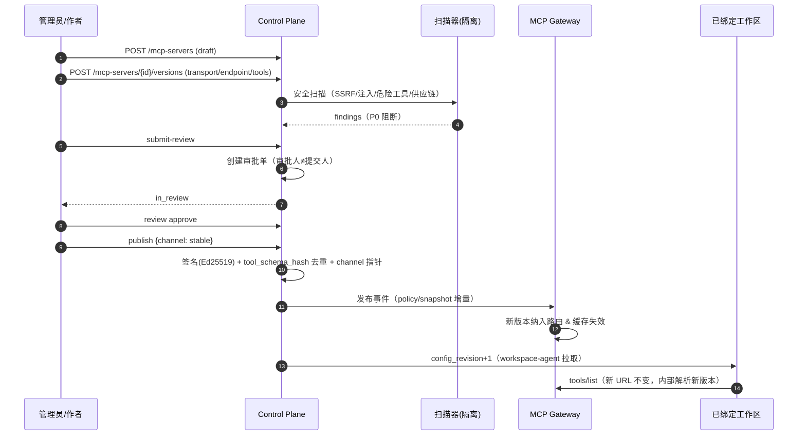
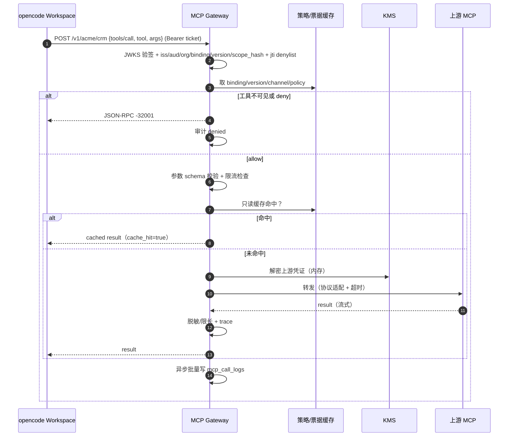
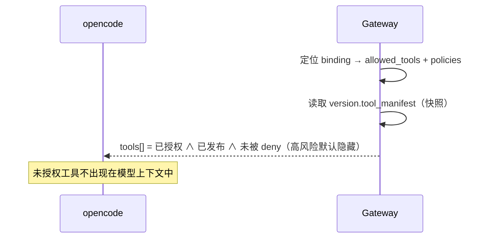
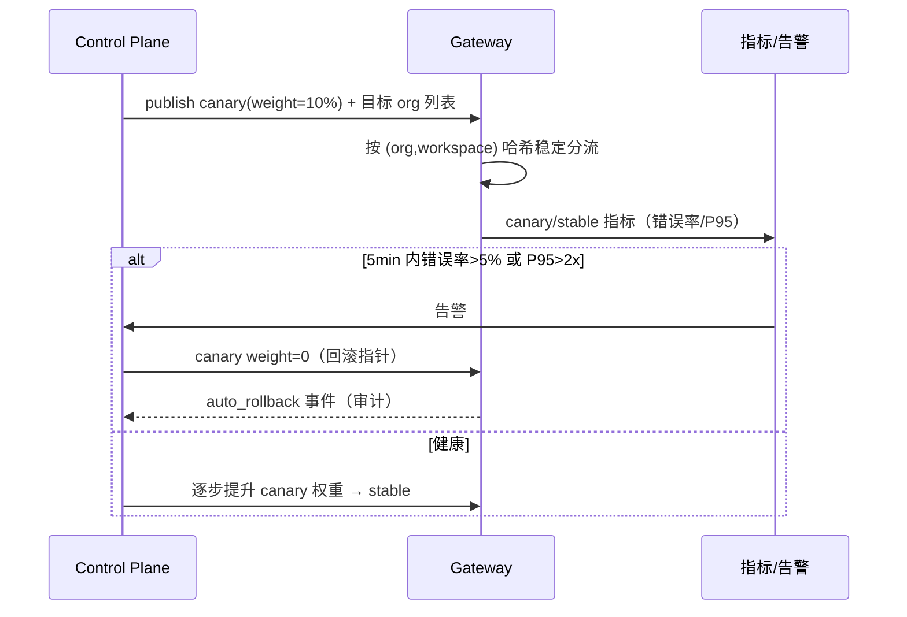
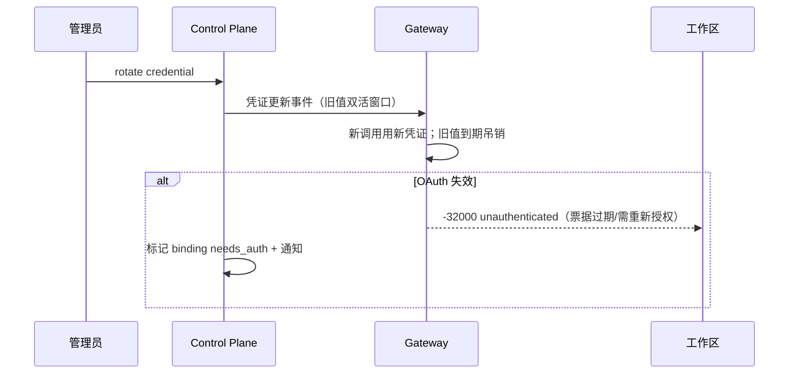
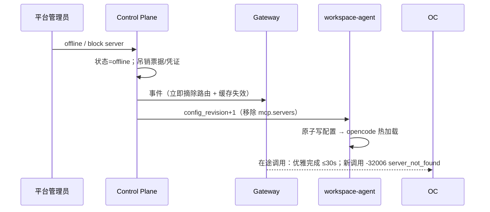

# MCP 全生命周期与 MCP 网关（MCP-GATEWAY）

- 版本：v0.5（1.1.0 冻结回改，2026-11-08；唯一权威 = `openapi 1.1.0 frozen@1.1.0` + `ARCH-V3 §4.7/§23.3`：canonical `/v1/{orgSlug}/{serverSlug}`、EdDSA/Ed25519+JWKS ticket TTL300s、ARCH §23.2 数字码、端口 4104）
- **契约核对**：**PASS** — architect 独立扫描（2026-11-08）确认 C1–C4 全闭合；`centers/MCP-GATEWAY.md v0.4` 与 `ARCH-V3 §4.7/§23.3/§23.4`、`ADR-V3-01/05` 一致，可冻结；**openapi `1.1.0` 已冻结（frozen@1.1.0，144 paths/197 ops/129 schemas）**，本文已按最终契约回改（只加不改；数据面 endpoint 不进资源 API）
- Owner：capability-centers（设计）；platform-backend（MVP 实现）
- 上游对齐：`docs/02-architecture/ARCH-V3.md` §3（生命周期）/§4（网关）/§6（AI 网关）/§11（WBS A2）
- 契约基线：`openapi.yaml` **1.1.0 FROZEN**（2026-11-08；v2 快照 `openapi.v2.lock.json` 保留）；本文件与 1.1 冲突时以 1.1 为准
- 现有实现：`services/mcp-hub/`（Registry/Lifecycle/Gateway 数据面实现）+ `apps/control-plane/`（REST 门面：cookie/CSRF/RBAC/审计、tool-policy、mcp_call_logs）
- 历史设计：`centers/MCP-HUB.md`（v2：注册/凭证/代理/绑定）——本文件在其上做 **v3 扩展（全生命周期 + 统一网关）**，冲突处以下文为准
- **ADR**：`docs/02-architecture/adr/ADR-V3-01-mcp-gateway.md`（Accepted，2026-11-08）——两层分工（Higress 接入 + 自研 MCP Gateway 工具级数据面）；本文件是其 §实现要点的落地设计
- **实现口径**：本文档 §6/§10/§12 已按 platform-backend 确认的 MVP 边界收敛（stable-only、进程内探针、不直连 PG、内存缓冲）；canary/灰度/WAL/FILE 等标 P2 的项不进 M2 MVP
- **服务命名说明**：ADR-V3-01 以 `mcp-gateway`（Go）描述生产数据面；本轮 MVP 由 `services/mcp-hub`（TypeScript）承担**同一角色**，对外契约/路径/错误码完全一致；生产演进到独立网关服务时**只换部署、不改契约**（见 §12）

---

## 0. 摘要与关键决策

| # | 决策 | 理由 |
| --- | --- | --- |
| D1 | **逻辑 Server 与不可变 Version 分离**；发布物是 `server_version`（semver + 工具清单快照 + 签名） | 支持版本回滚、审计、灰度，避免"改配置即上线" |
| D2 | **Channel 指针（stable/canary）** 决定工作区实际连接版本；回滚 = 换指针 | 回滚秒级、无需重建；灰度按 org/workspace 分流 |
| D3 | 网关是**独立 PEP 数据面**，不把工具级策略塞进 Higress/WAF | 策略复杂（工具/版本/租户/应用）、需低延迟本地决策；Higress 只做入口/流量治理（ARCH-V3 §6 结论） |
| D4 | 工作区只拿**绑定票据**（Bearer），不拿上游凭证；票据绑定 `binding_id + server_version + allowed_tools` | 凭证不出网关；泄露爆炸半径=单绑定；可即时吊销 |
| D5 | `tools/list` 阶段做**可见性过滤**：未授权工具不可见（而非调用才拒绝） | 防止模型"看到但调不通"的误导；降低提示注入面 |
| D6 | 数据面**不直连业务 PG**：只读策略快照 + 本地缓存；调用日志批量投递控制面 | 控制面故障不影响已发布工具调用（ARCH-V3 原则 2） |
| D7 | 远程 MCP 一律经网关，**stdio 仅无凭证白名单**；凭证型 stdio 降 M5.2/P2（安全审批） | 延续 v2 结论（R7.3 裁决），避免任意代码执行与凭证下发 |
| D8 | 审计 100%（含 denied/error），Trace 采样；`mcp_call_logs` 唯一写入方=控制面 | 合规与成本平衡；证据链可回放 |

---

## 1. 范围与角色

### 1.1 In Scope

- MCP Server 注册、版本、来源、可见性、审批、签名、发布/弃用/下线/紧急下线；
- 企业 MCP 目录、健康检查、凭证托管、绑定/授权、调用代理与审计；
- 统一网关数据面：streamable HTTP / SSE / stdio sidecar / REST→MCP；
- 工具级鉴权/白名单、限流/超时/重试/熔断、响应缓存、灰度/回滚；
- 与 opencode `mcp.servers` 的动态下发、工具变更热更新、未授权工具不可见。

### 1.2 Out of Scope

- 自研 MCP 协议实现（复用官方 SDK/协议语义）；
- MCP 市场计费/结算（仅计量事件）；
- 数字人/工作流（见 A5/A6）；
- 第三方 MCP 的内部业务逻辑。

### 1.3 角色与信任边界

```
用户/Agent(工作区)         平台控制面                 MCP Gateway               上游 MCP Server
   │  binding ticket          │ registry/policy/audit      │ PEP/凭证/代理              │ 企业系统
   │───────────────▶          │◀──── snapshot/logs ────────│──────────────────────────▶│
   └── 不可信输入（prompt/工具参数）                          └── 不可信上游响应
```

| 边界 | 信任级别 | 约束 |
| --- | --- | --- |
| 工作区（opencode/Agent） | 半可信（用户自己的代码） | 只有 binding ticket；不得持有上游凭证；网络只能到 Gateway/模型网关 |
| 控制面 | 可信（平台） | 唯一策略/生命周期/凭证/审计写入方（凭证以 KMS 引用） |
| MCP Gateway | 可信执行点 | 无状态多副本；只读快照；不落上游凭证明文 |
| 上游 MCP Server | **不可信** | 响应需脱敏/限长；SSRF 白名单；工具输出视为不可信内容 |
| stdio MCP | 高风险的执行代码 | 仅白名单镜像；沙箱运行；MVP 不接受用户上传 |

---

## 2. 全生命周期状态机

### 2.1 Server（逻辑对象）状态

```
draft ──submit──▶ in_review ──approve──▶ published ──deprecate──▶ deprecated ──offline──▶ offline
  ▲                   │                      │                                              ▲
  └────reject─────────┘                      └──────────────emergency offline───────────────┘
  └──────（平台 block，任意状态 → blocked；终态，仅平台管理员）──────────────────────────────┘
```

| 状态 | 语义 | 可被工作区引用 | 可新绑定 | 可调用 |
| --- | --- | --- | --- | --- |
| `draft` | 仅作者可见，可编辑版本 | ❌ | ❌ | ❌ |
| `in_review` | 锁定版本，等待安全扫描+人工审批 | ❌ | ❌ | ❌ |
| `published` | 至少一个版本发布（stable channel 有指针） | ✅ | ✅（按可见性/策略） | ✅ |
| `deprecated` | 停止新绑定/新安装，已绑定保留只读调用 | ✅（已绑定） | ❌ | ✅（只读工具；写工具按策略拒绝） |
| `offline` | 下线：吊销全部票据/凭证、断开连接 | ❌ | ❌ | ❌（返回 `mcp_offline`） |
| `blocked` | 平台紧急封禁（安全事件） | ❌ | ❌ | ❌（立即，≤5s 传播） |

> **v2 兼容（只加不改）**：`McpServer.status` 保留 v2 值 `[draft, pending_review, published, disabled]`，**追加** `deprecated/offline/blocked`（1.1 再追加 `review`，实现当前用 `review`）；映射：`review≡pending_review(read alias)`、`disabled≡offline`（读时映射，写时用新值；SDK 不 breaking）。

### 2.2 Version（不可变发布物）状态（1.1.0 权威）

```
draft ──submit-review──▶ in_review ──approve──▶ approved ──publish──▶ published ──yank──▶ yanked
  ▲                          │                    │
  └────────reject────────────┘                    └──（deprecated/offline 属 server 级，不作用于 version 状态）
```

**`McpServerVersionStatus = [draft, in_review, approved, published, yanked]`**（`approved`=审核通过待发布）；**不单设 validate 端点**，校验/扫描并入 `submit-review`，结果写独立字段 `scan_status` / `scan_report`。

| 字段 | 说明 |
| --- | --- |
| `version` | **int（1.1.0 MVP canonical）**：同 server 单调递增；发布后不可变 |
| `semver` | **可选（v3 目标，1.2）**：semver 字符串；与 `version` 并行双写（1.2 迁移计划） |
| `tools[]` | **MVP canonical 工具清单**（`McpTool[]` 简表，含 `destructive` fail-safe） |
| `transport` | `stdio / sse / streamable_http`（逻辑值；远程一律网关代理） |
| `endpoint` | **canonical**（1.1.0）；`upstream_url` 为 deprecated 别名（读兼容） |
| `command` | stdio 白名单镜像+argv（**不接受用户上传可执行**） |
| `tool_manifest` / `tool_manifest_hash` | 工具清单快照与规范化哈希（签名对象）；变更即需新版本 |
| `signature` + `signing_key_id` | Ed25519（KMS）签名，签名对象=规范化 manifest+digest |
| `source` | `internal / third_party / market / rest_import` |
| `visibility` | `private / org / team / public`（team 需 team_id；1.1 追加 team） |
| `scan_status` / `scan_report` | `pending/passed/failed` + SSRF/注入/危险工具/供应链结果（submit-review 时计算） |
| `eval_run_id` | 可选：企业 MCP 的冒烟评测（tools/list + 只读工具调用） |
| `approval_id` | 审批记录引用（`McpApproval` 内嵌版本详情；P2 独立查询端点） |

### 2.2.1 MVP 与 1.1.0 关系

- **MVP（M2.1/M2.2）**：审批/发布在 **Server 级**（v2 `POST /mcp-servers/{id}/review|publish`），版本创建/发布/回滚；1.1.0 新增 **version 级**端点，**version 级为权威**，v2 server 级保留为"对当前 stable 版本的便捷操作（内部委托 version 级、同一审计）"，仅改 description。
- reject → 回到 `draft`（可编辑/重新提交）；`offline` 后重新上线 = 新建版本 → draft → submit-review → publish。
- 版本不可变；`rollback` 只切 stable 指针并触发配置重算（不重建版本）。

### 2.3 转换表（guard / 副作用 / 事件）

| From → To | 触发 | Guard | 副作用 | 事件 |
| --- | --- | --- | --- | --- |
| draft → in_review | `submit-review` | schema/签名/endpoint/SSRF 校验通过；扫描无 P0；工具清单非空 | 写 `scan_status/scan_report`；锁定版本；创建审批单 | `mcp.version.review_requested` |
| in_review → approved | `review approve` | 审批人 ≠ 提交人；高风险需双人 | 记录审批人/意见/风险分（`McpApproval`） | `mcp.version.approved` |
| in_review → draft | `review reject` | 填写 reason | 版本可编辑/重新提交 | `mcp.version.rejected` |
| approved → published | `publish` | 签名有效；健康检查通过（或显式跳过并记录 DEGRADED） | 写 channel 指针；工具快照生效；通知 opencode 配置刷新 | `mcp.version.published` |
| published → yanked | `yank`（紧急） | 安全事件 | 指针回退上一 stable；通知所有绑定方；≤5s | `mcp.version.yanked` |
| server published → deprecated | `deprecate`（server 级） | 填写原因 | 禁止新绑定；通知使用方；version 状态不变 | `mcp.server.deprecated` |
| server deprecated/any → offline | `offline`（server 级） | 管理员 | 吊销绑定票据/凭证；清缓存；断开在途连接（优雅 30s） | `mcp.server.offline` |
| published → published(v2) | 新版本 publish | 新版本 approved | 按 channel 权重切换（stable 立即 / canary 灰度） | `mcp.channel.updated` |
| any → blocked | 平台 block | 仅 platform_admin | 全平台摘除；审计+通知 | `mcp.server.blocked` |

### 2.4 回滚语义

- **版本回滚**：`POST /mcp-servers/{id}/rollback {version:int, version_id?}` → 换 channel 指针；工作区在下次配置刷新（≤30s）自动指向旧版本；**不重建上游**。`version` 为 1.1 MVP canonical，`version_id` 兼容 optional。
- **Channel**：`stable`（默认）与 `canary`（灰度）。工作区绑定解析顺序：`canary`（若命中灰度规则）→ `stable`。
- **灰度规则**（`mcp_server_channels.weight` + policy）：按 org 百分比 / 指定 workspace 列表；命中 canary 的工作区配置指向 canary 版本。
- **自动回滚**：canary 版本 5min 内错误率 >5% 或 P95 > 2×stable → 自动把 canary weight 降 0 + 告警 + 记录 `mcp.channel.auto_rollback`。

### 2.5 健康检查

- 探针（Gateway 内，独立于工作区）：`initialize`（协议 `2026-07-28`，回退 `2025-11-25`）→ `tools/list` → 可选只读工具冒烟；
- 周期 60s；startup 10s / catalog 10s / 执行 10s；连续 3 失败 → `down`，2 次成功 → `healthy`；工具数下降 >20% 或 schema hash 变化 → `degraded` + 告警（可能上游被篡改）；
- 与状态机联动：`published` 且 `down` → 路由层摘除（返回 `mcp_health_down`），但不自动 `offline`；`down` 时禁止 publish 新版本（除非管理员豁免，记 DEGRADED）。

---

## 3. 数据模型（v3 增量/变更，落 DATA-MODEL）

> 公共约定：所有表 `org_id`（平台公共目录可 NULL，RLS 允许 `org_id IS NULL AND visibility='public'`）；时间 UTC；ID uuid；软删；审计字段。

```sql
-- 逻辑 server（目录条目）
mcp_servers (
  id uuid PK, org_id uuid NULL, slug text, name text, description text,
  category text, source text CHECK (source IN ('internal','third_party','market','rest_import')),
  visibility text CHECK (visibility IN ('private','org','team','public')),
  team_id uuid NULL,
  status text CHECK (status IN ('draft','in_review','published','deprecated','offline','blocked')),
  risk text CHECK (risk IN ('low','medium','high')),
  owner_user_id uuid, created_at timestamptz, updated_at timestamptz, deleted_at timestamptz,
  UNIQUE (org_id, slug), UNIQUE (slug) WHERE org_id IS NULL
);

-- 不可变版本
mcp_server_versions (
  id uuid PK, server_id uuid FK, org_id uuid,
  semver text, status text CHECK (status IN ('draft','validated','in_review','approved','published','deprecated','yanked')),
  transport text, endpoint text NULL, command jsonb NULL, env_refs text[] NULL,
  auth_type text CHECK (auth_type IN ('none','api_key','header','oauth2','mtls')),
  oauth_config jsonb NULL,
  tool_manifest jsonb,            -- [{name,description,input_schema_hash,read_only,destructive,risk}]
  tool_schema_hash text,          -- sha256(规范化 tool_manifest)
  source_url text NULL, image_digest text NULL,
  signature bytea, signing_key_id text,
  scan_report jsonb, eval_run_id uuid NULL,
  approval_id uuid NULL, published_at timestamptz, created_by uuid, created_at timestamptz,
  UNIQUE (server_id, semver)
);
CREATE UNIQUE INDEX ON mcp_server_versions (server_id, tool_schema_hash) WHERE status='published'; -- 防止同工具集重复发布

-- Channel 指针（stable/canary）
mcp_server_channels (
  server_id uuid, channel text CHECK (channel IN ('stable','canary')),
  version_id uuid, weight int DEFAULT 100 CHECK (weight BETWEEN 0 AND 100),
  updated_by uuid, updated_at timestamptz, PRIMARY KEY (server_id, channel)
);

-- 审批
mcp_approvals (
  id uuid PK, org_id uuid, subject_type text CHECK (subject_type IN ('server','version')), subject_id uuid,
  decision text CHECK (decision IN ('approved','rejected')), reviewer_user_id uuid,
  comment text, risk_score numeric(5,2), created_at timestamptz,
  UNIQUE (subject_type, subject_id, reviewer_user_id)
);

-- 工具级策略（PEP 配置）
mcp_tool_policies (
  id uuid PK, org_id uuid, server_id uuid,
  subject_type text CHECK (subject_type IN ('org','team','user','workspace','app')),
  subject_id uuid NULL, effect text CHECK (effect IN ('allow','deny')),
  tools text[] NULL,               -- NULL=全部工具（仍受 visible 工具清单限制）
  constraints jsonb,               -- {rpm,tpm,concurrency,timeout_ms,cache_ttl_sec,max_response_bytes}
  priority int, created_by uuid, created_at timestamptz
);

-- 凭证（KMS 信封，不存明文）
mcp_credentials (
  id uuid PK, org_id uuid, server_id uuid,
  scope text CHECK (scope IN ('org','user')), user_id uuid NULL,
  kind text, ciphertext bytea, kms_key_version text,
  status text CHECK (status IN ('active','rotating','revoked')),
  expires_at timestamptz, last_refreshed_at timestamptz, created_at timestamptz,
  UNIQUE (server_id, scope, COALESCE(user_id::text,''))
);

-- 绑定（工作区/应用/用户/组织 → server version/channel；票据哈希）
mcp_bindings (
  id uuid PK, org_id uuid, server_id uuid, version_id uuid NULL, channel text DEFAULT 'stable',
  subject_type text CHECK (subject_type IN ('user','workspace','app','org')), subject_id uuid,
  allowed_tools text[], denied_tools text[], credential_id uuid NULL,
  status text CHECK (status IN ('active','disabled','revoked')),
  token_hash text, token_expires_at timestamptz,
  created_by uuid, created_at timestamptz, expires_at timestamptz,
  UNIQUE (server_id, subject_type, subject_id)
);

-- 健康检查（按版本+通道）
mcp_health_checks (
  id bigserial, org_id uuid, server_id uuid, version_id uuid, channel text,
  phase text CHECK (phase IN ('startup','catalog','smoke')), status text CHECK (status IN ('healthy','degraded','down')),
  latency_ms int, tools_count int, error_code text, checked_at timestamptz
);

-- 调用审计（控制面唯一写入）
mcp_call_logs (
  id bigserial, org_id uuid, server_id uuid, version_id uuid, channel text,
  binding_id uuid, workspace_id uuid NULL, app_id uuid NULL, user_id uuid,
  tool_name text, method text, status text CHECK (status IN ('ok','denied','error','rate_limited','timeout','upstream_unavailable')),
  latency_ms int, upstream_latency_ms int, args_hash text, args_redacted jsonb,
  response_bytes int, cache_hit boolean, retry_count int, error_code text,
  trace_id text, session_id text, occurred_at timestamptz, ingested_at timestamptz
);

-- OAuth（网关侧 state 短期存储；token 落 mcp_credentials）
mcp_oauth_states (state text PK, org_id uuid, server_id uuid, binding_id uuid NULL, redirect_uri text, expires_at timestamptz, created_at timestamptz);
```

**与 v2 DATA-MODEL 差异**：`mcp_servers` 增 `source/visibility/team_id/risk/status`（去 `draft→published→disabled` 三态）；新 `mcp_server_versions/channels/approvals/tool_policies`；`mcp_bindings` 增 `version_id/channel/token_*`；`mcp_health_checks` 增 `version_id/channel/phase`；`mcp_call_logs` 增版本/缓存/trace 字段。**变更需走 openapi/ADR 流程**，MVP 可先兼容旧字段（`mcp_servers.status=published` 映射为 v3 published）。

---

## 4. MCP 网关设计（数据面）

### 4.1 统一端点

```
# 生产（Higress 路由到 MCP Gateway；无 /mcp 前缀）
https://mcp.<domain>/v1/{orgSlug}/{serverSlug}                     # streamable HTTP（canonical）
https://mcp.<domain>/v1/{orgSlug}/{serverSlug}/sse                 # SSE（兼容旧客户端）
https://mcp.<domain>/v1/{orgSlug}/{serverSlug}/rest/{toolName}     # REST→MCP（P2）

# 本地：local-gateway:8080 反代并**剥掉 /mcp 前缀** → mcp-hub:4104
http://localhost:8080/mcp/v1/{orgSlug}/{serverSlug}
http://localhost:8080/mcp/v1/{orgSlug}/{serverSlug}/sse

# mcp-hub 进程内 canonical（与入口去掉 /mcp 后逐字节一致）
/v1/{orgSlug}/{serverSlug}
/v1/{orgSlug}/{serverSlug}/sse
/v1/{orgSlug}/{serverSlug}/rest/{toolName}

# 兼容别名（deprecated path，保留；行为与 canonical 等价）
/v1/{orgSlug}/{serverSlug}/mcp
```

- **canonical 主路径（唯一）**：`/v1/{orgSlug}/{serverSlug}`（+`/sse`）。SDK/文档/测试断言一律用主路径（ARCH-V3 §4.1/§4.7/§16.1/§23 已统一 `{orgSlug}`）。
- **别名（deprecated/兼容，仅此两类）**：`/v1/{orgSlug}/{serverSlug}/mcp`（mcp 后缀）与 `/v1/{orgSlug}/{serverSlug}/rest/{toolName}`（REST→MCP 适配，P2）。别名与主路径走**同一中间件栈**；契约测试要求响应/错误码逐字节等价（path 回显除外）。
- **唯一实现、两条入口**：入口层（local-gateway/Higress）只做反代与 **`/mcp` 前缀剥离**（本地），**不做工具级策略**；`/mcp/v1/...` → `mcp-hub:4104/v1/...`。生产 Higress 直接把 `/v1/...` 转发到 MCP Gateway。
- **等价性契约（QA 冻结）**：同一组 API 测试（路由/ticket/错误码/SSE/限流）在 ①`local-gateway:8080/mcp/v1/...` 与 ②`mcp-hub:4104/v1/...` 上结果一致；生产 Higress 与 local-gateway 差异仅限 WAF/语义缓存/模型路由等插件能力，显式标注。
- 每个请求必须带 **binding ticket**（`Authorization: Bearer mcp_<...>`）；票据绑定到 `binding_id`，Gateway 由票据解析出 `org/server/version/channel/tools`。
- 内部调试入口保留 `/internal/mcp/proxy/{bindingId}`（mTLS/内网，仅测试与运维）。
- 端口约定：本地 `mcp-hub` 监听 **4104**（`PORT=4104`，现有默认/compose）；`local-gateway` 8080 反代 `/mcp/*` → `http://mcp-hub:4104` 并剥前缀。

### 4.1.1 票据模型（以 ARCH-V3 §4.7 / §23.3 为唯一权威）

> **C2 定稿（lead 最终裁决 / architect 已回写）**：Binding ticket = **EdDSA/Ed25519 JWT + JWKS**；**HMAC 仅本地 dev 兼容（同一 claims），不得作为生产形态**。本文不另立定义。

| 模式 | 值形态 | 验签 | 用途 | 阶段 |
| --- | --- | --- | --- | --- |
| `mcpb_` binding token | 随机 opaque（库中仅 `sha256`） | Gateway 查本地/内存 hash 表 | 内部调试入口 `/internal/mcp/proxy/{bindingId}`；兼容 v2 骨架 | 保留（非对外 ticket） |
| **EdDSA binding ticket（canonical）** | `eyJ...` Ed25519 JWT + `kid` | 控制面 JWKS（本地缓存，每 call 不查 DB） | 网关入口 `/v1/{orgSlug}/{serverSlug}` | **生产唯一形态** |
| dev HMAC（仅本地） | `mcp_<base64url(payload)>.<hmac>` | `MCP_TICKET_SECRET` | 本地开发/测试，**claims 必须与 EdDSA 相同** | 仅 dev/test |

**Claims（EdDSA，ARCH-V3 §4.7/§23.3）**：`iss=control-plane`、`aud="mcp:org:<orgSlug>"`、`sub`、`org`、`ws`、`app`、`binding_id`、`server_id`、`server_version`、`scope[]`、`scope_hash=sha256(canonical(scope+server_version))`、`jti`、`iat`、`exp`。
- **TTL 300s、非一次性**（同 binding 可复用至过期；agent 提前刷新）；续签/轮换走 `POST /api/v1/mcp-bindings/{bindingId}/rotate-token`。
- **吊销**：binding 状态 + `jti` denylist；生产 ≤5s、本地 ≤30s。
- **网关校验**：签名(JWKS)/iss/aud/org/ws/binding 状态/版本=当前 stable/工具∈scope ∧ 发布清单；不查业务 DB。
- **三态**：401 未认证；403 越权/跨租户（`tenant_mismatch`）；404 不存在（不泄露内部原因）。
- `scope_hash` 与策略快照不符 → 拒绝（防票据授权与策略漂移）；**任何模式都不授予上游凭证**，凭证只在 Gateway 内存注入。

### 4.2 请求流水线（每个 JSON-RPC 请求）

```
0. 入口（local-gateway:8080 或 Higress）：TLS/WAF/粗限流；本地 `/mcp/v1/{orgSlug}/{serverSlug}[/...]` 反代并**剥掉 `/mcp` 前缀** → `mcp-hub:4104/v1/{orgSlug}/{serverSlug}[/...]`；生产 `https://mcp.<domain>/v1/...` 直接转发 MCP Gateway
1. TLS/WAF/Higress 粗限流（IP/租户）
2. Gateway 认证：**EdDSA 验签（JWKS 本地，`kid`）** → 检查 iss/aud/org/ws/binding 状态/server_version=stable/scope_hash/jti/exp → 查 `jti` denylist（MVP 内存 TTL≤30s；生产 Redis ≤5s）
3. 路由解析：orgSlug/serverSlug → server_id；binding → version/channel；未发布/下线 → 404/410
4. 协议解析：JSON-RPC 方法（initialize/tools/list/tools/call/resources/*/prompts/*）
5. PEP（本地快照）：
   - tools/list：按 binding.allowed_tools ∩ version.tool_manifest ∩ policies 过滤 → 返回可见工具
   - tools/call：工具存在 → 未被 deny → 在允许集合 → 参数 schema 校验 → 约束（大小/深度）
6. 限流/预算：租户/绑定/工具维度令牌桶（Redis 多副本一致；本地预检 + 周期同步）
7. 凭证注入：按 credential_id 从 KMS 解密（内存最短生命周期）→ 注入 header/OAuth token/mTLS
8. 上游转发：按 transport 适配（streamable HTTP/SSE/stdio sidecar/REST-to-MCP），超时分层
9. 响应处理：限长（默认 2MB/可配）、脱敏（凭证/PII 模式）、流式原样透传、缓存（只读工具）
10. 审计/Trace：写本地**内存队列**（MVP）/批量投递控制面；span 名 = `mcp.<server>.<tool>`；指标上报
11. 返回：成功原样；错误统一 JSON-RPC error（见 §6.4）
```

### 4.3 协议适配矩阵

| transport | 上游形态 | Gateway 行为 | MVP |
| --- | --- | --- | --- |
| `streamable_http` | 远程 MCP endpoint | 透传 JSON-RPC/流式；支持 keep-alive/压缩 | ✅ |
| `sse` | 旧版远程 SSE | Gateway 以 SSE 客户端连接上游，向下游暴露 streamable HTTP 或 SSE | ✅（兼容） |
| `stdio` | 本地进程 | **仅白名单**：镜像内预装/受控 sidecar 托管；stdin/stdout JSON-RPC 桥接；禁网/只读/非 root | M5.2（P2） |
| `rest_import` | 企业 OpenAPI | 由注册时拉取 OpenAPI → 生成工具清单 → Gateway 把 `tools/call` 映射为 REST 调用（路径/参数/鉴权映射） | M2.3（P2） |

> 远程 MCP **不在工作区直连**：配置里的 URL 永远是 Gateway；上游地址只在版本记录中。

### 4.4 工具级 PEP（策略执行点）

- 决策输入：`tenant/org/team/user/workspace/app` + `server_id/version/tool` + 参数元数据 + 策略快照。
- 规则优先级：`deny` > `allow`；subject 精确 > team > org > 默认（默认拒绝未授权）。
- **高风险工具默认拒绝（lead 裁决 / architect ADR 字段）**：`tool_manifest.tools[].destructive: boolean`（写/删/支付/外发）；`destructive=true` 默认 **deny**，策略字段 `require_explicit_allow: boolean`（**默认 true**）；必须 **org admin 显式 allow + 审批** 才可绑定/调用/出现在 `tools/list`，并写审计（`mcp.tool.policy.high_risk_allowed`）。**未标注 `destructive` 按 destructive 处理（fail-safe）**；产品文案统一"高风险工具需单独授权"。
- **可见性**：`tools/list` 只返回 binding 允许 + 工具清单内 + 未被策略 deny 的工具；`resources/list` 同理。
- **`McpTool` schema（1.1.0）**：`name`、`description`、`title?`、`input_schema?`、`input_schema_hash`、`read_only`、`destructive?`、`risk`、`annotations?`；`read_only=true` 才允许自动重试/结果缓存；`input_schema_hash` 用于 `scope_hash` 与工具清单漂移检测。
- **`McpToolPolicy`（1.1.0 MVP canonical = 扁平行）**：`{server_id, revision, destructive_default, rules[{tool_name, effect, subject_type, subject_id, constraints{rpm,tpm,concurrency,timeout_ms,cache_ttl_sec,max_response_bytes}, priority, require_explicit_allow}]}`；PUT 批量替换 + `revision`/`If-Match`（冲突 409 `version_conflict`）。**v3 目标（1.2）**：按 `effect/tools[]/subjects` 分组的多策略结构；MVP 不使用，迁移计划见 §11。
- 参数校验：按 `input_schema_hash` 对应 JSON Schema 校验（快照内缓存）；限制深度/大小/正则复杂度（防 ReDoS）。
- 约束：`rpm/tpm/concurrency/timeout_ms/cache_ttl_sec/max_response_bytes` 来自策略（可覆盖全局默认）。
- 决策缓存：`(binding_id, tool, policy_revision)` → allow/deny，TTL 30s 或策略版本变化即失效；本地 LRU（每副本 ≤10k 条）。

### 4.5 凭证托管

| 模式 | 存储 | 注入 | 轮换 |
| --- | --- | --- | --- |
| `api_key/header`（org） | KMS 信封（`mcp_credentials`） | Gateway 内存解密→header | 管理员轮换；旧 key 双活窗口 |
| `oauth2`（org） | refresh/access token（KMS） | Gateway 自动刷新→Bearer | 过期前 5min 刷新；刷新失败 → `mcp_auth_required` |
| `oauth2`（user） | 按 user 的 token | 按调用者选凭证 | 用户重授权；未授权调用返回 401 |
| `mtls` | 证书/密钥（Secret） | 上游 mTLS | 证书轮换 |

- 任何响应/日志/审计不出现凭证明文；错误信息过滤上游 `Authorization`/token。
- 凭证轮换期间双 key 并存（`status=rotating`），全量切换后吊销旧值。
- **凭证型 stdio 不在 MVP**（Q2 裁决）；开启需安全审批 + 本地 sidecar 注入专审。

### 4.6 限流 / 超时 / 重试 / 熔断

| 维度 | 默认 | 超限行为 |
| --- | --- | --- |
| 租户（org） | 600 req/min | 429 + `Retry-After` |
| 绑定（binding） | 120 req/min、并发 8 | 429 |
| 工具（tool） | 按策略（可配 60/min） | 429 |
| 请求大小 | 1MB | 413 / JSON-RPC -32600 |
| 响应大小 | 2MB | 截断 + `truncated:true`（或按策略拒绝） |
| startup/catalog/execution 超时 | 10s/10s/60s | JSON-RPC -32003 / HTTP 504 |

- **重试**：仅 `read_only=true` 且上游错误可重试（连接失败/超时）1 次，指数退避 200ms；写工具不重试（防重复副作用）。
- **熔断**：每 `(server,version)` 独立；连续 5 次失败或错误率 >20%（30s 窗口）→ 打开 30s；半开 1 次成功恢复；打开期间快速失败 `mcp_upstream_unavailable`（429/503 可重试）。
- **隔离**：每上游连接池上限；每 server 并发上限；慢请求独立队列，避免级联。

### 4.7 响应缓存

| 对象 | 键 | TTL | 说明 |
| --- | --- | --- | --- |
| `tools/list` | `(server,version,tools_hash,binding_scope)` | 60s | 变更版本/策略即失效；缓存快照可含全量、返回前按 binding 过滤 |
| 只读工具结果 | `(server,version,tool,args_hash,credential_scope)` | 策略配置（默认 0=不缓存） | 仅 `read_only` 且 `cache_ttl_sec>0`；写工具永不缓存；命中不代替审计（记 `cache_hit=true`） |
| 健康/目录 | 内存快照 | 60s | 探针结果 |

- 缓存必须 ACL-scoped：不同 org/binding 不共享用户级缓存；公开只读可共享（键含 version）。
- 缓存失效：版本发布/回滚/下线/凭证轮换/策略更新 → pub/sub 广播 `cache.invalidate`。

### 4.8 审计与 Trace

- **审计 100%**：每次 `tools/call`（含 denied/rate_limited/timeout）写 `mcp_call_logs`：actor、binding、server/version/channel、tool、`args_hash`（sha256）+ `args_redacted`（按策略脱敏；默认只存 hash）、status、latency、upstream_latency、bytes、cache_hit、trace_id、session_id。
- **Trace**：opencode 侧生成 `session_id`（请求头 `x-oc-session-id` 注入）→ Gateway span `mcp.gateway` → `mcp.upstream`；OTel 导出；采样 10%（denied/error 100%）。
- **证据链**：控制面写入审计哈希链（复用 auditWORM/prev_hash），支持按调用回放。
- 数据面投递：**MVP 内存队列**（有界，批量 500ms/100 条）→ `POST /internal/mcp/call-logs:batch`（HMAC internal token，幂等 key=`log_id`）；控制面不可用时内存重试（退避，≤5min），**失败不阻塞调用**；**文件 WAL + 1h 补投为 P2**。
- **保留与查询（1.1.0 裁定）**：`mcp_call_logs` **保留/冷存 180 天**（满足 R7.5），`GET /mcp-call-logs` 在线查询窗口 **≤90 天**；超过 90 天提示走导出/冷存查询（审计证据链仍在）。1.1 `McpCallLog` 含 `tool_name/args_hash/version_id` 别名（与 `tool/request_hash/server_version_id` 并存，读兼容）。
- **禁止**：明文参数入库、凭证入日志、上游响应原样入审计。

### 4.9 健康检查、摘除与灰度

- 探针按 §2.5；结果写 `mcp_health_checks` 并广播 `mcp.health.changed`（≤2s 到控制面/控制台）。
- 路由摘除：`down` 的 (server,version) 不进入新连接；已连接在下次 `tools/list`/call 返回 `mcp_health_down`；控制台展示。
- **灰度**：canary channel 权重 + 规则（org 百分比/workspace 白名单）；Gateway 按 `(org_id, workspace_id)` 哈希稳定分流；指标对比 stable/canary；自动回滚见 §2.4。
- **回滚**：API 换指针 ≤2s；工作区配置刷新 ≤30s；在途流式调用不强制中断（新调用生效）。

---

## 5. 与 opencode 的集成

### 5.1 配置下发（远程一律指向 Gateway）

```jsonc
{
  "mcp": {
    "servers": {
      "crm": {
        "type": "remote",
        "url": "https://mcp.<domain>/v1/acme/crm",
        "headers": { "Authorization": "Bearer mcp_<binding-ticket>" },
        "timeout": { "startup": 10000, "catalog": 10000, "execution": 60000 }
      }
    }
  },
  "policies": [
    { "action": "mcp.use", "resource": "crm", "effect": "allow" },
    { "action": "mcp.use", "resource": "legacy-jira", "effect": "deny" }
  ]
}
```

- 票据由 workspace-agent 向控制面获取（agent 持工作区身份），写入 L2 全局配置；**不在工作区保存上游凭证**。票据为 **EdDSA/Ed25519 JWT（JWKS，`kid`）**，TTL 300s、非一次性；轮换走 `/mcp-bindings/{bindingId}/rotate-token`；本地 dev 允许 HMAC 但 claims 相同。
- 票据 TTL **300s**（可续签，续签走 `POST /api/v1/mcp-bindings/{id}/token`）；agent 在剩余 ≤60s 前续签，旧票保留至过期（重叠窗口）；续签失败 3 次 → 保留旧票至过期 + 告警 + 停止刷新（避免写入失效票据）。
- 配置刷新链路：发布/回滚/绑定变更 → 控制面 `config_revision+1` → agent 拉取 → 原子写 `opencode.json` → opencode watcher 热加载（目标 ≤30s）。
- 未授权/下线 server 从配置移除（不是 `disabled:true`），确保模型不可见。

### 5.2 工具可见性与热更新

- `tools/list` 由 Gateway 过滤；opencode 无需订阅工具变更，下一次 `tools/list`（或重连）即最新。
- 工具增删/改名/高风险变化 → 必须发布新版本；控制面计算 `tool_schema_hash` 变更并提示需评审（防"上游悄悄加删工具"）。
- 版本切换只改 channel 指针；工作区配置 URL 不变（Gateway 内部解析到新版本），因此**无需工作区重启**；只有 server 增删/绑定变更才改配置。
- `policies.mcp.use` 仅作兜底（防止用户手写配置绕过）；真正的工具级控制必须在 Gateway。

### 5.3 降级

| 场景 | 工作区表现 | 平台 |
| --- | --- | --- |
| Gateway 不可达 | MCP 工具连接失败，会话/模型正常 | 告警；已发布工具仍可后续恢复 |
| 上游 down | 该 server 工具不可用 | 摘除+状态展示；不自动 offline |
| 票据过期/吊销 | `401`/`mcp_auth_required` | agent 续签；绑定失效则移出配置 |
| 控制面不可用 | 已有配置继续可用；新绑定/续签失败 | Gateway 用策略快照继续服务（快照 TTL 内） |
| 版本 yank/offline | 下次配置刷新移出/降级 | ≤30s 传播；紧急情况 agent 强刷 |

---

## 6. API 草案

> 约定：控制面 REST 两层错误 `{error:{code,reason,message,details,request_id}}`，wire 小写；数据面 JSON-RPC 2.0；分页 `?cursor&limit`；写操作 `Idempotency-Key`；鉴权：控制面 OIDC Session/API Key，数据面 binding ticket。

### 6.0 MVP 契约（platform-backend 实现口径，2026-11-08 确认）

**control-plane（公开 `/api/v1`，cookie+CSRF；owner/admin 写）**

| Method | Path | MVP 说明 |
| --- | --- | --- |
| GET/POST | `/mcp-servers` | 列表/注册 |
| GET/PATCH/DELETE | `/mcp-servers/{serverId}` | 详情/元数据/删除 |
| POST/GET | `/mcp-servers/{serverId}/versions` | 创建不可变版本/版本列表 |
| POST | `/mcp-servers/{serverId}/rollback` | `{version}` 切 stable 指针 |
| POST | `/mcp-servers/{serverId}/review` | `{decision,comment}`；reject→draft |
| POST | `/mcp-servers/{serverId}/publish` | 发布（stable-only） |
| POST | `/mcp-servers/{serverId}/deprecate` | 弃用 |
| POST | `/mcp-servers/{serverId}/offline` | 下线（吊销票据/凭证） |
| POST | `/mcp-servers/{serverId}/health-check` | 手动触发探活（hub 执行） |
| GET | `/mcp-servers/{serverId}/health` | 只读健康展示 |
| GET/POST | `/mcp-bindings` | 绑定列表/创建（ticket 一次返回） |
| DELETE | `/mcp-bindings/{bindingId}` | 撤销 |
| POST | `/mcp-bindings/{bindingId}/rotate-token` | 轮换 ticket |
| GET/PUT | `/mcp-servers/{serverId}/tool-policy` | 工具级 allow/deny（MVP 单文档；v3 多策略表） |
| GET | `/mcp-call-logs` | 审计查询（MVP 先 `audit_logs`，`mcp_call_logs` 就绪后切换） |

**control-plane 内部**：`POST /internal/mcp/call-logs:batch`（hub 写入）、`GET /internal/mcp/snapshot`（hub 拉策略/绑定/版本快照，etag；**P2**）。

**mcp-hub（数据面）**：`POST/GET /v1/{orgSlug}/{serverSlug}`、`GET /v1/{orgSlug}/{serverSlug}/sse`、`POST /internal/mcp/proxy/{bindingId}`、`/internal/mcp/servers/{id}/{tools,credentials,health-check,test-connection}`、`GET /internal/mcp/calls`（本地缓冲查询）、`/healthz`、`/readyz`。

> §6.1–§6.2 为 **v3 目标态**（更细的版本/审批/channel/多策略端点），MVP 先实现本表；未列端点标 P2，不写入代码。

### 6.1 控制面：Server / Version / Lifecycle

| Method | Path | 说明 |
| --- | --- | --- |
| GET | `/api/v1/mcp-servers` | 目录（q/category/visibility/status） |
| POST | `/api/v1/mcp-servers` | 注册逻辑 server（draft） |
| GET | `/api/v1/mcp-servers/{serverId}` | 详情（含 channels/健康/工具摘要） |
| PATCH | `/api/v1/mcp-servers/{serverId}` | 元数据/可见性（不改已发布版本） |
| DELETE | `/api/v1/mcp-servers/{serverId}` | 下线并删除（有绑定需先 offline） |
| GET | `/api/v1/mcp-servers/{serverId}/versions` | 版本列表 |
| POST | `/api/v1/mcp-servers/{serverId}/versions` | 创建版本（transport/endpoint/工具/来源） |
| GET | `/api/v1/mcp-servers/{serverId}/versions/{versionId}` | 版本详情（manifest/签名/扫描/审批内嵌） |
| POST | `/api/v1/mcp-servers/{serverId}/submit-review` | **1.1 MVP 别名**（server 级，委托当前 draft 版本；version 级仍权威） |
| POST | `/api/v1/mcp-servers/{serverId}/versions/{versionId}/submit-review` | 提交审批（校验+扫描并入，写 `scan_status/scan_report`） |
| POST | `/api/v1/mcp-servers/{serverId}/versions/{versionId}/review` | `{decision,comment,risk}` |
| POST | `/api/v1/mcp-servers/{serverId}/versions/{versionId}/publish` | 发布（channel/weight） |
| POST | `/api/v1/mcp-servers/{serverId}/versions/{versionId}/yank` | 紧急撤回 |
| POST | `/api/v1/mcp-servers/{serverId}/deprecate` | 弃用（禁新绑定） |
| POST | `/api/v1/mcp-servers/{serverId}/offline` | 下线（吊销票据/凭证） |
| POST | `/api/v1/mcp-servers/{serverId}/rollback` | `{version:int, version_id?}`（1.1 MVP canonical；独立动作+审计+通知；`PUT /channels/{channel}` 仅设指针） |
| GET/PUT | `/api/v1/mcp-servers/{serverId}/channels` | GET `listMcpServerChannels` / PUT `setMcpServerChannel`（stable/canary 指针与权重） |
| POST | `/api/v1/mcp-servers/{serverId}/block` | 平台紧急封禁（admin） |
| GET | `/api/v1/mcp-servers/{serverId}/tools` | 工具清单（按版本，风险标注） |
| GET | `/api/v1/mcp-servers/{serverId}/health` | 最近探活+当前状态 |
| POST | `/api/v1/mcp-servers/{serverId}/health-check` | 主动探活 |

### 6.2 控制面：凭证 / 策略 / 绑定 / 审计

| Method | Path | 说明 |
| --- | --- | --- |
| GET/POST | `/api/v1/mcp-servers/{serverId}/credentials` | 列表（仅元数据）/写入（value 一次） |
| DELETE | `/api/v1/mcp-servers/{serverId}/credentials/{credentialId}` | 吊销 |
| POST | `/api/v1/mcp-servers/{serverId}/credentials/{credentialId}/rotate` | 轮换 |
| GET/PUT | `/api/v1/mcp-servers/{serverId}/tool-policies` | `getMcpToolPolicies`（返回 `revision`+`ETag`）/ `setMcpToolPolicies` 批量替换（`If-Match`，冲突 409 `version_conflict`） |
| GET/PUT | `/api/v1/mcp-servers/{serverId}/tool-policy` | **1.1 MVP alias**（`x-mvp-alias: true`，与复数等价；MVP 实现用单数，契约保留复数 canonical） |
| GET/POST | `/api/v1/mcp-bindings` | 绑定列表/创建（返回 ticket 明文一次） |
| GET/DELETE | `/api/v1/mcp-bindings/{bindingId}` | 详情/撤销 |
| POST | `/api/v1/mcp-bindings/{bindingId}/rotate-token` | 轮换 ticket（一次返回） |
| GET | `/api/v1/mcp-call-logs` | 审计查询（时间/actor/server/tool/status） |
| GET | `/api/v1/mcp-call-logs/{callId}` | 单条详情（脱敏） |

### 6.3 数据面（Gateway）

| Method | Path | 说明 |
| --- | --- | --- |
| POST/GET | `/v1/{orgSlug}/{serverSlug}` | streamable HTTP JSON-RPC（canonical；initialize/tools/*/resources/*/prompts/*） |
| GET | `/v1/{orgSlug}/{serverSlug}/sse` | SSE 兼容入口 |
| POST | `/v1/{orgSlug}/{serverSlug}/mcp` | **别名（deprecated path，保留兼容）**；与 canonical 行为等价 |
| POST | `/v1/{orgSlug}/{serverSlug}/rest/{toolName}` | **别名**（REST→MCP 适配，P2）；与主路径行为等价 |
| GET | `/healthz`、`/readyz` | 存活/就绪 |
| GET | `/metrics` | Prometheus（内网） |

**入口路径（等价）**：本地 `http://localhost:8080/mcp/v1/{orgSlug}/{serverSlug}[/sse|/mcp|/rest/*]` → 剥掉 `/mcp` 前缀 → `mcp-hub:4104/v1/{orgSlug}/{serverSlug}[/...]`；生产 `https://mcp.<domain>/v1/{orgSlug}/{serverSlug}[/...]` 由 Higress 转发。**入口层不做工具策略**；两条路径共享同一测试集（见 §4.1）；别名与 canonical 断言逐字节等价（path 回显除外）。

内部（mTLS/内网，不进 SDK/公网）：

| Method | Path | 说明 |
| --- | --- | --- |
| POST | `/internal/mcp/proxy/{bindingId}` | 调试/测试代理（等价数据面） |
| GET | `/internal/mcp/policy-snapshot` | 拉取策略/绑定/版本快照（`?org=&since=`） |
| POST | `/internal/mcp/call-logs:batch` | 审计批量写入（控制面实现，幂等） |
| POST | `/internal/mcp/servers/{serverId}/probe` | 主动探活（供控制面手动触发） |
| POST | `/internal/mcp/webhooks/health` | 健康事件推送 |
| GET | `/internal/mcp/bindings/{bindingId}/ticket` | 票据签发（控制面→agent 链路使用；或由控制面直接签发） |

### 6.4 错误模型（与 ARCH-V3 §4.7 冻结项同步）

> 数据面有两层：**HTTP transport 层**（任何 MCP 请求都可能直接返回）与 **JSON-RPC 协议层**（HTTP 200 + JSON-RPC error）。JSON-RPC error 的 `data.code` 使用下表 canonical 字符串，与 HTTP code 同名同义；客户端按 `data.code` 分支。

**HTTP 层（canonical，ARCH-V3 §4.7）**

| HTTP | code | 场景 |
| --- | --- | --- |
| 401 | `unauthenticated` | 无/过期 ticket |
| 403 | `tenant_mismatch` | ticket 租户与 endpoint 不符 |
| 403 | `tool_not_allowed` | 工具不在策略/发布清单（含高风险默认 deny） |
| 404 | `server_not_found` | server 未发布/不可见/已下线 |
| 404 | `tool_not_found` | 工具不在当前版本清单 |
| 409 | `version_conflict` | 发布/下线/回滚并发版本冲突 |
| 413 | `result_too_large` | 响应/请求超过租户上限 |
| 429 | `rate_limited` | RPM/TPM/并发超限（`Retry-After`） |
| 504 | `upstream_timeout` | 上游超时（`data.retryable` 标记） |
| 502 | `upstream_error` | 上游 5xx/协议错误 |
| 503 | `circuit_open` | 熔断打开 |

**JSON-RPC 层映射（ARCH-V3 §23.2 定稿；HTTP 200，`error.data.code`/`error.data.reason` 用同一 canonical 字符串）**

| HTTP | `reason` | JSON-RPC code | 场景 |
| --- | --- | --- | --- |
| 401 | `unauthenticated` | **-32000** | 无/过期 ticket |
| 403 | `tenant_mismatch` | **-32009** | ticket 租户 ≠ endpoint |
| 403 | `tool_not_allowed` | **-32001** | 策略/发布清单拒绝（含高风险默认 deny） |
| 404 | `server_not_found` | **-32006** | 未发布/不可见/已下线 |
| 404 | `tool_not_found` | **-32007** | 工具不存在/未在快照 |
| 409 | `version_conflict` | **-32010** | 版本/并发冲突 |
| 413 | `result_too_large` | **-32008** | 响应超上限 |
| 429 | `rate_limited` | **-32002** | RPM/TPM/并发超限（`Retry-After`） |
| 504 | `upstream_timeout` | **-32003** | 上游超时（`data.retryable` 标记） |
| 502 | `upstream_error` | **-32004** | 上游 5xx/协议错误 |
| 503 | `circuit_open` | **-32005** | 熔断打开 |

> JSON-RPC 标准错误码 `-32600/-32601/-32602` 保留给 JSON-RPC 格式/方法/参数错误（`data.reason` 分别为 `invalid_request/method_not_found/invalid_params`）。`openapi 1.1.0` 已将 `tenant_mismatch/tool_not_allowed/version_conflict/result_too_large/upstream_timeout/upstream_error/circuit_open/server_not_found/tool_not_found` 增补进 `ErrorReason`（**总数 58**）；控制面 REST 用 `code`（16 通用）+ `reason` 映射（401 `code=unauthorized`+`reason=ticket_invalid|auth_session_expired`；409 `code=conflict`+`reason=version_conflict`）。`error.data` 不入开放契约（数据面见本节 §6.4）。

**控制面 REST**：沿用两层模型——`401 unauthorized`、`403 forbidden`、`404 not_found`、`409 precondition_failed` + `reason=gate_blocked`（`details.gate_kind ∈ scan|review|health|signature`）、`429 rate_limited`、`503 service_unavailable`（`reason=mcp_health_down|mcp_upstream_unavailable`）。

---

## 7. 关键序列图

### 7.1 注册 → 审核 → 发布



### 7.2 工具调用（PEP + 凭证 + 审计）



### 7.3 tools/list 可见性过滤



### 7.4 灰度发布与自动回滚



### 7.5 凭证轮换 / needs_auth



### 7.6 下线/封禁传播



---

## 8. 安全边界

| # | 威胁 | 场景 | 控制 | 验证 |
| --- | --- | --- | --- | --- |
| S1 | 任意代码执行 | stdio 用户上传可执行/命令注入 | 仅白名单镜像；不接受用户 argv；沙箱（gVisor/P2）；参数数组非 shell | 提交 command → 422；沙箱逃逸测试 |
| S2 | SSRF | 注册 endpoint 指向内网/metadata/重定向 | 注册时 URL 校验 + 解析后 IP 复核（禁 10/8、172.16/12、192.168/16、169.254/16、127/8、::1、fc00::/7）；egress-proxy 白名单；禁止跟随跨域重定向 | SSRF 测试集（含 DNS rebinding/十进制 IP） |
| S3 | 凭证外泄 | 凭证进入工作区/日志/模型上下文 | 凭证只存 KMS/内存；工作区仅 binding ticket；日志/审计脱敏；响应过滤 `Authorization/Set-Cookie` | 配置/日志扫描无上游凭证 |
| S4 | 跨租户调用 | A org 的 ticket 调 B org 的 server | ticket 含 org/server/binding；Gateway 校验归属；RLS；404 不泄露 | 跨租户 ticket → 401/404 |
| S5 | ticket 重放/盗用 | 配置泄露 ticket | TTL 300s（非一次性、可续签）；jti；绑定 `(ws|app,binding)`；吊销表 ≤5s（MVP ≤30s）；异常频率检测 | 吊销后立即 401 |
| S6 | 工具越权 | binding 只允许 3 工具，调删除工具 | 本地 PEP + default deny + 可见性过滤；deny 审计告警 | 越权调用 -32001；不可见 |
| S7 | 提示注入（工具输出） | 上游返回恶意指令 | 输出标记为不可信内容（文档/Agent 提示）；限长；可选内容安全扫描；高风险 server 人工审核 | 注入用例不改变系统指令 |
| S8 | DoS/资源耗尽 | 高频/大响应/慢上游 | 限流/并发/超时/限长/熔断/队列隔离 | 压测单绑定不影响其他租户 |
| S9 | 供应链 | 上游 MCP 被篡改/工具突增 | 版本不可变 + 签名 + tool_schema_hash 变更告警 + 人工重审 | 工具清单变更→degraded+告警 |
| S10 | 审计篡改/缺失 | 数据面绕过写日志 | 100% 审计 + WAL + 幂等批量 + 哈希链；控制面唯一写入 | 断网 1h 后补投完整 |
| S11 | 缓存越权 | 用户 A 命中 B 的缓存 | 缓存键含 binding/credential scope；ACL 变更即失效 | 跨 binding 缓存不命中 |
| S12 | 混淆代理 | 低权限用户借高权限 server | binding 绑定 subject + allowed_tools + 凭证 scope；PEP 校验调用者 | 伪造成高权限 subject → 401 |

---

## 9. 可观测 / SLO / 容量

| 指标 | 目标 |
| --- | --- |
| Gateway 自身开销 P95 | ≤20ms（不含上游） |
| 本地 PEP 决策 P95 | ≤2ms（缓存命中） |
| ticket 验签（JWKS 本地） | ≤1ms |
| 吊销传播 | ≤5s（Redis pub/sub） |
| 配置下发到 opencode 生效 | ≤30s（`config_revision` → watcher） |
| 版本切换生效 | ≤2s（Gateway 指针） |
| 审计完整率 | 100%（含 denied；失败进 WAL） |
| 可用性 | 99.9%（多副本）；控制面故障时 Gateway 继续用快照 |
| 缓存命中（tools/list） | ≥80%（稳态） |

指标：`mcp_requests_total{org,server,tool,status}`、`mcp_request_duration_ms{server,tool,phase}`、`mcp_denied_total{reason}`、`mcp_rate_limited_total`、`mcp_cache_hit_ratio`、`mcp_circuit_state`、`mcp_audit_dropped_total`、`mcp_policy_snapshot_age_seconds`。

告警：上游 down、熔断打开、审计积压>5min、票据验签失败率>1%、策略快照过期>60s、canary 错误率超阈、跨租户访问尝试。

容量（1000 工作区、每工作区 5 server、平均 0.5 call/min）：稳态 ~40 QPS，峰值 300 QPS；Gateway 3 副本可承载；`tools/list` 缓存后上游压力可忽略；策略快照内存 <50MB/副本。

---

## 10. MVP 切分与验收

> 与 ARCH-V3 M2 对齐。**设计先行，platform-backend 实现**；`services/mcp-hub/` 现有骨架为起点。

### M2.1 生命周期 + 健康 + 代理（P0）

| 交付 | 验收 |
| --- | --- |
| Registry CRUD + 版本表 + 状态机（draft→review→published→deprecated→offline） | 非法迁移 409；审批人≠提交人；发布后版本不可变 |
| 签名 + tool_manifest 快照 | 篡改版本内容 → 校验失败；工具 hash 变化需新版本 |
| 健康探针（process 内 60s）+ 状态展示 | 3 失败→down；2 成功→healthy；摘除生效 |
| Gateway 代理（streamable HTTP/SSE）+ binding/ticket | opencode 经 Gateway 调通 mock MCP；无 ticket 401；跨租户 404 |
| **入口等价性**：`local-gateway:8080/mcp/v1/{orgSlug}/{serverSlug}[/...]`（剥 `/mcp`）→ `mcp-hub:4104/v1/{orgSlug}/{serverSlug}[/...]`，与直连 mcp-hub 同一测试集通过 | 两条路径的 method/path/状态码/SSE 行为一致；入口层无工具策略 |
| 审计（先 `audit_logs`，`mcp_call_logs` 就绪后切换） | 每次调用可查；denied 有记录 |
| 控制面配置下发 `mcp.servers` | 发布/解绑 ≤30s 反映到工作区配置 |

### M2.2 工具级 PEP + 限流 + 凭证（P1）

| 交付 | 验收 |
| --- | --- |
| 工具级 allow/deny + 可见性过滤 | 未授权工具不可见；越权调用 canonical `tool_not_allowed` 且审计 |
| **高风险默认拒绝**：`destructive=true` 默认 deny；org admin 显式 allow + 审计 + 文案 | 未授权高风险工具不可见/不可调；显式 allow 后可调；审计含审批人 |
| 限流（租户/绑定/工具）+ 超时 + 熔断 | 超限 429；熔断打开快速失败；恢复半开 |
| 凭证托管（KMS/Secret）+ 注入 + 轮换 | 工作区无凭证；轮换双活；OAuth 失效 needs_auth |
| 策略快照 + 本地缓存 | 控制面宕机时已发布工具可用（快照 TTL 内） |

> **MVP 明确不做（P2，不得提前实现）**：canary/灰度与自动回滚、REST→MCP 导入、文件 WAL、stdio 凭证型、版本级审批细分、响应缓存（默认关闭，仅留接口）、多策略表（MVP 单文档 tool-policy）。

### M2.3 灰度/缓存/REST 适配/可靠性（P2，本轮不做）

| 交付 | 验收 |
| --- | --- |
| canary channel + 自动回滚 | 灰度 10%→100%；错误率超阈自动回滚 |
| 只读工具响应缓存 | 命中不代替审计；写工具不缓存 |
| REST→MCP（OpenAPI 导入） | 示例企业 API 生成工具并可调用 |
| 文件 WAL 补投 + Trace 全链路 + 审计哈希链 | 控制面故障 1h 后日志完整；Trace 可串 session |
| stdio sidecar 白名单（凭证型 P2/安全审批） | 白名单外拒绝；沙箱隔离 |

> 以上为 v3 目标态；M2 MVP 仅收敛到 M2.1/M2.2，M2.3 进入后续迭代，避免"半成品"。

---

## 11. 契约 delta（v2 FROZEN → v3）

| 类型 | v2（openapi frozen） | v3 提案 | 处理 |
| --- | --- | --- | --- |
| ADR | — | **ADR-V3-01-mcp-gateway**（architect 签署，Accepted）：Higress 接入 + 自研 MCP Gateway 工具级数据面；**ADR-V3-05**（MCP 生命周期与契约升级）：v2 FROZEN 不动、v3 走 openapi `1.1.0` 增量 | 已签署；本文为实现设计 |
| openapi 1.1.0（**已冻结**） | v2：14 个 MCP ops | 1.1.0 共 16 个生命周期端点（+`getMcpServerVersion/rollback/deprecate/offline/GET channels/GET tool-policies` + server 级 `submit-review` 别名；单数 `/tool-policy` 为 `x-mvp-alias`）；`ErrorReason=58`；**数据面端点不进资源 API**（由本文 + 网关 OpenAPI 片段定义） | 已按 1.1.0 回改（只加不改） |
| Server 状态 | `draft/pending_review/published/disabled` | `draft/in_review/published/deprecated/offline/blocked` | openapi 1.1（枚举迁移映射） |
| 版本 | 无独立版本对象（server 上直接配置） | `mcp_server_versions` + channels | 新增端点/表；MVP 可向后兼容 |
| 端点 | `/mcp-servers/{id}/review|publish` | 增 versions/{vid}/validate|submit-review|review|publish|yank、server deprecate/offline/rollback/channels/block/tools | openapi 1.1 |
| 凭证 | 复用 server 级 credential | 按 server/版本 + org/user scope；轮换端点 | 新增 |
| 策略 | 仅 binding.allowed_tools | `mcp_tool_policies`（effect/constraints/priority）+ 高风险默认 deny | 新增 |
| 数据面 | 仅 `/internal/mcp/proxy/{bindingId}` | **canonical** `/v1/{orgSlug}/{serverSlug}`、`/sse`、`/rest/*`；入口加 `/mcp` 前缀（剥掉后转发） | openapi 1.1 + 独立 host；**ARCH-QA-01 已收敛（无 `/mcp` 后缀）** |
| 审计 | `audit_logs` 的 `mcp.tool.call` | `mcp_call_logs`（版本/缓存/trace 字段） | 表扩展 |

> 流程：**architect 签署 ADR-V3-01** → **architect 出 openapi `1.1.0`** → README §5.1 changelog → 通知 qa/platform-backend/capability-centers；**v2 FROZEN 不直接改、不允许实现先行**。platform-backend 按 1.1 实现；本文档与 1.1 冲突时以 1.1 为准并回改本文。
> **1.1.0 预审/回改**：按 `OPENAPI-1.1-PLAN.md` 预审并回改完成（2026-11-08）：6 个缺失端点已入 1.1.0；`McpServerVersion.version:int+tools[]` 为 MVP canonical（`semver` 可选 v3 目标）；`McpToolPolicy` MVP 扁平行（分组结构为 v3 目标）；单数 `/tool-policy` 为 `x-mvp-alias`；`McpCallLog` 别名（tool_name/args_hash/version_id）。P2（`McpCallLog` 归属/状态、ETag/If-Match、McpChannel.weight、status description 映射）进 **1.2.0 backlog（OPENAPI-1.1-PLAN §9）**；冻结期断言只按当前 schema（tool-policy 并发用 body `revision`，不断言 ETag）。

**1.2.0 迁移计划（非阻塞）**：① `McpServerVersion`：`version:int` 与 `semver` 双写，读路径优先 `version`；② `McpToolPolicy`：扁平行→分组结构双读，灰度期两套并存；③ `McpCallLog` 新字段/状态只加；④ `McpChannel.weight` 只加；⑤ App 协同 `collab-sessions` 层级为 v3 目标（MVP 平铺，1.2 迁移为平铺 canonical）。迁移期不得删除 v1.1 字段/路径。

---

## 12. 与 platform-backend 的实现分工（2026-11-08 已确认）

| 模块 | 归属 | 起点 / 说明 |
| --- | --- | --- |
| control-plane：registry/lifecycle/审批/健康/绑定/tool-policy/audit | platform-backend（`apps/control-plane/src/mcp/*`） | 新增模块；复用 auth/RBAC/audit；API 见 §6.0 |
| `mcp_call_logs` 写入 + 审计哈希链 | platform-backend | 先 `audit_logs`（`mcp.tool.call/denied`），`mcp_call_logs` 表就绪后切换；hub 批量投递 |
| 票据签发/吊销 | platform-backend（复用 ticket 签发器） | EdDSA/Ed25519 JWT + JWKS；claims/TTL/denylist 见 §4.1.1 与 ARCH-V3 §4.7/§23.3 |
| Gateway 数据面（协议适配/PEP/限流/熔断/审计缓冲） | platform-backend（`services/mcp-hub/`） | 现有 14 公开 ops + 8 内部路由为起点；新增 canonical `/v1/{orgSlug}/{serverSlug}`（`/mcp` 后缀为 deprecated 别名） |
| 本地统一入口 `local-gateway`（8080）：`/mcp/v1/{orgSlug}/{serverSlug}[/...]` → `mcp-hub:4104/v1/...`（**剥 `/mcp` 前缀**），**不做工具策略** | infra-devops / lead（task-27） | 与 Higress 同 subset 契约；同一测试集验证等价性 |
| 健康探针 + 路由摘除 + stable 路由 | platform-backend（mcp-hub 进程内） | 60s、initialize+tools/list、3 失败→down；canary P2 |
| 策略快照/本地缓存/票据校验 | platform-backend（mcp-hub） | MVP 内存快照；`/internal/mcp/snapshot` P2 |
| 设计/契约/序列/验收/风险 | capability-centers（本文件） | 本文为唯一设计源；实现冲突以本文 + openapi 1.1 + 评审为准 |

**服务命名/端口**：ADR-V3-01 以 `mcp-gateway`（Go）描述生产数据面；本轮 MVP 由 `services/mcp-hub`（TS，**`PORT=4104`**）承担同一角色，对路径/错误码/审计契约一致；生产演进到独立 `mcp-gateway` 时只换部署，不改契约。
> **端口判据（QA 冻结）**：`mcp-hub` 只允许监听 **4104**（lead 冻结）；`4200` 为历史值、已作废——**文档/代码/配置/测试断言中出现 4200 即判定失败**。ADR-V3-01 已同步为 `:4104`。

**边界约定**：数据面不直连业务 PG；控制面为权威；hub 只读快照 + 本地缓冲；`mcpb_` binding token 作为内部调试保留，网关入口统一用 EdDSA ticket；stdio 仅无凭证白名单（凭证型 P2/安全审批）；入口层（local-gateway/Higress）不做工具级策略。

---

## 13. 风险与开放问题

| # | 风险 | 影响 | 应对 |
| --- | --- | --- | --- |
| R1 | 工具级策略每 call 远程鉴权 → 延迟 | 体验 | 本地快照 + LRU + 30s TTL；策略版本号失效 |
| R2 | 控制面故障 vs 数据面独立 | 绑定/续签失败 | 快照 TTL、票据本地验签、WAL 补投；接受"新绑定不可用" |
| R3 | `tools/list` 快照与上游实际不一致 | 调用 -32007 `tool_not_found` | 发布时重拉并 hash 校验；上游变更告警；调用时兜底工具存在性校验 |
| R4 | stdio 凭证型需求（企业本地工具） | 需求无法满足 | P2 + 安全审批 + sidecar；不承诺"凭证不出工作区" |
| R5 | canary 分流与配置刷新不一致 | 灰度不准确 | 分流基于 binding 的 `channel` 字段（配置刷新后生效），Gateway 只执行指针 |
| R6 | 审计量级（1000 工作区） | 存储/写入压力 | 分区 + 批量 + 冷存；`args_redacted` 默认仅 hash |
| R7 | opencode 上游 MCP 客户端行为差异（SSE/streamable） | 兼容性 | 以 streamable HTTP 为主，SSE 兼容入口；版本锁定 v2.2.5 回归 |
| R8 | Higress 与自研 Gateway 边界 | 重复/冲突 | Higress 只做入口/WAF/粗限流；工具级 PEP 明确在 Gateway（ARCH-V3 §6） |
