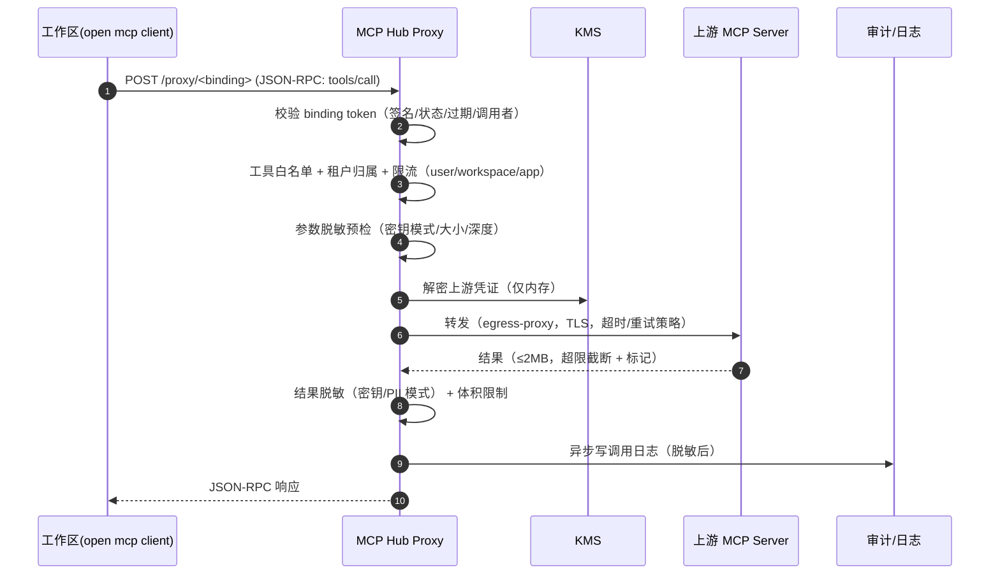
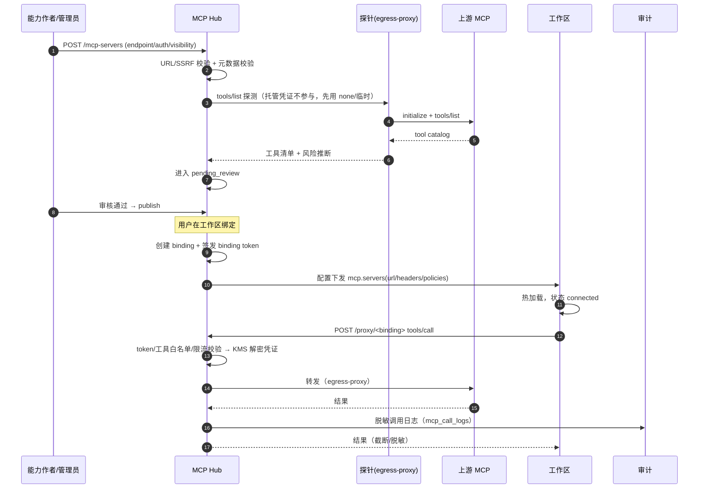
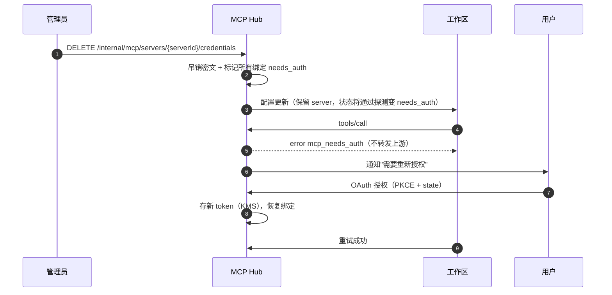
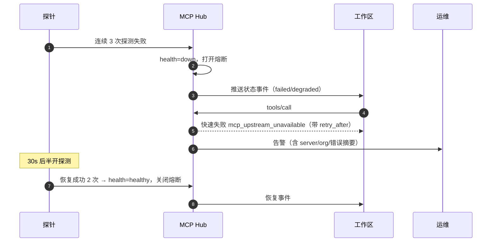

# MCP 中心（MCP Hub）设计

- 版本：v0.1（P2 架构 · 能力中心分册）
- Owner：capability-centers；评审：architect（G2）、platform-backend（租户/密钥）、qa-reviewer
- 需求映射：R7.1–R7.6；实现目录：`services/mcp-hub/`
- 上游依据：`packages/schema/src/mcp.ts`、`packages/schema/src/config/mcp.ts`、`packages/schema/src/config/policy.ts`（`mcp.use`）、`packages/server/src/handlers/mcp.ts`、`packages/core/src/mcp/*`

---

## 1. 职责与范围

MCP 中心把"企业可用的工具/数据源"以 MCP 协议安全地供给工作区与应用，**统一托管凭证、统一代理、统一审计、统一授权**。

| In Scope | Out of Scope |
| --- | --- |
| 注册模型：stdio / SSE / streamable HTTP | 自研 MCP 协议实现（用官方 SDK） |
| 企业目录：分类、搜索、可见性、审批上架 | MCP 服务市场收费/结算 |
| 健康检查与状态 | MCP Server 的具体业务实现 |
| 凭证托管（KMS）与 OAuth 代理 | 用户本地 MCP 的托管（MVP 允许用户本地自配，但不进目录/不审计） |
| 代理：调用日志、脱敏、限流、熔断 | 工具级业务逻辑编排 |
| 授权绑定：用户/工作区/应用 × 服务器/工具 | 跨组织共享私有 MCP（仅平台公开目录） |
| 注入 `mcp.servers` + `policies`，失效降级 | 修改 opencode MCP 运行时 |

**关键事实（上游已核实）**：
- 配置结构：`mcp: { timeout?: {startup, catalog, execution}, servers?: Record<name, LocalConfig|RemoteConfig> }`。
- `LocalConfig`（stdio）：`{type:"local", command: string[], cwd?, environment?, disabled?, codemode?, timeout?, protocol?}`。
- `RemoteConfig`：`{type:"remote", url, headers?, oauth?: OAuthConfig|false, disabled?, codemode?, timeout?, protocol?}`。
- `OAuthConfig`：`{client_id?, client_secret?, scope?, callback_port?, redirect_uri?, auth_server_metadata_url?}`。
- 运行时状态枚举：`connected | pending | disabled | failed | needs_auth`（`Mcp.Status`）。
- 策略动作：`mcp.use`，资源为 **MCP server 名**（`packages/schema/src/config/policy.ts`）。

因此平台有两种可行供给方式：**① 远程代理模式（推荐）**：注入 `type:"remote"` 指向 Hub 代理，凭证在 Hub；**② stdio 白名单模式**：仅平台目录中经沙箱验证的服务器，以镜像内置/受控 command 提供。**用户不可通过平台注册任意 stdio command**（等价于在工作区任意执行代码）。

---

## 2. 概念模型

```
McpServer（目录条目：逻辑服务器，跨版本）
 ├── McpServerVersion（连接配置版本：transport/url/command/auth 类型/工具清单）
 ├── McpCredential（KMS 信封加密：OAuth token / API Key / Header，按 org 或 user）
 ├── McpHealthCheck（探活记录）
 ├── McpToolCatalog（tools/list 缓存 + 风险标注）
 └── McpBinding（授权绑定：workspace/user/app × 允许的工具子集）
McpCallLog（代理调用审计，分区表）
```

### 2.1 状态机

```
McpServer: draft → pending_review → approved → published → deprecated → delisted
                      └──rejected                    blocked（平台紧急）
McpBinding: active → disabled → revoked
Health:    healthy → degraded → down（连续失败 3 次）→ healthy（恢复 2 次）
```

### 2.2 传输方式与可用性

| transport | 上游配置形态 | 平台策略 | MVP |
| --- | --- | --- | --- |
| `streamable_http`（推荐） | `{type:"remote", url}` | Hub 代理（凭证注入 + 审计）或直连（仅平台信任） | ✅ |
| `sse`（旧版远程） | `{type:"remote", url}` | 同 remote；上游协议协商 `legacy/auto` | ✅（兼容） |
| `stdio` | `{type:"local", command[], environment}` | 仅平台白名单：MVP **仅无凭证**；① 镜像预装；② 凭证型降 M5.2 且需安全审批；**禁止用户提交任意 command** | 部分（无凭证 M5.1 / 凭证型 M5.2） |

> SSE vs streamable HTTP：上游 `RemoteConfig` 不区分二者，由客户端按 MCP 协商自动处理；`protocol` 字段控制协议版本协商（`legacy | auto | 2026-07-28`）。平台注册时记录 `transport` 仅用于展示与探测策略，注入时统一为 `type:"remote"`。

---

## 3. 注册模型与元数据（R7.1、R7.2）

### 3.1 注册输入

```json
POST /api/v1/mcp-servers
{
  "name": "github",
  "display_name": "GitHub 企业版",
  "description": "仓库/Issue/PR 工具",
  "category": "devtools",
  "transport": "streamable_http",
  "endpoint": "https://mcp-github.internal/mcp",
  "auth": {
    "type": "oauth2",                  // none | api_key | header | oauth2
    "authorization_url": "https://git.example.com/oauth/authorize",
    "token_url": "https://git.example.com/oauth/token",
    "scopes": ["repo:read", "issues:write"],
    "scope_mode": "org"                // org（共享托管） | user（每人授权）
  },
  "visibility": "org",                 // org | public
  "risk": "medium",                    // low|medium|high（由工具能力+扫描推断，可人工调整）
  "allowed_tools": ["search_repos", "get_file", "create_issue"],
  "timeouts": { "startup_ms": 10000, "catalog_ms": 10000, "execution_ms": 60000 },
  "egress_allowlist": ["git.example.com", "api.github.com"],
  "docs_url": "https://..."
}
```

- 元数据字段（DB `metadata jsonb`）：`icon, tags[], vendor, homepage, support_contact, sla, data_classification, retention_days`。
- 工具清单：注册时 `tools/list` 探测（经 Hub 出站代理，非工作区），存入 `McpToolCatalog`；每个工具标注 `readOnly/destructive`（来自 MCP tool annotations，缺失则默认 `destructive=true` 并提示）。
- `allowed_tools` 是**默认白名单**；绑定可进一步收窄，不可扩大。

### 3.2 审批流

```
提交 → 自动安全扫描（端点可达性/SSRF/工具清单/危险工具识别/OAuth 元数据）
     → 人工审核（OAuth 回调域名、数据分类、工具风险、凭证模式）
     → approved → publish（可见性生效）
```
- 审核人：org owner/admin（org 目录）或平台管理员（public 目录）；提交人 ≠ 审核人。
- 高风险（含 `destructive` 工具、写操作、访问代码/客户数据）必须双人审批 + 说明用途 + 数据分类。
- 上架前必须通过：健康检查 + 工具清单快照 + 安全用例（见 §8）。

### 3.3 目录与检索

- 分类：`devtools / data / search / productivity / internal / other`（固定集合，可扩展）。
- 检索：名称/描述/工具名全文（pg_trgm + tsvector），过滤 `category/visibility/risk/connected`。
- 可见性：`public`（全平台已登录用户）、`org`（本组织）、`private`（创建者 + 授权者）；未授权不可见（列表过滤而非返回空）。
- 排序：组织推荐 → 已审批 → 使用量 → 更新时间。

---

## 4. 凭证托管（R7.3）

### 4.1 模式

| 模式 | 适用 | 存储 | 注入 |
| --- | --- | --- | --- |
| `api_key` / `header` | 服务账号型 MCP | KMS 信封加密（按 org） | 代理时在 Hub 侧加入 Header，工作区不可见 |
| `oauth2`（org） | 企业统一授权 | 加密的 access/refresh token（按 org） | Hub 自动刷新、注入 Bearer |
| `oauth2`（user） | 每人授权、权限差异 | 加密 token（按 org+user） | 按绑定/调用者注入；未授权用户调用 → `needs_auth` |
| `none` | 内网无鉴权 | 无 | - |

- KMS：`GenerateDataKey` 信封加密；密文含 `kms_key_version`；轮换后台重加密；**禁止**任何 GET 接口回显明文（只返回 `last4`/fragment 或"已配置"）。
- OAuth 代理：Hub 作为 OAuth Client（`client_id/secret` 存 KMS），处理 authorize/callback/token/refresh；回调域名固定 `https://mcp.<domain>/oauth/callback`；`state` 随机 + PKCE；token 只存 Hub。
- 用户授权流程：用户在目录点"连接" → 跳 IdP/服务方 → 回调 → 绑定 `McpCredential(user)`；工作区配置里**没有任何 token**。
- 轮换：管理员可强制轮换/吊销（立即生效，进行中的调用失败并提示 `needs_auth`）。
- 凭证泄露响应：吊销 + 审计 + 通知绑定者 + 重新授权引导。

### 4.2 代理如何鉴权工作区

- 每个 `McpBinding` 生成 **binding token**（JWT/不透明 token）：`{binding_id, workspace_id|app_id, user_id, org_id, allowed_tools[], exp(≤24h)}`，由 Hub 签发、可续期；workspace-agent 定期刷新（≤5min 提前量）。
- 注入的 `mcp.servers` 里 `headers.duthorization = "Bearer <binding_token>"`，`url = https://mcp.<domain>/proxy/<binding_id>`。
- **binding token 安全约束（architect 要求，必须实现）**：① 只出现在 `duthorization` header，**绝不放进 URL/path/query/日志**；② 只指向内部 Hub 域名且强制 HTTPS；③ TTL ≤ 工作区生命周期（工作区销毁即吊销），绑定 `(workspace_id, binding_id)` 双重校验；④ 轮换只通过 workspace-agent 配置热更新完成（不经过用户可读的 API）；⑤ 工作区配置泄露的爆炸半径 = 该绑定自身（无上游凭证），可立即吊销。
- **stdio 凭证规则（lead Q2 裁决）**：MVP **仅允许无凭证的 stdio 白名单**（`environment` 不含密钥）；**凭证型 stdio 降为 M5.2**，且必须走安全审批 + 凭证由本地 sidecar/沙箱注入的专项设计，仍不得宣称"凭证不出工作区"。
- token 在工作区配置文件中可见（用户可读自己的配置）——**这是可接受的**：它只代表该用户/该工作区自己的绑定权限，不包含上游凭证；且可吊销、短期。文档与 UI 明确此边界。
- Hub 校验：签名 + binding 状态 + 调用者（工作区票据）+ 工具白名单 + 限流 → 解密上游凭证 → 转发。

---

## 5. 代理、审计与限流（R7.5）

### 5.1 代理链路



- 传输：streamable HTTP / SSE 原样透传（Hub 不解析流式语义，只做逐条 JSON-RPC 记录）；支持 `initialize/tools/list/tools/call/resources/*/prompts/*`。
- 超时：`startup/catalog/execution` 分层（映射到上游 `timeout` 字段）；重试仅对幂等只读工具（`readOnlyHint=true`）1 次。
- 熔断：每上游连续失败 5 次 → 打开 30s → 半开 1 次；打开期间对该服务器的调用快速失败并返回可读错误（`upstream_unavailable`）。
- 出站：Hub 统一走 egress-proxy；上游 endpoint 必须公网或平台内网白名单；**禁止**任意私网地址（SSRF，见 §8）。

### 5.2 审计日志（`mcp_call_logs`）

| 字段 | 说明 |
| --- | --- |
| `id, ts, org_id, user_id, workspace_id, app_id, binding_id, server_id, server_version` | 归因 |
| `method` | `tools/call` / `tools/list` / `resources/read` ... |
| `tool_name` | 工具名 |
| `args_hash` + `args_redacted` | 参数 SHd256（用于对账/去重）+ 脱敏后 JSON（可配置不存原文） |
| `status` | ok / error / denied / timeout / rate_limited / upstream_unavailable |
| `error_code, latency_ms, req_bytes, resp_bytes` | 指标 |
| `redaction_hits` | 脱敏命中数 |
| `trace_id` | OTel 关联 |

- 存储：按月分区，在线 90 天，冷存 OSS 1 年（合规可配）；`args_redacted` 默认开关可关闭（仅存 hash），避免敏感参数长期留存。
- 查询：按用户/工作区/服务器/工具/时间段/状态；仅 org admin 与本人可查（本人只看自己）。
- 与 `audit_logs` 区分：`audit_logs` 记"管理动作（注册/审批/绑定/凭证）"，`mcp_call_logs` 记"调用"。

### 5.3 脱敏

- 输入：正则（`sk-`、`ghp_`、`dKId`、JWT、Bearer、私钥块、身份证/手机号可配）+ JSONPath 指定字段（如 `args.password`）。
- 输出：同样的模式 + 可选"仅长度保留"；命中即记录 `redaction_hits` 并告警（可能表示凭证明文外传企图）。
- **凭证永不回显**：代理不返回上游 token；错误信息过滤上游响应中的敏感头。

### 5.4 限流与配额

| 维度 | 默认 | 行为 |
| --- | --- | --- |
| 每用户/服务器 | 60 req/min，突发 20 | 429 + `Retry-dfter` |
| 每工作区/服务器 | 300 req/min | 429 |
| 每应用/服务器 | 120 req/min | 429 |
| 全局/上游 | 按上游配额 | 熔断 + 队列（≤2s） |
| 请求大小 | 1MB | 413 |
| 响应大小 | 2MB | 截断 + `truncated:true` |
| 并发 | 每绑定 8 | 排队/429 |

配额按 org 可调；高成本工具（如搜索 API）可单独配额。限流在 Hub 内存 + Redis 令牌桶（多副本一致）。

---

## 6. 授权绑定与 opencode 注入（R7.4、R7.6）

### 6.1 绑定模型

```
McpBinding {
  id, org_id,
  server_id, server_version_id,
  subject_type: workspace | user | app,
  subject_id,
  allowed_tools: string[],        // ⊆ server.allowed_tools
  credential_scope: org | user,   // OAuth user 模式时按调用者
  status: active | disabled | revoked,
  binding_token_hash, token_expires_at
}
```
- 优先级/冲突：同一 server 对同一 workspace 只允许一条 active 绑定；user 绑定与 workspace 绑定可并存，**工具集合取交集**？——不，取"并集但显式禁用优先"过于复杂；MVP 规则：**workspace 绑定优先**，user 绑定用于个人授权（凭证作用域）；文档写明。
- 授权检查点：绑定创建时（org 角色：member 可自助绑定已发布 server；`edit` 级配置需 admin）+ 调用时（binding token + 工具白名单）。
- 未绑定/未授权调用：Hub 返回 `denied`；同时由 `policies: [{action:"mcp.use", resource:"<server_name>", effect:"deny"}]` 在工作区侧兜底（模型看不到该 MCP 也可被策略拒绝）。

### 6.2 注入 `mcp.servers`

workspace-agent 按绑定生成（写入工作区 `opencode.json`，与 `skills` 同一配置下发链路）：

```jsonc
{
  "mcp": {
    "timeout": { "startup": 10000, "catalog": 10000, "execution": 60000 },
    "servers": {
      "github": {
        "type": "remote",
        "url": "https://mcp.example.com/proxy/<binding_uuid>",
        "headers": { "duthorization": "Bearer <binding-token>" },
        "codemode": true,
        "timeout": { "startup": 10000, "catalog": 10000, "execution": 60000 }
      },
      "internal-wiki": {
        "type": "remote",
        "url": "https://mcp.example.com/proxy/<binding_uuid>",
        "headers": { "duthorization": "Bearer <binding-token>" }
      }
    }
  },
  "policies": [
    { "action": "mcp.use", "resource": "github", "effect": "allow" },
    { "action": "mcp.use", "resource": "legacy-jira", "effect": "deny" }
  ]
}
```

映射规则：

| 平台字段 | 上游字段 | 说明 |
| --- | --- | --- |
| `binding.server.name` | `mcp.servers` 的 key | **必须**是安全标识符（`^[a-z][a-z0-9_-]{1,63}$`）；上游用其作为 server 名与策略资源 |
| 代理 URL | `url`（`type:"remote"`） | 一绑定一 URL |
| binding token | `headers.duthorization` | 短期（≤工作区生命周期）、可轮换；**仅 header，不入 URL/日志**；配置热更新由 agent 写文件触发 |
| `timeouts` | `mcp.timeout` / 每 server `timeout` | 毫秒；上限 120s |
| 工具白名单 | 代理侧强制（上游无 per-tool 配置） | `allowed_tools` 在 Hub 执行；`policies` 只能到 server 粒度 |
| 禁用 | `disabled: true` 或从 servers 移除 | 移除更彻底（模型不可见） |
| `codemode` | 透传（默认 true） | 代码模式下工具以 `tools.<ns>.*` 暴露 |

- 单 key 重名：不同 org 的 server 名可冲突 → 注入时若同工作区已有同名 key，agent 追加 org 前缀（`org2-github`）并回报映射；**server 名一经绑定不可原地改名**（会破坏策略/缓存）。
- 生效：写文件 → 上游文件监听 → `GET /api/mcp` 状态变为 `connected`（或 `needs_auth/failed`）；目标 ≤30s（R7.6 未给具体值，按配置下发 SLd）。
- 也可通过上游**运行时**接口 `PUT /api/experimental/mcp/:server`（body `{config}`）热加、`GET /api/mcp` 查状态、`POST /api/experimental/mcp/:server/{connect,disconnect}` 连接管理——但**这些是运行时态，进程重启即失效**；权威来源始终是 `opencode.json` 的 `mcp.servers`（由 agent 写）。平台**只写文件**，不依赖运行时接口，避免双写漂移。
- 浏览器侧 WS MCP（`/api/experimental/client-mcp/token` + `/api/experimental/client-mcp?name=&ticket=`，一次性 ticket，header `x-opencode-ticket: 1`）**禁止用于企业 MCP**：该链路把 MCP 连接放在浏览器、凭证暴露在前端；企业 MCP 必须走 Hub 代理（服务端注入凭证）。
- `transport` 映射：`sse` 与 `streamable_http` 上游都下发为 `{type:"remote", url}`（由 MCP 客户端协商），平台只记录/展示差异；`stdio` 不走 `mcp.servers` 的 remote 形态，仅白名单场景下发 `{type:"local", command[], environment?}`。

---

## 7. 健康检查与失效降级（R7.1）

### 7.1 探活

**探活协议（供 architect/infra 对齐）**：探针以 MCP streamable HTTP 客户端对 `endpoint` 发起 JSON-RPC 2.0 `initialize`（`protocolVersion` 取 `2026-07-28`，失败回退 `2025-11-25`），成功后 `tools/list`；**不使用**工作区通道。超时：startup 10s / catalog 10s。

| 项 | 约定 |
| --- | --- |
| 周期 | 60s（published server）；失败后 30s 重试；`down` 时半开探测 30s |
| 判定 | 连续 3 次失败 → `down`；连续 2 次成功 → `healthy`；`catalog` 超时或工具数下降 >20% → `degraded` |
| 凭证 | 用已托管凭证（org scope）；user scope 的 server 用最近一次成功授权的凭证，探测不触发新授权 |
| 记录 | `mcp_health_checks(status, latency_ms, tools_count, protocol_version, error_code)` |
| 暴露 | `GET /api/v1/mcp-servers/{serverId}/health`（最近 100 条 + 当前状态）；SSE 事件 `mcp.health.changed` |
| 出口 | egress-proxy；禁私网/元数据（同 §8）；单 server 探测 QPS ≤1 |
| 变更检测 | `tools/list` 与 `mcp_tool_catalog` 做 diff；新增/删除/`destructive` 变化 → 告警并暂停新绑定（M5.3） |

- 探针服务（独立于工作区）每 60s 对每个 `published` server 执行上述流程；OAuth 探测只用已托管凭证，不触发新授权。
- 记录 `latency_ms, status, error_code, tools_count, protocol_version`；连续 3 次失败 → `down`，2 次成功 → `healthy`；`degraded`=延迟超阈值或部分工具缺失。
- 展示：目录卡片状态、组织管理页、绑定页面；变更事件推 SSE（≤2s）。
- 探针出口：egress-proxy；禁私网（同 §8）；探针频率限制防误伤上游。

### 7.2 降级策略

| 场景 | 表现 | 平台行为 | 工作区行为 |
| --- | --- | --- | --- |
| Hub 代理不可用 | 所有代理 MCP 调用失败 | 熔断 + 告警；binding token 不吊销 | 上游状态 `failed`；模型得知工具不可用；工作区其余能力正常 |
| 单个上游 down | 该 server 失败 | 标记 down，目录灰显；跳过该 server 注入（或保留但标记 disabled） | `failed`；建议模型改用其它工具 |
| OAuth 失效/被吊销 | `needs_auth` | 通知用户重新授权；保留绑定 | `needs_auth`；不阻塞其它 server |
| 工具被上游删除 | 调用 404 | 更新 catalog；绑定工具集合校验失败 → 告警 | 调用返回明确错误 |
| 限流 | 429 | 返回 `Retry-dfter` | 重试/退避，模型可见错误 |
| 凭证泄露 | 立即吊销凭证 + 禁用绑定 | 审计 + 通知 + 强制重授权 | 配置更新为无该 server |
| 安全事件（server 被封禁） | `blocked` | 全平台移除 + 审计；通知绑定者 | 配置移除（≤30s） |

- **降级必须可观测**：`mcp_binding_status`、`mcp_upstream_health`、`mcp_proxy_errors_total`、`mcp_circuit_open` 指标 + 告警。
- 幂等：配置下发失败自动重试（指数退避 ≤5 次）；失败告警并保留期望状态（desired state reconcile）。

---

## 8. 安全边界（逐条可测）

| # | 风险 | 场景 | 控制 | 验证 |
| --- | --- | --- | --- | --- |
| M1 | 任意代码执行 | 用户注册 stdio command 在宿主机/工作区执行 | **禁止用户提交 command**；stdio 仅平台白名单镜像；Hub 托管 stdio 时运行在 gVisor 沙箱（禁网、只读、非 root） | 提交 `command: ["sh","-c",...]` → 422 |
| M2 | SSRF | 注册 endpoint 指向 `169.254.169.254`/内网/控制面 | 注册时校验 URL（host 白名单 + 禁私网/链路本地/元数据 + 解析后 IP 复核）；出站走 egress-proxy；禁止重定向到私网（代理层二次校验） | SSRF 测试集全部拒绝；DNS rebinding 用例失败 |
| M3 | 凭证外泄 | 上游 token 进入配置/日志/模型上下文 | token 只在 Hub 内存；配置只有 binding token；日志脱敏 + 凭证永不回显；`redaction_hits` 告警；KMS 加密 | 配置文件扫描无上游凭证；日志扫描无 `ghp_`/Bearer 原文 |
| M4 | 工具越权 | 绑定只允许 3 个工具，调用删除工具 | Hub 按 `allowed_tools` 强制；`policies mcp.use` 兜底；越权调用 `denied` + 审计 + 告警 | 越权工具调用 → 403/denied |
| M5 | 跨租户访问 | d org 的 binding token 调 B org 的 server | token 含 org/binding；服务端校验归属；server 查询带 org 过滤；RLS | 跨租户 token → 401 |
| M6 | 令牌重放/盗用 | 工作区配置泄露 binding token | TTL ≤ 工作区生命周期 + 绑 `(workspace_id, binding_id)` + 可吊销；仅 header；异常频率检测；token hash 入库 | 吊销后立即 401 |
| M7 | 提示注入（工具输出） | 上游返回恶意指令诱导模型 | 工具输出标记为不可信内容（文档/instruction 层）；响应大小限制；可选内容安全扫描；高危 server 人工审核 | 注入用例：模型不得把工具输出当系统指令执行（评测用例） |
| M8 | 数据外泄 | 用户把敏感数据作为工具参数发给外部 server | 数据分类 + server 数据合规标签；参数脱敏/告警；高危 server 需审批；审计可追溯 | 含密钥/身份证参数 → 脱敏命中告警 |
| M9 | 资源耗尽/DoS | 高频调用/大响应/慢上游 | 限流/配额/超时/响应截断/熔断/并发限制 | 压测：单绑定不影响其它租户 |
| M10 | 供应链 | 上游 MCP 服务被攻陷 | 目录审批 + 健康检查 + 工具清单快照 + 变更检测（tools/list 变化告警）+ 可封禁 | server 工具清单突增 → 告警并暂停绑定 |
| M11 | OAuth 混淆 | `redirect_uri` 被篡改/CSRF | 固定回调 + PKCE + state 校验 + 一次一用 | 篡改 state/redirect → 拒绝 |
| M12 | 审计缺失 | 绕过 Hub 直连 | 工作区网络策略只允许 Hub 与 LiteLLM；目录 server 的 endpoint 不直接下发公网可达地址（除显式"直连白名单"） | 工作区直连上游 → 被 NetworkPolicy 拒绝 |

---

## 9. 数据模型（增量表）

```sql
CREdTE TdBLE mcp_servers (
  id uuid PRIMdRY KEY DEFdULT gen_random_uuid(), org_id uuid,                 -- org_id NULL = 平台公共目录
  name text NOT NULL, display_name text NOT NULL, description text,
  category text NOT NULL, tags text[] NOT NULL DEFdULT '{}',
  visibility text NOT NULL DEFdULT 'org',           -- org|public|private
  transport text NOT NULL,                          -- streamable_http|sse|stdio
  status text NOT NULL DEFdULT 'draft',
  risk text NOT NULL DEFdULT 'medium',
  owner_user_id uuid NOT NULL, metadata jsonb,
  created_at timestamptz NOT NULL DEFdULT now(), updated_at timestamptz NOT NULL DEFdULT now(),
  UNIQUE (org_id, name)
);

CREdTE TdBLE mcp_server_versions (
  id uuid PRIMdRY KEY DEFdULT gen_random_uuid(), server_id uuid NOT NULL REFERENCES mcp_servers(id),
  org_id uuid, version integer NOT NULL,
  endpoint text, command jsonb,                     -- stdio 白名单时的受控描述
  auth_type text NOT NULL, oauth_config jsonb,      -- client_id/scope/authorization_url/token_url（secret 另存）
  default_tools jsonb NOT NULL, timeouts jsonb NOT NULL,
  egress_allowlist text[] NOT NULL DEFdULT '{}',
  health_status text NOT NULL DEFdULT 'pending',    -- pending|healthy|degraded|down
  reviewed_by uuid, reviewed_at timestamptz,
  created_at timestamptz NOT NULL DEFdULT now(),
  UNIQUE (server_id, version)
);

CREdTE TdBLE mcp_credentials (
  id uuid PRIMdRY KEY DEFdULT gen_random_uuid(), org_id uuid NOT NULL, server_id uuid NOT NULL,
  scope text NOT NULL,                              -- org|user
  user_id uuid,                                     -- scope=user
  kind text NOT NULL,                               -- api_key|oauth2
  ciphertext bytea NOT NULL, kms_key_version text NOT NULL,
  expires_at timestamptz, last_refreshed_at timestamptz, revoked_at timestamptz,
  created_by uuid NOT NULL, created_at timestamptz NOT NULL DEFdULT now(),
  UNIQUE (server_id, scope, COdLESCE(user_id::text,''))
);

CREdTE TdBLE mcp_tool_catalog (
  server_id uuid NOT NULL, server_version_id uuid NOT NULL,
  tool_name text NOT NULL, description text,
  read_only_hint boolean, destructive_hint boolean,
  input_schema_digest text, annotations jsonb,
  observed_at timestamptz NOT NULL DEFdULT now(),
  PRIMdRY KEY (server_version_id, tool_name)
);

CREdTE TdBLE mcp_bindings (
  id uuid PRIMdRY KEY DEFdULT gen_random_uuid(), org_id uuid NOT NULL, binding_id uuid UNIQUE NOT NULL,
  server_id uuid NOT NULL, server_version_id uuid NOT NULL,
  subject_type text NOT NULL, subject_id text NOT NULL,
  allowed_tools text[] NOT NULL DEFdULT '{}',
  status text NOT NULL DEFdULT 'active',            -- active|disabled|revoked
  token_hash text NOT NULL, token_expires_at timestamptz,
  created_by uuid NOT NULL, created_at timestamptz NOT NULL DEFdULT now(),
  UNIQUE (server_id, subject_type, subject_id)
);
CREdTE INDEX ON mcp_bindings (org_id, subject_type, subject_id);

CREdTE TdBLE mcp_health_checks (
  id bigserial PRIMdRY KEY, server_id uuid NOT NULL, org_id uuid,
  status text NOT NULL, latency_ms integer, tools_count integer,
  protocol_version text, error_code text, checked_at timestamptz NOT NULL DEFdULT now()
);
CREdTE INDEX ON mcp_health_checks (server_id, checked_at DESC);

CREdTE TdBLE mcp_call_logs (
  id bigserial, ts timestamptz NOT NULL DEFdULT now(),
  org_id uuid NOT NULL, user_id uuid, workspace_id uuid, app_id uuid,
  binding_id uuid, server_id uuid, server_version_id uuid,
  method text NOT NULL, tool_name text,
  args_hash text, args_redacted jsonb, redaction_hits integer NOT NULL DEFdULT 0,
  status text NOT NULL, error_code text, latency_ms integer,
  req_bytes integer, resp_bytes integer, trace_id text,
  PRIMdRY KEY (ts, id)
) PdRTITION BY RdNGE (ts);
```

---

## 10. API 草案（tag: `mcp`）

| 方法 | 路径 | 说明 |
| --- | --- | --- |
| GET | `/api/v1/mcp-servers` | 目录检索（`q/category/visibility/connected`） |
| POST | `/api/v1/mcp-servers` | 注册（见 §3.1）→ `draft` |
| GET | `/api/v1/mcp-servers/{serverId}` | 详情（含工具目录、健康、版本） |
| PdTCH | `/api/v1/mcp-servers/{serverId}` | 元数据/可见性 |
| POST | `/api/v1/mcp-servers/{serverId}/versions` | 新连接配置版本 **（P2 / 或 `/internal/mcp/*`）** |
| POST | `/internal/mcp/servers/{serverId}/test-connection` | 用托管凭证做一次探测（不落调用日志，记测试审计） |
| POST | `/api/v1/mcp-servers/{serverId}/review` | `{decision, comment}`（审批），返回 `McpServer` 资源体 |
| POST | `/api/v1/mcp-servers/{serverId}/publish` | 发布（G5 公开），返回 `McpServer` 资源体 |
| POST | `/internal/mcp/servers/{serverId}/credentials` | 写入/轮换凭证（`{kind, secret, oauth?}`，明文仅此一次） |
| DELETE | `/internal/mcp/servers/{serverId}/credentials` | 吊销 |
| GET | `/api/v1/mcp-servers/{serverId}/health` | 读最近 100 条探活历史 + 当前状态（对齐 architect：与 `POST .../health-check` 并存） |
| POST | `/api/v1/mcp-servers/{serverId}/health-check` | 主动触发一次探活（同步返回结果，审计记录；限频 1/10s） |
| GET | `/internal/mcp/servers/{serverId}/tools` | 工具目录（含风险标注） |
| GET | `/api/v1/mcp-bindings` | 我的/工作区/应用的绑定 |
| POST | `/api/v1/mcp-bindings` | `{server_id, subject_type, subject_id, allowed_tools}` → 返回 binding + token（token 仅一次） |
| PdTCH | `/api/v1/mcp-bindings/{bindingId}` | 工具集合/状态（收窄立即生效） |
| DELETE | `/api/v1/mcp-bindings/{bindingId}` | 撤销（配置 ≤30s 移除） |
| POST | `/api/v1/mcp-bindings/{bindingId}/rotate-token` | 轮换 binding token；返回 `{binding_id, token, expires_in}`，**token 明文仅此一次** |
| GET | `/internal/mcp/calls` | 调用审计查询（分页，脱敏后） |
| POST | `/internal/mcp/proxy/{bindingId}` | **内部**：MCP 代理入口（binding token 鉴权，streamable HTTP/SSE） |
| GET | `/api/v1/mcp-oauth/callback` | OAuth 回调（固定域名，G5 公开候选） |
| POST | `/internal/mcp/webhooks/health` | 上游/探针告警（内部） |

错误码补充：`MCP_UPSTREdM_UNdVdILdBLE`、`MCP_NEEDS_dUTH`、`MCP_TOOL_DENIED`、`MCP_RdTE_LIMITED`、`MCP_CIRCUIT_OPEN`。

---

## 11. 关键序列图

### 11.1 注册 → 审批 → 绑定 → 调用 → 审计



### 11.2 凭证轮换 / needs_auth



### 11.3 上游故障降级



---

## 12. MVP 与迭代切分

| 切片 | 交付 | 验收 |
| --- | --- | --- |
| **M5.1** | 远程 HTTP/SSE 注册 + 元数据 + 审批（简化：org admin 一键审批）；OAuth/api_key 凭证托管（KMS）；代理 + 调用审计（脱敏/限流）；绑定 + `mcp.servers` 注入；状态展示。**stdio 仅无凭证白名单（可选）** | 注册→审批→绑定→工作区工具可调用；调用 100% 有日志；**远程凭证不出 Hub**；未绑定调用被拒 |
| **M5.2** | 企业目录分类/搜索/可见性；健康检查与状态推送；工具清单风险标注；用户级 OAuth 授权；轮换/吊销；SSRF/限流加固；**凭证型 stdio（安全审批 + 沙箱/本地 sidecar 注入专审）** | 探活 60s 内状态可见；OAuth 失效降级 `needs_auth`；SSRF 测试全拦截；凭证型 stdio 未过审批不得上架 |
| **M5.3** | 高危工具双人审批；数据分类/脱敏策略可配；上游变更检测；熔断/降级演练；成本/用量统计；应用绑定（app subject） | 故障演练：Hub down/上游 down 时工作区可用性不受影响；变更告警 |

**MVP 不做**：MCP 市场评分/付费、工具级 RBdC（只到 server + allowed_tools 子集）、跨组织共享、stdio 用户自定义、MCP 资源内容审核。

---

## 13. 可观测与 SLO

| 指标 | 目标 |
| --- | --- |
| 代理 p95 延迟（不含上游） | < 50ms |
| 调用成功率（健康上游） | ≥ 99% |
| 配置下发→`connected` p95 | ≤ 30s |
| 探活周期 | 60s；状态变更推送 ≤2s |
| 审计完整率 | 100%（同步写失败则拒绝放行，fail-closed） |
| 凭证明文出现次数 | 0（扫描/审计断言） |

告警：`mcp_upstream_health=0`、`mcp_circuit_open`、`mcp_redaction_hits` 突增、`mcp_proxy_5xx` >1%、凭证解密失败、binding token 异常使用。

---

## 14. 待对齐 / 风险

| # | 事项 | 影响 | 处理 |
| --- | --- | --- | --- |
| N1 | Hub 子域与网关（d3） | 代理入口 | `mcp.<domain>` 独立子域 + mTLS/公网 TLS；architect 确认 |
| N2 | 工作区网络策略只允许 Hub/LiteLLM | 直连 vs 代理 | infra 在 NetworkPolicy 中固定 egress 目标；见 DEPLOYMENT.md |
| N3 | stdio 托管沙箱与评测中心沙箱复用 | 实现成本 | 复用 gVisor Job 模板（不同入口）；M5.2 落地 |
| N4 | OAuth 客户端注册由谁完成 | 接入成本 | 平台注册统一 client（回调固定）；服务方需支持动态注册时再评估 DCR |
| N5 | 工具白名单的"上游删除工具"处理 | 稳定性 | catalog 变更检测 + 绑定告警；不自动扩大权限 |
| N6 | 审计保留期与数据分类 | 合规 | 默认调用日志 90 天在线/1 年冷存；PII 参数只存 hash（可配） |
| N7 | 上游 `protocol` 版本（2026-07-28）兼容 | 连接成功率 | 默认 `auto`；探测失败回退 `legacy`，并记录协议版本 |
