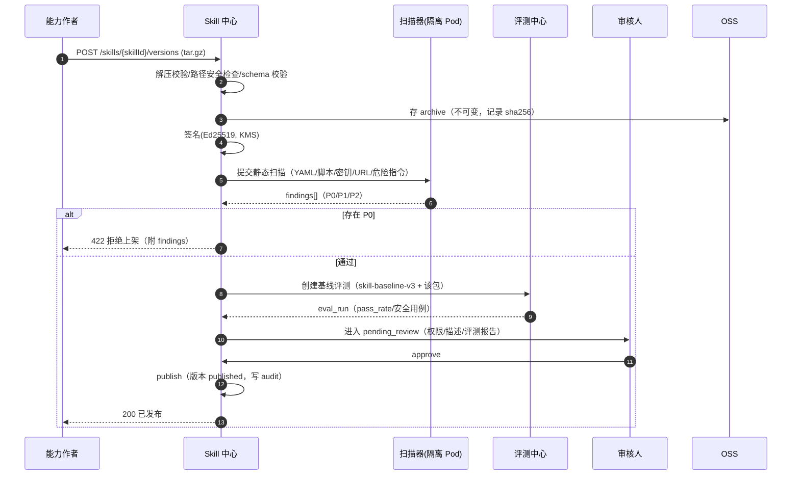
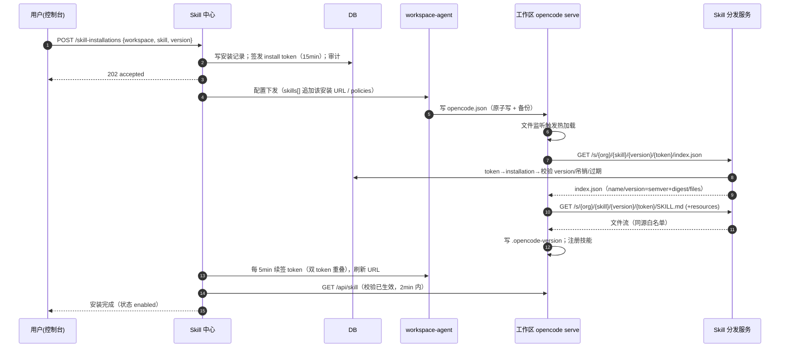
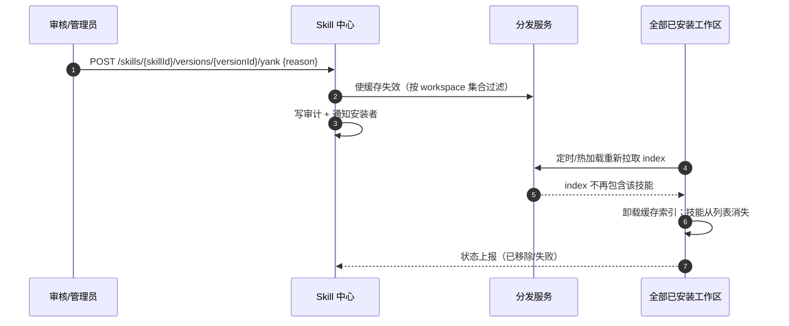

# Skill 中心（Skill Center）设计

- 版本：v0.1（P2 架构 · 能力中心分册）
- Owner：capability-centers；评审：architect（G2）、qa-reviewer、platform-backend
- 需求映射：R4.1–R4.6；实现目录：`services/skill-center/`
- 上游依据：`packages/schema/src/skill.ts`、`packages/core/src/skill/discovery.ts`、`packages/core/src/config/plugin/skill-file.ts`、`packages/schema/src/config.ts`（`skills`/`policies`）、`packages/server/src/handlers/skill.ts`

---

## 1. 职责与范围

Skill 中心是"能力的生产 → 审核 → 分发 → 安装 → 回滚"闭环，**不执行技能**；执行永远发生在用户的工作区（`opencode serve`）。

| In Scope | Out of Scope |
| --- | --- |
| Skill 包规范、校验器、semver、签名 | 在中心侧运行技能（由评测中心沙箱承担） |
| 注册/上传/审核/发布/下架/紧急撤回 | 技能运行时引擎（opencode 原生） |
| 按用户/项目安装、启用、升级、回滚、卸载 | 用户自定义私有技能的全量托管（MVP 允许"本地目录"旁路） |
| 版本化 URL 源分发（对接 `skills: string[]`） | 技能内容翻译/二次编辑 |
| 静态安全扫描 + 评测准入 + 权限展示 | 计费（仅产出用量事件给治理模块） |
| 安装量/启用/评分统计 | 社区评论审核（P2） |

**核心设计约束**：opencode 的 URL 技能源是无鉴权头、无客户端签名的普通 `GET`（`SkillDiscovery` 只用 `HttpClientRequest.get(url)`）。因此平台只能用**不可猜测的稳定能力 URL（capability URL）**做分发，并把"安装集合"编码在该 URL 对应的服务端状态里。参见 §5。

---

## 2. 概念模型

```
Skill（逻辑技能，跨版本稳定）
  └── SkillVersion（semver 版本，不可变制品）
        ├── Package（archive: SKILL.md + skill.yaml + resources）
        ├── ScanReport（静态扫描）
        └── EvalRunRef（发布准入评测）
SkillInstallation（工作区 × 技能 × 模式 × 版本）
SkillReview（评分/反馈）
SkillSourceToken（工作区分发凭证，按安装集合动态解析 index.json）
```

### 2.1 生命周期状态机

**Skill 级**：`draft → active → deprecated → delisted`（`blocked` 为紧急撤回终态，可由平台管理员从任意状态进入）

**版本级**：
```
draft ──submit──> scanning ──pass──> pending_review ──approve──> approved ──publish──> published
  │                  │                    │                         │                    │
  │                  └──fail──> rejected  └──reject──> rejected     └──────────────> yanked（撤回）
  └──（编辑/删除）                          published ──patch──> published（新版本）
```
- `published` 版本不可变；任何修改必须新版本。
- `yanked`：不再出现在任何 index.json，已安装实例在下一次同步时被移除并告警；`yanked_reason` 必填。
- `blocked`（平台级）：立即从所有源移除，关联工作区下次同步生效（≤2min），并写入审计 + 通知安装者。

---

## 3. 包规范

### 3.1 归档格式

- 上传格式：`.tar.gz`（也接受 `.zip`）。**MVP 上限：单包 ≤10MB**（lead Q3 裁决），解压后 ≤64MB、文件数 ≤500；超过 10MB 的包走**异步分发**（见 §5.5），不阻塞上传但首次可用延后。
- 根目录布局：

```
<archive root>/
├── SKILL.md            # 必需；opencode 原生识别
├── skill.yaml          # 必需；平台清单（审核/签名/权限/资源），不进入分发索引
├── references/...      # 可选资源
├── scripts/...         # 可选资源（仅作为文件，由工作区自行决定是否执行）
└── assets/...
```

- **skill.yaml 不参与分发**：分发 index 只列出 `SKILL.md` 与 `resources[].path`，避免把审核元数据暴露给使用者。
- 安全校验（与上游 `isSafeRelativePath` 对齐）：拒绝绝对路径、`..`、反斜杠、URL、`?`/`#`、NUL；解压时**不使用** `tar` 原始路径，按规范化后路径落盘并二次校验 `realpath` 在前缀内（防 zip-slip/符号链接逃逸）。

### 3.2 SKILL.md frontmatter（平台强约束子集）

上游只解析：`name`、`description`、`metadata`（任意对象）、`disable-model-invocation`。平台规范：

```yaml
---
name: pdf-report            # 必填，^[a-z0-9][a-z0-9-]{1,63}$，全局唯一（org 内唯一 slug）
description: "把 CSV/JSON 数据生成结构化 PDF 报告。当用户要求导出报表、生成 PDF 时使用。"  # 必填，≤1024 字符
disable-model-invocation: false   # 可选；true 表示仅允许用户显式调用
metadata:
  opencode/autoinvoke: true       # 可选；与 disable-model-invocation 冲突时以 opencode/autoinvoke 为准（上游实现）
  opencloud/display-name: "PDF 报告生成"
  opencloud/tags: ["report", "pdf"]
---
```
- **禁止**在 frontmatter 写平台专属的 `version/permissions/signature` 等字段：上游 schema 会丢弃未知键，导致"看起来生效实际不生效"；版本与权限只放 `skill.yaml`。
- 描述质量门槛：仅含"use this skill"之类空描述会被告警（影响可发现性评分）；`description` 是模型自动选择技能的唯一依据。

### 3.3 skill.yaml（平台清单，JSON Schema 校验）

```yaml
schema_version: 1
name: pdf-report
version: 1.2.3                 # semver 2.0，必填；发布后不可改
entry: SKILL.md
license: Apache-2.0
compatibility: { min_opencode: "2.2.0", max_opencode: "2.x" }
resources:                     # 显式声明随包分发文件（白名单，未声明不下载）
  - { path: references/format.md, kind: doc }
  - { path: scripts/render.py, kind: script }
permissions:                   # 声明式；用于审核/评测/安装前提示（见 §3.4）
  tools: [bash, read, write, webfetch]
  network: { egress: ["api.example.com"], rationale: "获取汇率" }
  secrets: [REPORT_API_KEY]
  filesystem: { read: ["**"], write: ["./out/**"] }
  mcp: [github]
dependencies:
  skills: []                   # 同上架组织的技能，semver range
  mcp: []
  runtime: { python: "3.11" }
```

JSON Schema 上架为 `skill-package.schema.json`；校验器在**上传时**与**发布时**各执行一次（防止审核后被替换，尽管制品不可变）。

### 3.4 权限声明的真实强制力（必须写清）

Skill 本质是**给模型的指令**，不是可插桩的进程。平台不谎称"技能权限沙箱"，强制力分三层：

| 层 | 机制 | 覆盖 |
| --- | --- | --- |
| 可用性 | `policies: [{action:"skill.use", resource:"<skill_id>", effect:"allow|deny"}]`（上游 `packages/schema/src/config/policy.ts` 已支持） | 未安装/未授权的技能不可被 `skill` 工具加载 |
| 工具边界 | workspace-agent 生成的 `policies`（`tool.use`）+ agent 配置 | 技能声明之外的 shell/网络类工具可被策略拒绝；这是**提示 + 策略**，非硬隔离 |
| 环境边界 | 工作区 Pod 的 NetworkPolicy、只读挂载、密钥按需注入 | 即使技能诱导模型外联，出口仍受白名单限制 |

因此：安装页面必须展示 `permissions` 并给出"技能将获得与你相同的工具权限"的明确提示（不能宣称仅授予声明权限）。高风险声明（`network.egress: ["*"]`、`secrets`、`bash`）触发**人工审批 + 评测中心专项安全用例**。

### 3.5 签名与完整性

| 对象 | 算法/格式 | 验证方 | 说明 |
| --- | --- | --- | --- |
| 归档 | `sha256` 全量摘要 + Ed25519 detached 签名（KMS 托管密钥，`kid` 标识） | 上传服务、评测中心、workspace-agent（下载归档时） | 签名对象 = 规范化后的 `SHA256SUMS`（逐文件）+ `skill.yaml` 原文哈希 |
| 分发 index | JWS（Ed25519）响应头 `X-OC-Signature` + `ETag: sha256` | 网关可选校验；平台侧审计 | opencode 原生不校验，因此**不能**把签名当作对运行时的保护 |
| 镜像（后续） | cosign keyless | 集群准入 | 若 M5.3 支持 OCI 分发再启用 |

签名链：`SkillVersion.signature` + `signing_key_id` 入库；密钥年轮换，历史公钥保留在 `/skill-source/keys`。

---

## 4. 数据模型（PostgreSQL，增量表）

> 公共表 `orgs/users/workspaces/audit_logs` 归 architect；本表只引用。所有表含 `org_id` 并启用 RLS。

```sql
CREATE TABLE skills (
  id                uuid PRIMARY KEY DEFAULT gen_random_uuid(),
  org_id            uuid NOT NULL REFERENCES orgs(id),
  slug              text NOT NULL,                       -- org 内唯一
  display_name      text NOT NULL,
  summary           text NOT NULL,
  category          text NOT NULL,
  tags              text[] NOT NULL DEFAULT '{}',
  visibility        text NOT NULL DEFAULT 'org',         -- org | public
  owner_user_id     uuid NOT NULL REFERENCES users(id),
  status            text NOT NULL DEFAULT 'draft',       -- draft|active|deprecated|delisted|blocked
  latest_version_id uuid,
  install_count     integer NOT NULL DEFAULT 0,          -- 异步聚合
  rating_avg        numeric(3,2),
  rating_count      integer NOT NULL DEFAULT 0,
  created_at        timestamptz NOT NULL DEFAULT now(),
  updated_at        timestamptz NOT NULL DEFAULT now(),
  UNIQUE (org_id, slug)
);

CREATE TABLE skill_versions (
  id              uuid PRIMARY KEY DEFAULT gen_random_uuid(),
  skill_id        uuid NOT NULL REFERENCES skills(id),
  org_id          uuid NOT NULL,
  semver          text NOT NULL,
  status          text NOT NULL DEFAULT 'draft',         -- draft|scanning|pending_review|approved|published|rejected|yanked
  manifest        jsonb NOT NULL,                        -- skill.yaml 解析结果
  readme_md       text,
  changelog       text,
  archive_key     text NOT NULL,                         -- OSS object key
  archive_sha256  text NOT NULL,
  archive_bytes   integer NOT NULL,
  signature       text NOT NULL,
  signing_key_id  text NOT NULL,
  scan_report     jsonb,                                 -- {engine, findings[], blocked}
  distribution_ready boolean NOT NULL DEFAULT true,      -- >10MB 异步分发完成后置 true（§5.5）
  eval_run_id     uuid,                                  -- eval_runs.id（发布准入）
  submitted_by    uuid NOT NULL,
  reviewed_by     uuid,
  review_comment  text,
  published_at    timestamptz,
  yanked_at       timestamptz,
  yank_reason     text,
  created_at      timestamptz NOT NULL DEFAULT now(),
  UNIQUE (skill_id, semver)
);
CREATE INDEX ON skill_versions (skill_id, status);

CREATE TABLE skill_installations (
  id             uuid PRIMARY KEY DEFAULT gen_random_uuid(),
  org_id         uuid NOT NULL,
  user_id        uuid NOT NULL REFERENCES users(id),
  workspace_id   uuid NOT NULL REFERENCES workspaces(id),
  skill_id       uuid NOT NULL REFERENCES skills(id),
  version_id     uuid NOT NULL REFERENCES skill_versions(id),
  mode           text NOT NULL,                          -- user | project
  project_path   text,                                   -- mode=project 时的项目相对路径
  state          text NOT NULL DEFAULT 'installing',     -- installing|enabled|disabled|failed|removed
  pinned         boolean NOT NULL DEFAULT true,
  last_synced_at timestamptz,
  created_at     timestamptz NOT NULL DEFAULT now(),
  UNIQUE (workspace_id, skill_id, mode, COALESCE(project_path,''))
);
CREATE INDEX ON skill_installations (workspace_id, state);

CREATE TABLE skill_source_tokens (
  id              uuid PRIMARY KEY DEFAULT gen_random_uuid(),
  installation_id uuid NOT NULL REFERENCES skill_installations(id) ON DELETE CASCADE,
  workspace_id    uuid NOT NULL REFERENCES workspaces(id),
  org_id          uuid NOT NULL,
  token_hash      text NOT NULL,                         -- HMAC-SHA256(token, server_secret)
  expires_at      timestamptz NOT NULL,                  -- TTL 15min；agent 每 5min 续签（双 token 重叠）
  revoked_at      timestamptz,
  last_used_at    timestamptz,
  created_at      timestamptz NOT NULL DEFAULT now()
);
CREATE INDEX ON skill_source_tokens (installation_id, expires_at);

CREATE TABLE skill_reviews (
  id         uuid PRIMARY KEY DEFAULT gen_random_uuid(),
  skill_id   uuid NOT NULL REFERENCES skills(id),
  version_id uuid,
  user_id    uuid NOT NULL,
  org_id     uuid NOT NULL,
  rating     smallint NOT NULL CHECK (rating BETWEEN 1 AND 5),
  comment    text,
  created_at timestamptz NOT NULL DEFAULT now(),
  UNIQUE (skill_id, user_id)
);

CREATE TABLE skill_usage_daily (                          -- 由事件聚合，非实时真值
  day            date NOT NULL,
  org_id         uuid NOT NULL,
  skill_id       uuid NOT NULL,
  workspace_id   uuid,
  installs       integer NOT NULL DEFAULT 0,
  activations    integer NOT NULL DEFAULT 0,             -- 来自工作区事件上报
  errors         integer NOT NULL DEFAULT 0,
  PRIMARY KEY (day, org_id, skill_id, workspace_id)
);
```

审核动作、发布、下架、安装、回滚全部写 `audit_logs`（action 前缀 `skill.*`）。

---

## 5. 分发：URL 源与 opencode 对接（本文件最关键的一节）

### 5.1 上游行为（已核实，决定平台设计）

`packages/core/src/skill/discovery.ts`：

1. 配置值以 `http(s)://` 开头 → `Skill.UrlSource`；`pull(url)` 把 URL 规范为以 `/` 结尾。
2. 拉取 `new URL("index.json", base)`，JSON 结构：
   ```json
   { "skills": [ { "name": "pdf-report", "version": "1.2.3", "files": ["SKILL.md", "references/format.md"] } ] }
   ```
3. 每个技能目录 = `<base>/<name>/`，逐文件 GET；文件必须与 index **同源**（`resource.origin !== source.origin` 直接丢弃）。
4. 目录内必须有 `SKILL.md` 或 `<name>.md`，否则该技能被忽略。
5. `version` 存在且与本地 `.opencode-version` 相同 → 跳过下载（缓存命中）；不同 → staging 下载 + 原子 rename（失败回滚）。`version` 缺省则每次都下载。
6. 缓存目录按 `hash(base)` 隔离 → **换 token（换 URL）= 换缓存根目录**，天然支持"安装集合变化"时全量刷新。
7. 路径安全：`isSafeSegment`/`isSafeRelativePath` 已拦 `..`、`/`、`\`、绝对路径、URL、`%2e%2e` 等（平台仍需在服务端做同样校验，防止伪造 index）。

### 5.2 分发 URL：路径令牌（禁止 query string）

> **硬约束（architect 已核实）**：`SkillDiscovery.pull` 用 `new URL("index.json", base)` 与 `new URL("<name>/", base)` 解析子资源，**base 的 query 会被丢弃**。因此签名/令牌只能放**路径**，不能放 query string；同时所有文件 URL 的 origin 必须与 index 相同（不能用跨域 CDN）。

采用**每安装项一个源 URL**（`skills` 是数组，天然支持）：

```jsonc
"skills": [
  "https://skills.<domain>/s/<org_slug>/<skill_slug>/<version>/<token>/",
  "https://skills.<domain>/s/<org_slug>/<other_slug>/<version>/<token>/"
]
```

- URL 结构：`/s/{org_slug}/{skill_slug}/{version}/{token}/index.json`；文件从 `/s/{org_slug}/{skill_slug}/{version}/{token}/{file}` 拉取。`name` 段 = `skill_slug`（安全路径段）；`files` 必含 `SKILL.md`（否则上游静默丢弃）。
- `<token>`：32 字节随机 base64url；DB 只存 `HMAC-SHA256(token)`；绑定 `workspace_id + installation_id + version_id`；**TTL 15 分钟**（可配 5–30），**每次拉取只读、只覆盖该一个安装项**。
- **续期机制**（解决"上游随时重拉、配置不能刷新"的矛盾）：workspace-agent 每 **5 分钟**为每个已启用安装重签 token，并以**双 token 重叠窗口**（旧 token 剩余 10 分钟有效时写入新 URL）原子更新 `skills` 配置；文件监听热加载。稳态开销：1000 工作区 × 每人 5 个技能 / 300s ≈ 17 次/秒 index 请求，文件因 `version` 命中不重下（`version = semver+digest`）。
- **续期失败降级（architect 要求，已写入 ADR-010）**：续签连续失败 3 次 → ①保留旧 token 至其自然过期（不吊销，避免已装技能立刻失效）；②告警 `skill_source_renew_failed`；③**停止刷新工作区配置**（绝不把 401 URL 写进 `opencode.json`）；④恢复后续签成功再继续刷新，必要时提示用户"技能源暂不可更新，已装技能仍可用"。
- 离线/企业内网场景：允许**目录源**（`skills: ["/home/opencode/.config/opencode/skills"]`），由 agent 将已安装技能落盘（注意上游还会扫 `~/.claude/skills`、`.agents/skills`、`.opencode/skill(s)`）；线上默认走 URL 源（可撤销、可计量、可审计）。
- 服务端处理：校验 token（未过期、绑定匹配、未吊销）→ 校验 `org_slug/skill_slug/version` 与安装项一致 → 返回单技能 index；文件路由校验 `file` 在 `files` 白名单内（与上游 `isSafeRelativePath` 同规则）→ 从 OSS 流式返回（`Cache-Control: private, no-store` + `ETag`）。
- 吊销：卸载/下架/封禁 → token 立即 revoke → 上游下一次 index 请求 404；因 URL 含 token，**缓存根随 token 变化**（`hash(base)`），不会读到旧内容。
- 不暴露 OSS 永久 URL；token/签名密钥绝不入日志；`GET /internal/skills/{skillId}/source-token` 仅返回给本人且写审计。

> 若安全评审坚持"token ≤10min 且不刷新"：技术上不可行（opencode 无 token 刷新能力，配置里的 URL 是静态的）。本方案的 15min TTL + 5min 主动续期已达到同等安全强度，且不引入随机失效。此决策需 architect 在 openapi/architecture 中确认。

### 5.3 安装/启用/回滚的生效链路

- 安装（用户级）：写 `skill_installations` → 为该安装签发分发 token → 通过 workspace-agent 配置通道把该安装的源 URL 追加进工作区全局 `opencode.json` 的 `skills` 数组 → 上游文件监听 → `SkillDiscovery.pull` → `GET /api/skill` 出现该技能。**升级/回滚 = 替换该安装项 URL（含 version + token），不触碰其它技能**（原子、可回滚、互不影响）。
- 项目级：`mode=project` 时，workspace-agent 在 `/workspace/<project>/opencode.json` 写入**该项目专属 token** 的源 URL（服务端校验 token 的 installation 属于该项目），仅在打开该项目时生效。若项目已有用户手写配置，agent 只**合并** `skills` 数组，不覆盖其它键（写前备份 + 冲突上报）。
- 启用/禁用：禁用 = 从 `skills` 数组移除该 URL（模型看不到该技能，最干净）；`policies` 的 `skill.use` deny 作为二次兜底（防止用户绕平台手填 URL）。
- 升级：默认 `pinned=true`（用户选定版本），支持 `follow_latest`；升级仅换 URL（version 段变化），回滚 = 换回旧版本 URL（旧版本制品永久保留）。R4.3 "发布→安装→可用 ≤2min"：配置下发 ≤5s + index ≤150ms + 文件拉取（≤10MB）≤30s + 缓存重建 ≤5s，余量用于重试。
- 卸载：删除安装记录 → 吊销 token → 从 `skills` 数组移除 URL；本地缓存目录因 URL 消失而不可达，由工作区日常清理任务回收（不影响正确性）。

### 5.4 与上游的映射表

| 平台对象 | opencode 配置/接口 | 备注 |
| --- | --- | --- |
| 已启用安装 | `skills: [<per-install source URL>]` | 每安装项一条 URL：升级/回滚只换对应条目 |
| 版本 | URL 的 `version` 段 + index `version` 字段 | 驱动 `.opencode-version` 缓存判断；URL 变化=缓存根变化 |
| 技能元数据 | `SKILL.md` frontmatter `name/description/metadata` | 平台只映射这些键 |
| 启用/禁用 | `policies[{action:"skill.use",resource:skill_id,effect}]` | 用户级配置 + 托管策略兜底 |
| 运行时查询 | `GET /api/skill`（`skill.list`） | 用于"已生效"校验，不用于计量 |
| 显式调用 | `POST /api/experimental/session/:id/skill`（baseline §2.3） | 用于统计"激活次数"的辅助信号 |

> 名称冲突：不同技能 `SKILL.md` 的 `name` 可能重复，但上游按**目录名**生成 ID（`skill-file.ts` 中 `path.basename(dirname(filepath))`），因此分发目录名必须唯一（= slug）。跨组织同名技能通过 slug 命名空间规避（`<name>` 已全局唯一约束在 index 内）。

### 5.5 大于 10MB 的包：异步分发（lead Q3）

- **同步通道（MVP 主路径）**：单包 ≤10MB，上传即校验、即发布，满足 R4.3 "≤2min 可用"。
- **异步通道（>10MB）**：上传后状态 `validating → packaging`；平台在 OSS 侧完成解压校验/扫描/签名/复制到分发缓存（不阻塞请求），期间安装页显示"技能包准备中（约 N 分钟）"，`skill_installs.state=preparing`，`source-url` 暂不返回 200，返回 `409 skill_package_preparing`（带 `retry_after`）。
- 准备完成 → `skill_versions.status=published` 且 `distribution_ready=true` → 才允许安装；**SLA ≤10min**（E4-03② 的异步承诺）。
- 失败 → `distribution_failed`（原因：解压超限/扫描 P0/签名失败），需作者重新上传或平台重试；重试幂等（同 digest 不重复打包）。
- 异步任务与同步通道共用同一套扫描/签名/评测 gate，**不能**用异步通道绕过任何检查。

---

## 6. API 草案（tag: `skill`）

| 方法 | 路径 | 说明 |
| --- | --- | --- |
| GET | `/api/v1/skills` | 列表；`q/category/tag/visibility/mine/status`，cursor 分页 |
| GET | `/api/v1/skills/by-slug/{org_slug}/{skill_slug}` | 按 slug 解析（返回与 `{id}` 相同结构） |
| POST | `/api/v1/skills` | 创建（`slug/display_name/summary/category/visibility`）→ `201 {id,status}` |
| GET | `/api/v1/skills/{skillId}` | 详情（含 latest、权限摘要、评分、安装数） |
| PATCH | `/api/v1/skills/{skillId}` | 元数据/可见性（不改版本） |
| POST | `/api/v1/skills/{skillId}/versions` | `multipart` 上传归档 + `changelog`；同步返回校验结果；`201 {version_id,status:"scanning"}` |
| GET | `/api/v1/skills/{skillId}/versions` | 版本列表（含状态、扫描、评测） |
| GET | `/api/v1/skills/{skillId}/versions/{versionId}` | 版本详情（manifest、权限、signature、scan_report） |
| POST | `/api/v1/skills/{skillId}/versions/{versionId}/submit-review` | 提交审核；返回 `SkillVersionSummary`（非 `{ok}`） |
| POST | `/api/v1/skills/{skillId}/versions/{versionId}/review` | `{decision:"approve"|"reject", comment}`；返回 `SkillVersion` 资源体；需 `skill.reviewer` |
| POST | `/api/v1/skills/{skillId}/versions/{versionId}/publish` | 发布；返回 `SkillVersion` 资源体；校验 `scan_ok && eval_gate_ok`，否则 `409 precondition_failed` + `reason=gate_blocked`（`details.gate_kind`） |
| POST | `/api/v1/skills/{skillId}/versions/{versionId}/yank` | `{reason}`；立即从所有源移除；返回 `SkillVersion` 资源体 |
| POST | `/api/v1/skills/{skillId}/versions/{versionId}/rollback` | 按 `versionId` 回滚（重新发布）；返回 `SkillVersion` 资源体 |
| POST | `/api/v1/skills/{skillId}/block` | 平台管理员紧急撤回（全部版本）**（P2）** |
| GET | `/internal/skills/{skillId}/source-token` | 返回当前用户的安装源 URL（含 token，仅本人可见；审计记录） |
| POST | `/api/v1/skill-installations` | `{workspace_id, skill_id, version_id?|latest, mode, project_path?}` → `202` |
| GET | `/api/v1/skill-installations` | 按工作区/技能过滤 |
| PATCH | `/api/v1/skill-installations/{installationId}` | `{state:"enabled"|"disabled"}` |
| POST | `/api/v1/skill-installations/{installationId}/rollback` | `{version_id}` **（P2）** |
| DELETE | `/api/v1/skill-installations/{installationId}` | 卸载 |
| GET | `/api/v1/skills/{skillId}/stats` | 安装/激活/评分趋势（按天） |
| POST | `/api/v1/skills/{skillId}/reviews` | `{rating, comment?}`，每人每技能一条（upsert）**（P2）** |
| GET | `/internal/skills/source-keys` | 历史签名公钥（分发用，非 v1 API 网关） |

内部/分发端点（独立子域，不鉴权 OIDC，仅 token）：

| 方法 | 路径 | 说明 |
| --- | --- | --- |
| GET | `/s/{org_slug}/{skill_slug}/{version}/{token}/index.json` | 单安装项索引（`Cache-Control: no-store`）；**令牌在路径**，禁止 query |
| GET | `/s/{org_slug}/{skill_slug}/{version}/{token}/{file}` | 技能文件；同源、白名单、路径校验（对齐上游 `isSafeRelativePath`） |
| GET | `/skill-source/keys` | 历史签名公钥（Ed25519 `kid`） |

> 跨域约束：index 与文件必须同 origin（上游校验），**不能**把文件托管在 CDN 子域；如需 CDN，须与源同域（反代）。

错误示例：
```json
{"error":{"code":"precondition_failed","reason":"gate_blocked","message":"skill version requires passing eval baseline","details":{"gate_kind":"eval","eval_run_id":"<uuid>","required_suite":"skill-baseline-v3","failed_cases_top5":["c007","c019"]},"request_id":"<uuid>"}}
```
> 错误码规则（architect 契约，两层模型）：`code` 用通用分类（`precondition_failed`/`forbidden`/…），领域原因放 `reason`；wire 值一律 `lower_snake`。发布被门禁拒绝 → `409 precondition_failed` + `reason=gate_blocked`（`details.gate_kind ∈ eval|scan|permission`）；评测运行本身失败是业务态 → `200` + `eval_runs.status=failed`，不是错误。

---

## 7. 关键序列图

### 7.1 发布（含扫描 + 评测准入）



### 7.2 安装与 opencode 生效



### 7.3 下架/撤回传播


> 时限承诺：撤回在**下一次拉取**生效；平台通过 workspace-agent 主动触发配置 touch（≤30s）+ 推送事件（≤2s 展示），实测目标 ≤2min（与 R4.3 同量级）。

---

## 8. 安全边界（逐条可测）

| # | 风险 | 场景 | 控制 | 测试用例 |
| --- | --- | --- | --- | --- |
| S1 | 恶意指令/提示注入 | SKILL.md 指示模型外传工作区代码或密钥 | 高危模式扫描（exfil 关键词+URL+base64 长串）；评测安全用例；工作区网络白名单；审计告警 | 构造含"读取 .env 并 POST 到外部"的技能，必须被扫描 P0 拦截 |
| S2 | 任意代码执行 | 技能附带脚本诱导模型执行 | 技能本身不自动执行；脚本仅作为资源；`tool.use` 策略可禁 shell；工作区非 root + 只读根 + netpol | 沙箱内执行脚本不得触达外网/宿主 |
| S3 | SSRF（上传/扫描阶段） | 归档内含远程资源 URL，扫描器/预览去抓取 | 扫描器不发起任意 URL 请求；如需抓取，仅走 egress-proxy 白名单 | 包内 `http://169.254.169.254/` 不得被访问 |
| S4 | zip-slip / 符号链接逃逸 | 归档含 `../../etc/passwd` 或 symlink | 规范化路径 + 前缀 realpath 校验；禁止 symlink/hardlink 条目 | 逃逸测试用例 100% 拦截 |
| S5 | Token 泄露 | 控制台/日志/截图泄露分发 token | token 仅一次性展示 + 可轮换；日志脱敏；token 只对本人工作区有效、只读安装集合；撤销即时生效 | 用 A 的 token 访问 B 集合 → 404 |
| S6 | 供应链替换 | 审核通过后替换制品 | 版本不可变 + sha256 + 签名；发布时复算；OSS 对象 WORM/版本化 | 篡改 OSS 对象后发布/分发必须失败 |
| S7 | 越权发布 | 普通成员直接发布 | RBAC `skill.publish`/`skill.review` 分离（发布者 ≠ 审核者）；服务端校验 org 归属 | 成员调用 publish → 403 |
| S8 | 越权安装公开技能 | 用户安装未授权 org 的私有技能 | 可见性 + 组织授权校验；安装接口按 `visibility` 与 org 白名单 | 跨租户安装 → 404 |
| S9 | 评分刷量 | 批量刷安装/评分 | 每用户每技能一条评分；安装量按 workspace 去重；异常检测（同 IP 高频） | 重复评分不叠加 |
| S10 | 元数据注入 | frontmatter 注入 HTML/脚本 | 前端渲染用白名单 Markdown；CSP；服务端转义 | XSS 扫描 0 |

**平台侧不得宣称**："技能只能使用声明的工具"。实际口径见 §3.4。

---

## 9. 扫描与统计

### 9.1 静态扫描（MVP 集成开源引擎，自研规则层）

| 类别 | 规则示例 | 级别 |
| --- | --- | --- |
| 密钥 | AWS key、私钥块、`ghp_`、JWT、高熵字符串 | P0 |
| 危险指令 | `curl ... \| sh`、`rm -rf /`、`chmod 777`、`eval(base64...)`、`socket`/`nc` 反弹 | P0/P1 |
| 外联 | 硬编码外部域名 / webhook / 短链 | P1 |
| 指令质量 | 描述空洞、超长（>32KB 上下文预算）、与声明权限不一致 | P2 |
| 供应链 | 脚本 `npm install` 未锁版本、`pip install` 无 hash | P1 |
| 隐私 | 包内含 `.env`、token、内部 IP、个人信息 | P0 |

扫描在**隔离 Pod**（无网、只读源、临时 emptyDir）运行；结果存 `scan_report`，P0 阻断发布。

### 9.2 统计与评分

- 安装量：`skill_installations` 聚合（enabled 去重，按 workspace）。
- 激活量：workspace-agent 从上游事件流采集 `skill` 相关事件（`skill.updated` + 显式调用端点），5min 批量上报；**标注为近似值**（上游无逐次调用计量）。
- 评分：1–5 星 + 可选评论；`rating_avg` 用贝叶斯平滑（`(sum + 4*3.5) / (count + 4)`）避免 1 条 5 星排第一。
- 榜单：安装量/评分/最近更新，组织内与平台公开分开；不展示个人安装明细给作者（隐私）。

---

## 10. MVP 与迭代切分

| 切片 | 交付 | 验收 |
| --- | --- | --- |
| **M5.1** | 包规范 + JSON Schema 校验器；上传/版本/发布/下架；URL 源分发（token + index.json）；用户级安装/启用/回滚；`skills` 注入 + 热加载验证；审计 | 发布→安装→`GET /api/skill` 可见 ≤2min；回滚后版本一致；跨租户不可见 |
| **M5.2** | 静态扫描（P0 阻断）+ 评测准入 gate；审核流（提交/批准/拒绝）；权限展示 + 高危审批；项目级安装；评分 | 高危包不可发布；未过基线评测发布返回 `409 precondition_failed + reason=gate_blocked`；项目级安装仅在对应项目生效 |
| **M5.3** | 统计看板；评分榜单；签名轮换；分发缓存优化；技能推荐；紧急撤回演练 | 撤回 ≤2min 传播到 95% 在线工作区；签名轮换不影响已安装实例 |

**MVP 不做的**：OCI 分发、技能依赖自动解析、私有技能外部分享、评论审核、A/B 推荐。

---

## 11. 可观测与 SLO

| 指标 | 目标 | 告警 |
| --- | --- | --- |
| 发布接口 p95 | < 800ms（不含扫描/评测异步） | > 1s 持续 5min |
| 上传校验失败率 | < 10%（作者可修正） | 突增 3x |
| 分发 index p95 | < 150ms | > 500ms |
| 安装→生效 p95 | ≤ 2min | > 5min |
| 扫描队列积压 | < 20 | > 100 |
| 拉取 4xx/5xx | < 0.5% | > 2% |

日志：结构化 JSON，`org_id/workspace_id/skill_id/version_id/request_id`，token/签名密钥永不入日志。

---

## 12. 待对齐 / 风险

| # | 事项 | 影响 | 处理 |
| --- | --- | --- | --- |
| K1 | 分发子域与网关归属（A3） | token 校验位置 | 默认独立子域 + 控制面校验；architect 确认 |
| K2 | `skills` 配置在项目级配置的合并语义 | 项目级安装 | workspace-agent 只合并该键，写前快照；纳入 BACKEND.md 对齐 |
| K3 | 技能调用计量的上游信号 | 统计精度 | 明确标注近似；若上游后续提供 usage 事件再升级为精确 |
| K4 | 签名验证的执行方（opencode 不验证） | 安全叙事 | 只在平台/agent 侧验证；文档不夸大 |
| K5 | OSS 对象锁/WORM 能力 | 制品不可变 | 依赖 OSS 版本控制 + 应用层 digest 校验；infra 确认 |
| K6 | 大包（>10MB）对 2min 生效目标 | 体验 | **MVP 上限 10MB**（lead Q3）；>10MB 走异步分发（OSS 预热 + 后台复制到分发缓存），安装页显示"准备中"，就绪后启用；M5.3 做分片/压缩优化 |

---

## 附录 A：`skill.yaml` JSON Schema（v1，供 DATA-MODEL/openapi 落列）

```json
{
  "$schema": "https://json-schema.org/draft/2020-12/schema",
  "$id": "https://schemas.opencode.cloud/skill-package-v1.json",
  "type": "object",
  "required": ["schema_version", "name", "version", "entry", "resources", "permissions"],
  "additionalProperties": false,
  "properties": {
    "schema_version": { "const": 1 },
    "name": { "type": "string", "pattern": "^[a-z0-9][a-z0-9-]{1,63}$" },
    "version": { "type": "string", "pattern": "^\\d+\\.\\d+\\.\\d+(-[0-9A-Za-z.-]+)?$" },
    "entry": { "const": "SKILL.md" },
    "license": { "type": "string" },
    "compatibility": {
      "type": "object",
      "additionalProperties": false,
      "properties": {
        "min_opencode": { "type": "string" },
        "max_opencode": { "type": "string" }
      }
    },
    "resources": {
      "type": "array",
      "maxItems": 500,
      "items": {
        "type": "object",
        "required": ["path", "kind"],
        "additionalProperties": false,
        "properties": {
          "path": { "type": "string", "pattern": "^(?!/)(?!.*(^|/)\\.\\.(/|$))[^\\\\?#]+$" },
          "kind": { "enum": ["doc", "script", "asset", "data"] }
        }
      }
    },
    "permissions": {
      "type": "object",
      "additionalProperties": false,
      "required": ["tools"],
      "properties": {
        "tools": {
          "type": "array", "uniqueItems": true,
          "items": { "enum": ["read", "write", "edit", "bash", "webfetch", "websearch", "task", "skill", "mcp", "pty"] }
        },
        "mcp": { "type": "array", "items": { "type": "string", "pattern": "^[a-z][a-z0-9_-]{1,63}$" }, "uniqueItems": true },
        "network": {
          "type": "object",
          "additionalProperties": false,
          "properties": {
            "egress": { "type": "array", "items": { "type": "string" }, "uniqueItems": true },
            "rationale": { "type": "string", "maxLength": 500 }
          }
        },
        "filesystem": {
          "type": "object",
          "additionalProperties": false,
          "properties": {
            "read":  { "type": "array", "items": { "type": "string" }, "uniqueItems": true },
            "write": { "type": "array", "items": { "type": "string" }, "uniqueItems": true }
          }
        },
        "secrets": { "type": "array", "items": { "type": "string", "pattern": "^[A-Z][A-Z0-9_]{1,63}$" }, "uniqueItems": true }
      }
    },
    "dependencies": {
      "type": "object",
      "additionalProperties": false,
      "properties": {
        "skills": { "type": "array", "items": { "type": "object", "required": ["name", "range"], "properties": { "name": { "type": "string" }, "range": { "type": "string" } } } },
        "mcp": { "type": "array", "items": { "type": "string" } },
        "runtime": { "type": "object", "additionalProperties": { "type": "string" } }
      }
    }
  }
}
```

**派生列（供 `skill_versions` 物化）**：`manifest.name`→`name`、`manifest.version`→`semver`、`manifest.permissions.tools/mcp/network.egress/filesystem/secrets`→`permissions jsonb`（GIN 索引，支持"按权限筛选高风险技能"）、`manifest.resources[]`→`resource_paths text[]`、`archive_sha256`→`checksum`、`signature`/`signing_key_id` 单列。

**与 opencode 的字段对应**：`SKILL.md` frontmatter 只承载 `name/description/metadata/disable-model-invocation`（上游 `skill-file.ts` 会丢弃未知键，因此版本/权限**不能**写进 frontmatter）；`skill.yaml` 是平台专属清单，不进入分发 index。
