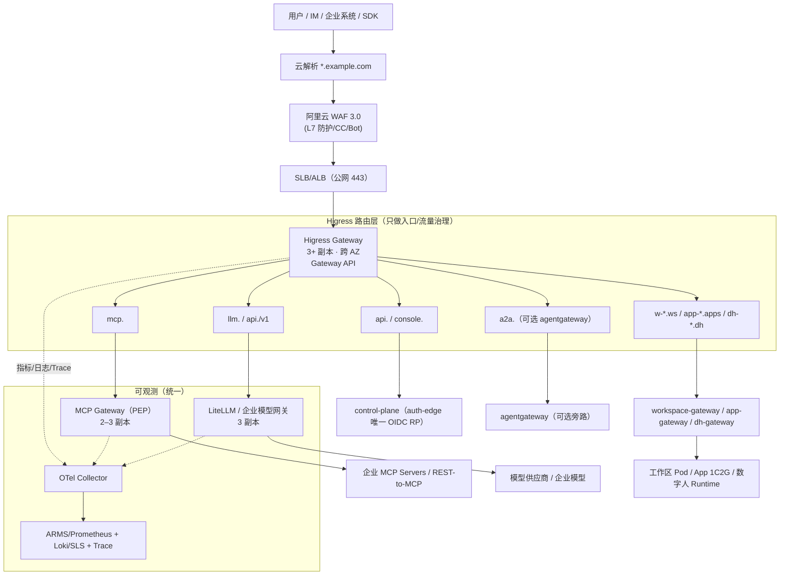

# 统一 AI 网关（Higress / agentgateway）与 7x24 运行架构

- 版本：v0.1（A4 / task-27 交付，待 Lead + architect 评审）
- 日期：2026-11-08
- 作者：`infra-devops`（基础设施 / SRE）
- 关联：[ARCH-V3.md](../ARCH-V3.md)（§0/§2/§4/§6/§10）、[DEPLOYMENT.md](DEPLOYMENT.md)（v2 部署基线）、[SECURITY.md](../SECURITY.md)、[adr/](../adr/)
- 写作用域：`docs/02-architecture/deploy/` + `deploy/gateway/`；**不 commit**
- 事实来源与访问日期见 §12（外部资料均为 2026-11-08 访问；标注 `[事实]` / `[推断]` / `[假设]`）

---

## 0. 结论摘要（TL;DR）

1. **生产默认 Higress on ACK**（CNCF Sandbox，一个网关同时承载 LLM 模型路由、MCP 代理、K8s 推理流量三类 AI 流量 `[事实]`）。理由：MCP 代理 + REST-to-MCP + 语义缓存 + Token 限流是**开箱插件**，与阿里云 SOFA/ACK/WAF/SLB 的落地路径成熟，且走 Gateway API 抽象不成锁定。
2. **agentgateway 作为可选数据面**（Solo 开源，Kubernetes 内置控制面 + Gateway API，MCP/A2A/LLM 原生 `[事实]`）。适用：A2A 多 Agent 互调、多云/非阿里云环境、需要 standalone 边缘部署；不作为 v3 默认主线。
3. **统一入口**：`Internet → WAF/TLS → Higress(public) → { MCP Gateway, Model Gateway, control-plane API, workspace, app, digital-human }`；RTC 媒体流**不进 WAF**，走独立四层 SLB/UDP（见 §4.6/§8）。
4. **网关只做入口与流量治理**；MCP 的**工具级授权/凭证/审计**在独立 MCP Gateway（PEP）执行（ARCH-V3 §4），避免把业务策略塞进网关插件——这是本设计最重要的边界。
5. **本地 dev 不引入完整 Higress**：保留 `services/local-gateway`（Bun，:8080，`*.localhost` 路由），新增 `deploy/gateway/local/` 的 Envoy/轻量 compose 与 Gateway API/MCP route **模板**（本地仅作语法与路由验证，不生效于生产）。
6. **7x24**：Higress 网关 ≥3 副本跨 AZ + HPA/KEDA + PDB；控制面/网关/数据面分层降级；Watchdog（只读诊断 → 人工确认 → 自动修复分阶段）；备份恢复以 GitOps + CRD/配置导出为主；灰度用 header/权重 + 副本灰度；成本量级见 §10（Higress 自身约 ¥0.6–1.2 万/月量级 `[推断]`，不含流量与 WAF）。
7. **关键风险**：Higress MCP 插件版本演进快（v2.2.x，MCP 2026-07-28 支持 `[事实]`）→ 用 `McpBridge/WasmPlugin` 抽象 + 版本锁定 + 回归；agentgateway 与 Higress 的 Gateway API 子集差异 → 只用共同子集（HTTPRoute/Gateway）+ 平台适配层。

---

## 1. 需求、流量类型与 SLO

### 1.1 五类流量（决定路由与治理策略）

| # | 流量 | 入口 | 典型协议 | 治理重点 |
|---|---|---|---|---|
| T1 | 控制面 API / 控制台 | `api.` / `console.` | HTTPS/JSON、SSE | SSO、RBAC、限流、审计 |
| T2 | **MCP 工具调用** | `mcp.` | streamable HTTP、SSE（兼容旧客户端） | 工具级 PEP、凭证注入、审计、结果截断 |
| T3 | **模型调用** | `llm.`（或 `api./v1`） | OpenAI 兼容（流式 SSE） | 虚拟 Key、预算、语义缓存、供应商 fallback |
| T4 | 工作区 / 应用 / 数字人 | `w-*.ws` / `app-*.apps` / `dh-*.dh` | HTTPS、WS、SSE；RTC 走独立四层 | access-ticket→cookie、Basic 注入、WS/SSE 长连接 |
| T5 | A2A（可选） | `a2a.` | HTTP/JSON-RPC | Agent 身份、任务幂等、Trace 串联 |

### 1.2 目标（与 ARCH-V3 / DEPLOYMENT 对齐）

| 指标 | 目标 | 说明 |
|---|---|---|
| 网关可用性 | **99.95%**（月度） | 多副本跨 AZ + PDB；单副本故障不中断 |
| 网关附加时延 p95 | **< 20ms**（T1/T2 非流式）、首字节 < 100ms（T3 流式） | 不含上游；语义缓存命中应更快 |
| MCP 工具调用成功率 | ≥99.5%（不含工具自身 5xx） | 网关 5xx < 0.5% |
| 模型调用成功率 | ≥99%（含 fallback 后） | 供应商故障时 fallback 生效 |
| SSE/WS 稳定性 | 异常断开 <1%/h；单连接 ≥30min | 超时 3600s，buffering off |
| 配置生效 | 路由/策略 ≤30s | Gateway API/CRD watch |
| 审计完整性 | MCP/模型/应用访问 100% 审计 | Trace + 结构化日志 + WORM 归档 |

---

## 2. 选型对比：Higress vs agentgateway

### 2.1 事实基线（2026-11-08）

| 维度 | Higress | agentgateway |
|---|---|---|
| 项目归属 | CNCF **Sandbox** 项目，开放治理 `[事实]`（[higress.cn](https://higress.cn/en/)、[CNCF](https://www.cncf.io/projects/higress/)） | Solo.io 开源（GitHub `agentgateway/agentgateway`），有企业版 `[事实]`（[agentgateway.dev](https://agentgateway.dev/docs/)） |
| 定位 | **一个网关三类 AI 流量**：LLM Gateway / MCP Gateway / Model Gateway（K8s Inference Extension）`[事实]` | Agent 连接：LLM 消费、MCP 连接、Agent(A2A) 连接 `[事实]`（[About](https://agentgateway.dev/docs/kubernetes/latest/documentation/about/)） |
| 部署形态 | K8s Gateway API / 独立部署；阿里云 AI 网关企业版（99.95% SLA）`[事实]` | **Standalone binary/Docker** 与 **Kubernetes（内置控制面 + Gateway API）** 两种 `[事实]` |
| MCP 能力 | MCP Server 托管/代理、**REST→MCP**、streamable HTTP/SSE、鉴权方案（securitySchemes/passthrough）、参数映射、请求/响应模板 `[事实]`（[MCP Server 插件文档](https://higress.io/en/docs/ai/mcp-server/)） | MCP connectivity（多 MCP server 聚合/路由）、A2A、LLM provider 连接 `[事实]`（文档导航 LLM/MCP/Agent） |
| 模型治理 | 多模型代理、权重/fallback、**语义缓存**、**Token 管理/限流** `[事实]`（[AI Gateway 首页](https://higress.cn/en/)） | LLM consumption + 路由；企业版含更多策略 `[推断]`（以官方文档为准） |
| 生态/实践 | 阿里云 SOFA AI 网关内核、携程/君润/今日投资等案例 `[事实]`（[SOFA 实践](https://higress.cn/blog/higress-gvr7dx_awbbpb_tng81uvf75an4l9u/)） | 多云/Agent 互操作导向；与 Solo 生态（Gloo/服务网格）集成 `[推断]` |
| 版本节奏 | v2.2.4（2026-10）；MCP 2026-07-28 支持 `[事实]`（站点 News） | Kubernetes 文档 1.7.x（latest，2026）`[事实]` |
| 锁定风险 | 中：WasmPlugin/McpBridge 是 Higress 专有 CRD | 中：AgentgatewayPolicy 等专有资源 |
| 与本项目契合 | **高**：ACK/阿里云 WAF-SLB、现有 LiteLLM、MCP Gateway 规划、成本可算 | 中：A2A 与多云是加分项，但 v3 主场景在阿里云 |

### 2.2 结论（ADR-GW-01，待 architect 落 ADR）

> **生产默认：Higress on ACK。agentgateway 作为可选数据面（A2A/多云/边缘独立部署），二者都通过 Gateway API 暴露统一抽象，业务侧只依赖域名与 HTTP 契约。**

决策理由：

1. **能力覆盖**：v3 需要模型路由 + MCP 代理 + 应用/工作区入口一体化；Higress 一个组件覆盖三类 AI 流量，减少一层自研网关 `[事实+推断]`。
2. **落地路径**：ACK + 阿里云 WAF/SLB/ARMS 的集成、SOFA 生产实践、企业版 SLA 兜底，风险最低 `[事实]`。
3. **成本**：Higress 开源版自建（3 副本）成本远低于商用 AI 网关；语义缓存可降低模型 token 成本 `[推断]`。
4. **不锁定**：统一用 Gateway API（Gateway/HTTPRoute）+ 域名契约；若切 agentgateway，只需替换 data plane 与少量策略 CRD。
5. **A2A 不是 MVP 硬需求**：A2A 用 agentgateway 作为**旁路**部署（`a2a.` 域名），不阻塞主线。

**何时切 agentgateway**（触发条件）：① 需要跨云/混合云统一数据面；② A2A 成为 P0；③ Higress MCP 插件无法满足某企业 MCP 协议（如特殊 SSE 语义）；④ 阿里云外部署。切换成本评估：路由迁移 ≤2 人日，策略 CRD 重写 ≤5 人日（以共同子集为准）。

### 2.3 备选与否决

| 方案 | 评价 | 结论 |
|---|---|---|
| A. Higress 自建（ACK） | 能力全、成本可控、需运维网关 | **采纳（默认）** |
| B. agentgateway 作为主数据面 | MCP/A2A 原生、轻量；阿里云生态集成弱、企业 SLA 需商业版 | 采纳为**可选旁路** |
| C. 阿里云 AI 网关商业版 | 托管、SLA 99.95%；按量计费、定制插件受限 | P2 兜底（合规/大促峰值） |
| D. 仅用 ingress-nginx + LiteLLM | 无 MCP 代理/REST-to-MCP、AI 治理弱 | 否决（v2 方案，v3 不满足） |
| E. 自研 Go 网关 | 可控但重复造轮子，MCP 协议演进快 | 否决 |

---

## 3. 统一入口拓扑

### 3.1 拓扑图（生产 ACK）



### 3.2 域名与职责矩阵

| 域名 | 上游 | 认证 | 关键治理 |
|---|---|---|---|
| `console.<domain>` | console（Next.js） | auth-edge OIDC 会话 | CSP、限流、WAF |
| `api.<domain>` | control-plane | OIDC/`ock_` API Key | RBAC、幂等、限流、审计 |
| `api.<domain>/api/v1/workflows/*` | control-plane 门面 → workflow-engine:4105（内网） | OIDC/`ock_` | 工作流 RBAC、幂等、审计；**不新增公网 `workflows.` 域名** |
| `api.<domain>/api/v1/dh/*` | control-plane 门面 → digital-human:4106（内网） | OIDC/`ock_` | 数字人会话/资产/渲染 API；RTC token 由门面签发 |
| `api.<domain>/api/v1/eval/*` | control-plane 门面 → eval-center:4102（内网） | OIDC/`ock_` | 评测任务/报告 RBAC、配额、审计；**不新增公网 `eval.` 域名** |
| `api.<domain>/api/v1/memory/*` | control-plane 门面 → memory-service:4107（内网） | OIDC/`ock_` + 内部 `MEMORY_API_KEY` | 记忆读写租户隔离、配额、审计；不暴露 `memory.` 域名 |
| `mcp.<domain>` | MCP Gateway | access ticket / API Key | 工具级 PEP、凭证、审计、结果上限 |
| `llm.<domain>`（或 `api.<domain>/v1`） | LiteLLM | 虚拟 Key（Bearer） | 预算、Token 限流、语义缓存、fallback |
| `w-<id>.ws.<domain>` | workspace Pod :4096 | access-ticket→`__Host-oc_ws` | Basic 注入、WS/SSE、连接上限 |
| `app-<id>.apps.<domain>` | app-gateway→App :3000 | access-ticket→`__Host-oc_app` + ACL | 分享 ACL、404 防枚举 |
| `dh-<id>.dh.<domain>` | dh-gateway→数字人 API | SSO + 会话令牌 | 会话配额、RTC token、审计 |
| `a2a.<domain>`（可选） | agentgateway | mTLS/API Key | Agent 身份、幂等、Trace |

### 3.3 平面划分（与 DEPLOYMENT.md 对齐）

| 平面 | 组件 | 故障影响 | 降级 |
|---|---|---|---|
| 入口面 | WAF/SLB/Higress | 全站入口 | 多副本/跨 AZ；SLB 健康检查；DNS 切换（P2） |
| 治理面 | MCP Gateway / LiteLLM / auth-edge | 对应能力 | 网关层 5xx + `Retry-After`；已建 SSE/WS 不中断 |
| 控制面 | control-plane / console | 新登录、管理操作 | 已登录用户仍可进工作区（ticket 本地验签） |
| 数据面 | workspace/app/数字人 | 单租户/单应用 | operator 重建；会话重连 |

---

## 4. 路由、租户与流量治理

### 4.1 Gateway API 抽象（不锁定实现）

- 只用共同子集：`GatewayClass`、`Gateway`（listeners 443/80）、`HTTPRoute`、`ReferenceGrant`、`BackendTrafficPolicy`（可选，按实现降级为注解）。
- 租户维度：**域名 + Header `X-OC-Tenant`（内部可信，由 auth-edge 注入）**；不接受客户端直接传 tenant 覆盖（网关 `RequestHeaderModifier` 先删除再注入）。
- 灰度：`HTTPRoute` 权重（90/10）+ Header `X-OC-Canary: 1` 强制进金丝雀；模型灰度由 LiteLLM 权重路由（`llm.` 层）。
- 东西向：内部服务调用走 ClusterIP，不经公网网关；跨命名空间用 `ReferenceGrant` 显式放行。

### 4.2 路由优先级（避免歧义）

```
mcp.*                        → MCP Gateway（最高：协议特殊）
llm.* / */v1/*               → LiteLLM
api.*/api/v1/workflows/*     → control-plane 门面 → workflow-engine:4105（内网；无独立公网域名）
api.*/api/v1/dh/*            → control-plane 门面 → digital-human:4106（内网；RTC token 由门面签发）
api.*/api/v1/eval/*          → control-plane 门面 → eval-center:4102（内网；无独立公网域名）
api.*/api/v1/memory/*        → control-plane 门面 → memory-service:4107（内网；带内部 MEMORY_API_KEY）
api.* / console.*            → control-plane / console
w-*.ws.*                     → workspace-gateway（按 Host 取 workspace id）
app-*.apps.*                 → app-gateway（ACL）
dh-*.dh.*                    → dh-gateway（RTC token + 会话）
a2a.*                        → agentgateway（可选）
*（默认）                     → 404（默认拒绝，不回落首页）
```

> **v3 新服务路由决策（task-43）**：`workflow-engine`（4105）与 `digital-human`（4106）**只经 control-plane 门面**暴露，
> **不新增** 公网 `workflows.` 域名、也**不**在 local-gateway 增加 `/workflows/*`、`/dh/*` 直路由。
> 理由：① 工作流/数字人资源都必须走租户 RBAC、配额、审计；② 门面可做幂等/限流/错误归一；③ 避免绕开 control-plane 的越权面。
> 仅数字人**媒体流（RTC）**按 §4.6 走独立四层 SLB，不经 HTTP 网关。

### 4.3 MCP 路由（Higress MCP Server 插件）

- **托管模式**：`mcp.<domain>/v1/{tenant}/{server}` → Higress `mcp-server` 插件按 `server` 配置代理到后端 MCP（streamable HTTP/SSE）`[事实：MCP Server 插件支持 proxy/SSE/passthrough auth]`。
- **REST→MCP**：企业既有 HTTP API 通过插件 `tools` + request/response 模板转成 MCP 工具，**不改造企业系统** `[事实]`。
- **工具清单**：source of truth 在控制面 MCP Registry；Higress 插件配置由控制面渲染（ConfigMap/CRD），灰度发布 = 新配置 + `server_version`。
- **注意边界**：Higress 做"协议适配 + 入口鉴权"；**工具级 allow/deny、参数校验、结果脱敏、预算**由 MCP Gateway（PEP）执行（ARCH-V3 §4.3），避免网关配置膨胀与发布耦合。

### 4.4 模型路由（Higress AI 插件 + LiteLLM 双层）

| 层 | 职责 | 配置 |
|---|---|---|
| Higress | 入口鉴权（虚拟 Key）、路由到 LiteLLM、**语义缓存**、Token 限流（粗粒度）、供应商 fallback（可选） | `ai-proxy`/`ai-cache`/`ai-token-ratelimit` Wasm 插件 |
| LiteLLM | 虚拟 Key 生命周期、预算、精确计量、模型映射、供应商 fallback（权威） | LiteLLM config/DB |

**避免双写**：预算/计量以 LiteLLM 为权威（ARCH / ADR-013）；Higress 的 Token 限流只做**入口保护**（防突发），阈值高于 LiteLLM 预算（如 120%），超限返回 429 + `Retry-After`，不参与计费。语义缓存仅对**幂等、非个性化**请求开启（temperature=0、无用户上下文），默认关闭、按模型白名单开启；缓存键含 tenant/model/prompt hash，**不跨租户命中**。

### 4.5 限流、超时、重试、熔断

| 策略 | 值（默认） | 说明 |
|---|---|---|
| 租户级 RPM | 6,000（可配） | 网关本地令牌桶 + Redis 共享；超限 429 |
| MCP 工具级 | 按工具配置（如 600/min） | 在 MCP Gateway 执行（更细） |
| 模型 Token | 按虚拟 Key（LiteLLM） | 网关 Token 限流作入口保护 |
| 并发连接 | 每用户 5、每工作区 10 | 防 SSE/WS 资源耗尽 |
| 超时 | API 300s；SSE/WS 3600s；MCP 120s（工具可配） | 流式不缓冲 |
| 重试 | **仅连接失败/未返回响应头**；最多 1 次；非幂等工具不重试 | 模型调用重试边界见 DEPLOYMENT §6.5 |
| 熔断 | 上游连续 5xx >50%（10s 窗口）→ 熔断 30s | 半开探测；返回 503 + 结构化错误 |

### 4.6 WS/SSE/RTC 特殊处理

- WS/SSE：`Upgrade` 透传、`proxy-buffering off`、`read/send-timeout 3600s`、`X-Accel-Buffering: no`；Higress 侧对应 `proxyBuffering=false`、`timeout` 调大（以注解/策略实现）。
- SSE 需要**多副本入口**：每个长连接占一个 worker 连接；1000 并发连接 → 网关 ≥3 副本并调大 `worker_connections`（与 DEPLOYMENT §6.4 一致）。
- **RTC（数字人）不进 WAF/HTTP 网关**：媒体流走独立四层 SLB（UDP 7881/7882）+ TURN/TLS 443 兜底；仅信令/API 走 `dh-*.dh`。WAF 不解析 UDP，避免误伤。

---

## 5. 身份、安全与多租户

### 5.1 认证链（与 ADR-004/D15 对齐）

```
浏览器/客户端
  ├─ 控制台/API：control-plane auth-edge（唯一 OIDC RP）→ __Host-oc_session
  ├─ 工作区/应用：控制面签 access-ticket（ed25519, 60s, jti 一次性）→ gateway 本地验签 → host-only cookie → Basic/代理
  ├─ MCP：access-ticket（aud=mcp:<server>）或 API Key（ock_）
  └─ 模型：LiteLLM 虚拟 Key（sk-...，KMS 托管）
```

- **网关不做 SSO**：只做 token/签名校验（JWKS 本地缓存）与 header 注入；SSO 归 auth-edge，避免双 RP（ADR-004）。
- **API Key**：`ock_` 前缀，SHA-256+pepper 存库；网关校验后注入 tenant/user header；吊销 ≤5s（Redis 黑名单）。
- **MCP 凭证**：只存 KMS/Secret，由 MCP Gateway 运行时注入；**不经过 Higress**（网关不持有企业凭证）。
- **Header 防伪**：网关先删除客户端传入的 `X-OC-Tenant`/`X-OC-User`/`X-Forwarded-User`，再由可信组件注入。

### 5.2 网络与 WAF

| 层 | 策略 |
|---|---|
| WAF | 接入 `*.example.com`；OWASP CRS；`/api/*` 600 rpm/IP、登录 20 rpm/IP；`mcp.*` 请求体上限 1MB；Bot 管理 |
| TLS | 仅 TLS1.2+；HSTS；通配符证书（`*.ws`/`*.apps`/`*.dh`）+ 自定义域名单独证书；cert-manager DNS-01 |
| 入站 | 仅 443；80→301；管理端口不暴露公网 |
| 出站 | MCP Gateway/LiteLLM 专用 egress（NAT/EIP + 域名白名单）；禁止网关直连云元数据 |
| SSRF | MCP Registry 注册时校验 URL（禁私网/元数据/非标端口），网关侧二次校验（ARCH-V3 §4.4） |
| mTLS（P2） | 网关→auth-edge/MCP Gateway 内部 mTLS（SPIFFE），防内网横向 |

### 5.3 多租户隔离（网关层证据）

| 维度 | 机制 | 验证 |
|---|---|---|
| 身份 | ticket `aud` 绑定 workspace/app/mcp server；tenant header 由 auth-edge 注入 | 跨租户 ticket 必须 401/404 |
| 路由 | 每租户域名/路径前缀 + ReferenceGrant；默认 404 | 用 A 租户 token 访问 B 域名 → 404 |
| 缓存 | 语义缓存 key 含 tenant；Redis 前缀 `org:<id>:` | 缓存命中不跨租户（单测+压测） |
| 限流 | 租户/用户/连接维度；Redis 计数按 org 前缀 | 单租户打满不影响其他租户 |
| 审计 | 每条请求带 tenant/user/trace_id；审计表按 org 过滤 | 审计检索越权测试 |

---

## 6. 可观测、审计与告警

### 6.1 三类信号

| 信号 | 采集 | 去向 | 关键字段 |
|---|---|---|---|
| Metrics | Higress Prometheus（请求/连接/延迟/5xx/限流/缓存命中） | ARMS/Prometheus | route、tenant、upstream、status、model/server |
| Logs | Envoy access log（JSON）+ 应用日志 | Loki/SLS | trace_id、tenant、route、latency、bytes、error_code |
| Traces | OTLP（网关 span → 上游 span） | Tempo/ARMS Trace | `gateway.request` → `mcp.tool`/`llm.call` → `upstream` |

### 6.2 核心看板

1. **Gateway Overview**：QPS、p50/p95/p99、5xx、429、连接数、上游健康、缓存命中率；
2. **MCP**：工具维度 QPS/错误/耗时/限流/审计量；
3. **Model**：模型维度 tokens/cost/429/fallback、供应商延迟；
4. **Tenant**：租户用量、配额、异常访问（403/404 比例）；
5. **Capacity**：副本 CPU/连接/文件描述符、HPA 事件、节点池水位。

### 6.3 告警（P0–P2 分级，示例）

```yaml
# 节选：完整在 deploy/gateway/ops/50-prometheusrule.yaml
- alert: GatewayHigh5xx
  expr: sum(rate(higress_requests_total{code=~"5.."}[5m])) / sum(rate(higress_requests_total[5m])) > 0.01
  for: 5m
  labels: { severity: P0 }
  annotations: { summary: "网关 5xx >1%（5min）", runbook: "RUNBOOK#gateway-5xx" }

- alert: McpToolErrorRate
  expr: sum(rate(mcp_tool_calls_total{status="error"}[5m])) by (server, tool) / sum(rate(mcp_tool_calls_total[5m])) by (server, tool) > 0.05
  for: 10m
  labels: { severity: P1 }

- alert: GatewayConnectionsExhausted
  expr: higress_connections_active / higress_connections_limit > 0.85
  for: 5m
  labels: { severity: P1 }
```

### 6.4 审计

- 必须审计：MCP 工具调用（谁/租户/工具/参数摘要脱敏/结果状态/耗时）、模型调用（token/成本/模型）、应用访问（ACL 决策）、工作区入口（ticket 兑换）；审计写入 WORM/哈希链（与 SECURITY §7 对齐）。
- **禁止**：记录 prompt/代码全文、上游凭证、ticket 原文；URL query 中的 ticket 必须脱敏。

---

## 7. 7x24 运行架构

### 7.1 副本、调度与弹性

| 组件 | 副本（prod 基线） | 调度/弹性 | 资源（每副本，假设） |
|---|---|---|---|
| Higress Gateway | **3–6**（≥3 AZ 各 1） | HPA：CPU 60% / 活跃连接 >8k；`topologySpreadConstraints` zone 均摊 | 2C4G requests，4C8G limits |
| MCP Gateway | **3**（跨 AZ 分布；`minAvailable: 2`） | HPA：CPU 60% + 工具调用 QPS；KEDA（审计/调用队列深度）；滚动 `maxUnavailable: 1` | 1C2G / 2C4G |
| LiteLLM | 3（既有限流） | HPA：CPU 60%；连接数 | 1C2G / 2C4G |
| auth-edge（control-plane） | 3–6 | HPA：CPU 60% | 500m/1Gi |
| agentgateway（可选） | 2 | HPA：CPU 60% | 1C2G / 2C4G |

- **节点池**：`gateway` 池（8C16G×3，`dedicated=gateway:NoSchedule`，跨 3 AZ），与业务 Pod 隔离；Higress 用 `hostPort`/`LoadBalancer` 两种暴露方式，ACK 上优先 **SLB → NodePort/LoadBalancer**，避免 hostPort 与 Terway 冲突 `[推断]`。
- **PDB**：Higress `minAvailable: 2`，**MCP Gateway `minAvailable: 2`（3 副本）**，LiteLLM `minAvailable: 2`；节点排水/升级时保底。MCP Gateway 的 PDB 与 HPA 需配合（HPA `minReplicas: 3`，避免缩到 2 以下破坏 PDB）。
- **MCP Gateway 无状态化**：工具策略/凭证解析走本地缓存 + Redis（60s TTL）；审计写入异步队列（不阻塞工具调用）；会话状态外置（Redis/DB），副本可任意漂移。**滚动升级期间**：新副本先就绪再摘旧副本（`maxSurge: 1, maxUnavailable: 1`），工具调用失败由客户端重试（幂等工具）或返回可重试错误。
- **优雅滚动**：`maxUnavailable: 1`、`preStop sleep 10`、`terminationGracePeriodSeconds: 300`（长连接排空）；`reloadable` 配置热更新不重启进程（Higress 支持配置热加载 `[推断]`，以版本验证为准）。
- **容量水位**：网关节点 CPU 分配率 ≤70%；连接数按 8k/副本设计（与 ARCH §9.4 对齐），超 70% 触发扩容；HPA 与 cluster-autoscaler 联动。
- **单 AZ 故障**：剩余 2 副本承接全部流量（按 3 副本设计余量 ≥1.5×峰值）；SLB 健康检查自动摘除。
- **文件描述符/内核**：网关节点 `fs.file-max`、`somaxconn` 调优；`ulimit -n ≥ 1,048,576`（按副本连接数）。

### 7.2 故障模式与降级（RTO/MTTR）

| # | 故障 | 检测 | 影响 | 降级/恢复 | RTO |
|---|---|---|---|---|---|
| G-01 | 单 Higress 副本崩溃 | 健康检查/5xx | 无（连接重连） | K8s 重建 + SLB 摘除；SSE/WS 客户端自动重连 | ≤30s |
| G-02 | 整 AZ 故障 | 节点/AZ 探针 | 1/3 容量 | 剩余副本 + SLB 跨 AZ；必要时扩容 | ≤5min |
| G-03 | WAF/SLB 故障 | 合成拨测 | 入口不可用 | 阿里云 SLA；DNS 切备用入口（P2） | ≤15min |
| G-04 | MCP Gateway 故障 | 5xx/健康 | MCP 工具不可用；已建立会话短时中断 | 网关 503 + `Retry-After`；多副本重启；会话重试（工具幂等） | ≤1min |
| G-05 | LiteLLM 故障 | 5xx/延迟 | 模型调用失败 | 网关熔断 + 明确错误；恢复后重试；不切直连供应商 | ≤1min |
| G-06 | auth-edge 故障 | 登录失败率 | 新登录失败；已登录/ticket 不受影响 | ticket 本地验签继续；多副本重启 | ≤1min |
| G-07 | 配置错误发布 | 5xx/路由 404 激增 | 部分路由错误 | GitOps 回滚（≤5min）+ 网关 reload | ≤5min |
| G-08 | 上游 MCP Server 故障 | 工具错误率 | 单工具不可用 | 网关标记 unhealthy + 熔断；UI 标记；不影响其他工具 | — |
| G-09 | 证书过期 | 证书监控 | 全站 TLS 失败 | cert-manager 提前 30 天续期；手工兜底证书 | ≤10min |
| G-10 | 连接数打满 | `connections_active/limit` | 新连接失败 | HPA 扩容 + 限流；拒绝非关键流量（优先级队列） | ≤3min |
| G-11 | **上游 MCP Server/供应商持续故障（熔断）** | 连续 5xx >50%（10s 窗口） | 单工具/单模型不可用 | 熔断 30s → 半开探测（放行 ≤5% 请求）；快速失败 + 结构化 `upstream_unavailable` + `Retry-After`；其他工具/模型不受影响；恢复自动闭合 | ≤30s（熔断生效） |
| G-12 | **审计/调用队列积压** | 队列深度 >10k 或最老消息 >60s | 审计延迟，不影响主链路（异步） | **降级顺序**：① 采样率降为 10%（打标 `sampled=true`）② 保留安全关键事件（越权/凭证/发布）100% ③ 丢弃可重建的指标类事件 ④ 队列 80% 时告警 + 扩副本；恢复后补序号空洞审计 | 即时（降级） |

> 熔断参数（默认，`deploy/gateway/ops/50-prometheusrule.yaml` 同源）：连续 5xx 比例 >50%（10s 窗口，最少 20 请求）→ 打开 30s；半开放行 5%；连续 3 次成功关闭。**熔断在 MCP Gateway/LiteLLM 侧执行**（上游级），Higress 只做入口级快速失败。

> 原则：**入口面故障不放大到数据面**；已建立的长连接（SSE/WS）在网关单副本故障时由客户端重连，平台不承诺断线期间事件不丢（ARCH §11）。

### 7.3 Watchdog（24/7 运维 Agent）

分三阶段，避免误杀：

| 阶段 | 行为 | 审批 | 例 |
|---|---|---|---|
| Phase 1（默认） | **只读诊断 + 告警**：健康检查、配置漂移、证书/配额/连接数、上游 SLA | 无（只读） | 发现 MCP Server unhealthy → 告警 + 建议摘除 |
| Phase 2 | **建议修复**：生成修复单/命令，人工确认后执行 | 人工确认（IM 卡片） | 网关副本不足 → 建议扩容命令 |
| Phase 3（P2） | **自动修复**：白名单动作（重启 crash pod、扩容、回滚配置） | 仅限预批准动作 + 审计 | 单副本 CrashLoop → 自动重启 |

- 实现：`deploy/gateway/ops/30-watchdog-cronjob.yaml`（每 2min）+ 控制面 `/internal/ops/checks` API（只读 token）；输出结构化事件到审计。
- 检查清单（最小集）：网关副本数/就绪、5xx/429、连接数、证书剩余天数、配置 revision 与 Git 一致性、MCP Server 健康、LiteLLM 上游健康、**审计/调用队列深度与最老消息年龄**、**熔断器状态**、WAF 拦截异常、备份任务成功。
- **误报控制**：连续 3 次失败才告警；维护窗口静默；自动修复动作有冷却（30min）与回滚脚本。

### 7.4 备份与恢复

| 对象 | 方式 | RPO/RTO | 说明 |
|---|---|---|---|
| 网关路由/策略 | **GitOps（Argo CD）** 为唯一事实源；CRD/ConfigMap 导出到 OSS 每日 | RPO 0 / RTO ≤10min | 任何手工改动视为漂移，Watchdog 告警 |
| Higress 配置（McpBridge/WasmPlugin/插件） | 同上 + 版本化；变更走 PR | RPO 0 / RTO ≤10min | 禁止 Console 直改生产（只读或审计） |
| 证书/私钥 | cert-manager Secret + KMS；导出备份（加密） | RPO 0 / RTO ≤10min | 不落 Git 明文 |
| 限流/缓存状态（Redis） | 可重建（无需备份） | — | 故障时降级为本地令牌桶 |
| 审计日志 | SLS + OSS WORM，365 天 | — | 合规 |

**恢复顺序**：ACK 集群 → Higress（Helm values）→ Gateway API 资源 → 后端服务 → DNS/SLB → 冒烟（`/healthz`、`mcp.<domain>` tools/list、`llm.<domain>` 模型列表、`api.<domain>` 健康）。

### 7.5 灰度与回滚

| 对象 | 灰度方式 | 回滚 | 时限 |
|---|---|---|---|
| Higress 版本/插件 | 新增 1 个副本（10% 流量，Header 强制）→ 25% → 50% → 100% | Helm 回滚/缩容旧副本 | ≤5min |
| 路由配置 | Git PR + Argo CD 同步；先 staging | `git revert` + sync | ≤5min |
| 模型路由/权重 | LiteLLM 权重（5%→…）+ Header 指定模型 | 权重回退 | ≤2min |
| MCP 工具配置 | 新 `server_version` 灰度（按 tenant 白名单） | 切回旧版本指针 | ≤2min |
| WAF 规则 | 观察模式（log-only）→ 拦截 | 规则关闭 | ≤5min |

**回滚判据**：5xx >1%（5min）、429 激增、p95 时延 >2×基线、MCP 工具错误率 >5%、路由 404 激增 → 自动/人工回滚并告警。

### 7.6 演练（每季度）

1. kill 1 个 Higress Pod → 验证连接重连、SLB 摘除、5xx <0.1%；
2. 断开 LiteLLM → 验证熔断/错误语义/恢复；
3. 注入错误路由 → 验证回滚 ≤5min；
4. 证书 7 天到期模拟 → 验证续期/告警；
5. 连接打满 → 验证 HPA + 优先级拒绝；
6. 演练记录写 `docs/05-delivery/DRILL-YYYYQn.md`（与 DEPLOYMENT §11.4 一致）。

---

## 8. 本地开发方案（不引入完整 Higress）

### 8.1 边界（Lead 裁决，2026-11-08）

| 项 | 本地 Docker | 生产 ACK |
|---|---|---|
| 统一入口 | **`local-gateway:8080`**（现有 Bun 服务，`*.localhost`） | **Higress**（`*.example.com`，Gateway API） |
| MCP 路由 | `local-gateway` 新增 **`/mcp/*` → `mcp-hub:4104`**，**纯反向代理** | Higress `/mcp/*` → **MCP Gateway** |
| 工具级策略/PEP | ❌ 不做（mcp-hub 内部仅做最小权限/凭证，不承担工具级策略） | ✅ MCP Gateway 执行（ARCH-V3 §4.3；Higress 不承载） |
| 直连测试 | `mcp-hub` 自暴露 `http://mcp-hub:4104/v1/{orgSlug}/{serverSlug}` 供 E2E/curl 直连 | MCP Gateway 内部 Service 直连（仅集群内） |
| 其他路由 | api/console/llm/ws/apps/dh 均经 local-gateway | 经 Higress |

> **端口口径（lead 2026-11-08 裁决）**：`mcp-hub` 固定 **4104**（不改 `deploy/local/docker-compose.yml`）。入口 `local-gateway:8080 /mcp/v1/{orgSlug}/{serverSlug}` → 去掉 `/mcp` 前缀 → `mcp-hub:4104 /v1/{orgSlug}/{serverSlug}`。

> 原则：本地与生产**契约等价子集**（§8.3）保证同一套 API 测试可切换数据面；MCP 工具策略永远在 MCP Gateway，不在入口网关——本地不得用 mcp-hub 模拟工具策略，避免"测过但生产没测"。

### 8.2 本地路由表（与生产同构）

| 本地 Host/Path | 上游 | 说明 |
|---|---|---|
| `console.localhost:8080` | console:3000 | 控制台 |
| `api.localhost:8080` | control-plane:4000 | 控制面 API |
| `api.localhost:8080/api/v1/workflows/*` | control-plane 门面 → workflow-engine:4105 | **本地不新增 `/workflows/*` 直路由**；经门面（task-43） |
| `api.localhost:8080/api/v1/dh/*` | control-plane 门面 → digital-human:4106 | **本地不新增 `/dh/*` 直路由**；经门面（task-43） |
| `api.localhost:8080/api/v1/eval/*` | control-plane 门面 → eval-center:4102 | 评测任务/报告；经门面（task-50），不新增直路由 |
| `api.localhost:8080/api/v1/memory/*` | control-plane 门面 → memory-service:4107 | 记忆读写；带内部 `MEMORY_API_KEY`（task-50） |
| `mcp.localhost:8080/mcp/*` | **mcp-hub:4104** | 纯反代；前缀重写 `/mcp` → ``（mcp-hub 的 `/v1/{orgSlug}/{serverSlug}`） |
| `mcp-hub:4104/v1/{orgSlug}/{serverSlug}` | 直连 | E2E 直连 mcp-hub（不经网关） |
| `llm.localhost:8080` | mock-model:9100 | OpenAI 兼容 mock |
| `w-<id>.ws.localhost:8080` | workspace:4096 | 工作区（Basic 注入） |
| `app-<id>.apps.localhost:8080` | app-center 或 app mock | 应用 ACL 占位 |
| `dh-<id>.dh.localhost:8080` | dh-mock:9300（占位） | 数字人 API 占位（RTC 本地不验）；生产 `dh-*` 由 Higress 转发到 dh-gateway |

> **task-43/task-50 决策**：workflow-engine/digital-human/eval-center/memory-service **仅内网直连**（compose 服务名 4105/4106/4102/4107），
> 对外只经 control-plane 门面（`/api/v1/workflows/*`、`/api/v1/dh/*`、`/api/v1/eval/*`、`/api/v1/memory/*`）；
> local-gateway **不新增**对应直路由，避免绕开 RBAC/审计；生产同理：Higress 只把 `api.<domain>` 路由到 control-plane，不新增公网域名。

**`local-gateway` 的 MCP 路由实现要求**（代码在 `services/local-gateway`，由 owner 落地；本文给契约）：

```ts
// 伪代码：新增路由（不改变工作区 host 路由逻辑）
const MCP_HUB = process.env.MCP_HUB_URL ?? "http://mcp-hub:4104";
if (url.pathname.startsWith("/mcp/")) {
  const target = new URL(url.pathname.replace(/^\/mcp/, "") + url.search, MCP_HUB);
  // 纯反代：保留 method/body/headers/SSE，不注入工具策略
  return proxy(target, req);
}
```

- 需保留：`authorization`、`content-type`、`accept: text/event-stream`、`mcp-session-id` 等头；**不缓冲 SSE**；超时 ≥300s。
- 错误：上游不可达 → `503 {"error":{"code":"service_unavailable",...}}`（与生产错误模型一致，见 §8.3）。

### 8.3 契约等价子集（同一套测试跑 local-gateway 与 Higress）

只承诺以下子集等价；实现专属能力（Higress 语义缓存、Token 限流、Wasm 插件）**不在等价范围**，测试需显式跳过并标注。

| 契约 | local-gateway（dev） | Higress（staging/prod） | 测试断言 |
|---|---|---|---|
| 路由 | Host/Path 前缀 → 上游 | HTTPRoute（hostnames + path） | 相同请求命中相同上游；未知路由 **404** |
| 鉴权头 | 透传 `authorization`/ticket；删除 `X-OC-Tenant` 等客户端注入 | RequestHeaderModifier 删除 + auth-edge 注入 | 客户端伪造 tenant header 被移除 |
| 错误模型 | `{error:{code,message,request_id}}` | 同 | `unauthorized/forbidden/not_found/...` 一致 |
| MCP 协议 | `/mcp/*` 纯透传（含 SSE） | `/v1/*` 经 MCP Gateway（PEP） | `initialize`/`tools/list`/`tools/call` 一致 |
| ticket 一次性 | 由 workspace-gateway 校验 | 同（gateway 本地验签） | 重放 → 401 `ticket_reused` |
| SSE 直通 | `text/event-stream` 不缓冲 | `proxy-buffering off`/长超时 | 首帧 ≤1s，30min 不断连（压测） |
| 限流 | 本地令牌桶（可选） | Redis 共享令牌桶 | 超限 **429 + Retry-After** |
| 上游故障 | 503 `service_unavailable` | 503 + 熔断 | 断上游后返回结构化错误，不裸 502 |

**同一套 API 测试（双数据面）**：

```bash
# 测试代码按 BASE_URL + PLANE 环境变量参数化（测试由 qa-reviewer 维护，路径 tests/contract 或 tests/e2e）
# 本地（local-gateway）
PLANE=local BASE_URL=http://api.localhost:8080 \
MCP_BASE_URL=http://mcp.localhost:8080 \
bun test tests/contract/gateway-contract.test.ts

# staging（Higress）
PLANE=higress BASE_URL=https://api.staging.example.com \
MCP_BASE_URL=https://mcp.staging.example.com \
bun test tests/contract/gateway-contract.test.ts

# 断言要点（最小集）：
#  - 未认证 401；无权限 403；不存在/不可见 404；未知路由 404；限流 429；
#  - 错误 envelope 字段齐全（code/message/request_id）；
#  - MCP initialize → tools/list → tools/call 的 JSON-RPC 错误码一致；
#  - SSE 事件流首帧与断线重连（Last-Event-ID/重放语义按 ARCH-V3，不承诺不丢）。
```

> 测试矩阵：`{local-gateway, Higress} × {api, mcp, llm, workspace} × {正常/未认证/越权/限流/上游故障}`。Higress 专属行为（语义缓存、Token 限流）用独立用例，只在 `PLANE=higress` 执行。

### 8.4 本地 compose 与 Envoy（可选）

- `deploy/gateway/local/docker-compose.gateway.yml`：
  - `profile=local-gateway`（默认）：复用 `services/local-gateway`；新增 `mcp-hub:4104`（若镜像未构建，用 mock 代替并标注）；
  - `profile=envoy`：可选 Envoy（`deploy/gateway/local/envoy.yaml`），更接近生产 L7 行为（Header 删除、Host 路由、SSE 不缓冲）。
- 本地**不应用** `gateway-api/*`（kind 无 Higress GatewayClass）；模板仅供 `kubectl apply --dry-run=client` 与 staging 预演。

### 8.5 本地验证命令

```bash
# 1) 启动本地栈（含 mcp-hub/mock-model）
docker compose -f deploy/local/docker-compose.yml \
  -f deploy/gateway/local/docker-compose.gateway.yml --profile local-gateway up -d

# 2) 路由与鉴权
curl -s -o /dev/null -w '%{http_code}\n' http://api.localhost:8080/healthz            # 200
curl -s http://mcp.localhost:8080/mcp/healthz | jq .                                  # mcp-hub 健康
curl -s -X POST http://mcp.localhost:8080/mcp/v1/org-demo/crm \
  -H 'authorization: Bearer local-ticket' -H 'content-type: application/json' \
  -d '{"jsonrpc":"2.0","id":1,"method":"tools/list","params":{}}' | jq '.result.tools' # 工具列表

# 3) 直连 mcp-hub（不经网关，排除网关因素）
curl -s http://127.0.0.1:4104/v1/org-demo/crm -H 'authorization: Bearer local-ticket' ...

# 4) 生产 manifest 语法校验（无 GatewayClass 时 client dry-run）
kubectl apply --dry-run=client -f deploy/gateway/gateway-api/ -f deploy/gateway/security/ -o name

# 5) 双数据面契约测试
PLANE=local BASE_URL=http://api.localhost:8080 bun test tests/contract/gateway-contract.test.ts
```

---

## 9. 成本估算（人民币，量级）

> 单价为 **假设/目录价量级**（2026-11，中国站，未含折扣），T7 应用价格 API 复核；仅网关层增量成本（不含工作区/模型 token）。

| 项 | 规格/数量 | 单价假设 | 月成本（元） |
|---|---|---|---|
| 网关节点池（增量） | 3×8C16G（gateway 池已含 auth-edge/litellm，按 50% 分摊给 Higress） | ¥1,000/月/台 × 3 × 50% | 1,500 |
| Higress 副本资源 | 3×2C4G（已在节点池内） | — | （含上） |
| SLB（公网 HTTPS） | 1 实例 + LCU | ¥1,500/月 | 1,500 |
| WAF 3.0 企业版 | 1 域名组 | ¥3,500/月 | 3,500 |
| 带宽包 | 500 Mbps（含 RTC 峰值预留，按网关分摊 50%） | ¥3,000/月 | 1,500 |
| 可观测（ARMS + SLS） | 指标 + 访问日志 | ¥1,500/月 | 1,500 |
| agentgateway（可选旁路） | 2×1C2G | ¥600/月 | 600 |
| **合计** | | | **≈ ¥10,100/月（Higress 主）/ +¥600（agentgateway）** |

**敏感度**：副本数 3→6 ≈ +¥1,000/月；WAF 升配/大促 ≈ +¥2,000–5,000；阿里云 AI 网关商业版作为 P2 兜底按量计费（量级 ¥0.1–0.3/万请求 + 模型 token 另计 `[推断]`，需询价）。

**与自研网关对比**：自研需 2–3 人月 + 持续维护 MCP 协议演进，年化人力 ≫ 网关资源成本 → 选择成熟开源 + 抽象层是成本最优 `[推断]`。

---

## 10. 交付物、部署顺序与验证

### 10.1 交付物清单（本次）

```
docs/02-architecture/deploy/AI-GATEWAY.md        # 本文
deploy/gateway/
├── README.md                                    # 索引、安装/验证、与 DEPLOYMENT 的关系
├── gateway-api/                                 # Gateway API 抽象（Higress GatewayClass）
│   ├── 00-gatewayclass.yaml
│   ├── 10-gateway.yaml                          # public/internal listener、TLS
│   └── 20-httproutes.yaml                       # api/mcp/llm/console/ws/apps/dh/a2a
├── higress/
│   ├── 10-mcp-server.yaml                       # MCP Server 插件（proxy / REST-to-MCP）
│   ├── 20-ai-proxy.yaml                         # 模型路由/fallback
│   ├── 30-semantic-cache.yaml                   # 语义缓存（按模型白名单）
│   ├── 40-token-ratelimit.yaml                  # 入口 Token 保护
│   └── 50-ext-auth.yaml                         # auth-edge ext_authz
├── security/
│   ├── 10-certificates.yaml                     # cert-manager 通配符/自定义域名
│   └── 20-networkpolicy.yaml                    # gateway 命名空间默认拒绝
├── ops/
│   ├── 10-hpa-pdb.yaml
│   ├── 20-servicemonitor.yaml
│   ├── 30-watchdog-cronjob.yaml
│   ├── 40-backup-cronjob.yaml
│   └── 50-prometheusrule.yaml
├── values/
│   └── higress-values.yaml                      # Helm values（ACK）
└── local/
    ├── docker-compose.gateway.yml               # 本地 profile（local-gateway/envoy + mock-mcp/dh）
    ├── envoy.yaml                              # 可选 Envoy 配置
    └── README.md
```

### 10.2 部署顺序（staging → prod）

1. **前置**：cert-manager + cert-manager DNS webhook；Higress 命名空间/CRD；网关节点池。
2. `helm install higress -n higress-system -f deploy/gateway/values/higress-values.yaml`（版本锁定）。
3. `kubectl apply -f deploy/gateway/gateway-api/`（GatewayClass/Gateway/HTTPRoute）。
4. `kubectl apply -f deploy/gateway/higress/`（MCP/AI 插件配置；由控制面渲染亦可）。
5. `kubectl apply -f deploy/gateway/security/`（证书/NetworkPolicy）。
6. `kubectl apply -f deploy/gateway/ops/`（HPA/PDB/监控/Watchdog/备份/告警）。
7. 冒烟：`curl https://api.<domain>/healthz`、`https://mcp.<domain>/healthz`、`https://llm.<domain>/v1/models`、`https://console.<domain>/`、工作区 `w-*.ws` 登录链路、`kubectl get pods -n higress-system`。
8. 观察 24h（5xx/p95/连接数/证书）→ 灰度发布后续变更。

### 10.3 与既有 T7 / DEPLOYMENT 的映射

| 本文能力 | 既有任务/文档 | 说明 |
|---|---|---|
| 网关入口/WAF/TLS | DEPLOYMENT §6、T7.1 Terraform（SLB/WAF/证书） | 本文明细化 v3 入口；v2 的 `ws-gateway`/`app-gateway` 保留为后端路由组件 |
| MCP Gateway | ARCH-V3 §4、A2（capability-centers/platform-backend） | 本文只定义入口与协议边界，PEP 在 MCP Gateway |
| 模型网关 | DEPLOYMENT §6.5 / LiteLLM | 本文新增 Higress 前置（语义缓存/Token 保护），预算权威仍在 LiteLLM |
| 7x24 | DEPLOYMENT §10–§12 | 本文补充网关层 HPA/KEDA/PDB/Watchdog/演练 |
| 本地 dev | `deploy/local/*` + `services/local-gateway` | 新增 `deploy/gateway/local/*` profile，不改既有栈 |

---

## 11. 风险与开放问题

| ID | 风险 | 级别 | 对策 | Owner |
|---|---|---|---|---|
| GW-R1 | Higress MCP/AI 插件版本演进快（MCP 协议 2026-07-28 等），配置 breaking | 高 | 版本锁定 + 配置契约测试 + 灰度；插件配置由控制面渲染、可回滚 | infra + qa |
| GW-R2 | Higress 与 agentgateway 的 Gateway API/策略子集差异 | 中 | 只用共同子集（Gateway/HTTPRoute/ReferenceGrant）；策略走平台适配层 | infra |
| GW-R3 | 语义缓存导致"跨租户/个性化答案串味" | 高 | 默认关闭；白名单模型 + temperature=0 + tenant key 前缀；审计 | infra + 安全 |
| GW-R4 | WAF 误伤 SSE/MCP 流式（长连接/请求体） | 中 | 长连接白名单 + 请求体上限分路径；观察模式先行 | infra |
| GW-R5 | RTC UDP 与 WAF/SLB 不兼容 | 中 | 独立四层 SLB + 安全组；TURN/TLS 443 兜底 | infra |
| GW-R6 | 网关成为单点 | 中 | 3+ 副本跨 AZ + PDB + 压测；商业网关 P2 兜底 | infra |
| GW-R7 | agentgateway 选型被 A2A 需求倒逼提前 | 低 | 旁路部署 `a2a.`，不污染主链路 | infra + architect |
| GW-R8 | 成本（WAF/带宽/副本）超预算 | 中 | 成本看板 + 按租户分摊；WAF 规则按需 | infra + lead |

**开放问题**：① Higress 是否用阿里云 AI 网关商业版（合规/大促兜底）？② A2A 是否 v3 P0？③ 语义缓存是否纳入默认（默认关闭，需产品确认）；④ WAF 与 RTC 的边界是否需安全评审（媒体流合规）。

---

## 12. 来源、假设与变更记录

### 12.1 外部来源（访问日期 2026-11-08）

| # | 来源 | 用途 |
|---|---|---|
| S1 | [Higress 官网（EN）](https://higress.cn/en/) | CNCF Sandbox；三类 AI 流量；语义缓存/Token 管理；v2.2.4/MCP 2026-07-28 |
| S2 | [CNCF Higress 项目页](https://www.cncf.io/projects/higress/) | CNCF Sandbox 归属 |
| S3 | [Higress MCP Server 插件文档](https://higress.io/en/docs/ai/mcp-server/) | MCP 代理/SSE/REST-to-MCP/鉴权/模板 |
| S4 | [Higress 语义缓存场景](https://higress.cn/en/docs/ai/scene-guide/semantic-cache/) | 语义缓存能力 |
| S5 | [Higress Token 管理](https://higress.cn/en/docs/ai/scene-guide/token-management/) | Token 限流/统计 |
| S6 | [SOFA AI 网关落地实践](https://higress.cn/blog/higress-gvr7dx_awbbpb_tng81uvf75an4l9u/) | 企业实践 |
| S7 | [agentgateway 文档首页](https://agentgateway.dev/docs/) | standalone/K8s 两种形态、Gateway API |
| S8 | [agentgateway About](https://agentgateway.dev/docs/kubernetes/latest/documentation/about/) | Gateway API/Policies、能力导航 |
| S9 | [agentgateway GitHub](https://github.com/agentgateway/agentgateway) | 开源事实 |
| S10 | [阿里云 AI 网关产品对比](https://www.alibabacloud.com/help/zh/api-gateway/ai-gateway/product-overview/product-comparison) | 商业版能力/兜底参考 |

### 12.2 假设（`[假设]`）

- A1：ACK 集群 ≥1.28，Higress 以 Helm 安装、Gateway API CRD 可用；集群可创建 3 AZ gateway 节点池。
- A2：WAF 3.0 仅处理 L7 HTTP(S)，RTC 走独立四层 SLB（需确认账号配额/带宽）。
- A3：LiteLLM 继续作为模型预算/计量权威（ADR-013），Higress 只做入口保护。
- A4：MCP 工具级策略由 MCP Gateway 执行（ARCH-V3 §4），不由 Higress 插件承载。
- A5：单价为目录价量级假设（§9），需 T7 价格 API 复核。

### 12.3 待核实（T7 前）

| ID | 事项 | 关闭方式 |
|---|---|---|
| GW-V1 | Higress 在 ACK 的 Gateway API 安装方式与 GatewayClass 命名（`higress`/`higress-gateway`） | 真机安装 + `kubectl get gatewayclass` |
| GW-V2 | MCP Server 插件配置入口（ConfigMap vs WasmPlugin vs Console）与版本兼容 | 读 v2.2.x 文档 + PoC |
| GW-V3 | 语义缓存命中率/成本收益（本平台 prompt 分布） | 灰度 2 周 A/B |
| GW-V4 | WAF 对 SSE/长连接/MCP 请求体的实际限制 | 压测 + 观察模式 |
| GW-V5 | agentgateway 与 Higress 的 HTTPRoute 子集差异清单 | 双环境对照 |
| GW-V6 | RTC UDP 与 ACK SLB/Terway 的端口/安全组配置 | 真机联调（与 pm-research/数字人） |

### 12.4 变更记录

| 版本 | 日期 | 变更 | 作者 |
|---|---|---|---|
| v0.1 | 2026-11-08 | 初稿：选型对比、统一入口拓扑、Gateway API/MCP 路由、安全/可观测、7x24、本地 dev、成本、交付物与验证 | infra-devops |
| v0.2 | 2026-11-08 | 按 lead 裁决补充：本地网关边界（`/mcp/*`→mcp-hub 纯反代、PEP 在 MCP Gateway）、双数据面契约等价子集与同一套测试、MCP Gateway 3 副本/PDB、上游熔断、审计队列积压降级；对齐 DIGITAL-HUMAN-INFRA.md | infra-devops |

