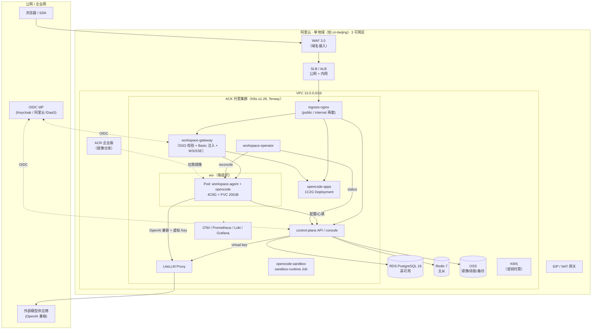
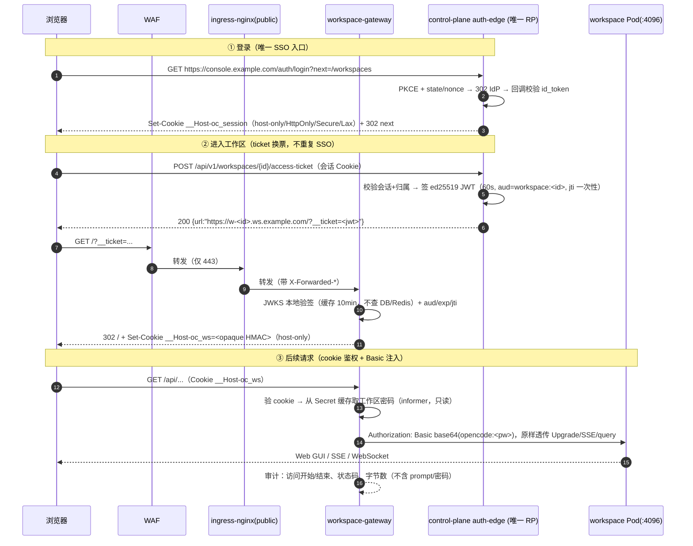
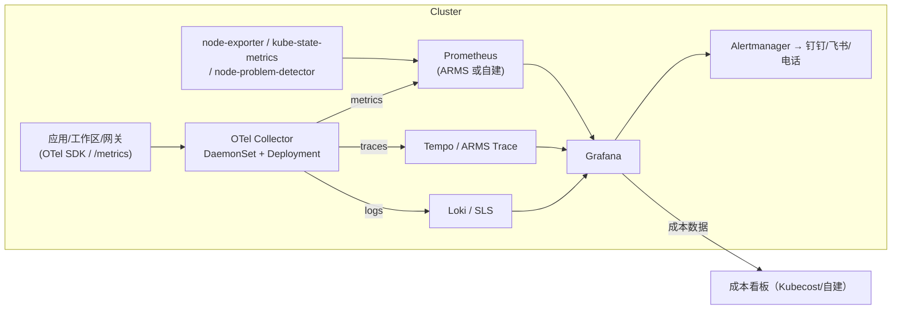

# 部署架构（P2-D / T2.6 + T4.5–T4.7 设计基线）

- 版本：v0.1（G2 评审稿）
- 作者：`infra-devops`（基础设施 / SRE）
- 日期：2026-11-04
- 任务：`task-6`（写作用域：`docs/02-architecture/deploy/`）
- 上游依据：[PLAN.md](../../00-program/PLAN.md)、[ROLES.md](../../00-program/ROLES.md)、[REVIEW-GATES.md](../../00-program/REVIEW-GATES.md)、[OPENCODE-BASELINE.md](../../00-program/OPENCODE-BASELINE.md)
- 上游代码证据（只读，commit `4f271bc` / v2.2.5）：
  - `packages/cli/src/commands/handlers/serve.ts`、`packages/cli/src/server-process.ts`、`packages/cli/src/env.ts`
  - `packages/cli/Dockerfile`、`packages/cli/src/services/service-config.ts`、`packages/cli/src/database-path.ts`
  - `packages/core/src/config/discovery.ts`、`packages/protocol/src/groups/server.ts`、`packages/protocol/src/groups/pty.ts`
- 对齐关系：本文是 **部署视角** 的子设计；总体 C4/数据模型/API 契约以 `architect` 的 `docs/02-architecture/*` 为准，工作区状态机与 CRD 契约以 `platform-backend` 的 `docs/02-architecture/services/BACKEND.md` 为准，沙箱/构建以 `capability-centers` 的 `docs/02-architecture/centers/CENTERS.md` 为准。**若本文与之冲突，以 architect 汇总后的 G2 结论为准，并回改本文。**
- 本轮边界：只做设计与目录规划，**不写部署代码**。Terraform/Helm/Operator/镜像在 G2 PASS 后按第 13 节目录落地（T7.1/T7.2/T4.5–T4.7）。

---

## 0. 结论摘要（TL;DR）

1. **运行形态**：ACK 托管版（Terway CNI）+ 6 类节点池（system / workspace / sandbox / app / gateway / build）。每用户一个 `OpencodeWorkspace` CR → 1 个 Pod（4C8G，requests=limits，独享）+ 1 个 ESSD PVC（ReadWriteOncePod，20GiB 默认，Retain）+ Service + Ingress + Secret + NetworkPolicy。
2. **访问链路**：公网 → WAF → SLB(CLB) → ingress-nginx(public) → `workspace-gateway`（校验 SSO 会话 + 用户-工作区归属 + 注入上游 `Authorization: Basic opencode:<密码>`）→ 工作区 Pod `:4096`；WS/SSE 全程透传（`proxy-buffering off`，超时 3600s）。
3. **关键上游事实**：`opencode serve` 的 Web GUI **只从根路径提供静态资源**（`web-ui.ts` 对 `/api`、`/auth`、`/openapi.json` 之外一律返回 UI），**不支持子路径反代** → 每个工作区必须用 **独立子域名**（`w-<id>.ws.<domain>`），不能用 `/w/<id>/` 路径前缀（另：`opencode_session` Cookie 的 `path=/` 会让多工作区互相覆盖）。`--port` **必须显式传 4096**：不传时上游从 4096 起在 `EADDRINUSE` 时 +1 递增（`server/src/process.ts:listen`），端口会漂移。`OPENCODE_SERVER_PASSWORD` **必须非空**：为空/缺失时 `auth.ts:required()` 返回 false，鉴权中间件直通 = 全裸 API（fail-open），operator 与 agent 必须"密码为空即拒绝启动"。探针不直接查上游：由 workspace-agent 暴露 `:8081/startupz|healthz|livez` 代查（`/api/info` 无免鉴权 health 端点，且 `httpGet` 带 Basic 会把 Secret 落进 Pod spec）。
4. **存储约束**：opencode 使用 SQLite（`databasePath()` → `<data>/opencode.db`）→ 数据目录必须落在 **块存储 RWO PVC**（ESSD），**禁止 NFS/OSS/NAS**（SQLite WAL 锁定与 fsync 语义不安全）。因此 Deployment 用 `Recreate`，PVC 用 `WaitForFirstConsumer` + `Retain`。
5. **默认不销毁**（D1）：**稳态（running/stopped/idle）operator 永不删除 PVC**；显式销毁由控制面二次确认 + 冷却期（lead D17：默认 5min，可配 **5–1440min，不允许 0**）后落 `storage.retainPolicy=snapshot-then-delete`，operator **快照成功后**才删 PVC；PVC 先保留 24h 快速恢复，之后仅快照 30d。可选 scale-to-zero 只把 `replicas: 0`，PVC 保留，默认关闭。
6. **成本量级**（假设单价见 §9，人民币，含目录价量级，未含商务折扣）：
   - 1,000 工作区 **常驻**：约 **¥72 万/月**（≈ ¥721/工作区·月），其中工作区计算 ≈ ¥64 万、PVC ≈ ¥1 万；**该成本决定商业模式必须先确认**（§9.5/R1）；
   - 混部（300 常驻 + 700 空闲休眠保 PVC）：约 **¥27 万/月**；默认仍常驻（D1），休眠是**产品选项**而非静默降本。
7. **沙箱**：评测 Job 与不可信构建跑在 `opencode-sandbox` 命名空间，`RuntimeClass=sandbox-runtime`（默认 handler=gvisor/runsc；ACK 不支持 runsc 时降级 Kata/runV，工作负载 YAML 不变，见 §7/R3、ADR-007），`automountServiceAccountToken: false`、默认禁网、只读根、`activeDeadlineSeconds`。
8. **可观测**：OTel Collector(DaemonSet) + Prometheus(ARMS 或自建) + Loki/SLS + Grafana；核心 SLO：控制面 99.9%、工作区 99.5%、就绪 p95 ≤ 90s、网关 5xx < 0.5%。
9. **交付路径**：Terraform（VPC/ACK/ACR/RDS/Redis/OSS/SLB/WAF）→ Helm Chart（platform / operator / gateway / observability / apps）→ GitHub Actions（构建+签名+扫描推 ACR）→ Argo CD（GitOps，staging 自动 / prod 手动审批）。
10. **证据策略**（无云凭证，A5）：`terraform validate/plan`（provider 打桩 + 变量化）、`kind` 上跑 Operator/CRD/Ingress/网关 e2e、`helm template` 快照、`kubeconform`、`conftest/OPA` 策略测试、成本用价格计算器 JSON 快照。

---

## 1. 范围、约束与上游事实基线

### 1.1 本文覆盖

| # | 主题 | 章节 |
|---|---|---|
| 1 | ACK 集群拓扑、VPC/节点池/托管服务、命名空间、NetworkPolicy、ResourceQuota/LimitRange | §2 |
| 2 | `workspace-operator`：CRD、reconcile、4C8G、PVC、探针、事件、漂移、升级、RBAC | §3 |
| 3 | `workspace-agent`：配置/技能/MCP 同步、健康上报、进程生命周期、日志 | §4 |
| 4 | 运行时镜像：基础、版本锁定、工具链、非 root、只读根、入口、签名扫描 | §5 |
| 5 | 网关：auth-edge/access-ticket、上游 Basic 注入、WS/SSE、LiteLLM、cert-manager、WAF/限流 | §6 |
| 6 | 沙箱命名空间（`sandbox-runtime`）与评测 Job | §7 |
| 7 | 应用 1C2G 部署模板 | §8 |
| 8 | 容量模型、节点数量、PVC/带宽、人民币成本估算（标假设） | §9 |
| 9 | 可观测、SLO/告警、成本看板 | §10 |
| 10 | 备份/灾备 | §11 |
| 11 | 灰度（金丝雀工作区）与回滚 | §12 |
| 12 | Terraform/Helm 目录、CI/CD（GH Actions→ACR→Argo CD）、环境分层 | §13 |
| 13 | 失败模式与降级、风险、待核实、G2 自检 | §14–§16 |

### 1.2 硬约束（来自 PLAN / STATUS 决策）

| ID | 约束 | 影响 |
|---|---|---|
| C1 | 每用户 1 个独立 `opencode serve` 实例，4C8G，`requests=limits` | 不允许超卖；节点按 8 工作区/32C128G 打包 |
| C2 | 退出不销毁；仅显式销毁（二次确认 + 冷却期） | operator 不因空闲/失联删资源；PVC `Retain` |
| C3 | 应用固定 1C2G；工作区固定 4C8G；配额硬限制 | LimitRange + ResourceQuota 强制 |
| C4 | 上游只读集成，锁定版本；不 fork 核心 | 镜像按 commit/digest 锁定；升级走金丝雀 |
| C5 | 沙箱强隔离（`sandbox-runtime`：gVisor 或 Kata） | 独立节点池 + RuntimeClass + 默认禁网 |
| C6 | 单地域、双/三可用区，不做多地域多活 | RDS/Redis 同地域高可用；PVC 单 AZ |
| C7 | 无云凭证时用 `terraform plan` + kind 作为证据 | §13.6 证据矩阵 |

### 1.3 上游代码事实（本文设计的地基，均已在 `upstream/opencode` 核实）

| 事实 | 证据（路径:符号） | 设计含义 |
|---|---|---|
| `serve` 只解析 `--hostname/--port/--cors/--service/--stdio` | `packages/cli/src/commands/handlers/serve.ts:Runtime.handler` | 容器入口固定 `opencode serve --hostname 0.0.0.0 --port 4096` |
| 密码来源：`OPENCODE_PASSWORD` / `OPENCODE_SERVER_PASSWORD`（推荐后者），用户名固定 `opencode`，支持 Basic、`?auth_token=`、HMAC Cookie（30 天）；**空密码 = 不鉴权** | `packages/cli/src/env.ts:password`、`packages/server/src/auth.ts:required`、`packages/cli/src/server-process.ts` | 密码由控制面生成存 K8s Secret，**必须非空**（fail-closed 校验）；网关注入 Basic；密码等价工作区全部权限，按 Secret 级别保护；轮换即吊销全部会话（session 由密码派生签名） |
| 默认模式不传 `--port` 时从 4096 起、遇 `EADDRINUSE` **+1 递增**；服务模式另有 channel 端口 | `packages/server/src/process.ts:listen`、`packages/cli/src/services/service-config.ts:defaultPort` | **必须显式 `--port 4096`**，否则 Service/探针/NetworkPolicy 端口漂移；探针用固定端口 |
| 自动更新可关闭：`config.update="disable"` + `OPENCODE_DISABLE_AUTOUPDATE=1` | `packages/core/src/config/*`、`env.ts` | 镜像内禁止自更新（版本由镜像 digest 决定，防止运行时被替换） |
| Web GUI 仅根路径；`/api*`、`/auth*`、`/openapi.json` 走 API | `packages/cli/src/services/web-ui.ts:handler` | **不支持子路径反代** → 子域名路由 + wildcard 证书 |
| `GET /api/info` 返回 `version/pid/urls/paths` | `packages/protocol/src/groups/server.ts:server.info` | 就绪/健康探针端点（需认证） |
| PTY 连接 `/api/pty/:id/connect?ticket=...`，header `x-opencode-ticket` | `packages/protocol/src/groups/pty.ts` | 网关必须放行 Upgrade + 该 query/header，不做 query 重写 |
| SQLite 路径 `<data>/opencode.db`（`OPENCODE_DB` 可覆盖） | `packages/cli/src/database-path.ts` | 数据目录必须块存储 RWO，快照/备份以文件级快照为准 |
| 配置来源优先级含 **system 目录 `/etc/opencode`** > global（`$XDG_CONFIG_HOME/opencode`）> project | `packages/core/src/config/discovery.ts:systemDirectory` | 托管策略写 `/etc/opencode`（只读根下用 emptyDir 挂载，由 agent 写） |
| 配置热加载（`FileSystem` 监听 + `Config.watch`） | `packages/core/src/config/watch.ts` | 模型/技能/MCP 变更 ≤30s 生效，无需重启 Pod |
| 镜像为单文件静态二进制（musl），官方 CLI 镜像基于 alpine + `libgcc/libstdc++/ripgrep` | `packages/cli/Dockerfile` | 运行时镜像可换 debian 基础镜像，直接 COPY 二进制 |
| `OPENCODE_CONFIG_DIR` 可覆盖配置目录 | `packages/cli/src/server-process.ts` | agent 可把配置目录指到挂载的 emptyDir |

> 待核实项（不阻塞本文，但必须在 T4.5/T4.6 前关闭）：`/api/info` 未认证时的返回码（401 亦可用于 TCP 层判活）、`/etc/opencode` 下 managed policy 的确切文件语义（`ConfigManaged.Document` 只暴露类型，加载逻辑需读 `config/load` 全链）、SSE `/api/event` 的心跳间隔与反代 idle 超时匹配。

---

## 2. ACK 集群拓扑

### 2.1 总体拓扑



### 2.2 网络平面（Terraform 模块 `modules/vpc`）

| 资源 | 规划 | 说明 |
|---|---|---|
| VPC | `10.0.0.0/16`（1 个） | 预留扩展；不与其他环境共享 |
| 可用区 | 3 个（如 `cn-beijing-h/i/j`，以账号实际为准） | RDS/Redis 主备跨 AZ；工作区节点尽量跨 AZ 打散 |
| 节点交换机 | 每 AZ `/24` × 3（`10.0.1.0/24`…） | 给 ACK 节点/ENI |
| Pod 交换机 | 每 AZ `/20` × 3（`10.0.16.0/20`…），Terway **独占 ENI** 模式 | 1000 工作区 + 应用 + Job，IP 容量按 ≥4000 Pod 规划；Terway 建议开 `ENITrunking` 提升单节点 IP 密度 |
| Service CIDR | `172.20.0.0/16`（不与 VPC 重叠） | 集群级 |
| NAT 网关 | 每 AZ 1 个（或共享 1 个 + 跨 AZ 路由） | 出网统一出口；模型调用出网走 NAT/EIP |
| 安全组 | 节点 SG 仅放通 VPC 内 6443/10250/10255/VXLAN 或 Terway 所需端口；SLB SG 仅 80/443 | 禁止节点公网 IP（不用 `AssignPublicIp`） |
| 流日志 | VPC FlowLog → SLS，采样 1:10 | 安全审计/排障 |

### 2.3 节点池（Terraform `modules/ack` + `node_pools`）

| 节点池 | 规格（假设） | 数量（prod 基线） | 污点/标签 | 用途与隔离理由 |
|---|---|---|---|---|
| `system` | 8C32G × 3（每 AZ 1） | 3（+1 伸缩） | `dedicated=system:NoSchedule` | ingress-nginx、cert-manager、Argo CD、Prometheus、Loki、KEDA、operator |
| `workspace` | 32C128G（ESSD 系统盘） | **160**（1000 常驻；7 工作区/节点，见 §9.2；备选 16C64G×374） | `dedicated=workspace:NoSchedule`，`node-pool=workspace` | 用户工作区；DaemonSet 预留后 allocatable≈30.5c，**7 工作区/节点**（不是 8——16C64G 则只有 3/节点）；`maxPods` 建议 32 |
| `sandbox` | 16C64G（安装 `runsc`，`RuntimeClass=sandbox-runtime`） | 3–10（autoscaler） | `dedicated=sandbox:NoSchedule` | 评测 Job / 不可信构建，gVisor 隔离；节点需注册 runsc |
| `app` | 8C32G（安装 `runsc`，跑 gVisor） | 32（200 应用 / 7 + 缓冲，autoscaler 8–40） | `dedicated=app:NoSchedule` | 用户应用 1C2G **也跑 gVisor**（用户代码不可信）；gVisor 影子开销 50m/128Mi，每节点 7 应用 |
| `gateway` | 8C32G × 3 | 3 | `dedicated=gateway:NoSchedule` | LiteLLM / workspace-gateway / app-gateway；高连接数（SSE/WS） |
| `build`（可选） | 8C32G × 2，Spot | 0–4 | `dedicated=build:NoSchedule`；`node.kubernetes.io/spot=true` | rootless BuildKit；失败可重试 |

节点池通用要求：

- 系统盘 ESSD PL1 ≥ 200GiB；容器运行时 containerd，`maxPods` 显式设置（Terway 受 ENI 规格限制，`ecs.g7.16xlarge` 建议 64）。
- 全部节点开启 `node-problem-detector`、`nodelocaldns`、`ack-node-problem-detector` 事件采集；节点自动修复（ACK 节点池自愈 + 自定义 `NodeProblemDetector` 告警）。
- workspace 节点池关闭自动升级/自动修复的"重建"能力，避免批量驱逐：设置 PDB + `node-pool` 升级分批（maxSurge 10%）。
- **不用抢占式实例承载工作区**（数据/进程稳定性要求），仅 `build`/`sandbox` 可用 Spot。
- 节点 OS：Alibaba Cloud Linux 3（kernel ≥5.10，gVisor 兼容性好）；关闭 SELinux 强制模式（gVisor 节点池例外，按官方要求）。

### 2.4 托管服务选型

| 服务 | 规格（prod 基线，假设） | 用途 | 关键配置 |
|---|---|---|---|
| ACR 企业版 | 基础版实例 + 命名空间 `opencode-{env}` | 运行时镜像、应用镜像、Helm chart（OCI） | 开启镜像扫描、镜像签名（cosign）、VPC 内网访问、按 digest 拉取 |
| RDS PostgreSQL 16 | 高可用版 8C32G，存储 500GiB ESSD，跨 AZ 备 | 控制面业务库 | `rds.force_ssl=1`、自动备份 7 天 + PITR、审计日志开、白名单仅 VPC、慢日志到 SLS |
| Redis 7 | 社区版主从 8GiB（或集群 3 分片） | 会话、限流、幂等键、SSE 广播、缓存 | `maxmemory-policy allkeys-lru`（会话键单独 DB）；开启 TLS + 密码（KMS/Secrets） |
| OSS | 标准存储 + 低频/归档分层 | 技能包、评测数据集/报告、应用构建上下文与产物、PVC 快照转储、审计归档 | 私有 Bucket、VPC 内网 endpoint、服务端加密 SSE-KMS、版本化 + 生命周期 |
| SLB / CLB | 公网 1 个（WAF 后）、内网 1 个（控制面/内部调用） | 入口 | 公网仅开 443（80 强制跳转）；开启健康检查、连接限速、WAF 联动 |
| WAF 3.0 | 企业版（假设） | 公网入口防护 | 接入 `*.example.com`，开 Bot 管理、CC 防护、自定义规则（`/api/*` 速率）；仅放行 443 |
| cert-manager | 集群内（`platform-system`） | 证书自动签发 | `ClusterIssuer` ACME DNS-01（阿里云 DNS webhook）+ 通配符证书；内部用私有 CA |
| KMS | 密钥托管 | DB 密码、LiteLLM 主密钥、workspace 密码加密 | 每环境独立 CMK；Secrets 走 External Secrets Operator + KMS |
| 域名/DNS | 阿里云云解析 | `*.ws`、`*.apps`、`api.`、`console.` | 泛解析到 SLB；DNS TTL 60s；证书与域名绑定 |

> **地域与合规**：单地域（默认 `cn-beijing`，待用户确认）；数据不出境；审计日志留存 ≥180 天（SLS + OSS 归档 365 天）。

### 2.5 命名空间规划

| 命名空间 | 内容 | 关键策略 |
|---|---|---|
| `platform-system` | Argo CD、cert-manager、external-secrets、KEDA、Prometheus、Loki、OTel Collector、node-problem-detector | 仅平台 SA 可写；PSA `restricted`（第三方组件按需 `baseline`） |
| `platform-ingress` | ingress-nginx（public/internal 两套 controller） | 节点池 `system`/`gateway`；PSA `baseline` |
| `opencode-control` | control-plane API（含 **auth-edge：唯一 OIDC RP**）、console（Next.js） | PSA `restricted`；HPA 3–12 |
| `opencode-gateway` | **workspace-gateway**（ticket 验签 + Basic 注入）、**app-gateway**（ACL）、LiteLLM、egress-proxy | PSA `restricted`；HPA；长连接；oauth2-proxy 仅第三方 UI 可选 |
| `opencode-system` | workspace-operator（leader election）、CRD、webhook | PSA `restricted`；仅 operator SA |
| `ws-<orgId>`（每组织） | `OpencodeWorkspace` CR、工作区 Pod/PVC/Service/Ingress/Secret/NetworkPolicy | 每组织一个 ns（BACKEND §5.2）；PSA `restricted`；Quota 见 §2.7 |
| `opencode-sandbox` | 评测 Job、不可信构建 Pod | PSA `restricted` + gVisor；默认禁网 |
| `opencode-apps` | 用户应用 1C2G Deployment/Service/Ingress | PSA `restricted`；ResourceQuota |
| `opencode-build` | rootless BuildKit / 构建 Job | PSA `restricted`；禁 hostPath；限网 |
| `opencode-observability`（可选，或并入 `platform-system`） | Grafana、告警规则 | 只读 |

> **工作区命名空间（v0.3 定稿）**：canonical = **每组织一个 `ws-<orgId>`**（BACKEND §5.2；ARCHITECTURE §5 已于 2026-11-04 同步为 `ns: ws-<orgId>`，G2 P1-3 关闭）。§2.7 的 ResourceQuota/LimitRange 模板是**每组织命名空间**基线（值按组织配额缩放），另用集群级求和 + 容量对账（§9）防止组织间挤兑。

### 2.6 NetworkPolicy（默认拒绝 + 白名单）

原则：**每个命名空间先 default-deny ingress/egress，再逐条放行**；跨命名空间用 `namespaceSelector` + 具体标签，不用 IP 段。

工作区命名空间基线（节选，完整清单在 Helm chart `templates/networkpolicies/`）：

```yaml
# 1) 默认拒绝（两个方向）
apiVersion: networking.k8s.io/v1
kind: NetworkPolicy
metadata: { name: default-deny-all, namespace: ws-<orgId> }
spec:
  podSelector: {}
  policyTypes: [Ingress, Egress]
---
# 2) 允许 gateway 访问工作区 4096（含 WS/SSE）
apiVersion: networking.k8s.io/v1
kind: NetworkPolicy
metadata: { name: allow-workspace-gateway, namespace: ws-<orgId> }
spec:
  podSelector:
    matchLabels: { app.kubernetes.io/name: opencode-workspace }
  policyTypes: [Ingress]
  ingress:
    - from:
        - namespaceSelector: { matchLabels: { kubernetes.io/metadata.name: opencode-gateway } }
          podSelector: { matchLabels: { app.kubernetes.io/name: workspace-gateway } }
      ports: [{ protocol: TCP, port: 4096 }]
    - from:  # 就绪/存活探针由 kubelet 发起，无需策略；metrics 采集
        - namespaceSelector: { matchLabels: { kubernetes.io/metadata.name: platform-system } }
          podSelector: { matchLabels: { app.kubernetes.io/name: prometheus } }
      ports: [{ protocol: TCP, port: 4096 }]
---
# 3) 工作区出网：DNS + 控制面 + LiteLLM + MCP Hub + OSS 内网
apiVersion: networking.k8s.io/v1
kind: NetworkPolicy
metadata: { name: allow-workspace-egress, namespace: ws-<orgId> }
spec:
  podSelector:
    matchLabels: { app.kubernetes.io/name: opencode-workspace }
  policyTypes: [Egress]
  egress:
    - to: [{ namespaceSelector: { matchLabels: { kubernetes.io/metadata.name: kube-system } },
             podSelector: { matchLabels: { k8s-app: kube-dns } } }]
      ports: [{ protocol: UDP, port: 53 }, { protocol: TCP, port: 53 }]
    - to: [{ namespaceSelector: { matchLabels: { kubernetes.io/metadata.name: opencode-control } } }]
      ports: [{ protocol: TCP, port: 8080 }]
    - to: [{ namespaceSelector: { matchLabels: { kubernetes.io/metadata.name: opencode-gateway } },
             podSelector: { matchLabels: { app.kubernetes.io/name: litellm } } }]
      ports: [{ protocol: TCP, port: 4000 }]
    - to: [{ namespaceSelector: { matchLabels: { kubernetes.io/metadata.name: opencode-gateway } },
             podSelector: { matchLabels: { app.kubernetes.io/name: mcp-hub } } }]
      ports: [{ protocol: TCP, port: 8081 }]
    # 公网/依赖下载的唯一出口：egress-proxy（白名单 + 审计）；工作区 Pod 自身不直连 0.0.0.0/0
    - to: [{ namespaceSelector: { matchLabels: { kubernetes.io/metadata.name: opencode-gateway } },
             podSelector: { matchLabels: { app.kubernetes.io/name: egress-proxy } } }]
      ports: [{ protocol: TCP, port: 3128 }]
    # 阿里云内网 endpoint（OSS/ACR/RDS 终端节点）按 Terraform 输出的 ipBlock 精确放行；
    # 不要用空的 to: []（不匹配任何目标，会让规则静默失效）——G2-18。
    # - to: [{ ipBlock: { cidr: <oss-vpc-endpoint-cidr> } }]
    #   ports: [{ protocol: TCP, port: 443 }]
  # 注意：本命名空间**不存在** 0.0.0.0/0 放行；用户 git clone/npm install 走 egress-proxy。
  # egress-proxy 自身的 NetworkPolicy（opencode-gateway ns）才允许 443/80 出公网，并按域名白名单 + 审计。
```

> **G2-18 修正**：① 删除原 `to: []` 规则（空列表不匹配任何目标，等于没放行，且与 §6.7"经 egress-proxy 白名单"冲突）；② 工作区 egress 恒定三条：DNS、平台内网服务（control-plane/LiteLLM/MCP Hub）、**egress-proxy:3128**；③ OSS/ACR/RDS 使用 VPC 终端节点时按 Terraform 输出的 `ipBlock` 精确放行；④ 公网只经 egress-proxy（其 NP 允许 443/80，配域名白名单 + 审计日志），工作区 Pod 直连公网一律拒绝。**运维验收**：`kubectl exec` 从工作区 `curl https://example.com` 必须被拒；`curl -x http://egress-proxy:3128 https://github.com` 成功；非白名单域名经代理返回 403 且产生审计事件。

### 2.7 ResourceQuota / LimitRange

```yaml
# ws-<orgId>（每组织）：按组织配额缩放；组织数假设见下方推导；分环境覆盖
apiVersion: v1
kind: ResourceQuota
metadata: { name: workspaces-quota, namespace: ws-<orgId> }
spec:
  hard:
    requests.cpu: "4600"        # 1000×4 + 15% 余量（含 agent 侧车开销）
    requests.memory: "10000Gi"
    limits.cpu: "4600"          # requests=limits，配额即真实消耗上限
    limits.memory: "10000Gi"
    count/opencodeworkspaces.opencode.ai: "1200"
    persistentvolumeclaims: "1200"
    requests.storage: "24Ti"     # 1000×20GiB + 20% 余量
    count/services: "1200"
    count/ingresses.networking.k8s.io: "1200"
    count/secrets: "4000"
---
apiVersion: v1
kind: LimitRange
metadata: { name: workspace-defaults, namespace: ws-<orgId> }
spec:
  limits:
    - type: Container
      default: { cpu: "4", memory: "8Gi", ephemeral-storage: "2Gi" }
      defaultRequest: { cpu: "4", memory: "8Gi", ephemeral-storage: "2Gi" }
      max: { cpu: "4", memory: "8Gi" }      # 强制 4C8G，不允许超分
      min: { cpu: "100m", memory: "128Mi" }
    - type: PersistentVolumeClaim
      max: { storage: "500Gi" }
      min: { storage: "10Gi" }
---
# opencode-apps：每应用 1C2G
apiVersion: v1
kind: ResourceQuota
metadata: { name: apps-quota, namespace: opencode-apps }
spec:
  hard:
    requests.cpu: "300"          # 300 应用 × 1C
    requests.memory: "600Gi"
    limits.cpu: "300"
    limits.memory: "600Gi"
    count/deployments.apps: "350"
---
apiVersion: v1
kind: LimitRange
metadata: { name: app-defaults, namespace: opencode-apps }
spec:
  limits:
    - type: Container
      default: { cpu: "1", memory: "2Gi" }
      defaultRequest: { cpu: "1", memory: "2Gi" }
      max: { cpu: "1", memory: "2Gi" }     # 应用固定 1C2G
---
# opencode-sandbox：评测突发，配额按并发 Job 上限
apiVersion: v1
kind: ResourceQuota
metadata: { name: sandbox-quota, namespace: opencode-sandbox }
spec:
  hard:
    requests.cpu: "160"
    requests.memory: "320Gi"
    limits.cpu: "160"
    limits.memory: "320Gi"
    count/jobs.batch: "80"
```

> 配额调整流程：`terraform` 管节点容量，`ResourceQuota` 管逻辑上限；二者必须同步（§9 容量模型给出对应关系）。超配额时 CR 进入 `Error/QuotaExceeded` 事件，控制面提示"容量不足/申请提额"。

---

## 3. workspace-operator

### 3.1 定位与边界

- **只做一件事**：把 `OpencodeWorkspace` CR 收敛成一组命名空间内的 Kubernetes 资源，并回报状态/事件。
- **不负责**：不直接暴露用户 API、不签发访问票据、不做计费、不删除用户数据（除非 CR 明确 `deletionPolicy=Delete` 且 finalizer 校验通过）、不调用 opencode API。
- 技术选型：Go + controller-runtime（与 PLAN 技术栈一致）；`--leader-elect`；多副本 2（HA），仅 leader reconcile；watch CR + Owned 资源。
- 部署位置：`opencode-system`；RBAC 见 §3.9。

### 3.2 CRD `OpencodeWorkspace`（**v0.2 已按 `services/BACKEND.md §5.2` 对齐，差异见 §3.11**）

Group/Version：`workspace.opencode.cloud/v1alpha1`；Kind：`OpencodeWorkspace`；Scope：`Namespaced`（**每组织命名空间 `ws-<orgId>`**）；短名 `ow`。**`spec` 唯一写者是控制面**，Operator 只写 `status` + finalizer（防手工改 CR 绕过审计）。下列 YAML 为**部署视角示意**，字段以 BACKEND.md §5.2 为准（差异修正见 §3.11）。

```yaml
apiVersion: workspace.opencode.cloud/v1alpha1
kind: OpencodeWorkspace
metadata:
  name: ws-01H7F3C2A91                 # ws-<workspaceId(ULID)>，控制面生成
  namespace: ws-org_01H...             # 每组织一个命名空间
  labels:
    opencode.cloud/org-id: org_01H...
    opencode.cloud/owner-user-id: usr_01H...
    opencode.cloud/workspace-id: ws_01H...
    opencode.cloud/managed-by: control-plane
  annotations:
    opencode.ai/spec-hash: "sha256:..."        # 漂移检测基线
    opencode.ai/deletion-confirmed-at: ""      # 控制面写入（销毁二次确认时间）
spec:
  # ---- 归属（不可变）----
  owner:
    userId: usr_01H...
    orgId: org_01H...
    email: alice@example.com                   # 仅用于事件/审计展示，不落标签
  # ---- 规格（MVP 仅允许 4C8G，字段保留扩展）----
  size: "4C8G"                                 # enum: 4C8G（MVP）；未来 2C4G/8C16G
  image:
    repository: registry.cn-beijing.aliyuncs.com/opencode-prod/workspace-runtime
    tag: "2.2.5-20261104"                      # 人读 tag
    digest: "sha256:..."                       # 必填，运行时以 digest 为准
  persistence:
    enabled: true
    size: "20Gi"                                # 默认 20GiB；可配 50/100GiB（扩容只增）
    storageClass: alicloud-disk-essd-pl1
    reclaimPolicy: snapshot-then-delete      # BACKEND 默认：快照后删 PVC（快照留 30 天）；可配 retain | delete
    mountPath: /home/opencode                  # PVC 同时以 subPath 挂到 /workspace
  runtime:
    port: 4096                                 # 固定；与 Service/NetworkPolicy 对齐
    runtimeClassName: ""                       # 工作区不用 gVisor（PTY/工具链兼容）
    idleTimeout: "0s"                          # 0 = 不自动休眠（D1）
    stopPolicy: "Never"                        # Never | IdleStop（P2）
  config:
    modelPolicyRef: mp_01H...                  # 控制面模型策略版本
    litellmKeyRef: { secretName: ws-7f3c2a91-llm }   # 虚拟 Key（由控制面写入）
    skills: []                                 # 技能源 URL 列表（SKILL.md 包）
    mcpBindings: []                            # MCP 绑定（名称 + 代理地址）
    managedPolicyRef: mp-managed-01H...        # /etc/opencode 托管策略版本
  networking:
    host: ws-7f3c2a91.ws.example.com           # 子域名（不支持子路径，见 §1.3）
    tlsSecretName: wildcard-ws-example-com     # cert-manager 产出
    allowedGroups: [grp-eng]                   # 组织/组级访问（网关校验）
    public: false
  lifecycle:
    deletionPolicy: Retain                     # Retain（默认）| Delete（显式销毁）
    terminationGracePeriodSeconds: 60
    preStopSleepSeconds: 5
  # ---- 运营 ----
  priorityClassName: opencode-workspace
  nodeSelector: {}                             # 由 operator 注入 dedicated=workspace
  # ---- 状态（由 operator 写）----
status:
  phase: Ready                                 # Pending|Provisioning|Starting|Ready|Idle|Stopping|Stopped|Deleting|Deleted|Error
  conditions:
    - type: Ready
      status: "True"
      reason: PodReady
      lastTransitionTime: "2026-11-04T09:00:00Z"
  observedGeneration: 7
  observedSpecHash: "sha256:..."
  podName: ws-7f3c2a91-0
  serviceName: ws-7f3c2a91
  pvcName: ws-7f3c2a91-home
  ingressHost: ws-7f3c2a91.ws.example.com
  url: https://ws-7f3c2a91.ws.example.com/
  imageDigest: "sha256:..."
  opencodeVersion: "2.2.5"
  agentVersion: "0.1.0"
  lastActiveAt: "2026-11-04T09:00:00Z"          # 由 agent 心跳/控制面上报
  error:
    code: ""                                    # QuotaExceeded|ImagePullFailed|PVCBindFailed|...
    message: ""
```

**字段设计要点**

| 字段 | 设计理由 / 契约 |
|---|---|
| `image.digest` 必填 | 质量红线：生产不允许 `latest`/浮动 tag；digest 是可回滚的确定性标识（BACKEND 字段名 `imageDigest`） |
| `size` enum | MVP 只接受 `4C8G`；**BACKEND 用 `resources{requests,limits}` 表达且必须相等**，operator 校验并拒绝其他值（§3.11） |
| `persistence.reclaimPolicy` | **BACKEND 默认 `snapshot-then-delete`**（先快照→删 PVC→快照留 30 天）；`retain`（保 PVC）/`delete`（仅 admin 强制）可选（§3.11） |
| `lifecycle.stopPolicy` | D1 默认 `idleSuspend=false`；开启只缩容 Pod，不删 PVC（BACKEND `lifecycle.idleSuspend`） |
| `networking.host` | 子域名必需（上游不支持子路径）；BACKEND 字段为 `access.host=w-<id>.ws.<domain>`，operator 只消费 |
| `status.observedSpecHash` | 漂移检测：BACKEND 契约用 `config.hash` + `observedGeneration`，operator 同时维护 `spec-hash` 注释 |
| `config.*Ref` | BACKEND：`config.managedConfigMap`（L1，ConfigMap ro）+ `config.globalConfigMap`（L2，agent 可写）+ `config.revision/hash`；密码 `server.passwordSecretRef`，LiteLLM Key `litellm.keySecretRef` |
| `status.phase` | 必须与 BACKEND §5.1 状态机一一映射：`Provisioning→Starting→Ready→Idle→Stopping→Stopped`；`Deleting→Deleted`；异常 `Error`（无 `Pending`，排队用 `Provisioning/reason=Queued`） |

### 3.3 reconcile 逻辑（伪代码）

```text
Reconcile(req):
  ws = get(OpencodeWorkspace, req)
  if ws == nil: return                      # 已删除，无需 cleanup（finalizer 在 Delete 分支处理）

  if ws.DeletionTimestamp != nil:
      return handleDeletion(ws)             # §3.6

  # 0) 基础校验
  if ws.Spec.Size != "4C8G": setError(UnsupportedSize); return
  if ws.Spec.Image.Digest == "": setError(ImageDigestRequired); return
  ensureFinalizer(ws, "opencode.ai/workspace-protection")
  quotaOK, err := checkQuota(ws)
  if !quotaOK: setPhase(Error, QuotaExceeded, event=Warning QuotaExceeded); requeue(30s); return

  # 1) Secret：工作区密码（SSO 网关向上游注入用，用户不可见）
  pw = getSecret(ws, "<name>-auth"); if !exists:
      pw = random(32 bytes, base64url); createSecret(<name>-auth, OPENCODE_SERVER_PASSWORD=pw)
      event(Normal PasswordCreated)
  # 控制面写入的 LiteLLM 虚拟 Key Secret 只读取，不创建

  # 2) PVC：先于 Deployment（RWO + WaitForFirstConsumer）
  pvc = ensurePVC(name=<name>-home, size=ws.Spec.Persistence.Size,
                  storageClass=..., accessMode=ReadWriteOnce,
                  labels/ownerRefs, annotations{"opencode.ai/retain": "true"})
  if pvc.Status.Phase != Bound: setPhase(Provisioning, PVCBinding); requeue(5s); return

  # 3) Deployment（4C8G，requests=limits，Recreate）
  dep = ensureDeployment(
      replicas = (stopPolicy==Stopped ? 0 : 1),
      strategy = Recreate,
      template = workspacePodTemplate(ws, pvc, secret),
      progressDeadlineSeconds = 300)
  injectNodeAffinity(dep, "dedicated=workspace")
  injectTopologySpread(dep, zone maxSkew=1)
  # 4) Service（ClusterIP:4096）
  # 5) NetworkPolicy（ingress from workspace-gateway; egress per §2.6）
  # 6) Ingress（host-based, TLS, annotations: 超时/缓冲/WS）
  # 7) ConfigMaps（agent bootstrap 指针、托管策略版本号）
  # 8) 状态与事件
  refreshStatus(ws, dep, pvc)
  ensureEventOnPhaseChange(ws)
  # 9) 漂移检测（每 5min 全量 resync 时执行）
  if drifts(ws, dep, pvc, ingress): patch/repair; event DriftRepaired
  return requeue(ws.Spec.Runtime.IdleTimeout > 0 ? 60s : 5m)
```

**幂等与并发**：所有 ensure 用 `CreateOrUpdate`（server-side apply / patch 语义）；使用 `controllerutil.SetControllerReference` 建立 OwnerReference（PVC 例外：**不设** `blockOwnerDeletion` 之外的 ownerRef？——PVC 需随 CR 保留，故 PVC 设 ownerRef 但 `deletionPolicy=Retain` 时由 finalizer 显式放行，见 §3.6）。同一 CR 的 reconcile 用 `MaxConcurrentReconciles=8`，不同 CR 并行。

**失败分类与退避**：

| 错误 | 退避 | 事件 |
|---|---|---|
| 配额不足 | 30s → 5m | `Warning QuotaExceeded` |
| PVC 未绑定 | 5s → 60s | `Warning PVCBinding` |
| 镜像拉取失败 | 由 kubelet 重试；operator 10s/1m/5m 观察 | `Warning ImagePullFailed` |
| Pod CrashLoop | 观察 `status.conditions`，2 次/10min 内重启 → `Error/CrashLoopBackOff` | `Warning OpencodeCrashLoop` |
| K8s API 5xx | 指数退避（max 5m），不放弃 | — |

### 3.4 4C8G 资源与 Pod 模板（核心片段）

```yaml
apiVersion: apps/v1
kind: Deployment
metadata:
  name: ws-7f3c2a91
  namespace: ws-<orgId>
spec:
  replicas: 1
  strategy:
    type: Recreate                    # RWO PVC + SQLite：禁止双 Pod 同时挂载
  selector: { matchLabels: { app.kubernetes.io/name: opencode-workspace, opencode.ai/workspace: ws-7f3c2a91 } }
  template:
    metadata:
      labels:
        app.kubernetes.io/name: opencode-workspace
        app.kubernetes.io/managed-by: workspace-operator
        opencode.ai/workspace: ws-7f3c2a91
      annotations:
        opencode.ai/spec-hash: "sha256:..."
        prometheus.io/scrape: "true"
        prometheus.io/port: "4096"
    spec:
      serviceAccountName: workspace-runtime   # 无任何 K8s 权限，仅 projected token 供 agent 换取 bootstrap
      automountServiceAccountToken: false
      securityContext:
        runAsNonRoot: true
        runAsUser: 1000
        runAsGroup: 1000
        fsGroup: 1000
        seccompProfile: { type: RuntimeDefault }
      priorityClassName: opencode-workspace
      nodeSelector: { dedicated: workspace }
      tolerations: [{ key: dedicated, operator: Equal, value: workspace, effect: NoSchedule }]
      topologySpreadConstraints:
        - maxSkew: 1
          topologyKey: topology.kubernetes.io/zone
          whenUnsatisfiable: ScheduleAnyway
          labelSelector: { matchLabels: { app.kubernetes.io/name: opencode-workspace } }
      terminationGracePeriodSeconds: 60
      containers:
        - name: workspace
          image: registry.cn-beijing.aliyuncs.com/opencode-prod/workspace-runtime@sha256:...
          imagePullPolicy: IfNotPresent
          command: ["/usr/local/bin/opendream-cloud-entrypoint"]
          env:
            - { name: OPENCODE_PORT, value: "4096" }
            - { name: OPENCODE_HOSTNAME, value: "0.0.0.0" }
            - { name: OPENCODE_SERVER_PASSWORD, valueFrom: { secretKeyRef: { name: ws-7f3c2a91-auth, key: OPENCODE_SERVER_PASSWORD } } }
            - { name: OPENCODE_DISABLE_AUTOUPDATE, value: "1" }   # 配合 managed config update:"disable"
            - { name: OPENCODE_CONFIG_DIR, value: "/home/opencode/.config/opencode" }
            - { name: OPENCODE_DB, value: "/home/opencode/.local/share/opencode/opencode.db" }
            - { name: AGENT_HEALTH_PORT, value: "8081" }
            - { name: HOME, value: "/home/opencode" }
            - { name: WORKSPACE_ID, value: ws-7f3c2a91 }
            - { name: CONTROL_PLANE_URL, value: "http://control-plane.opencode-control.svc:8080" }
            - { name: LITELLM_BASE_URL, value: "http://litellm.opencode-gateway.svc:4000" }
            - { name: LITELLM_KEY_FILE, value: "/etc/opendream-cloud/llm-key" }
          resources:
            requests: { cpu: "4", memory: "8Gi", ephemeral-storage: "2Gi" }
            limits:   { cpu: "4", memory: "8Gi", ephemeral-storage: "2Gi" }   # requests=limits
          securityContext:
            allowPrivilegeEscalation: false
            readOnlyRootFilesystem: true
            capabilities: { drop: ["ALL"] }
          ports:
            - { containerPort: 4096, name: http, protocol: TCP }
            - { containerPort: 8081, name: agent-health, protocol: TCP }
          # 探针全部指向 agent：agent 代查 /api/info（免把 Basic 头/密码写进探针配置）
          startupProbe:
            httpGet: { path: /startupz, port: 8081 }
            periodSeconds: 2
            failureThreshold: 45          # ≤90s 就绪目标
            timeoutSeconds: 2
          readinessProbe:
            httpGet: { path: /healthz, port: 8081 }
            periodSeconds: 5
            failureThreshold: 3
            timeoutSeconds: 2
          livenessProbe:
            httpGet: { path: /livez, port: 8081 }   # agent 存活 + 上游端口/信息可读；不做深度检查
            initialDelaySeconds: 120
            periodSeconds: 20
            failureThreshold: 6
          lifecycle:
            preStop:
              exec: { command: ["/bin/sh", "-c", "sleep 5; kill -TERM 1"] }
          volumeMounts:
            - { name: home, mountPath: /home/opencode, subPath: home }
            - { name: home, mountPath: /workspace, subPath: workspace }
            - { name: config, mountPath: /etc/opencode }           # emptyDir，agent 写入托管配置
            - { name: runtime, mountPath: /run/opencode }
            - { name: llm-key, mountPath: /etc/opendream-cloud, readOnly: true }
            - { name: tmp, mountPath: /tmp }
            - { name: vartmp, mountPath: /var/tmp }
      volumes:
        - name: home
          persistentVolumeClaim: { claimName: ws-7f3c2a91-home, readOnly: false }
        - name: config
          emptyDir: { sizeLimit: 64Mi }
        - name: runtime
          emptyDir: { sizeLimit: 64Mi }
        - name: tmp
          emptyDir: { sizeLimit: 2Gi }
        - name: vartmp
          emptyDir: { sizeLimit: 1Gi }
        - name: llm-key
          secret: { secretName: ws-7f3c2a91-llm, defaultMode: 0400 }
```

**4C8G 隔离可证明性**（对应 G2 检查项"每用户 4C8G 隔离方案可证明"）：

| 维度 | 证据 | 验证方式 |
|---|---|---|
| CPU | `requests.cpu = limits.cpu = 4`，CFS quota 硬限；LimitRange max=4 防越权 | `kubectl get pod -o jsonpath` 断言；压测单工作区 8 线程跑满时邻居 p95 不变（k6 + Prometheus） |
| 内存 | `requests.memory = limits.memory = 8Gi`，OOM 只杀本 Pod | `stress-ng --vm` 触发 OOM 测试：同节点其他工作区无影响 |
| 网络 | 独立 NetworkPolicy + 独立 Ingress Host；跨工作区无放行规则 | `conntrack`/`nmap` 从 A 工作区访问 B 失败；e2e 用例 |
| 存储 | 独立 PVC，`ReadWriteOnce`，路径不共享；PVC 名含 workspace id | `ls /workspace` 互不可见；`df` 只读本 PVC |
| 身份 | 独立 `OPENCODE_SERVER_PASSWORD`（空值即拒绝启动）；网关校验 userId↔workspaceId 归属 | 用 A 的 SSO 访问 B 的 Host → 403（网关）；上游直连需知道 B 的密码 |
| 内核 | 工作区共用宿主内核（非 gVisor）；不可信代码在 §7 沙箱，不在工作区 | 威胁模型：工作区=半可信（用户自己的代码，跑自己的工具链），跨租户靠 K8s 隔离；如要求更强隔离可整体切 gVisor 节点池（代价：PTY/工具兼容性与性能，需 ADR） |

> **设计取舍**：工作区不放 gVisor（PTY、编译、ptrace、部分 syscall 兼容性风险，且性能损耗对交互式编码体验明显）；不可信/评测/构建放 gVisor。该取舍需 architect 在 `SECURITY.md` 确认（本文标注为 **D-INFRA-1**，建议进 ADR）。

### 3.5 PVC 策略（Retain 与显式删除）

> **v0.2 对齐**：`retainPolicy` 取值 `retain | snapshot-then-delete(默认) | delete`；下表"Delete"行对应 `snapshot-then-delete`（先快照成功再删，快照留 30 天）与 `delete`（仅 admin）。稳态期间任何策略都不自动删 PVC。

| 场景 | 行为 |
|---|---|
| 用户退出浏览器 | 无任何动作（Pod 常驻，PVC 保留） |
| Pod 崩溃/被驱逐/节点回收 | Deployment 重建 Pod，PVC 重挂，数据不丢（SQLite 在 PVC） |
| 控制面"停止工作区"（P2） | `replicas: 0`，PVC 保留，`phase=Stopped`；再进来自动 `replicas: 1` |
| 用户"销毁工作区" | ① 控制面二次确认（输入工作区名）② 写入 `deletion-confirmed-at` ③ 冷却期 5min（D17，可配 5–1440min；期间可撤销）④ 控制面把 `storage.retainPolicy=snapshot-then-delete` 写入 spec ⑤ 删 CR |
| operator 处理 CR 删除（Retain） | 删除 Deployment/Service/Ingress/NetworkPolicy/Secret；**保留 PVC**，删除 finalizer；事件 `Normal WorkspaceDeletedDataRetained` |
| operator 处理 CR 删除（`snapshot-then-delete`） | 控制面在冷却期后把 `retainPolicy=snapshot-then-delete` 写进 spec（唯一写者）；operator 快照成功 → 删 PVC（快照留 30d）→ 删 finalizer；快照失败 → `Error` + `code=internal_error, details.phase=snapshot` + 告警，**不删 PVC** |
| PVC 被人工/误删 | Operator 检测到 `pvc Not Found` → `phase=Error/PVCNotFound`，**不自动重建**（避免"静默新建空盘"掩盖数据丢失）；告警 + 事件，等待人工/控制面决策 |
| 命名空间误删 | StorageClass `reclaimPolicy: Retain` + PV `Retain`，PV 进入 Released；Runbook 提供恢复流程（§11.4） |

```yaml
apiVersion: storage.k8s.io/v1
kind: StorageClass
metadata:
  name: alicloud-disk-essd-pl1
  annotations: { storageclass.kubernetes.io/is-default-class: "false" }
provisioner: diskplugin.csi.alibabacloud.com
parameters:
  type: cloud_essd
  performanceLevel: PL1
  encrypted: "true"
  kmsKeyId: "<kms-key-id>"          # 由 Terraform 注入
reclaimPolicy: Retain               # 双保险：CR 层 Retain + SC 层 Retain
volumeBindingMode: WaitForFirstConsumer
allowVolumeExpansion: true
```

> 扩容：用户申请扩容 PVC（控制面审批）→ patch PVC `spec.resources.requests.storage` → 阿里云云盘在线扩容；仅允许增不允许减。ESSD PL1 上限 32TiB，单 PVC 规划 ≤500GiB。

**ESSD 是单 AZ 块存储 → 两条必须写进 Runbook 的运维事实**：

1. **Pod 重调度受 AZ 约束**：PV 有节点亲和（`topology.kubernetes.io/zone=<原 AZ>`），Pod 只能回到同 AZ 节点；节点池必须 **3 AZ 均摊**（`topologySpreadConstraints`），否则会出现"某 AZ 无节点 → PVC 可挂但无 Pod 可调度"。
2. **节点失联后 RWO 多挂载阻塞**：节点 NotReady/断电时 `volumeattachment` 未清理，Pod 重建会卡在 `Multi-Attach error`（Terway/CSI 需等 `node.kubernetes.io/unreachable` 容忍 300s + 云盘 detach）。运维动作：确认原节点确实不可用 → 清理 `VolumeAttachment`（`kubectl delete volumeattachment <name>`）或从快照在新 AZ 重建 PVC（§11.4，RPO ≤24h）。**禁止**在生产直接 `Forced` 删除运行中节点上的 attachment。
3. **快照应用一致性**：不直接快照正在写入的 SQLite 活文件。快照前由 agent 执行 `sqlite3 "$DB" ".backup '/home/opencode/.backup/opencode.db'"`（或 `VACUUM INTO`）→ 快照该备份文件目录 → 恢复时用备份文件替换（详见 §11.2/§11.4）。CSI `VolumeSnapshot` 负责块级一致性，应用一致性由上述 hook 保证。

### 3.6 最终一致性：finalizer 与删除流程（v0.2 以 BACKEND §5.2/§5.6 为准，见 §3.11）

```text
handleDeletion(ws):
  if pvc exists:
     switch spec.storage.retainPolicy:            # 控制面唯一写者；operator 不再要求独立票据
       case Retain:
          delete workload resources; event WorkspaceDeletedDataRetained
       case SnapshotThenDelete:                    # 默认
          snap = snapshot(pvc, name="<ws>-final-<ts>"); if failed -> Error/SnapshotFailed + alert, 不删 PVC
          delete pvc; event WorkspaceDeletedDataDestroyed (snapshot 留 30 天)
       case Delete:                                # 仅 platform.admin 可设
          delete pvc; event WorkspaceDeletedDataDestroyed
  removeFinalizer("workspace.opencode.cloud/finalizer")
```

**防手工绕过**：`spec` 只有控制面可写（RBAC），`deletionTimestamp` 只可能由控制面发起；operator 对 `retainPolicy` 做白名单校验并记录审计事件。BACKEND 未定义"一次性删除票据"，故不再作为实现要求（P2 可加 operator→控制面 `/internal/.../verify` 回调做纵深，不改契约）。

> **PVC 归谁删**：销毁路径由 operator 执行（它拥有 lifecycle），触发条件是控制面在"二次确认 + 冷却期（lead D17：默认 5min，可配 5–1440min）"后把 `retainPolicy` 落进 spec；快照失败绝不删 PVC。与 BACKEND §5.6 逐条对齐（§3.10/§3.11）。

### 3.7 探针与就绪判定的细节

| 探针 | 端点 | 判定 | 说明 |
|---|---|---|---|
| startup | `GET :8081/startupz`（agent） | agent 已就绪且上游 `GET /api/info`（带内部 Basic）返回 2xx | 覆盖首次启动 + SQLite 迁移 + 配置加载，上限 90s（45×2s） |
| readiness | `GET :8081/healthz`（agent） | 上游 `/api/info` 2xx + 事件流可建立（可选） | 未就绪时 Ingress 不转发（Service endpoints 摘除）；agent 本地缓存 3s 防抖动 |
| liveness | `GET :8081/livez`（agent） | agent 进程存活 + 上游 TCP 可连，**不要求**业务请求成功 | 避免长任务/SQLite lock 误杀；agent 连续 3 次无法连上游 → livez 失败 → 重启容器 |

> **为什么不把密码写进 `httpGet.httpHeaders`**：`httpGet` 的 header 是明文（无法引用 Secret），会把工作区密码暴露在 Pod spec/`kubectl describe` 中。由 agent 持密码代查（agent 本身就在同 Pod、以 uid 1000 运行），探针只暴露 agent 端口。`ws-healthcheck.sh` 保留为本地调试工具（`kubectl exec` 用），不作为探针。

> **为什么 p95 ≤90s 可达成**：4C8G 独占、镜像预热在节点（`IfNotPresent` + 启动预热 DaemonSet）、配置由 emptyDir 秒级注入、SQLite 空库迁移 <2s。实测目标：空库首启 6–12s，含 agent bootstrap 15–25s，安全余量充足。大 PVC 首次挂载（ESSD 卷挂载 5–15s）已计入。

### 3.8 状态、事件与漂移修复

**phase 映射**（与 platform-backend 状态机对齐）：

| CR phase | 触发条件 | 控制台展示 |
|---|---|---|
| `Pending` | CR 已创建，未被 reconcile | "排队中" |
| `Provisioning` | PVC 未 Bound / 配额检查中 | "准备存储（1/3）" |
| `Starting` | Pod 已调度，startup 探针未过 | "启动 opencode…" |
| `Ready` | readiness 通过 | "就绪" |
| `Idle` | 无活跃会话 ≥N 分钟（由 agent 上报） | "空闲（不销毁）" |
| `Stopping` / `Stopped` | `replicas: 0` | "已停止（数据保留）" |
| `Deleting` | DeletionTimestamp 且票据未就绪 | "删除中（等待确认）" |
| `Deleted` | 资源清理完成（CR 可能已被移除） | "已删除" |
| `Error` | 上述失败分类 | "异常 + 错误码（WorkspaceError.code）+ 重试" |

**Events（reason 清单，便于告警/审计）**：`PasswordCreated`、`PasswordRotated`、`PVCBound`、`PodScheduled`、`PodReady`、`DriftRepaired`、`WorkspaceDeletedDataRetained`、`WorkspaceDeletedDataDestroyed`、`DeletionBlocked`、`QuotaExceeded`、`PVCBinding`、`ImagePullFailed`、`OpencodeCrashLoop`、`PVCNotFound`、`IngressReady`。

**漂移检测与修复**（每 5min resync + watch 事件驱动）：

| 漂移 | 检测 | 修复 |
|---|---|---|
| Deployment 副本被改 | `spec.replicas != desired` | patch 回期望值 |
| 镜像被改 | `image != spec.image.digest` | patch 回 digest；事件 `DriftRepaired` |
| 资源被改（4C8G） | requests/limits 不匹配 | patch 回 4C8G；若被 LimitRange 拒绝 → 告警 |
| PVC 被扩/被改 | `spec.resources.requests.storage` 与 CR 不符 | 只允许"扩容"方向同步；缩小 → 拒绝 + 告警 |
| NetworkPolicy/Ingress 被删 | 不存在 | 重建 |
| Service 端口被改 | `port != 4096` | 重建 |
| Secret 丢失 | 不存在 | **不重建**（密码丢失=会话失效，需控制面重新签发）；`Error` 事件 + 告警 |
| Pod 被手动删除 | pod 不存在 | 由 Deployment 自动重建；operator 仅更新 status |
| 标签被改（归属） | owner 标签丢失 | patch 回；安全告警（可能被人为绕过租户隔离） |

**Webhook（可选，P2）**：ValidatingAdmissionPolicy（CEL）校验 `size` enum、`image.digest` 非空、`host` 必须匹配 `<name>.ws.<domain>`；Mutating 不做（保持声明式透明）。

### 3.9 升级策略（operator / CRD / 工作区镜像 / opencode）

| 对象 | 策略 |
|---|---|
| **operator 自身** | Helm 滚动（2 副本，PDB minAvailable=1），leader election；CRD 用 `helm upgrade --force` 的独立 CRD 目录 + `kubectl apply --server-side`，**向后兼容**：先加字段，后废弃字段（N/N+1 支持） |
| **CRD schema** | 只增不改类型；`v1alpha1 → v1` 通过 conversion webhook；删除字段前至少 2 个 release 标记 deprecated |
| **工作区镜像/opencode 版本** | ① 构建新镜像（新 digest）② 金丝雀：5% 用户 / 独立 `release-channel=canary` ③ 观察 24h（错误率、就绪 p95、崩溃率）④ 全量（分批 10% 并发，每批观察 10min，逐批 patch CR `spec.image.digest`）⑤ 失败自动回滚到上一 digest（§12） |
| **SQLite schema 迁移** | opencode 启动时可能迁移 DB，**只前向**。升级前对 PVC 打 VolumeSnapshot；跨大版本升级必须先在 canary 用户验证；回滚仅允许"代码回滚 + 快照恢复 DB"（不能降级 DB）→ 写进 Runbook |
| **停机预算** | 单工作区重启 ≤60s（terminationGrace 60s + 启动 25s）；升级按用户分批，不做全量同时重建 |
| **兼容矩阵** | 维护 `docs/05-delivery/COMPAT.md`（opencode 版本 × CRD × agent × 控制面 API）；agent 与控制面 API 必须 N/N+1 兼容 |

### 3.10 与 platform-backend 的 CRD 契约（待对齐清单）

以下字段/行为需与 `platform-backend` 的 `docs/02-architecture/services/BACKEND.md` 逐条对齐，**任何不一致须在 G2 前关闭**：

| # | 契约点 | 本文定义 | 待确认 |
|---|---|---|---|
| 1 | 状态机枚举 | `Pending/Provisioning/Starting/Ready/Idle/Stopping/Stopped/Deleting/Deleted/Error` | 后端状态机是否同名字段？ |
| 2 | 创建入口 | 控制面创建 CR（`status` 由 operator 写），后端只 watch/查询 | 是否需要 operator 回调 webhook？建议 watch + informer |
| 3 | 密码 Secret 命名 | `<wsname>-auth`，key `OPENCODE_SERVER_PASSWORD` | 后端是否也读写该 Secret（轮换流程）？ |
| 4 | 销毁 | 冷却期 5min（D17，可配）+ 快照后删 PVC（§3.6/§3.11）；无独立票据 | 已对齐 D17 |
| 5 | 访问 URL | `https://<wsname>.ws.<domain>/` | 票据/短链是否走后端？ |
| 6 | 配额 | ResourceQuota 硬限 + CR 级 `QuotaExceeded` | 组织配额在哪层执行（后端 vs K8s）？ |
| 7 | 空闲判定 | agent 上报 `lastActiveAt`；`stopPolicy=IdleStop` 为 P2 | 默认关闭（D1） |
| 8 | 取消销毁 | 冷却期内 `deletion-confirmed-at` 清空即可 | 后端 API 语义 |

### 3.11 CRD 契约对齐修订（v0.2，以 `services/BACKEND.md §5.2` 为准）

§3.2 的 YAML 是**部署视角示意**；自本文 v0.2 起，Operator 实现必须按 BACKEND §5.2 的字段名与语义执行，映射如下（差异项已标 ★）：

| 本文示意字段 | BACKEND 权威字段 | 说明 |
|---|---|---|
| `apiVersion: opencode.ai/v1alpha1` | `workspace.opencode.cloud/v1alpha1` | ★ API 组名不同，以 BACKEND 为准 |
| ns `opencode-workspaces`（示意名） | **每组织 `ws-<orgId>`** | canonical：BACKEND §5.2 + ARCH §5（2026-11-04 已改为 `ns: ws-<orgId>`）；本文模板统一用占位 `ws-<orgId>`（BK-03） |
| `labels.opencode.ai/*` | `opencode.cloud/{org-id,owner-user-id,workspace-id,managed-by}` | ★ 标签前缀统一 `opencode.cloud` |
| `owner{userId,orgId}` | `tenantId` + `ownerUserId` + `displayName` | 租户键 `tenantId` 必须等于 ns 的 org label |
| `size: 4C8G` | `resources{requests,limits}` 且必须相等；`server.port=4096` | operator 拒绝非 4C8G/非 4096 |
| `persistence{size,storageClass,reclaimPolicy}` | `storage{pvcSize,storageClass,retainPolicy}`；默认 `snapshot-then-delete` | ★ 默认不是 `retain`：销毁先快照→删 PVC→快照留 30 天 |
| `config{modelPolicyRef,skills,mcpBindings}` | `config{revision,managedConfigMap,globalConfigMap,hash}`；模型/技能/MCP 内容由控制面渲染进 ConfigMap | operator 不解析配置内容，只挂载/同步 hash |
| `networking{host,tlsSecretName}` | `access{host,ticketAudience}`；`litellm.keySecretRef` | TLS Secret 由 cert-manager 产出，不进 CR spec |
| `lifecycle{deletionPolicy,stopPolicy}` | `lifecycle{autoStart,idleSuspend,destroyAfter}` | 销毁策略在 `storage.retainPolicy`；`destroyAfter` 仅用户显式设置 |
| `status{phase,error,ingressHost,...}` | `status{phase,reason,message,conditions[5],observedGeneration,configAppliedRevision,podName,serviceName,pvcName,url,lastActivityAt,failureCount,lastTransitionTime}` | operator 只写 status；`message` 不得含密钥 |

**删除/保留语义（v0.2 修正）**：

1. **控制面是 `spec` 唯一写者**（RBAC + 审计），Operator 只写 `status` + finalizer。因此 §3.6 的"一次性删除票据"**不作为实现要求**（BACKEND 未定义）；防绕过靠：spec 写权限收敛 + `deletionTimestamp` 只可能由控制面发起 + 审计事件 `workspace.destroy.*`。若需防御纵深，P2 可让 operator 回调控制面 `/internal/.../verify` 做二次确认（不改 CRD 契约）。
2. **冷却期**：**D17 = 默认 5min（可配 5–1440min，不允许 0 绕过冷却）**，期间工作区仍可用、可取消；PVC 保留 24h（快速恢复）+ 快照 30 天（慢恢复）。BACKEND v0.3 §5.6 / ARCH §7.2 / ADR-012 已与 D17 一致（G2 P1-4 关闭）。
3. **PVC 两段式**：`snapshot-then-delete`（**销毁时默认**）→ 快照成功后才删 PVC，快照保留 **30 天**；`retain` → 保留 PVC（24h 快速恢复窗口后转快照，详见 ARCHITECTURE §7.2）；`delete` → 仅 `platform.admin` 强制。**快照失败则绝不删 PVC**（`Error` + `code=internal_error` + `details.phase=snapshot` + 告警；不新增 `ErrorReason` 枚举，见 BK-08）。
4. **稳态**：工作区存活期间 PVC **绝不自动删除**（"退出不销毁"），与 PLAN D1 一致；销毁是唯一删除路径。★ BACKEND §5.6 末尾"默认 `retain: true`"与 §5.2 `retainPolicy` 默认 `snapshot-then-delete` 字面冲突，应理解为"稳态不删 / 销毁时默认快照后删"，建议 BACKEND 改词（G2 P2-4）。

---

## 4. workspace-agent

### 4.1 形态选择

**采用"agent 作为主容器 PID 1，opencode 作为子进程"**（单容器方案）：

- 容器 `command: /usr/local/bin/opendream-cloud-entrypoint`（agent 二进制）。
- agent 负责：配置/技能/MCP 同步、opencode 进程生命周期、健康上报、日志采集与脱敏、优雅停机。
- **理由**：日志天然一条 stdout 流（kubelet 采集无需 hostPath/特权）；进程生命周期可精确控制；配置变更可直接重启子进程（虽热加载优先）；避免 sidecar 的共享卷与 `shareProcessNamespace` 复杂度。
- 备选（否决）：sidecar + `shareProcessNamespace` → 日志需从 `/proc/<pid>/fd` 读或双流，权限与排障复杂；initContainer 只能做一次性 bootstrap，无法持续同步。

### 4.2 启动与生命周期

```text
main():
  loadEnv()                                  # WORKSPACE_ID, CONTROL_PLANE_URL, LITELLM_KEY_FILE...
  bootstrap():                               # 带重试（指数退避，最多 5 分钟）
     GET {CP}/internal/v1/workspaces/{id}/bootstrap   # 用 projected SA token 换短期 token
     → { config: opencode.jsonc, managed: {...}, skills: [...], mcp: [...],
         modelPolicy, litellmKey, agentToken(24h), pollInterval }
  writeConfigAtomic():                       # /etc/opencode（emptyDir）
     opencode.jsonc, managed.json, skills.json
  startOpencode():                           # /usr/local/bin/opencode serve --hostname 0.0.0.0 --port 4096
     inherit stdout/stderr → 经脱敏后写自身 stdout（kubelet 采集）
     env: OPENCODE_SERVER_PASSWORD（来自 Secret，仅注入 opencode 子进程；空值 fail-closed）
  watchConfig():                             # SSE {CP}/internal/v1/workspaces/{id}/stream
     on change → 原子写配置 → 依赖 opencode 文件监听热加载（≤30s）
     fallback: 每 30s 轮询；连续失败 5 次 → 告警 + 保持旧配置（不中断服务）
  heartbeatLoop(): 每 15s
     POST {CP}/internal/v1/workspaces/{id}/heartbeat
     { phase, opencodePid, opencodeVersion, activeSessions, lastActivityAt,
       pvcUsedBytes, cpuThrottleCount, agentVersion }
  healthServer(): 监听 :8081（仅 Pod 内/探针访问）
     /startupz → 200 when 配置注入完成 && 上游 /api/info 2xx
     /healthz  → 200 when 上游 /api/info 2xx（缓存 3s）
     /livez    → 200 when agent 存活 && 上游 TCP 可连
  healthLoop(): 每 10s
     检查 opencode 端口 + /api/info；连续 3 次失败 → 上报 Unhealthy（不自行重启，交给 liveness/operator）
     **密码校验**：bootstrap 返回或 Secret 读取到空密码 → 拒绝启动 opencode 并上报 Error
     （上游空密码 = 不鉴权，绝不能放行）
     opencode 退出 → 记录退出码/最后 200 行日志 → 指数退避重启（1s,2s,4s,8s,16s，max 5 次/10min）
     超过阈值 → 上报 CrashLoop，停止重启并等待 operator/人工介入（避免重启风暴）
  on SIGTERM:
     转发 SIGTERM 给 opencode → 等待优雅退出（最多 30s）→ 若超时 SIGKILL
     flush 日志、发送最终 heartbeat(phase=Stopping)
```

**为什么 agent 不重启 opencode 到底**：opencode 崩溃可能是脏配置导致，无限重启会掩盖问题并放大日志；5 次/10min 上限 + 明确 `CrashLoop` 状态让用户看到"异常 + 重试"。

### 4.3 配置下发模型

| 内容 | 写入位置 | 生效方式 | 优先级/防篡改 |
|---|---|---|---|
| 全局配置（provider=LiteLLM、model、skills 源、mcp.servers） | `/home/opencode/.config/opencode/opencode.jsonc`（PVC，用户可见但平台可覆盖） | opencode 文件监听热加载 | 用户可改，但会被 system 层覆盖 |
| **托管策略**（policies：禁止用户改 model/provider、禁止直连外部 API） | `/etc/opencode/opencode.jsonc`（emptyDir，root-only 可写，agent 以 uid1000 写、opencode 只读） | 启动加载 + 监听 | **system > global > project**（`discovery.ts`），实现平台强制 |
| LiteLLM 虚拟 Key | Secret → 文件 `/etc/opendream-cloud/llm-key`（0400） | 进程启动读取；轮换时热更新（写文件 + 通知） | 不出现在配置 JSON，避免随配置导出泄露 |
| 技能源 | `skills: string[]`（URL 列表，含版本） | 热加载 + 技能发现 | 只允许平台签名的源域名；用户可加个人技能？MVP 否（白名单） |
| MCP | `mcp.servers`（远程走 Hub 代理；stdio 仅镜像白名单） | 热加载 | 凭证由 Hub 托管，配置里只有代理地址 + 引用 |
| Agent 自身 token | 内存 + 文件（0600） | 24h 轮换 | 短期、绑定 workspaceId；泄露影响面有限 |
| 自更新禁用 | managed config `update: "disable"` + 环境变量 `OPENCODE_DISABLE_AUTOUPDATE=1` | 启动 | 防止运行时被自更新替换；opencode 版本只由镜像 digest 决定 |
| 遥测/自动下载 | 关闭 `models` 自动拉取（`OPENCODE_DISABLE_MODELS_FETCH=1`，模型清单由平台下发） | 启动 | 稳定性 + 隐私；模型列表由 LiteLLM/控制面提供 |

**原子写入**：`write tmp → fsync → rename`；保留上一版 `*.bak`；写入失败重试 3 次后上报 `ConfigSyncFailed`（不阻塞服务）。

**同步延迟目标**：控制面改模型策略 → 工作区生效 **≤30s**（SSE 推送 + 热加载），满足 R2.6/R4.3。

### 4.4 健康上报与数据面

| 指标 | 采集方式 | 用途 |
|---|---|---|
| `phase` / `opencode_pid` / 版本 | agent 内部状态 | status 展示、升级验证 |
| `activeSessions`、`lastActiveAt` | opencode API（`/api/session` 或 agent 侧统计） | Idle 判定、成本看板 |
| `pvcUsedBytes` | `statfs` on `/home/opencode` | PVC 告警（>85%） |
| `cpuThrottleCount` | cgroup v2 `cpu.stat` | 4C8G 是否够用（容量模型校准） |
| 进程重启次数 | agent 计数 | CrashLoop 告警 |
| 结构化日志 | stdout（JSON lines，含 `workspace_id`, `level`, `event`） | Loki/SLS 检索 |

> 心跳走控制面内网 Service（NetworkPolicy 已放行），不经过公网；上报失败不阻断本地服务（离线可用），恢复后补报最近 10 条。

### 4.5 日志采集与脱敏

- **采集**：所有容器 stdout/stderr → kubelet → Promtail/OTel Collector（DaemonSet）→ Loki（或 SLS）。不落宿主机文件、不 hostPath、不特权。
- **脱敏（agent 侧 + collector 侧双保险）**：正则替换 `ock_[A-Za-z0-9]{20,}`、`sk-[A-Za-z0-9]{20,}`、`Authorization: Basic ...`、`OPENCODE_SERVER_PASSWORD=...`、`"password":"..."`；命中即替换为 `***`。
- **保留**：热数据 7 天（Loki/SLS），冷归档 OSS 180 天；审计类事件（登录/Key/销毁）单独走控制面审计表 + OSS 归档 365 天。
- **日志量估算**：单工作区平均 5–20MB/天（JSON），1000 工作区 ≈ 5–20GB/天；按 §9 单价估算 ≈ ¥0.3/GB 写入 + 存储。
- **禁止**：不在日志打印 workspace 密码、LiteLLM Key、MCP 凭证、用户 prompt 全文（默认关闭 prompt 日志，开启需组织管理员审计开关）。

### 4.6 agent 安全边界

- **无 K8s 权限**：`automountServiceAccountToken: false`；agent token 由控制面离线签发（非 SA token），仅能访问本 workspace 的内部 API。
- **不可横向**：不能读其他工作区、不能访问 K8s API、不能调用云元数据（169.254.169.254 由 NetworkPolicy/节点配置阻断）。
- **升权防护**：非 root（uid 1000）、无 capabilities、只读根；agent 只能写 emptyDir/PVC 指定路径。
- **供应链**：agent 镜像与运行时镜像同签名、同扫描门禁。

---

## 5. 运行时镜像

### 5.1 设计原则

1. **可复现**：基础镜像 digest 锁定、Bun 版本锁定、opencode 版本 = 上游 commit 构建的二进制（`opencode --version` 断言 `2.2.5`）。
2. **安全默认**：非 root（uid 1000）、只读根文件系统、无 capabilities、`RuntimeDefault` seccomp、无 SSH、无包管理器缓存。
3. **工具链可用**：git、常用语言运行时（Node 22 / Python 3.12 / Go? 按需）、ripgrep、jq、curl、编译基础（build-essential）。
4. **分层可控**：`workspace-runtime:<opencode-version>-<date>`（最小）+ `workspace-runtime:<...>-full`（全工具链，默认），避免每个工作区拉 GB 级镜像。
5. **启动快**：镜像层预热（节点 DaemonSet 预拉 + `IfNotPresent`），首启 <30s。

### 5.2 Dockerfile 草案（`deploy/docker/workspace/Dockerfile`，T4.7 落地）

```dockerfile
# syntax=docker/dockerfile:1.7
# ---------- 构建阶段：从锁定 commit 产出 opencode 单文件二进制 ----------
FROM oven/bun:1.4.4@sha256:<bun-digest> AS build
ARG OPENCODE_COMMIT=4f271bcd150a31d7e5e5430df9fe05e9046e131d
WORKDIR /src
COPY upstream/opencode /src           # CI 中由 scripts/fetch-upstream.sh 检出该 commit
RUN bun install --frozen-lockfile
RUN bun run build:cli                 # 产出 dist/cli-linux-x64-baseline-musl/bin/opencode（以实际构建脚本为准）
RUN ./dist/cli-linux-x64-*/bin/opencode --version | grep -F "2.2.5"   # 版本锁定断言

# ---------- 运行时阶段 ----------
FROM debian:12-slim@sha256:<debian-digest>

ARG OPENCODE_VERSION=2.2.5
ENV DEBIAN_FRONTEND=noninteractive \
    HOME=/home/opencode \
    XDG_CONFIG_HOME=/home/opencode/.config \
    XDG_DATA_HOME=/home/opencode/.local/share \
    BUN_INSTALL=/home/opencode/.bun \
    PATH=/home/opencode/.bun/bin:/usr/local/bin:/usr/bin:/bin \
    LANG=C.UTF-8

# 1) 最小工具链（版本锁定在 images/versions.txt，由 CI 校验）
RUN apt-get update && apt-get install -y --no-install-recommends \
      ca-certificates curl wget git openssh-client ripgrep jq less vim-tiny \
      unzip tar xz-utils procps tini build-essential python3 python3-venv python3-pip \
      libgcc-s1 libstdc++6 \
 && rm -rf /var/lib/apt/lists/* /var/cache/apt

# 2) Bun（与上游一致）+ Node 22（可选 full 变体）
COPY --from=build /usr/local/bin/bun /usr/local/bin/bun
RUN bun --version | grep -F "1.4.4"

# 3) opencode 单文件二进制（musl 静态，可在 debian 运行）
COPY --from=build /src/dist/cli-linux-x64-baseline-musl/bin/opencode /usr/local/bin/opencode
RUN opencode --version | grep -F "${OPENCODE_VERSION}"

# 4) workspace-agent + 健康检查脚本
COPY --from=agent-build /out/opendream-cloud-agent /usr/local/bin/opendream-cloud-agent
COPY deploy/docker/workspace/entrypoint.sh /usr/local/bin/opendream-cloud-entrypoint
COPY deploy/docker/workspace/ws-healthcheck.sh /usr/local/bin/ws-healthcheck

# 5) 非 root 用户（uid/gid 1000，与 Pod securityContext 对齐）
RUN groupadd -g 1000 opencode \
 && useradd -u 1000 -g 1000 -m -d /home/opencode -s /usr/sbin/nologin opencode \
 && mkdir -p /workspace /etc/opendream-cloud /run/opencode \
 && chown -R 1000:1000 /home/opencode /workspace /etc/opendream-cloud /run/opencode \
 && chmod 755 /usr/local/bin/opendream-cloud-entrypoint /usr/local/bin/ws-healthcheck \
 && chmod 4755 /usr/bin/passwd 2>/dev/null || true

USER 1000:1000
WORKDIR /home/opencode
EXPOSE 4096
STOPSIGNAL SIGTERM
ENTRYPOINT ["/usr/local/bin/opendream-cloud-entrypoint"]
```

### 5.3 只读根文件系统下的可写点

| 路径 | 类型 | 用途 |
|---|---|---|
| `/home/opencode` | PVC（`subPath: home`） | `.config`、`.local/share/opencode`（SQLite）、`.cache`、`.bun` |
| `/workspace` | PVC（`subPath: workspace`） | 用户项目代码区 |
| `/etc/opencode` | emptyDir | agent 写托管配置（opencode system 配置目录） |
| `/etc/opendream-cloud` | Secret（只读） | LiteLLM Key 文件（0400） |
| `/tmp`、`/var/tmp` | emptyDir（sizeLimit） | 编译临时文件、pip/npm 临时目录 |
| `/run/opencode` | emptyDir | PID/socket/lock |

**已知限制（写进用户文档 + 镜像 README）**：

- 全局 `pip install` / `npm install -g` 会失败（根文件系统只读）→ 引导用户用 venv（`/workspace/.venv`）或 `pip install --user`（写 `/home/opencode/.local`）、`bun add`/`npm i` 到项目内。
- `apt-get install` 不可用（符合安全预期）；需要系统包 → 走镜像构建申请或 Skill 预装。
- 内核级操作（mount、iptables、docker-in-docker）不可用；需要容器构建 → 用平台应用中心 BuildKit（§13）。

### 5.4 镜像安全与签名

| 控制 | 工具/方式 | 门禁 |
|---|---|---|
| 漏洞扫描 | Trivy（OS + 依赖），CI 阻断 `HIGH/CRITICAL`（有例外需书面豁免 + 到期日） | 必须 |
| SBOM | Syft（CycloneDX），随镜像推 ACR + OSS | 必须 |
| 签名 | cosign keyless（GitHub OIDC），签名 digest | 必须 |
| 验签 | Kyverno `verifyImages`（集群准入）或 ACK 安全中心镜像签名策略 | prod 必须 |
| 基线扫描 | CIS Docker Benchmark（docker-bench-security） | 建议 |
| 依赖来源 | 只从官方源 + 内网镜像代理；锁 digest | 必须 |
| CVE 响应 SLA | Critical 72h、High 14d 内出新镜像 | 运营 |

**版本锁定清单**：`deploy/docker/images/versions.env`（`DEBIAN_DIGEST`、`BUN_VERSION`、`OPENCODE_COMMIT`、`OPENCODE_VERSION`、`AGENT_VERSION`）；CI 校验镜像内 `--version` 与清单一致，不一致即失败。

### 5.5 镜像变体与预热

| 镜像 | 大小目标 | 内容 |
|---|---|---|
| `workspace-runtime:2.2.5-<date>` | ≤1.2GB | 基础 + git + ripgrep + python3 + build-essential + bun |
| `workspace-runtime-full:2.2.5-<date>` | ≤2.5GB | + Node 22、Go 1.23、常用 CLI（gh、kubectl、terraform）、playwright 依赖（可选） |
| `workspace-agent:0.1.0` | ≤40MB | 独立 agent 构建（若拆侧车用） |

预热：每 workspace 节点 DaemonSet 运行 `image-prepull`，按节点池标签预拉当前 stable + canary digest；同时使用 ACK 的镜像缓存（P2P 加速）降低 1000 Pod 同时拉取对 ACR 的压力。

---

## 6. 网关与访问链路

### 6.1 端到端请求链路（**v0.2 按 lead 裁决 D15 / ADR-004：控制面是唯一 OIDC RP**）



**为什么仍需独立 `workspace-gateway`**（oauth2-proxy 不再作为平台 RP，见 ADR-004）：

1. **上游 Basic 注入必须按 Host 动态取密码**（每个工作区不同 Secret），ingress-nginx 注解无法安全做到；
2. **ticket→host-only cookie 换票**：让 60s 一次性 ticket 只出现一次，避免进 Referer/访问日志；cookie 名/域按工作区隔离；
3. **WS/SSE 长连接与上游选择**（Envoy/Go 反向代理比 NGINX 注解更可控）；
4. **按用户/工作区的限流与审计**集中一层；
5. **不依赖 DB**：gateway 只依赖 JWKS 本地缓存 + Secret 读取，DB/Redis 故障时已登录用户仍可进入工作区（ARCH §7.1）。

### 6.2 身份与会话（控制面 auth-edge）

| 项 | 设计 |
|---|---|
| RP | **控制面 `auth-edge` 是唯一 OIDC Relying Party**：Authorization Code + PKCE(S256)，强制 `state`/`nonce`，拒绝 `alg=none`/HS256 |
| 会话 | Redis `sess:<sid>` + `__Host-oc_session`（Secure/HttpOnly/SameSite=Lax/**无 Domain**），绝对 8h / 空闲 30min（可配）；登录后轮换 sid 防固定 |
| 登出/踢出 | 删除 Redis 会话 + 清 cookie；工作区/应用 cookie 各自域名，SSO 登出不强制立即踢出已开工作区（`__Host-oc_ws` 12h + 吊销表 ≤60s） |
| 敏感操作 | 销毁工作区/改成员/轮换 Key 要求 `max_age ≤5min`（`prompt=login` step-up） |
| 工作区/应用入口 | **不再走 SSO**：控制面签发 60s ed25519 access-ticket（`aud=workspace:<id>` / `app:<id>`，jti 一次性）→ gateway 本地验签 → host-only cookie 换票 |
| oauth2-proxy | **MVP 不部署为平台 RP**（避免双 RP/双会话）；仅保留为"非平台第三方 UI"可选组件，与平台会话互不共享（ADR-004） |
| IdP 故障 | 新登录失败（502 `idp_unavailable`，定制页）；已登录会话与已持 ticket 的工作区进入不受影响 |
| 安全 | OIDC client_secret/会话密钥来自 KMS→ESO；ticket 私钥 KMS 托管、公钥 `/.well-known/workspace-jwks.json`（JWKS 多 kid 灰度） |

### 6.3 上游鉴权注入（关键安全约束）

- opencode 密码等价于工作区全部权限（可签发 30 天 Cookie，见 `server/src/auth.ts`）。因此：
  - 密码仅存 K8s Secret（`<ws>-auth`，key `OPENCODE_SERVER_PASSWORD`），**永不下发浏览器**；
  - `workspace-gateway` 以**只读 informer** watch 工作区命名空间的 `<ws>-auth` Secret（RBAC：get/list/watch，仅该 ns），缓存于内存，拼 Basic 头后转发；**不写日志、不落盘**；Secret 轮换 → informer 刷新 + 旧上游会话失效；
  - 工作区 Pod 不暴露公网（NetworkPolicy 仅允许 workspace-gateway）；**禁止**开发人员 `kubectl port-forward` 到生产工作区（RBAC 不授予 `pods/portforward`）；
  - **剥离/拒绝**客户端传入的 `auth_token` query（上游支持但会进日志/Referer）；
  - **禁止**公网访问上游 `POST /api/pair` 与 `/auth/connect/:code`（gateway 直接 404；配对链接可派生 30 天会话，仅保留为离线应急且需手工审计）；
  - 轮换：90 天或疑似泄露 → 控制面更新 Secret → operator 不重建 Pod（opencode 从 env 读密码，需重启才生效）→ 滚动重启工作区；轮换事件审计。

### 6.4 WebSocket / SSE 透传参数

| 参数 | 值 | 原因 |
|---|---|---|
| `proxy-buffering` | `off`（SSE 路径） | SSE 需实时推送 |
| `proxy-read-timeout` / `proxy-send-timeout` | `3600s` | 长会话/PTY；上游 SSE 可能长期静默，需应用层心跳（agent 每 15s 或上游自带） |
| `proxy-http-version` | `1.1` | WS Upgrade 需要 |
| Upgrade 头 | 透传 `Upgrade`/`Connection` | PTY WebSocket |
| `X-Accel-Buffering` | `no`（响应头） | 防中间层缓冲 |
| 客户端断开 | 检测并关闭上游连接 | 防连接泄漏 |
| 限流 | 每用户并发连接 ≤5；每工作区 ≤10 | 防资源耗尽 |
| 请求体上限 | 50MB | 文件上传；大文件走 OSS 直传（P2） |
| 超时 | 普通 API 300s；SSE/WS 3600s | 与 NFR "长连接稳定 ≥30min" 对齐 |
| ingress 容量 | public ingress-nginx **≥4 副本**，`worker_connections=65535`、`worker-processes=auto`，开启 `reuseport` | 每个 SSE/WS 连接占一个 worker 连接；1000 并发连接需预留余量；HPA 按 `nginx_connections_active` |
| 连接排空 | ingress `maxUnavailable: 1` + `preStop` + `terminationGracePeriodSeconds: 300` | 滚动升级不掐断长连接 |

### 6.5 LiteLLM 网关

| 项 | 设计 |
|---|---|
| 部署 | `opencode-gateway` ns，Deployment 3 副本（HPA 3–10），前面 Service（ClusterIP），**不暴露公网** |
| 存储 | LiteLLM 使用 RDS 独立 database（`litellm`），存 virtual keys/spend/预算；Redis 做限流计数 |
| 虚拟 Key | 控制面为每个用户（或每工作区）签发 `sk-...` 虚拟 Key（预算=组织配额、RPM/TPM 限制、过期时间、可撤销），写入工作区 Secret；opencode provider `baseURL=http://litellm...:4000`、`apiKey=<虚拟Key>` |
| 上游模型 | 供应商 Key 存 LiteLLM config（KMS 加密的环境变量/Secret）；路由、重试、fallback、超时 |
| 模型策略执行 | 三层：① LiteLLM key 的 `models` 白名单 ② opencode `policies` 禁用未授权 provider ③ 控制面 UI 不展示。任一层失效仍有两层兜底 |
| 计量 | LiteLLM 回调 → 控制面 `usage` 表（5 分钟聚合）；与 opencode `usage` 事件对账（差异 >2% 告警） |
| 可观测 | `/health/liveliness`、`/health/readiness`；Prometheus 指标（requests、tokens、cost、429、5xx、上游延迟）；日志脱敏（不含 prompt） |
| 限流 | 按虚拟 Key（RPM/TPM）+ 全局并发；429 带 `Retry-After`；opencode 侧应显示友好提示 |
| 故障降级 | 单供应商 5xx/超时 → fallback 到备用模型（配置化）；全挂时 LiteLLM 返回 503，工作区提示"模型服务不可用"，不影响已有会话数据 |

```yaml
# LiteLLM 部署要点（values 片段，完整在 Helm chart）
replicaCount: 3
resources: { requests: { cpu: "1", memory: "2Gi" }, limits: { cpu: "2", memory: "4Gi" } }  # 网关不在 4C8G 配额内
env:
  - { name: DATABASE_URL, valueFrom: { secretKeyRef: { name: litellm-db, key: url } } }
  - { name: STORE_MODEL_IN_DB, value: "True" }
  - { name: REDIS_HOST, value: redis.opencode-control.svc }
probes:
  readiness: { httpGet: { path: /health/readiness, port: 4000 }, periodSeconds: 10 }
  liveness:  { httpGet: { path: /health/liveliness,  port: 4000 }, periodSeconds: 20 }
```

### 6.6 cert-manager 与证书

| 项 | 设计 |
|---|---|
| Issuer | `ClusterIssuer/letsencrypt-prod`（ACME DNS-01，阿里云 DNS webhook，支持泛域名）+ `ClusterIssuer/internal-ca`（内部服务 mTLS，P2） |
| 工作区证书 | 共享通配符 `*.ws.example.com`（一个 Certificate + Secret `wildcard-ws-example-com`，所有工作区 Ingress 共用）→ 避免 1000 张证书触发 Let's Encrypt 限流 |
| 应用证书 | `*.apps.example.com` 通配符；自定义域名（R6.6）单独 Certificate（HTTP-01 或 DNS-01），域名绑定流程由 app-center 发起 CR |
| 轮换 | cert-manager 自动续期（到期前 30 天）；Grafana 面板 `certmanager_certificate_expiration_timestamp_seconds`，<21 天告警 |
| 私钥 | Secret 由 cert-manager 管理；不上传 OSS、不进 Git |
| 备用 | 阿里云 SSL 证书服务作为兜底（DNS 不可用/限流时人工切换） |

### 6.7 WAF、DDoS 与出网代理

| 层 | 策略 |
|---|---|
| WAF | 接入 `*.example.com`；OWASP 规则集（CRS）+ 自定义：`/api/*` 单 IP 600 req/min、登录接口 20 req/min；Bot 管理（已知爬虫放行） |
| DDoS | 阿里云 DDoS 基础防护（EIP/SLB）+ 安全组；SLB 连接限速 |
| 入站 | 只开 443；80 → 301；HSTS；TLS1.2+，禁弱套件 |
| 出网（工作区） | **默认只有 egress-proxy 白名单**：`github.com`、`registry.npmjs.org`、`pypi.org`、`proxy.golang.org`、企业 Git、`*.aliyuncs.com`（OSS/ACR 内网）；白名单由组织管理员配置；其余拒绝并返回 403 + 事件 |
| egress-proxy | `opencode-gateway` 部署 Squid/Envoy（2 副本），HTTP(S) 正向代理 + 域名白名单 + 审计日志（目标域名/字节数，不含内容）；工作区 `HTTP(S)_PROXY` 环境变量指向它 |
| 模型出网 | LiteLLM 专用 NAT/EIP 出口，独立带宽与流控；不与其他出网共享 |

> **egress-proxy 的 NetworkPolicy（唯一公网出口，G2-18）**：`opencode-gateway` 命名空间内 `egress-proxy` 允许 egress 到 `0.0.0.0/0` 的 443/80（**仅此组件**），并强制域名白名单 + 审计（目标域名/字节数，不含内容）；工作区/应用/评测 Pod **不允许**直接 `0.0.0.0/0`。白名单变更走组织管理员审批（4 眼）+ 审计事件。

> 取舍：**默认禁网**会让 `git clone`/`npm install` 需白名单（体验下降）；但这是租户隔离与数据外泄防护的必要成本。MVP 先开常用白名单，后续按组织策略细化（"允许公网"开关 + 审计）。

---

## 7. 沙箱命名空间（评测 / 不可信执行）

### 7.1 隔离基线

| 控制 | 设计 |
|---|---|
| RuntimeClass | **`sandbox-runtime`**（ADR-007 契约名，工作负载不绑定实现）。默认 handler=`runsc`（gVisor，经专用节点池）；ACK 不提供 runsc 时 handler=`runv`/Kata（ACK 安全沙箱），隔离语义等价（用户态内核/轻量 VM），性能略有差异。见 V3/V11 真机验证 |
| 命名空间 | `opencode-sandbox`，PSA `restricted`，ResourceQuota 见 §2.7 |
| 身份 | `automountServiceAccountToken: false`；无 RBAC；专用 SA 无任何 RoleBinding |
| 网络 | 默认 deny-all egress；只允许 DNS + eval-center 回调 + 显式白名单（数据集/依赖源）；**不允许**访问控制面 API、RDS、Redis、其他工作区 |
| 文件系统 | `readOnlyRootFilesystem: true`；工作目录 `/work`（emptyDir 2Gi）；输出 `/out`（emptyDir 或 OSS 上传后清空） |
| 权限 | uid **65532**（与 SECURITY §6.4 统一）；drop ALL；`AllowPrivilegeEscalation=false`；`seccomp RuntimeDefault`（gVisor 自带更强） |
| 资源 | 默认 2C4G（评测任务可配 1–4C / 2–8G，上限由 LimitRange/LimitRange 限制）；`activeDeadlineSeconds`（默认 900s，最大 3600s）；`ttlSecondsAfterFinished: 3600` |
| 宿主 | 只调度到 `dedicated=sandbox:NoSchedule` 节点；节点无其他负载；节点不打公网 IP |
| 逃逸检测 | gVisor + 禁止 `/proc/sys`、禁止 mount、禁止 ptrace（gVisor 默认）；e2e 用已知逃逸 PoC（DirtyPipe 变体、runc CVE 样本）验证拦截 |
| 输出 | 结果 JSON + 产物上传 OSS（预签名 URL，由 eval-center 签发），Pod 内不持有云凭证 |

### 7.2 评测 Job 模板（`services/eval-center` 渲染）

```yaml
apiVersion: batch/v1
kind: Job
metadata:
  generateName: eval-run-
  namespace: opencode-sandbox
  labels:
    opencode.ai/eval-run: run_01H...
    opencode.ai/org-id: org_01H...
spec:
  backoffLimit: 0                    # 评测失败不自动重试，由 eval-center 决定是否重跑
  activeDeadlineSeconds: 900
  ttlSecondsAfterFinished: 3600
  template:
    metadata:
      labels: { app.kubernetes.io/name: eval-sandbox, opencode.ai/eval-run: run_01H... }
      annotations:
        container.apparmor.security.beta.kubernetes.io/eval: runtime/default
    spec:
      runtimeClassName: sandbox-runtime      # ADR-007：handler 由集群能力决定（gvisor/kata）
      restartPolicy: Never
      automountServiceAccountToken: false
      serviceAccountName: sandbox-runner
      nodeSelector: { dedicated: sandbox }
      tolerations: [{ key: dedicated, operator: Equal, value: sandbox, effect: NoSchedule }]
      securityContext:
        runAsNonRoot: true
        runAsUser: 65532
        runAsGroup: 65532
        fsGroup: 65532
        seccompProfile: { type: RuntimeDefault }
      containers:
        - name: eval
          image: registry.cn-beijing.aliyuncs.com/opencode-prod/eval-runner@sha256:...
          command: ["/sandbox/run-eval.sh"]
          env:
            - { name: EVAL_RUN_ID, value: run_01H... }
            - { name: TASK_URL, value: "https://oss-internal/.../task.json?sig=..." }   # 预签名，短 TTL
            - { name: RESULT_UPLOAD_URL, value: "https://oss-internal/.../result?sig=..." }
            - { name: HTTP_PROXY, value: "http://egress-proxy.opencode-gateway.svc:3128" }
          resources:
            requests: { cpu: "2", memory: "4Gi", ephemeral-storage: "2Gi" }
            limits:   { cpu: "2", memory: "4Gi", ephemeral-storage: "4Gi" }
          securityContext:
            allowPrivilegeEscalation: false
            readOnlyRootFilesystem: true
            capabilities: { drop: ["ALL"] }
          volumeMounts:
            - { name: work, mountPath: /work }
            - { name: out, mountPath: /out }
            - { name: tmp, mountPath: /tmp }
      volumes:
        - { name: work, emptyDir: { sizeLimit: 2Gi } }
        - { name: out, emptyDir: { sizeLimit: 1Gi } }
        - { name: tmp, emptyDir: { sizeLimit: 1Gi } }
---
apiVersion: networking.k8s.io/v1
kind: NetworkPolicy
metadata: { name: eval-sandbox-deny-all, namespace: opencode-sandbox }
spec:
  podSelector: { matchLabels: { app.kubernetes.io/name: eval-sandbox } }
  policyTypes: [Ingress, Egress]
  ingress: []                        # 无入站（结果由 Pod 主动上传）
  egress:
    - to: [{ namespaceSelector: { matchLabels: { kubernetes.io/metadata.name: kube-system } },
             podSelector: { matchLabels: { k8s-app: kube-dns } } }]
      ports: [{ protocol: UDP, port: 53 }]
    - to: [{ namespaceSelector: { matchLabels: { kubernetes.io/metadata.name: opencode-gateway } },
             podSelector: { matchLabels: { app.kubernetes.io/name: egress-proxy } } }]
      ports: [{ protocol: TCP, port: 3128 }]
```

### 7.3 RuntimeClass 定义

```yaml
apiVersion: node.k8s.io/v1
kind: RuntimeClass
metadata: { name: sandbox-runtime }
handler: runsc          # gVisor；Kata 集群改为 runv/kata-qemu（ADR-007）
scheduling:
  nodeSelector: { dedicated: sandbox }
  tolerations: [{ key: dedicated, operator: Equal, value: sandbox, effect: NoSchedule }]
overhead:
  podFixed: { cpu: "50m", memory: "128Mi" }    # gVisor 运行时开销（计入配额）
```

> 节点侧：gVisor 需在节点安装 `runsc` 并注册到 containerd（ACK 可用 `ack-node-problem-detector` + 自定义初始化脚本；若用 ACK 安全沙箱节点池，则 handler 为 `runv`）。**该能力必须在 T7.1 前用真实集群验证**（V3）。

---

## 8. 应用部署模板（1C2G）

应用中心（`services/app-center`）从工作区构建镜像推 ACR 后，在 `opencode-apps` 创建 Deployment/Service/Ingress。**由 app-center 渲染并 apply（不建 CRD，MVP 简化；P2 可引入 `OpencodeApp` CRD 复用 operator 模式）**。

```yaml
apiVersion: apps/v1
kind: Deployment
metadata:
  name: app-9c2f1a
  namespace: opencode-apps
  labels:
    opencode.ai/app-id: app_01H...
    opencode.ai/org-id: org_01H...
    app.kubernetes.io/managed-by: app-center
spec:
  replicas: 1
  revisionHistoryLimit: 5
  strategy: { type: RollingUpdate, rollingUpdate: { maxUnavailable: 0, maxSurge: 1 } }
  selector: { matchLabels: { opencode.ai/app: app-9c2f1a } }
  template:
    metadata: { labels: { opencode.ai/app: app-9c2f1a } }
    spec:
      automountServiceAccountToken: false
      runtimeClassName: sandbox-runtime        # ADR-007 抽象：ACK 侧 handler=gvisor 或 kata；应用代码不可信
      securityContext: { runAsNonRoot: true, runAsUser: 1000, fsGroup: 1000, seccompProfile: { type: RuntimeDefault } }
      nodeSelector: { dedicated: app }
      tolerations: [{ key: dedicated, operator: Equal, value: app, effect: NoSchedule }]
      topologySpreadConstraints:
        - { maxSkew: 1, topologyKey: topology.kubernetes.io/zone, whenUnsatisfiable: ScheduleAnyway,
            labelSelector: { matchLabels: { opencode.ai/app: app-9c2f1a } } }
      containers:
        - name: app
          image: registry.cn-beijing.aliyuncs.com/opencode-apps/app-9c2f1a@sha256:...
          ports: [{ containerPort: 3000, name: http }]
          resources:
            requests: { cpu: "1", memory: "2Gi" }
            limits:   { cpu: "1", memory: "2Gi" }        # 固定 1C2G
          securityContext:
            allowPrivilegeEscalation: false
            readOnlyRootFilesystem: true
            capabilities: { drop: ["ALL"] }
          startupProbe: { tcpSocket: { port: 3000 }, failureThreshold: 30, periodSeconds: 2 }
          readinessProbe: { httpGet: { path: /, port: 3000 }, periodSeconds: 5, failureThreshold: 3 }
          livenessProbe: { tcpSocket: { port: 3000 }, initialDelaySeconds: 30, periodSeconds: 20, failureThreshold: 6 }
          volumeMounts:
            - { name: tmp, mountPath: /tmp }
      volumes:
        - { name: tmp, emptyDir: { sizeLimit: 512Mi } }
---
apiVersion: v1
kind: Service
metadata: { name: app-9c2f1a, namespace: opencode-apps }
spec:
  selector: { opencode.ai/app: app-9c2f1a }
  ports: [{ name: http, port: 80, targetPort: 3000 }]
---
apiVersion: networking.k8s.io/v1
kind: Ingress
metadata:
  name: app-9c2f1a
  namespace: opencode-apps
  annotations:
    # v0.2（D15/ADR-004）：不再用 oauth2-proxy；应用入口统一经 app-gateway（验 access-ticket + __Host-oc_app cookie + ACL）
    nginx.ingress.kubernetes.io/proxy-read-timeout: "300"
spec:
  ingressClassName: nginx-public
  tls: [{ hosts: ["app-9c2f1a.apps.example.com"], secretName: wildcard-apps-example-com }]
  rules:
    - host: app-9c2f1a.apps.example.com
      http:
        paths:
          - { path: /, pathType: Prefix, backend: { service: { name: app-gateway, port: { number: 8080 } } } }
```

> `app-gateway` 按 Host 查 `app_id`（ConfigMap/CR 注册表）→ 校验 ticket→cookie → 查 ACL（Redis 60s 缓存，变更 pub/sub ≤5s 失效）→ 反向代理到 `app-9c2f1a:80`；无权返回统一 404（防枚举）。**应用 Service 不直接暴露给 Ingress**（避免绕过 ACL）。

要点：

- **固定 1C2G**：requests=limits + LimitRange max，防超卖/超用；OOM 只影响本应用，Prometheus 采集 `container_oom_events_total` 告警。
- **无 PVC**：应用不允许挂持久卷（`ResourceQuota` 禁止 PVC）；需要存储走 OSS SDK（应用侧用 STS 临时凭证，由 app-center 注入）。
- **SSO 与 ACL（v0.2）**：入口先由控制面签 `aud=app:<id>` 的 access-ticket（60s），`app-gateway` 本地验签 + host-only `__Host-oc_app` cookie + **ACL 实时校验**（公开/组织/指定用户 × view/use/edit）；SSO 会话只在控制面 auth-edge，不在应用域名。编辑权限仅用于"进入编辑态"前端行为，写操作走控制面 API 鉴权。
- **休眠（R6.7）**：`replicas: 0` + PVC 无 → 冷启动 ≤5s（镜像已预热）；由 app-center 按 `lastAccessAt` 触发（默认 7 天）。
- **回滚（R6.7 ≤2min）**：Deployment 保留 5 个 ReplicaSet，`kubectl rollout undo` 或 app-center 指定 image digest → 立即生效；构建产物不可变（digest）。
- **自定义域名（R6.6）**：app-center 校验 TXT 所有权 → 创建 Certificate（cert-manager）→ Ingress 加 host → 证书就绪 ≤10min（DNS-01）。

---

## 9. 容量模型与成本估算（人民币）

> **重要**：本节所有单价为 **假设值**（2026-11 阿里云中国站目录价量级，未含商务折扣/节省计划；不含税费差异），仅用于 **量级判断与预算口径**。T7.1 必须用阿里云价格计算器/`DescribePrice` API 复核并回填精确值。假设与来源集中在 §9.4。

### 9.1 工作负载假设

| 假设 | 值 | 依据 |
|---|---|---|
| 工作区数 | 1,000（NFR 上限） | PLAN NFR "1,000 并发工作区 / 10,000 用户" |
| 工作区规格 | 4C8G，requests=limits | C1 |
| 每工作区 PVC | **20GiB** ESSD PL1（默认；可配 50/100GiB） | §3.5 默认，architect 容量模型对齐 |
| 应用数 | 200（1000 用户 × 20% 发布率） | 产品假设，待 PRD 校准 |
| 应用规格 | 1C2G × 1 副本，gVisor | C3 + §7 |
| 评测并发 | 20 Job × 2C4G（峰值），日 500 次 | 能力中心假设 |
| 节点规格 | 32C128G（workspace）/ 8C32G（system/app/gateway）/ 16C64G（sandbox） | §2.3 |
| 工作区打包 | **7/节点**（32C：DaemonSet 预留后 allocatable≈30.5c，30.5/4=7.6；内存 128/8=16 → CPU 瓶颈）。16C64G 只有 **3/节点**（15.2/4=3.8） | 4C8G 严格隔离；**不是 8/节点** |
| 节点缓冲 | +12%（滚动升级/故障转移/碎片） | SRE 经验值 |
| 镜像/日志/快照存储 | OSS 10TiB + 快照 15% PVC 容量 | §11 |
| 带宽 | 300 活跃会话 × 100–300kbps ≈ **30–90 Mbps** 峰值；LiteLLM→供应商峰值 200–400Mbps | ARCHITECTURE §9.3；SLB 1Gbps×2 冗余 |

### 9.2 场景 A：1,000 工作区常驻（默认，D1）

节点数推导：`1000 / 7 = 142.9 → 143 台`，加 12% 缓冲 → **160 台**（3 AZ 均摊 ≈ 54/53/53）。

| 资源 | 数量 | 单价（假设） | 月成本（元） |
|---|---|---|---|
| 工作区节点 32C128G | **160**（143 + 12%） | ¥4,000/月 | **640,000** |
| system 节点 8C32G | 3 | ¥1,000/月 | 3,000 |
| gateway 节点 8C32G | 3 | ¥1,000/月 | 3,000 |
| app 节点 8C32G（gVisor，7 应用/节点） | 32（200/7 + 缓冲） | ¥1,000/月 | 32,000 |
| sandbox 节点 16C64G | 5（峰值弹性 3–10） | ¥2,000/月 | 10,000 |
| build 节点（Spot，可选） | 2 | ¥600/月 | 1,200 |
| **计算小计** | | | **689,200** |
| PVC（1000 × 20GiB ESSD PL1） | 20TiB | ¥0.5/GiB·月 | 10,240 |
| 快照（15% × 2 份） | 6TiB | ¥0.12/GiB·月 | 737 |
| RDS PG 16 高可用 8C32G/500GiB | 1 | ¥3,000/月 | 3,000 |
| Redis 8GiB 主从 | 1 | ¥1,000/月 | 1,000 |
| OSS（技能/数据集/备份/日志归档 10TiB） | — | ¥0.12/GiB·月 | 1,229 |
| SLB/CLB（1Gbps × 2 + LCU）+ 内网 | 2 | ¥3,000/月 | 3,000 |
| NAT/EIP + 出网流量（1–2TB/月） | — | ¥0.5/GB + 带宽 | 3,000 |
| WAF 企业版 | 1 | ¥3,500/月 | 3,500 |
| ACR 企业版 + 存储 | 1 | ¥500/月 | 500 |
| ACK 托管管理费（Pro） | 1 | ¥500/月 | 500 |
| ARMS Prometheus | — | ¥1,500/月 | 1,500 |
| SLS 日志（5–20GB/天，均值 10GB） | 300GiB/月 | ¥0.3/GiB 写入 + 存储 | 4,000 |
| **合计（场景 A）** | | | **≈ 721,400 元/月** |
| **单工作区** | | | **≈ 721 元/月（≈ ¥8,660/年）** |

> 备选节点规格：若优先"故障域小"（单节点只影响 3 个用户），用 **16C64G × 374 台**（1000/3=334 + 12%）≈ ¥748,000/月，比 32C128G 方案 **贵约 ¥10.8 万/月（+17%）**。默认取 32C128G×160（成本最优、每节点 7 用户）；该取舍建议写入 ADR（与 architect §3 容量模型对齐）。

### 9.3 场景 B / C / D（对比）

| 场景 | 常驻工作区 | 计算（元/月） | 存储（元/月） | 平台/网络（元/月） | 合计（元/月） | 单活跃工作区 |
|---|---|---|---|---|---|---|
| A：全部常驻 | 1000 | 689,200 | 10,977 | 21,200 | **≈ 721,400** | ¥721 |
| B：300 常驻 + 700 休眠（**PVC 全保留**） | 300 | 48×4,000 + 49,200 = 241,200 | 10,977 | 21,200 | **≈ 273,400** | ¥911 |
| C：40% 活跃（400 常驻） | 400 | 65×4,000 + 49,200 = 309,200 | 10,977 | 21,200 | **≈ 341,400** | ¥853 |
| D：200 常驻 + 预热占位（见 §9.6） | 200 | 33×4,000 + 49,200 = 181,200 | 10,977 | 21,200 | **≈ 213,400** | ¥1,067（含冷启动保障） |

> **权衡**：B/C 省 52–62% 计算成本，但首次访问需 60–120s 冷启动（Pod 调度 + PVC 挂载 + opencode 启动；若节点池已缩容还需 1–3min 扩节点）。**默认仍为 A（D1 退出不销毁）**；休眠应作为**用户可见的产品选项**（收低价），而不是静默降本——否则违反 R3.3 的验收语义。

> **权衡**：场景 B/C 省 60–65% 计算成本，但首次访问需 60–120s 冷启动（PVC 挂载 + Pod 调度 + 启动），且需要 warm pool 或 cluster-autoscaler（ACK 弹性伸缩 1–3 分钟扩节点）。**默认仍为 A（D1 退出不销毁）**，由商业模式决定是否提供"休眠模式"折扣（建议做产品功能而非静默降本）。

### 9.4 单价假设表（必须复核）

| 项 | 假设单价 | 来源/口径 | 复核方式 |
|---|---|---|---|
| ECS 通用型 g7 32C128G | ¥4,000/月 | 阿里云 ECS 目录价量级（包年包月折算，含系统盘） | `DescribePrice` / 价格计算器 |
| ECS 8C32G | ¥1,000/月 | 同上 | 同上 |
| ECS 16C64G | ¥2,000/月 | 同上 | 同上 |
| ECS Spot（build） | 按需 30% | 抢占式实例历史折扣 | 同上 |
| ESSD PL1 云盘 | ¥0.5/GiB·月 | 块存储目录价量级 | 同上 |
| 快照 | ¥0.12/GiB·月 | 快照目录价量级 | 同上 |
| OSS 标准存储 | ¥0.12/GiB·月 | OSS 目录价 | 同上 |
| OSS 外网下行 | ¥0.5/GiB | 仅公网；VPC 内网/同地域免费 | 同上 |
| RDS PG 高可用 8C32G | ¥3,000/月 | 含 500GiB ESSD、7 天备份 | 同上 |
| Redis 主从 8GiB | ¥1,000/月 | 社区版 | 同上 |
| SLB 实例 + 流量（1Gbps×2 + LCU） | ¥3,000/月 | 两套（公网+内网）含规格费 | 同上 |
| NAT 网关 + EIP + 流量 | ¥3,000/月 | 含 3TB/月出网 | 同上 |
| WAF 企业版 | ¥3,500/月 | 域名数为 1 的量级 | 售前报价 |
| ACK Pro 管理费 | ¥500/月 | 集群管理费（节点数阶梯） | 同上 |
| ARMS Prometheus | ¥1,500/月 | 指标量 1000 工作区量级 | 同上 |
| SLS 日志 | ¥0.3/GiB 写入 | 含 30 天存储 | 同上 |
| ACR 企业版 | ¥500/月 | 基础版 + 存储 | 同上 |
| 人力 | 未计 | SRE 2–3 人 + 值班 | 另行核算 |

**成本敏感度**（单变量，对场景 A 合计）：

| 变量 | 变化 | 月成本变化 |
|---|---|---|
| 工作区数 | ±10%（900/1100） | ∓ ¥64,000 / ± ¥64,000 |
| 节点单价 | ±20%（商务折扣） | ∓ ¥128,000 / ± ¥128,000 |
| PVC 规格 | 20 → 50GiB | +¥30,720 |
| 常驻比 | 100% → 30%（场景 B） | −¥448,000 |
| 日志量 | ×3 | +¥8,000 |
| 规格升级 | 4C8G → 8C16G | 计算成本约翻倍（+¥70 万/月量级） |

### 9.5 成本结论与建议

1. **1,000 工作区常驻 ≈ ¥72 万/月**，单工作区 ≈ **¥721/月（≈ ¥8,660/年）**。若按席位收费（假设 ¥99–199/席位·月），需 **3,600–7,300 付费席位**才能覆盖直接成本（未含人力/模型 token），**商业模式必须先在 G2 与 lead/PM 对齐**（见 R1）。
2. 建议把"休眠模式"做成**产品功能**（场景 B：离线保数据低价档），而不是静默降本；默认仍常驻（D1）。
3. **成本分摊**：所有资源带 `opencode.ai/org-id`、`user-id`、`workspace` 标签，成本看板按组织/用户归集（§10.4），月度与账单对账。
4. **容量水位**：workspace 节点池保持 ≤70% 分配率（160 台支撑 1000 工作区，分配率约 62.5%），>80% 告警并扩容；`ResourceQuota`（§2.7）必须与节点容量同步调整，避免"有配额没节点"。
5. **价格复核**：§9.4 全部为假设值，T7.1 用 `DescribePrice`/价格计算器生成 `cost-snapshot.json` 回填；商务折扣/节省计划预计可再降 20–40%（**未计入上表**）。

### 9.6 成本开关（可运维动作）

| 开关 | 机制 | 默认 | 预期效果 |
|---|---|---|---|
| **空闲提示 → 主动停止** | 控制台对 `lastActiveAt` >7 天的工作区展示"停止以节省成本"横幅（用户点确认）→ CR `replicas: 0` | 提示开、自动关 | 保守，不违反 D1 |
| **IdleStop（P2）** | `spec.runtime.stopPolicy=IdleStop` + `idleTimeout`（如 2h）→ operator 缩容到 0，PVC 保留；再访问自动拉起（冷启动 60–120s） | 关闭（D1） | 场景 B：−52% 计算 |
| **组织级预算** | 控制面预算 + LiteLLM 虚拟 Key 预算；超预算 429/降级 | 开 | 防 token 失控 |
| **节点池缩容** | cluster-autoscaler 按 pending 缩容（业务低峰）；`warm placeholder`（见下）保底 | 开 | 场景 C 成本 |
| **日志降采样** | 非生产/低价值日志采样 10%；prompt 日志默认关 | 开 | SLS 成本 −40% |
| **快照分层** | 日备 7 天 + 周备 4 周；冷数据转 OSS 归档 | 开 | 快照成本 −50% |
| **非生产停机** | dev/staging 夜间缩容到 0（Argo CD 定时） | 开 | 非生产 −60% |

**预热池的正确做法（回答 architect ②）**：不存在"50 个 stopped-ready Pod 只占镜像不占 4C"——**Pod 存在即占 `requests`**（4C8G 是硬请求），所以"预热 Pod"会白烧 50×4C = 200 vCPU。可行替代：

1. **节点预热（推荐）**：`cluster-autoscaler` 的 `--scale-down-delay-after-add` + **占位 Pod（pause，PriorityClass=`warm-placeholder`，priority=-1，requests 100m/128Mi）** 铺在 workspace 节点池，维持 2–3% 的空闲节点；真实工作区到达时以高优先级**抢占**占位 Pod（scheduler preemption），无需等扩节点。占位 Pod 只占 ~0.1C/个，成本≈0。**抢占失败（节点无空洞）时**：控制面 API 返回 `503/429 + Retry-After: 30`，CR 进入 `Pending/Queued` 并排队，控制台展示排队位置；operator 不无限重试打爆 API（Runbook 补充排队语义）。
2. **镜像预热**：每 workspace 节点 DaemonSet `image-prepull` 预拉 stable + canary digest；ACR P2P 加速；`imagePullPolicy: IfNotPresent`。
3. **PVC 预配额度**：与云盘配额团队确认可一次性创建 1000×20GiB ESSD（20TiB），避免首次登录时云盘库存不足。
4. **首登预热**：SSO 首次登录事件即触发 CR 创建（而非等用户点"进入"），把就绪延迟藏进用户阅读欢迎页的时间。
5. **不做**：长期保留大量 `replicas: 1` 但无会话的"空闲常驻池"（成本等于场景 A，没有收益）。

---

---

### 9.7 单位经济模型（G2 要求 · 由 `lead` 指定补全）

**口径**：只算基础设施直接成本（§9.2–9.4，人民币/月，假设单价、未含折扣）；**不含**人力、模型 token（token 由 LiteLLM 单独计量、按调用另行定价）、市场与支持成本。所有数字可复算：`月成本 = 平台固定 + 常驻边际 × 活跃数 + 休眠边际 × 休眠数`。

| 口径 | 常驻档 | 休眠档（保 PVC，stopped） |
|---|---|---|
| 边际成本/工作区·月 | **¥651** = 计算 ¥640（¥4,000/7 打包）+ PVC ¥10 + 快照 ¥0.7 | **¥11** = PVC ¥10 + 快照 ¥0.7（冷启动算力按实际拉起时长另计） |
| 平台固定成本/月（不随工作区数线性变化） | **¥71,166** = 非工作区计算 ¥49,200 + RDS/Redis/OSS/SLB/NAT/WAF/ACR/ACK/ARMS/SLS + 快照 | 同左 |
| 1,000 全常驻 | 71,166 + 651×1000 = **¥722,166** | — |
| 活跃率 r（常驻 r×1000） | 71,166 + 651×1000r + 11×1000(1−r) | — |
| r=30% | 71,166 + 195,300 + 7,700 = **¥274,166** | — |
| r=10% | **¥136,266** | — |

**盈亏平衡（按席位订阅，全部 1,000 用户可付费）**：

| 活跃率 r | 总成本/月 | 盈亏平衡单价（1,000 席全付费） | 按 ¥199/席 需付费席位 | 按 ¥99/席 需付费席位 |
|---|---|---|---|---|
| 100%（全常驻） | ¥722,166 | **¥722/席·月** | 3,629 | 7,295 |
| 40% | ¥337,566 | ¥338/席·月 | 1,696 | 3,410 |
| 30% | ¥274,166 | ¥274/席·月 | 1,378 | 2,769 |
| 10% | ¥136,266 | ¥136/席·月 | 685 | 1,377 |

**敏感度**：活跃率每 +10pp ≈ **+¥64,000/月**；节点单价 −20%（商务折扣）≈ **−¥128,000/月**，可把 100% 常驻的盈亏平衡从 ¥722 降到 ≈ **¥594/席·月**。

**结论（给 G2/商业模式）**：

1. 若定价 ¥199/席·月且全量常驻，**需约 3,600 个付费席位**才能覆盖基础设施直接成本；若只覆盖平台自身 1,000 用户，则单价必须 ≥¥722/席·月（不含 token/人力）。
2. **必须组合三件事**：① 默认常驻（D1，产品承诺）② 提供"休眠保数据"低价档（把边际成本从 ¥651 降到 ¥11）③ 模型 token 单独计量/定价（否则 token 成本会吞掉毛利）。
3. 建议 G2 由 PM/lead 确认「目标活跃率 + 定价 + 是否含 token」三参数；本文 §9.2–9.6 与本节作为单位经济模型的**基础设施成本基线**，token 单价由模型中心提供后叠加。

---

## 10. 可观测性（OTel / Prometheus / Loki / Grafana）

### 10.1 组件与数据流



| 层 | 方案 | 说明 |
|---|---|---|
| Metrics | Prometheus（ARMS 托管版优先；自建则 2 副本 + Thanos/长期存储 OSS） | 保留 15 天热数据 + 13 个月降采样 |
| Logs | Loki（自建，S3/OSS 后端）或 SLS | 结构化 JSON；保留 7 天热 + 180 天归档 |
| Traces | OTel Collector → Tempo/ARMS | 采样：控制面 100%、工作区请求 10%、错误 100% |
| Dashboards | Grafana（平台/工作区/网关/成本/容量） | 代码化（Jsonnet/Helm values），不手改 |
| Alerts | Alertmanager + 钉钉/飞书 Webhook + 电话（P1） | 分级：P0 电话、P1 群、P2 工单 |
| Profiling（P2） | Pyroscope / 持续性能分析 | 排障用 |

### 10.2 关键指标与 SLO

| SLI | 指标 | SLO | 目标告警 |
|---|---|---|---|
| 控制面可用性 | `sum(rate(http_requests_total{code!~"5.."}[5m])) / sum(rate(http_requests_total[5m]))` | **99.9%**（月） | 1h 错误率 >0.5% 告警；burn-rate 2%/1h |
| 工作区可用性 | 非 Error 状态的 `OpencodeWorkspace` 占比 | **99.5%** | >0.5% 工作区 Error 持续 5min |
| 工作区就绪时延 | `openpage_workspace_ready_seconds` p95 | **≤90s** | p95 >90s 持续 10min |
| 创建成功率 | 24h 内成功 Ready / 创建总数 | **≥99%** | <98% 告警 |
| 网关延迟 | workspace-gateway p95 | <300ms（不含上游流） | >500ms |
| 网关错误 | 5xx / 总请求 | **<0.5%** | >1% 持续 5min |
| 模型网关 | LiteLLM 5xx / 429 比例、上游 p95 | 5xx <1%，429 可解释 | 5xx >2% / 供应商全挂 |
| 配置生效时延 | 控制面变更 → 工作区生效 | **≤30s** p95 | >60s 告警 |
| SSE/WS 稳定性 | 异常断开率 | <1%/小时 | >3% |
| 存储 | PVC 使用率 >85% | 告警 | 90% 严重 |
| 证书 | 到期 <21 天 | 告警 | <7 天 P0 |
| 成本 | 日成本偏离预算 >15% | 告警 | >30% P0 |
| 节点 | CPU/内存分配率 >80%（workspace 池） | 告警+扩容 | >90% P0 |

### 10.3 告警规则清单（PrometheusRule 摘要）

```yaml
groups:
  - name: opencode.workspace.slo
    rules:
      - alert: WorkspaceReadyTooSlow
        expr: histogram_quantile(0.95, sum by (le) (rate(opencode_workspace_ready_seconds_bucket[10m]))) > 90
        for: 10m
        labels: { severity: P1, team: infra }
        annotations: { summary: "工作区就绪 p95 > 90s", runbook: "RUNBOOK.md#workspace-slow" }
      - alert: WorkspaceErrorRateHigh
        expr: sum(opencode_workspaces{phase="Error"}) / sum(opencode_workspaces) > 0.005
        for: 5m
        labels: { severity: P1 }
      - alert: OpencodeCrashLoop
        expr: increase(container_restart_count{namespace=~"ws-.*"}[15m]) > 3
        for: 5m
        labels: { severity: P2 }
  - name: opencode.gateway
    rules:
      - alert: WsGateway5xx
        expr: sum(rate(ws_gateway_requests_total{code=~"5.."}[5m])) / sum(rate(ws_gateway_requests_total[5m])) > 0.01
        for: 5m
        labels: { severity: P0 }
      - alert: LitellmUpstreamErrors
        expr: sum(rate(litellm_request_errors_total[5m])) / sum(rate(litellm_requests_total[5m])) > 0.02
        for: 5m
        labels: { severity: P1 }
  - name: opencode.infra
    rules:
      - alert: WorkspaceNodeAllocHigh
        expr: sum(kube_node_status_allocatable{resource="cpu", node=~".*workspace.*"}) / sum(kube_node_status_capacity{resource="cpu"}) > 0.8
        for: 10m
        labels: { severity: P1 }
      - alert: PvcUsageHigh
        expr: kubelet_volume_stats_used_bytes / kubelet_volume_stats_capacity_bytes > 0.85
        for: 15m
        labels: { severity: P2 }
      - alert: CertificateExpiringSoon
        expr: certmanager_certificate_expiration_timestamp_seconds - time() < 21*24*3600
        for: 1h
        labels: { severity: P1 }
      - alert: DailyCostBudgetExceeded
        expr: sum(increase(cloud_cost_total[24h])) > 1.15 * on() group_left sum(cloud_cost_budget)
        for: 1h
        labels: { severity: P1 }
```

### 10.4 看板（Grafana，代码化）

| 看板 | 内容 | 使用者 |
|---|---|---|
| `Platform Overview` | 请求量/错误率/延迟、控制面 SLO、工作区状态分布 | SRE / Lead |
| `Workspace Lifecycle` | 创建/就绪耗时瀑布、PVC 绑定耗时、Pod 重启、Error 分类 | SRE |
| `Gateway` | workspace-gateway QPS/连接数/SSE 时长、LiteLLM tokens/cost/429 | SRE / 后端 |
| `Capacity & Nodes` | 节点池分配率、可调度余量、autoscaler 事件、Pod 密度 | SRE |
| `Cost` | 按 org/user/workspace 分摊（CPU/内存/PVC/带宽）、日/月趋势、预算对比 | 管理 / Lead |
| `Security` | 403/401 比例、异常归属访问、WAF 拦截、镜像验签失败 | 安全 / QA |
| `Tenant View`（P2） | 单组织用量/配额/成本 | 团队负责人 |

### 10.5 日志与审计

- 结构化 JSON：`{ts, level, service, workspace_id, org_id, user_id, trace_id, span_id, msg, ...}`；所有服务统一 OTel 语义约定。
- 审计事件（不可变）：登录、Key 生命周期、工作区创建/销毁、Skill 发布/安装、应用分享变更、MCP 凭证使用、模型策略变更 → 控制面 `audit_logs` + OSS 归档（WORM 可选），保留 ≥180 天（NFR），推荐 365 天。
- **禁止**记录：密码、虚拟 Key、MCP 凭证、prompt/代码全文（可按组织开关，默认关）。

---

## 11. 备份与灾备（DR）

### 11.1 目标

| 指标 | 目标 | 说明 |
|---|---|---|
| RPO（数据库） | ≤5 分钟 | RDS PITR（binlog/WAL） |
| RPO（工作区数据） | ≤24 小时 | PVC 快照每日；重要数据另存 OSS |
| RPO（配置/GitOps） | 0 | Git 是唯一事实源 |
| RTO（控制面） | ≤1 小时 | RDS 切换 + Argo CD 重建 |
| RTO（单工作区） | ≤10 分钟 | PVC 从快照恢复 + Pod 重建 |
| RTO（整集群） | ≤4 小时 | Terraform + Argo CD 全新搭建（不含用户 PVC 全量恢复） |
| 保留 | DB 7 天 PITR + 30 天全备；PVC 快照 7 天日备 + 4 周周备；审计 365 天 | 合规要求 ≥180 天 |

### 11.2 备份矩阵

| 对象 | 方式 | 频率 | 保留 | 恢复演练 |
|---|---|---|---|---|
| RDS PostgreSQL | 自动备份 + PITR + 跨 AZ 备库；每月逻辑备份到 OSS | 连续（PITR） | 7 天 PITR / 30 天全备 | 季度 |
| Redis | 主从 + AOF；非关键（会话可重建） | 实时 | 3 天 | 半年 |
| 工作区 PVC | **应用一致**：agent 先 `sqlite3 .backup` 到 PVC 内 `.backup/` → CSI VolumeSnapshot（ESSD 块快照）→ 转 OSS 归档（可选）。**禁止对活 SQLite 文件直接 cp/快照** | 每日 02:00（分批限速）；销毁前强制一次 | 7 天日 / 4 周周 | 季度 |
| 工作区重要数据 | 用户可将 `/workspace` 同步到 OSS（应用层导出，P2） | 用户触发 | 用户定义 | 半年 |
| 技能包/评测数据/应用产物 | OSS 版本化 + 跨区复制（可选） | 实时 | 版本化 30 天 | 半年 |
| K8s 资源 | GitOps（Helm values + Argo CD）；集群级 `velero`（P2 可选） | 每次变更 | 永久（Git） | 每次变更 |
| 密钥/配置 | KMS + Secrets 的 IaC（不含明文）；ESO 从 KMS 拉取 | 变更时 | — | — |
| 镜像 | ACR 多副本 + 镜像保留策略（最近 30 个 tag + 所有生产 digest） | 每次发布 | 永久（digest） | — |
| 审计日志 | SLS + OSS 归档（可开合规保留/WORM） | 实时 | 365 天 | 半年 |

### 11.3 灾备场景与动作

| 场景 | 影响 | 动作 |
|---|---|---|
| 单工作区 PVC/Pod 损坏 | 单用户 | 从最近快照恢复 PVC（新 PVC + 改名挂载）→ 重建 Pod；用户数据回退 ≤24h（需告知） |
| 节点故障 | 该节点 8 个工作区 | K8s 自动重调度；PVC（ESSD）跟随节点 AZ → **跨 AZ 不自动迁移**；若节点整机故障，PV 需等待云盘恢复/从快照重建（RTO ≤10min，RPO ≤24h） |
| AZ 故障 | 1/3 工作区 + 可能 RDS 主 | RDS 自动切备（同城跨 AZ）；工作区跨 AZ 重新调度（新 Pod 挂新盘副本？ESSD 单 AZ → 受影响工作区需从快照恢复到其他 AZ，RTO 30–60min） |
| RDS 故障 | 控制面只读/不可用 | 切备库（RDS 自动/手动）；控制面降级为只读模式；工作区继续可用（opencode 不依赖控制面，仅配置同步暂停） |
| Redis 故障 | 会话/限流/缓存 | 会话重建（用户重登）；限流退化（本地令牌桶兜底）；SSE 广播重连 |
| LiteLLM 故障 | 模型调用失败 | 多副本 + 多供应商 fallback；全挂时明确报错，不丢会话 |
| 集群整体不可用 | 全站 | 用 Terraform + Argo CD 在新集群重建控制面（RTO 4h）；PVC 需从快照恢复（按用户优先级） |
| 误删 CR/命名空间 | 数据风险 | SC `reclaimPolicy: Retain` + PV `Released` → Runbook 手工重绑；禁止运维在生产直接 `kubectl delete ns`（RBAC） |

### 11.4 恢复 Runbook（要点，T7.3 完整版）

1. **误删 PVC**：找到 `Released` PV → 移除 `claimRef` → 创建同名 PVC 绑定 → 重建 Pod；或从快照新建 PVC 改 `claimName`。
2. **从快照恢复工作区**：`VolumeSnapshot` → 新建 PVC（`dataSource`）→ patch CR `persistence` + 触发 Recreate → 校验 SQLite 完整性（`PRAGMA integrity_check`）。
3. **控制面恢复**：RDS PITR 到目标时间 → 滚动重启 control-plane → 校验迁移版本 → Argo CD sync → 冒烟（登录/列表/创建）。
4. **集群重建**：`terraform apply`（VPC/ACK/ACR/RDS/Redis/OSS/SLB/WAF）→ Argo CD 引导 → 恢复 secrets（KMS/ESO）→ 恢复 PVC 快照（按组织）→ 冒烟。
5. **演练要求**：每季度一次；记录 `docs/05-delivery/DRILL-YYYYQn.md`；G7 前必须完成一次完整演练（含 1 个工作区恢复 + 控制面 PITR）。

### 11.5 删除与合规

- 用户删除工作区：PVC 快照保留 30 天（可配置）后过期，满足"删除请求 30 天内完成"（R10.3）；删除动作全程审计。
- 数据导出：控制面提供工作区文件导出（tar/OSS 预签名 URL）；导出审计。
- 加密：PVC/OSS/RDS 全部加密（KMS CMK 每环境独立）；跨账号访问禁止。

---

## 12. 灰度发布与回滚

### 12.1 发布单元

| 单元 | 方式 | 灰度粒度 | 回滚 |
|---|---|---|---|
| 控制面/控制台 | Argo Rollouts（金丝雀 5%→25%→50%→100%） | 流量（Header/Cookie/用户 ID 哈希） | 回滚 Argo Revision（≤2min） |
| workspace-gateway / auth-edge | Argo Rollouts + 双版本 Service | 按 Host 哈希分桶 | 切回旧 ReplicaSet（≤2min） |
| LiteLLM | 滚动 + 配置版本化 | 按虚拟 Key 分组（内部测试 Key） | 回退 config + 镜像（≤5min） |
| **工作区镜像/opencode** | **金丝雀工作区**（独立节点池 `workspace-canary` + `release-channel=canary` 标签） | 先 5 个内部用户 → 5% → 25% → 50% → 100% | patch CR digest 回上一版（逐批 ≤5min） |
| CRD/CRD schema | 先 apply 兼容 schema，后升级 operator | 全量（向后兼容） | 回滚 operator 镜像；CRD 字段只增不减 |
| Terraform（基础设施） | `plan` 评审 → `apply`（人工审批） | 按模块/环境 | 反向 apply 或从上一次 state 恢复；破坏性变更走独立 PR |

### 12.2 工作区金丝雀流程（详细）

```text
① 构建 stable + canary 两个镜像（digest 固定），推 ACR 并签名
② 创建 5 个金丝雀 CR（image.digest=canary, release-channel=canary, nodeSelector=workspace-canary）
③ 观察 24h：就绪 p95、CrashLoop、OOM、agent 同步失败、用户反馈
④ 通过 → 按 5%→25%→50%→100% 分批 patch 现有 CR 的 spec.image.digest
   每批间隔 10min，自动检查：错误率 <0.5%、就绪 p95 <90s、无新增 CrashLoop
⑤ 任一批指标越界 → 自动回滚该批（patch 回上一 digest）并暂停发布、告警
⑥ 全量后保留 canary 通道给内部用户，stable 为主
```

**自动回滚判据**（Argo Rollouts AnalysisTemplate / 自研 Job）：

| 指标 | 阈值 | 窗口 |
|---|---|---|
| 工作区 Error 率 | >0.5% | 5min |
| 就绪 p95 | >90s | 10min |
| CrashLoop 新增 | >3/15min | 5min |
| agent 配置同步失败率 | >1% | 5min |
| 网关 5xx（发布相关） | >1% | 5min |

### 12.3 回滚演练与时限（G7 验收）

| 演练 | 目标时限 | 验证 |
|---|---|---|
| Helm/Argo CD 回滚控制面 | ≤5min | 记录时间戳 + 冒烟结果 |
| 工作区镜像回滚（单批） | ≤5min | 10 个 CR 回滚 + 就绪验证 |
| LiteLLM 配置回滚 | ≤3min | 虚拟 Key 调用成功 |
| 数据库迁移回滚（expand-contract） | 不适用（只前向）；用快照恢复 | 演练快照恢复 ≤30min |
| 工作区数据恢复（单用户） | ≤10min | 数据完整性校验 |

---

## 13. Terraform / Helm 目录规划与 CI/CD

### 13.1 仓库目录（T7.1 / T7.2 / T4.7 落地位置）

```text
deploy/
├── terraform/
│   ├── modules/
│   │   ├── vpc/                 # VPC、交换机、NAT、EIP、安全组、流日志
│   │   ├── ack/                 # ACK 托管集群、Terway、addons、节点池（system/workspace/sandbox/app/gateway/build）
│   │   ├── acr/                 # ACR EE 实例、命名空间、镜像保留、扫描
│   │   ├── rds/                 # PG 16 高可用、参数组、备份、白名单
│   │   ├── redis/               # Redis 主从、TLS、白名单
│   │   ├── oss/                 # bucket、加密、版本化、生命周期、VPC endpoint
│   │   ├── slb/                 # 公网/内网 SLB、监听、健康检查
│   │   ├── waf/                 # 域名接入、规则组
│   │   ├── dns/                 # 云解析记录（泛解析）、证书兜底
│   │   ├── kms/                 # CMK、别名、授权
│   │   └── observability/       # SLS/ARMS 实例（可选）
│   ├── envs/
│   │   ├── dev/                 # 单 AZ 小型；kind 本地优先
│   │   ├── staging/             # prod-like，缩容
│   │   └── prod/                # 3 AZ
│   │       ├── main.tf
│   │       ├── variables.tf
│   │       ├── terraform.tfvars
│   │       ├── backend.tf       # OSS backend + state lock
│   │       └── outputs.tf       # 输出集群 ID、ACR、DB 地址等给 Helm/Argo
│   └── README.md                # 变量说明、执行顺序、证据命令
├── helm/
│   ├── charts/
│   │   ├── opencode-platform/   # control-plane、console、rbac、secrets、hpa、pdb
│   │   ├── workspace-operator/  # CRD、deployment、rbac、webhook、prometheus rules
│   │   ├── workspace-runtime/   # 工作区 Pod 模板（configmap）、NetworkPolicy、LimitRange/Quota
│   │   ├── opencode-gateway/    # workspace-gateway、app-gateway、litellm、egress-proxy
│   │   ├── opencode-sandbox/    # RuntimeClass、Quota、NetworkPolicy、Job 模板 configmap
│   │   ├── opencode-apps/       # 应用部署模板（app-center 渲染用）
│   │   └── opencode-observability/ # 告警规则、Grafana dashboards、OTel collector
│   └── values/
│       ├── values-dev.yaml
│       ├── values-staging.yaml
│       └── values-prod.yaml
├── docker/
│   ├── workspace/               # Dockerfile、entrypoint.sh、ws-healthcheck.sh、versions.env
│   ├── agent/
│   └── eval-runner/
├── gitops/                      # Argo CD Application/AppProject、环境 overlay（指向 values + image digest）
│   ├── projects/
│   ├── apps-dev/  apps-staging/  apps-prod/
│   └── bootstrap/               # 首次安装（argocd、external-secrets、cert-manager）
└── scripts/
    ├── validate.sh              # terraform fmt/validate, helm lint/template, kubeconform, conftest
    ├── smoke.sh                 # kind 上的 e2e 冒烟
    └── cost-snapshot.sh         # 调价格 API 生成成本快照
```

### 13.2 Terraform 约定

- **状态**：OSS backend（`opencode-tfstate-{env}`，加密 + 版本化）+ `use_lockfile`/Tablestore 锁；state 按 env 隔离，禁止跨 env 引用（除只读 data source）。
- **变量化**：`region`、`azs`、`cluster_version`、`node_pool_desired/*`、`domain`、`acr_*`、`rds_*`；所有默认值标注来源与适用范围；**不允许硬编码 AK/SK**（用 CI OIDC 角色/RAM Role）。
- **变更流程**：PR → `terraform fmt -check` + `validate` + `plan -out`（CI 摘要 + 人工审核）→ 合并 → `apply`（prod 需 approval）→ 输出写回 `outputs.tf` 供 Helm/Argo 使用。
- **破坏性保护**：RDS/OSS/PVC 相关资源 `prevent_destroy`；删除需显式 PR 标注 `destroy-approved` 标签。
- **无凭证证据**：`terraform validate` + `plan`（`-refresh=false`，provider 打桩：`provider "alicloud" { }` + `skip_region_validation`）在 CI 中可跑；真实 `apply` 作为用户提供凭证后的执行项（A5）。

### 13.3 Helm 约定

- Chart 与镜像分离：`values-prod.yaml` 只引用 digest（`image.digest`），tag 仅人读；Argo CD 用 `Image Updater` 或 CI 提交 digest 变更。
- 所有资源带 `app.kubernetes.io/*` + `opencode.ai/*` 标签；统一 `commonLabels`。
- 强制安全基线：`securityContext`（非 root/只读根/drop ALL）不可被 values 关闭（`fail` 校验），`conftest` 策略测试。
- 每个 chart 提供 `NOTES.txt`（访问地址、验证命令）+ `tests/`（helm test）。
- `helm template` 快照测试（golden file），防渲染回归。

### 13.4 CI/CD 流水线（GitHub Actions → ACR → Argo CD）

```yaml
# .github/workflows/deploy.yml（骨架）
name: ci-cd
on:
  pull_request:
  push:
    branches: [main]

permissions:
  id-token: write        # cosign keyless / OIDC 云角色
  contents: read
  packages: write

jobs:
  lint-test:
    runs-on: ubuntu-latest
    steps:
      - uses: actions/checkout@v4
      - uses: oven-sh/setup-bun@v2
      - run: bun install --frozen-lockfile && bun run lint && bun run typecheck && bun run test
      - run: ./deploy/scripts/validate.sh          # terraform fmt/validate, helm lint, kubeconform, conftest
  build:
    needs: lint-test
    if: github.event_name == 'push'
    runs-on: ubuntu-latest
    steps:
      - uses: actions/checkout@v4
      - uses: docker/setup-buildx-action@v3
      - uses: docker/login-action@v3
        with: { registry: registry.cn-beijing.aliyuncs.com, username: ${{ secrets.ACR_USER }}, password: ${{ secrets.ACR_PASS }} }
      - uses: docker/build-push-action@v6
        with:
          context: .
          file: deploy/docker/workspace/Dockerfile
          push: true
          tags: registry.cn-beijing.aliyuncs.com/opencode-prod/workspace-runtime:${{ github.sha }}
          provenance: true
          sbom: true
          cache-from: type=registry,ref=.../workspace-runtime:buildcache
          cache-to: type=registry,ref=.../workspace-runtime:buildcache,mode=max
      - name: scan (post-push)
        run: |
          trivy image --exit-code 1 --severity HIGH,CRITICAL \
            registry.cn-beijing.aliyuncs.com/opencode-prod/workspace-runtime:${{ github.sha }}
      - name: sign
        run: |
          cosign sign --yes registry.cn-beijing.aliyuncs.com/opencode-prod/workspace-runtime@${{ steps.build.outputs.digest }}
  gitops-bump:
    needs: build
    if: github.ref == 'refs/heads/main'
    runs-on: ubuntu-latest
    steps:
      - run: ./deploy/scripts/bump-image-digest.sh prod ${{ needs.build.outputs.digest }}   # 提交到 gitops/apps-staging
  deploy-staging:
    needs: gitops-bump
    runs-on: ubuntu-latest
    environment: staging
    steps:
      - run: argocd app sync opencode-staging --wait --timeout 600
      - run: ./deploy/scripts/smoke.sh staging        # 冒烟：登录/工作区就绪/模型调用/应用访问
  deploy-prod:
    needs: deploy-staging
    runs-on: ubuntu-latest
    environment: prod        # 需要人工审批（GitHub Environment Protection）
    steps:
      - run: argocd app sync opencode-prod --wait --timeout 900
      - run: ./deploy/scripts/smoke.sh prod
```

**流水线门禁**：

| 阶段 | 门禁 |
|---|---|
| PR | lint/typecheck/unit（覆盖率不降）、helm lint、tf validate、kubeconform、conftest、secret 扫描（gitleaks） |
| 构建 | 镜像漏洞（HIGH/CRITICAL=0）、SBOM 生成、cosign 签名 |
| staging | 自动部署 + 冒烟 + E2E（qa 提供） |
| prod | 人工审批 + 金丝雀（§12）+ 冒烟 + 观察 30min |
| 回滚 | 任意阶段失败自动回滚到上一 Argo Revision；通知值班 |

### 13.5 环境分层

| 维度 | dev | staging | prod |
|---|---|---|---|
| 目标 | 本地/开发验证 | 预发、E2E、性能 | 生产 |
| 集群 | 本地 kind（优先）或 ACK 单 AZ 小规格 | ACK 1–2 AZ，缩容（50 工作区） | ACK 3 AZ，全量 |
| 数据 | 内存/小型 RDS、脱敏种子数据 | 独立 RDS/Redis/OSS（脱敏） | 生产 RDS/Redis/OSS + 备份 |
| 域名 | `*.dev.example.com` + 自签/Let's Encrypt staging | `*.staging.example.com` | `*.example.com` 通配符生产证书 |
| 发布 | 本地 `helm install` / Skaffold | main 自动 | 人工审批 + 金丝雀 |
| 可观测 | 本地日志/最小 Prometheus | 完整栈（缩容） | 完整栈 + 长期存储 |
| 安全 | 弱化（仅内网） | 等同 prod（验签、NetworkPolicy 全开） | 全门禁 |
| 成本 | ≈0（kind） | prod 的 10–15% | §9 |

### 13.6 无云凭证下的交付证据矩阵（A5）

| 交付物 | 证据 | 命令 |
|---|---|---|
| Terraform | `validate` + `plan`（打桩）+ fmt | `terraform -chdir=deploy/terraform/envs/prod validate` / `plan -refresh=false` |
| Helm | lint + template 快照 + kubeconform | `helm lint` / `helm template ... \| kubeconform -strict` |
| 策略 | conftest/OPA 测试（安全基线） | `conftest test` |
| Operator | kind 集成测试（envtest + kind e2e），真实创建 CR → Pod Ready | `make test-e2e`（kind） |
| 网关/SSO | kind 上 auth-edge + mock IdP + mock opencode 的 e2e | `./deploy/scripts/smoke.sh kind` |
| 容量/成本 | 价格快照 JSON + 本文件 §9 表 | `./deploy/scripts/cost-snapshot.sh` |
| 回滚 | kind 上 Helm rollback + 工作区 digest 回滚演练脚本 | `./deploy/scripts/rollback-drill.sh` |

---

### 13.7 T7.1 前真机验证清单（G7 前置，`lead` 指定）

| # | 验证项 | 方法 | 通过标准 | 责任 |
|---|---|---|---|---|
| 1 | **ACK 是否托管 runsc（gVisor）** | 建 gVisor 节点池 → 注册 `runsc` handler → 跑 eval Job / 1C2G 应用 / 构建 Job 三类负载；`uname -a` 确认 gVisor 内核 | 3 类负载 100% 成功；已知逃逸 PoC 全部拦截；否则降级 **Kata `runv`**（RuntimeClass 抽象为 `sandbox-runtime`，ADR-007） | infra |
| 2 | 工作区端口与鉴权 fail-closed | 不传 `--port` 观察 4096+1 漂移；构造空密码启动 | Service/探针端口稳定 4096；空密码被 operator/agent 拒绝启动，不放行 | infra |
| 3 | **WAF 默认策略** | 接入 `*.example.com`；OWASP CRS + 自定义：`/api/*` 600 rpm/IP、登录 20 rpm/IP；Bot 管理 | 仅 443 对外；80→301；CC 攻击被限速；正常 SSE 不受影响 | infra + 安全 |
| 4 | **出网白名单默认策略** | 工作区默认 deny egress；仅经 egress-proxy 白名单（github.com / registry.npmjs.org / pypi.org / proxy.golang.org / 企业 Git / OSS·ACR 内网）；eval/sandbox 仅 DNS + 结果上传 | 非白名单域名 403 + 审计事件；白名单变更有审批与审计；无工作区直连公网路径 | infra + 安全 |
| 5 | 抢占失败与创建排队 | pause 占位 Pod 被抢占失败（节点无空洞）时，观察创建路径 | CR 进入 `Pending/Queued`，API 返回 **429/503 + `Retry-After: 30`**；控制台展示排队；不无限重试打爆 API | infra |
| 6 | ESSD 单 AZ / VolumeAttachment | 模拟节点 NotReady → 触发 Pod 重建 | 观测 `Multi-Attach`；按 §3.5/§11.4 清理 attachment 或快照跨 AZ 重建；**RTO ≤10min** | infra |
| 7 | 1000 工作区分批压测 | k6：300 并发 SSE + 1000 工作区 API；观察节点扩容与就绪 | 就绪 p95 ≤90s、网关 5xx <0.5%、SSE 异常断开 <1%/h；容量与 §9 偏差 <10% | infra + QA |
| 8 | 证书签发/轮换 | 泛域名 `*.ws`/`*.apps` 签发 + 手动撤销重签 | 证书就绪 ≤10min；<21 天告警触发；续期不中断 | infra |
| 9 | 备份恢复 | RDS PITR + PVC 快照恢复 + 单工作区数据校验（`PRAGMA integrity_check`） | RPO/RTO 达标（§11.1）；恢复演练留档 | infra + QA |
| 10 | 回滚时限 | Helm/Argo CD 回滚 + 工作区 digest 回滚 + LiteLLM 配置回滚 | 全部 ≤5min（§12.3） | infra |

---

## 14. 失败模式与降级（部署视角）

| # | 故障 | 检测 | 影响 | 降级/恢复 |
|---|---|---|---|---|
| F1 | K8s API 不可用 | operator 健康、API 延迟 | 无法创建/变更工作区；已有 Pod 继续运行 | operator 指数退避；控制面读缓存；恢复后自动 reconcile |
| F2 | 节点池耗尽（无节点可调度） | `Pending` Pod、autoscaler 事件 | 新工作区创建失败/排队 | cluster-autoscaler 扩容（1–3min）；预置 warm pool；CR `Error/CapacityExhausted` + 队列 |
| F3 | 镜像拉取失败（ACR 抖动/限流） | `ImagePullFailed` 事件 | 新 Pod 起不来；已有 Pod 不受影响 | ACR 多副本 + P2P 缓存；节点预热；重试退避 |
| F4 | PVC 绑定失败（ESSD 配额/库存） | `PVCBinding` 事件 | 工作区卡在 Provisioning | 告警 + 云盘配额检查；重试；提示用户稍后 |
| F5 | opencode CrashLoop | 重启计数 | 单工作区不可用 | agent 限次重启 → `CrashLoop`；operator 重建 Pod；保留 PVC 数据 |
| F6 | 网关过载（SSE 连接过多） | 连接数/延迟 | 访问变慢/断流 | HPA 扩容；每用户连接上限；LB 层排队 |
| F7 | LiteLLM/供应商故障 | 5xx/延迟 | 模型调用失败 | 多副本 + 多供应商 fallback；明确错误提示；会话不丢 |
| F8 | RDS 故障 | 连接错误/复制延迟 | 控制面只读/不可用；工作区可用 | RDS 自动切备（≤1min）；控制面只读模式；配置同步暂停 |
| F9 | Redis 故障 | 连接错误 | 会话重登、限流退化 | 本地令牌桶兜底；会话重建 |
| F10 | 证书过期 | 探针/告警 | 全站 HTTPS 报错 | cert-manager 提前续期；<7 天 P0 告警；备份证书手工切换 |
| F11 | 误删/误改资源 | 漂移检测、审计 | 单点异常 | operator 漂移修复；RBAC 最小化；变更审计 |
| F12 | 节点整机故障（ESSD 单 AZ） | NotReady、Pod 驱逐 | 8 个工作区不可用 | 从快照恢复（RPO ≤24h，RTO ≤10min）；告知用户 |
| F13 | 配额/容量不一致 | CR Error + 配额告警 | 创建失败但节点空闲（或反之） | 定期对账脚本（节点容量 vs ResourceQuota vs 活跃 CR） |
| F14 | agent 无法连控制面 | 心跳缺失 | 配置不更新、状态滞后 | 本地缓存继续服务；重连补报；不影响 opencode |
| F15 | 日志/指标管道故障 | Collector 健康 | 可观测缺失（不影响业务） | 本地 buffer + 丢弃策略；恢复后补传（有限） |

---

## 15. 风险、待核实项与开放问题

### 15.1 风险

| ID | 风险 | 概率 | 影响 | 对策 | Owner |
|---|---|---|---|---|---|
| R1 | 1,000 工作区常驻成本 ≈¥68 万/月，商业模式未验证 | 高 | 高 | 先做场景 B 成本模型 + 休眠产品化；与 lead/PM 在 G2 对齐定价；容量分批上线（100→300→1000） | infra + lead |
| R2 | 工作区未用 gVisor，多租户共享内核；恶意用户可利用内核漏洞逃逸到同节点其他租户 | 中 | 高 | 威胁模型明确工作区为"半可信"；内核及时补丁；gVisor 工作区选项（成本/兼容性评估）；seccomp/AppArmor；节点隔离+最小权限 | infra + architect |
| R3 | ACK 对 gVisor 的托管支持需验证（可能只有 Kata/安全沙箱） | 中 | 中 | T7.1 前用真实集群验证；降级 Kata（等价隔离）；沙箱 Job 模板抽象 RuntimeClass 名 | infra |
| R4 | 上游 opencode 子路径不支持 → 必须泛域名 + 通配符证书 | 已确认 | 低 | 泛域名 DNS + 通配符证书（已设计）；自定义域名走单独 Certificate | infra |
| R5 | SQLite 在 PVC 上的并发/损坏风险（多进程/异常断电） | 中 | 中 | 单 Pod（Recreate）、WAL、优雅停机、每日快照、`integrity_check` 校验；长期考虑迁移到控制面托管会话存储（架构决策，需 ADR） | infra + architect |
| R6 | 节点池 140 台的运维复杂度（升级/故障/成本） | 中 | 中 | 节点池自动化、分批升级、节点自愈、容量看板；考虑更大规格节点减少台数（64C256G → 70 台，blame radius 更大） | infra |
| R7 | 4C8G 严格限流导致重编译/大仓库体验差 | 中 | 中 | 反馈收集 + 规格升级选项（未来 8C16G）；CPU burst 不允许（破坏隔离）；提供远程构建 | infra + PM |
| R8 | 泛域名 + 共享证书的密钥泄露影响所有工作区 TLS | 低 | 高 | Secret 最小权限、KMS 加密、证书轮换、密钥访问审计 | infra |
| R9 | 破坏性 Terraform/Helm 变更加速事故 | 中 | 高 | prevent_destroy、plan 审批、GitOps、回滚演练、变更窗口 | infra |
| R10 | 无真实集群导致设计偏差（探针/端口/网关行为） | 高 | 中 | 所有上游事实已读代码确认；kind e2e 验证；G7 真实集群验收 | infra |

### 15.2 待核实项（V 清单，T4.5/T7.1 前关闭）

| ID | 事项 | 影响 | 关闭方式 |
|---|---|---|---|
| V1 | ~~`/api/info` 未认证返回码~~ → 已确认：**无免鉴权 health 端点**，探针由 agent `:8081` 代查（§3.7） | 已关闭 | architect 代码核实 + 本文 §1.3 |
| V2 | `?auth_token=` 的 TTL/用途；能否替代 Basic 注入 | 网关安全模型 | 读 `server/src/auth.ts` 全文 + 实测 |
| V3 | ACK gVisor 节点池支持（runsc）与 Kata 降级路径 | 沙箱方案 | 真实集群/阿里云文档 + PoC |
| V4 | managed policy（`/etc/opencode`）的实际加载与优先级语义 | 强制策略可行性 | 读 `core/src/config/load*` + 实测 |
| V5 | opencode 配置变量语法（`{file:...}`/`{env:...}`）用于注入 LiteLLM Key | agent 配置生成 | 读 `config/variable.ts` + 实测 |
| V6 | `skills` URL 源的目录索引格式（是否需 index.json） | 技能分发 | 读 `core/src/skill/discovery.ts` |
| V7 | SSE `/api/event` 心跳间隔与 NGINX idle 超时匹配 | 长连接稳定性 | 实测 + 网关参数调优 |
| V8 | 多租户下 SQLite 并发/备份最佳实践（是否开 WAL、快照一致性） | 数据安全 | 读 `database-path.ts` + core storage + 压测 |
| V9 | ACK 安全沙箱/镜像验签（Kyverno vs 安全中心）能力边界 | 供应链门禁 | 阿里云文档 |
| V10 | 价格 API/价格计算器复核 §9 单价 | 成本准确性 | T7.1 `cost-snapshot.sh` |
| V11 | **ACK 托管 runsc 真机可用性**（含 Kata runv 降级） | 沙箱/应用/构建隔离能力 | §13.7-1；**G7 前必须关闭**（真机 PoC） |

### 15.3 开放问题（需用户/lead 决策）

1. 地域与 K8s 版本？是否已有 ACK 集群/ACR？→ 决定 Terraform 是否可真实 apply。
2. SSO 提供方（Keycloak / 阿里云 IDaaS / 企业微信 / 钉钉 / 飞书）？→ 决定 auth-edge 的 OIDC 配置与 claim 映射。
3. 商业模式（席位 / 资源时长 / token）？→ 决定是否默认休眠（R1）。
4. 工作区是否允许公网出网（git/npm）？默认白名单是否够用？
5. 是否需要工作区级 gVisor（更强隔离 vs 兼容性/成本）？
6. 自定义域名需求（R6.6）优先级与域名归属。
7. 审计留存 180 天是否满足合规，是否需 WORM/等保。
8. 是否接受 140 台 workspace 节点（或改用更大规格节点）？

---

## 16. G2 自检映射（部署检查项）

| # | G2 检查项（REVIEW-GATES.md） | 本文对应 | 自检结论 | 证据 |
|---|---|---|---|---|
| 1 | C4 部署视图 | §2.1 拓扑图 + §2.3 节点池 | 满足（部署视图完整；容器/组件视图在 ARCHITECTURE.md） | 本文 + architect 文档 |
| 2 | 关键数据流：登录/拉起/模型/技能/应用/MCP | §6.1 请求链路、§4 配置同步、§6.5 LiteLLM、§8 应用、§7 沙箱 | 满足（部署侧角度） | 图 + 接口契约 |
| 3 | 4C8G 隔离可证明 | §3.4 隔离矩阵 | 满足（资源/网络/存储/身份四维 + 验证方法） | `kubectl` 断言 + e2e |
| 4 | 退出不销毁、显式销毁状态机与回收 | §3.5/§3.6/§3.8 + D1 | 满足（稳态不删 + 冷却期 + 快照后删 + 无票据） | CR YAML + 流程 |
| 5 | 数据模型多租户 | 非本文范围；存储层由 org/user 标签 + ns 隔离 | 见 DATA-MODEL.md | — |
| 6 | API 契约 | 非本文；CRD 契约见 §3.10 | 需与 BACKEND.md 对齐 | 待 G2 对齐 |
| 7 | 安全（STRIDE/密钥/越权/逃逸） | §2.6 NetworkPolicy、§3.4 安全上下文、§6.2/6.3 鉴权、§7 沙箱、§11 加密 | 部分（本文覆盖部署侧；完整 STRIDE 在 SECURITY.md） | 本文 |
| 8 | 部署拓扑与容量模型（1000 工作区）可推导 | §2 + §9（节点数推导 + 成本） | 满足（含假设与敏感度） | §9 表格 |
| 9 | ≥8 ADR | 本文提出 4 条需 ADR 的决策：D-INFRA-1（工作区不 gVisor）、D-INFRA-2（子域名而非子路径）、D-INFRA-3（agent 单容器 PID1 而非 sidecar）、D-INFRA-4（ESSD RWO + Recreate 而非共享存储） | 提交 architect 纳入 ADR | 建议 ADR-09~12 |
| 10 | 失败模式与降级（网关/K8s/DB） | §14 F1–F15 | 满足 | 表格 |

**自检结论：PASS（部署可行性）/ 3 项待对齐**（§3.10 CRD 契约、V1–V3 待核实、成本单价需复核）。请 `qa-reviewer` 汇总、`architect` 交叉确认。

---

## 17. 参考与变更记录

### 17.1 参考

- 项目内：[PLAN.md](../../00-program/PLAN.md)、[ROLES.md](../../00-program/ROLES.md)、[REVIEW-GATES.md](../../00-program/REVIEW-GATES.md)、[OPENCODE-BASELINE.md](../../00-program/OPENCODE-BASELINE.md)、[STATUS.md](../../00-program/STATUS.md)
- 上游代码（只读）：`upstream/opencode/packages/cli/src/{server-process.ts,env.ts,commands/handlers/serve.ts,services/{service-config.ts,web-ui.ts},database-path.ts}`、`upstream/opencode/packages/core/src/config/{discovery.ts,watch.ts}`、`packages/protocol/src/groups/{server.ts,pty.ts}`、`packages/cli/Dockerfile`
- 阿里云文档（待 T7.1 核实版本）：ACK 节点池/Terway/RuntimeClass、ACR 镜像签名、ESSD 快照、RDS PITR、WAF 3.0、cert-manager alidns webhook
- 成本口径：阿里云价格计算器 / `DescribePrice` API（T7.1 回填）

### 17.2 变更记录

| 版本 | 日期 | 变更 | 作者 |
|---|---|---|---|
| v0.1 | 2026-11-04 | 初稿：ACK 拓扑、CRD/operator、agent、镜像、网关、容量成本、沙箱、应用、可观测、备份、灰度、Terraform/Helm/CI | infra-devops |
| v0.2（待） | G2 后 | 关闭 V1–V10；对齐 BACKEND.md CRD 契约；回填真实单价；补 ADR-09~12 | infra-devops |


