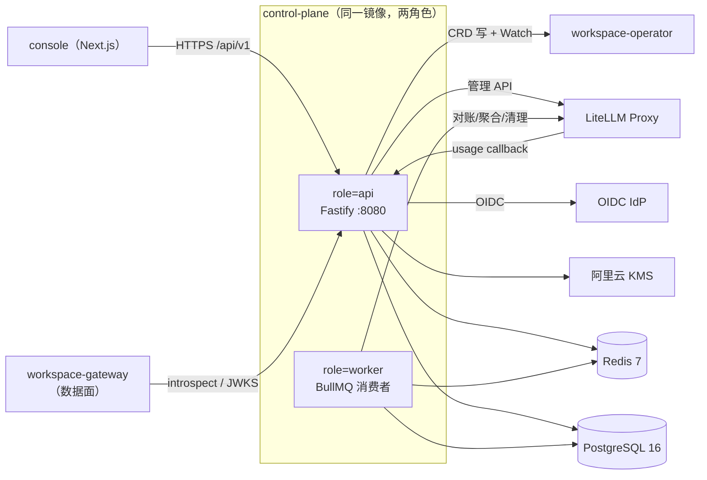
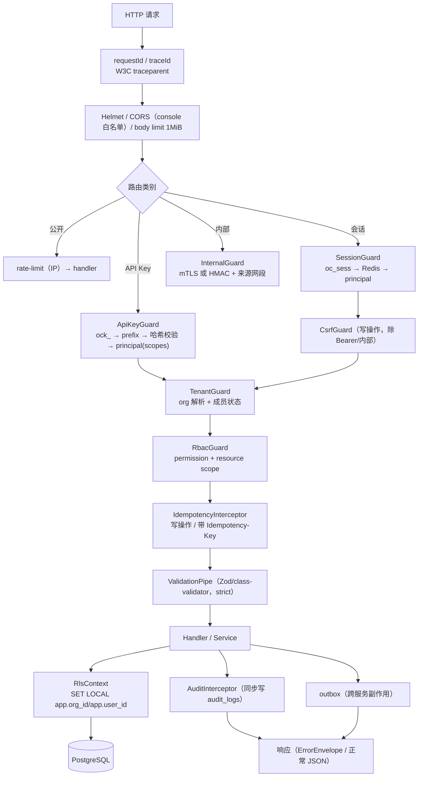
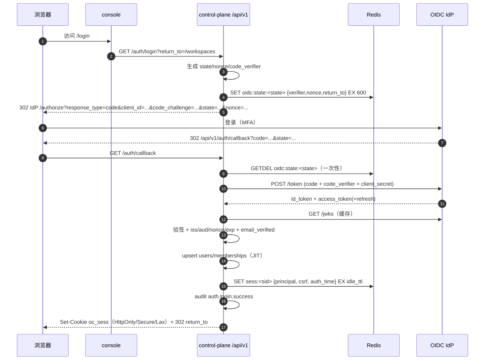
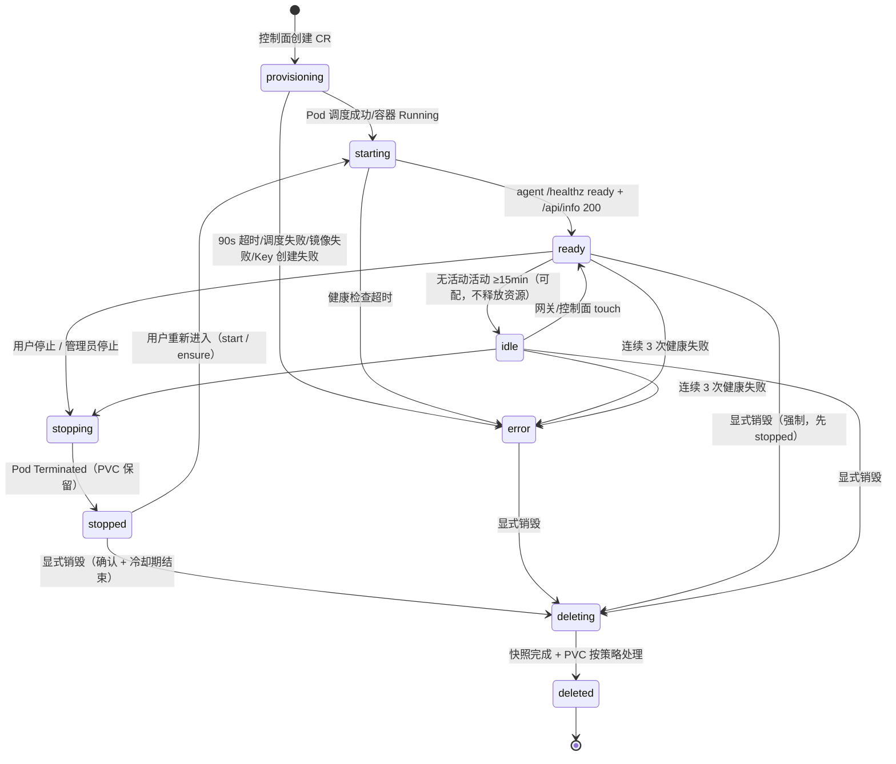
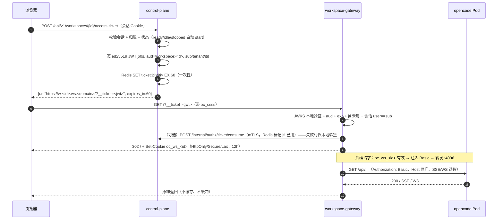

# 平台后端子设计（Control Plane / BACKEND）

- 版本：v0.1（P2 架构子设计，待 G2 评审）
- Owner：`platform-backend`（G4 主持）
- 任务：task-4 / P2-S
- 上游基线：opencode `2.2.5`（commit `4f271bcd…`，只读）
- 关联文档：[ARCHITECTURE.md](../ARCHITECTURE.md)、[DATA-MODEL.md](../DATA-MODEL.md)、`openapi.yaml`、[SECURITY.md](../SECURITY.md)、[deploy/DEPLOYMENT.md](../deploy/DEPLOYMENT.md)、[centers/CENTERS.md](../centers/CENTERS.md)
- 写作用域：`docs/02-architecture/services/`（不写根文件）
- 状态：**草案**；与 architect 的 ARCHITECTURE/DATA-MODEL 已按 §13 待对齐项逐条比过

> 约定：本文所有表/接口均标注**租户键**与**鉴权方式**。接口路径统一 `/api/v1`，错误体统一 §2.5。
> 本文只做服务内部设计；权威 DDL 以 `DATA-MODEL.md` 为准，权威 HTTP 契约以 `openapi.yaml` 为准。
> 两处不一致时：**租户键/鉴权更严格者优先**，并回写两侧。

---

## 0. 结论摘要（TL;DR）

| # | 决策 | 理由 / 约束 |
| --- | --- | --- |
| B1 | 控制面 = NestJS 11 + Fastify（单镜像、双角色：`api` 与 `worker`），PostgreSQL 16 + Redis 7；**不代理用户会话流量** | 用户流量走 workspace-gateway（ARCHITECTURE §7.1），控制面故障不影响已登录用户使用工作区 |
| B2 | 认证 = OIDC code flow + PKCE(S256) + 服务端会话（Redis，opaque cookie `oc_sess`，HttpOnly/Secure/SameSite=Lax） | 不把 IdP token 暴露给浏览器 JS；会话可即时吊销 |
| B3 | 授权 = RBAC（owner/admin/member/viewer）+ 资源范围 + 平台管理员；**每请求租户上下文** `AsyncLocalStorage` → PG `SET LOCAL app.org_id/app.user_id` → RLS | 越权默认拒绝；跨租户一律 404（避免存在性探测） |
| B4 | API Key = `ock_<kid>_<secret>`；**HMAC-SHA256 + 带版本 pepper** 存哈希；scope/过期/轮换/吊销 ≤5s | 256-bit 随机密钥无需慢哈希；architect 已裁定采纳（A1 关闭），pepper 轮换见 §3.4 |
| B5 | 模型中心三层执行：**策略解析（控制面）→ LiteLLM 虚拟 Key `models` 允许集合（权威执行点）→ opencode `policies`/`model`（UX 隐藏）** | 模型调用不经过控制面；LiteLLM 是唯一能对每次请求强制授权与记账的位置 |
| B6 | 虚拟 Key **每工作区一把**（budget 归属 user/tenant），只注入 L1 托管配置；用户在工作区内可见但**仅限本租户配额，可即时吊销** | 用户有终端，任何容器内配置都可能被读；不能下发平台主 Key |
| B7 | 工作区编排：控制面只写 CRD `OpencodeWorkspace.spec`，Operator 收敛；状态权威在 `workspaces.state`（9 态，ARCHITECTURE §7.2） | 控制面故障不丢状态；"退出不销毁"由状态机边界保证 |
| B8 | 访问 = 子域名 `w-<id>.ws.<domain>` + **ed25519 JWT 60s 一次性票据** + gateway 本地 JWKS 验签 → 注入上游 Basic | 不查 DB；上游密码/会话永不下发浏览器；PTY/SSE/WS 原样透传 |
| B9 | 显式销毁 = `POST /workspaces/{id}/destroy` + 请求体二次确认（`confirm_name` + `acknowledge_data_loss`）→ 202 + 冷却期（**默认 5min，可配 5–1440min**）→ 快照 → 删 PVC；PVC 保留 24h 快速恢复 → 之后仅快照 30d | 满足 R3.3；冷却期内可取消且工作区仍可用；与 `openapi.yaml`/PRD-E3-03③ 一致 |
| B10 | 计量权威源 = **LiteLLM spend log**（request_id 幂等），opencode `session/stats` 仅对账（偏差 >2% 告警） | 上游无通用计费 API（BASELINE 待核实项 7 关闭结论） |

**核心不变量**

1. 任何业务 SQL 必须在设置了 `app.org_id` 的事务内执行；跨租户读一律 404。
2. 任何公开响应不得包含上游 opencode 密码、LiteLLM 虚拟 Key 明文、平台供应商密钥、其他租户 id。
3. 任何写操作必须落审计（`audit_logs`，append-only），审计失败同事务回滚（单体内）或进 outbox（跨服务）。
4. 工作区销毁只能由显式用户动作触发；不存在任何"空闲自动销毁"默认路径（仅可选的"闲置休眠"保留 PVC，默认关闭）。
5. 控制面不直连工作区 SQLite、不直接 `kubectl exec`；只经 CRD、K8s Watch、工作区内部 HTTP（Basic）与网关。

---

## 1. 范围、边界与依赖

### 1.1 In Scope（本设计）

| 域 | 内容 | 对应需求 |
| --- | --- | --- |
| 身份与访问 | OIDC SSO、会话、登出/吊销、RBAC、`ock_` API Key、审计 | R1.1–R1.4 |
| 模型中心 | provider/model 注册表、策略解析、LiteLLM 虚拟 Key、预算/限流、用量采集、配额执行点、配置下发 | R2.1–R2.6、R10.2 |
| 工作区编排 | 生命周期 API、状态机、CRD 契约、自动拉起、就绪判定、URL/票据、显式销毁、幂等重试 | R3.1–R3.10 |
| opencode 集成 | 配置生成、托管策略防篡改、热更新、健康检查、版本锁定 | R2.6、R3.5、R3.7 |

### 1.2 Out of Scope（由其他域负责）

| 内容 | Owner | 接口边界 |
| --- | --- | --- |
| CRD 的 reconcile 实现、Pod/PVC/Service/Ingress 创建、镜像、探针 | infra-devops | 本文给 CRD 契约（§5.2）与就绪判定（§5.4），实现见 `deploy/DEPLOYMENT.md` |
| workspace-gateway 的反代、Basic 注入、SSE/WS 透传 | infra-devops（+architect） | 本文给票据格式（§5.5）与 JWKS 端点 |
| 控制台交互、字段展示 | web-console | 本文给 API 与错误码 |
| Skill/MCP/评测/应用中心的业务逻辑 | capability-centers | 本文给"配置注入契约"（§6.7、§11.3）与共享鉴权原语 |
| LiteLLM 部署、供应商密钥托管、模型路由配置 | infra-devops + 平台管理员 | 本文给 Key 生命周期与调用契约（§4.3） |
| 计费账单、真实扣费 | 后续 | 本文只到 `usage_records/usage_hourly` 与导出接口 |

### 1.3 外部依赖与假设

| 依赖 | 用途 | 失败影响 | 降级 |
| --- | --- | --- | --- |
| OIDC IdP（Keycloak/IDaaS） | 登录、登出、JWKS | 新登录不可用 | 已有会话继续；展示 IdP 故障页；不降级为本地密码 |
| PostgreSQL 16（RDS） | 所有业务状态 | 写操作失败 | 只读缓存（会话/模型目录）；工作区访问不受影响（gateway 不查 DB） |
| Redis 7 | 会话、幂等、限流、吊销黑名单、ticket jti | 会话校验失败 | 会话降级为签名 JWT cookie；幂等降级 DB；限流降级本地令牌桶 |
| LiteLLM Proxy | 模型调用、预算、记账 | 模型不可用 | 已开会话可继续编辑/终端；UI 横幅；不直连供应商 |
| K8s API / Operator | 工作区编排 | 创建/销毁排队 | 已就绪工作区继续服务；outbox 重试 |
| 阿里云 KMS | 供应商密钥、ed25519 私钥、API Key pepper | 启动失败（fail-closed） | 本地开发用 file-based KEK（仅 dev） |
| OSS | 快照、审计归档、导出 | 快照慢 | 销毁前快照失败则**不删 PVC**（安全优先） |

---

## 2. 控制面模块划分与请求链路

### 2.1 运行单元



- `api`：同步 REST + SSE（控制台事件）。水平扩展无状态；会话在 Redis，业务在 PG。
- `worker`：LiteLLM 用量拉取/对账、小时聚合、过期清理、outbox 投递、销毁冷却调度、审计归档。至少 2 副本，BullMQ 锁保证单执行。
- **不使用内存态**做业务判断（除每实例缓存）；重启不丢任务。

### 2.2 NestJS 模块树

| 模块 | 职责 | 依赖 | 写表 | 鉴权/租户说明 |
| --- | --- | --- | --- | --- |
| `AuthModule` | OIDC code+PKCE、回调、会话、登出、会话吊销、IdP 元数据缓存 | Redis、KMS、`IdentityModule` | 无（Redis `sess:*`、`oidc:state:*`） | 登录端点公开；其余需 `oc_sess` |
| `IdentityModule` | `users`、`orgs`、`memberships`、teams、JIT 开户、角色解析 | PG | `users`、`orgs`、`memberships`、`teams`、`team_members` | 全部经 `RlsContext`；`org_id` 必填（platform admin 例外） |
| `RbacModule` | 权限点定义、`can()` 判定、角色矩阵、资源范围 | `IdentityModule` | 只读 | 每请求 `principal`；写操作同时校验 DB 角色（防 JWT 快照过期） |
| `ApiKeyModule` | `ock_` 创建/列表/轮换/吊销、scope 校验、introspection | Redis、PG | `api_keys` | 创建/吊销需会话或具备 `apikey.manage` 的 Key；列表只见自己 |
| `AuditModule` | 审计写入（同步/outbox）、检索、导出、哈希链 | PG、OSS | `audit_logs`、`outbox` | 检索需 `audit.read`；导出平台管理员/owner |
| `ModelRegistryModule` | provider/model 注册表、健康状态、`models.dev` 同步、别名管理 | PG、LiteLLM | `model_providers`、`models` | 读：`member` 可见（按策略过滤）；写：`admin` |
| `ModelPolicyModule` | 策略 CRUD、解析器、revision、下发 | PG、Redis | `model_policies`、`model_policy_rules` | 写：`admin`；读：`member` 仅见自己可用的解析结果 |
| `VirtualKeyModule` | LiteLLM Key 生成/更新/轮换/吊销、指纹、预算绑定 | LiteLLM、KMS | `litellm_keys`（新增，§13-A2） | 仅服务内部与 `admin` 管理端点；用户不可见明文 |
| `UsageModule` | LiteLLM spend log 拉取、`request_id` 幂等入库、聚合、对账、导出 | PG、LiteLLM | `usage_records`、`usage_hourly` | 用户读自己；`owner/admin` 读本 org；导出需 `usage.export` |
| `QuotaModule` | org/user 配额与预算、超限判定、提升申请 | PG、Redis | `quota_limits`（新增，§13-A3） | 写 `admin`；读 `member` 自己 |
| `WorkspaceModule` | 生命周期 API、状态机、CRD 客户端、Watch 映射、销毁流程 | K8s、PG、outbox | `workspaces`、`workspace_events`、`workspace_snapshots` | 仅 owner 可见/操作；org admin 经视图只读元数据 |
| `WorkspaceConfigModule` | 生成 L1/L2 配置、revision、推送、校验和 | PG、Redis pub/sub、agent | `workspace_config_revisions`（新增，§13-A4） | 仅内部 + owner 只读自己的 `applied_revision` |
| `AccessTicketModule` | ed25519 JWT 签发、JWKS、jti 登记 | KMS、Redis | 无（Redis `ticket:jti:*`） | 需会话 + 工作区归属；TTL 60s |
| `EventModule` | 控制台 SSE（`workspace_events`、quota、destroy 提醒） | PG、Redis | 读 | 按 org 过滤；`Last-Event-ID` 续传 |
| `AdminModule` | 平台管理员：org/user 管理、全局模型、全局审计、运维开关 | 全部 | 全部（platform scope） | `platform_admin` 角色，强制 MFA（IdP `acr`） |
| `HealthModule` | `/healthz`、`/readyz`、`/metrics` | PG/Redis/K8s/LiteLLM 探针 | 无 | 内网/监控白名单，不暴露公网 |

**模块依赖原则**：`Auth → Identity → Rbac`；业务模块只依赖 `Rbac`、`Audit`、`Quota`，**不得**互相直接调用；跨域用 `outbox` 事件。`WorkspaceConfigModule` 不读 `WorkspaceModule` 的私有状态，只读 `workspaces.config_revision`。

### 2.3 请求处理链路（中间件顺序，固定不可换）



**关键规则**

1. `TenantGuard` 之前**不触达业务表**；`TenantGuard` 之后所有 repository 必须经 `RlsContext`（类型系统上禁止裸 `pg` 调用）。
2. 会话请求：读+写都校验；对写操作额外校验 `memberships.status='active'`（防 JWT 快照过期）。
3. API Key 请求：`org_id` 必须来自 Key 行，**不信任请求体/查询参数**；Key 可携带 `org_id` 限定（默认绑定创建时 org）。
4. 所有写接口幂等语义见 §5.7；重复 `Idempotency-Key` 返回首次响应，不重复执行副作用。
5. 响应不缓存鉴权结果（除 gateway 侧的 introspection 5s 缓存，显式版本失效）。
6. 慢查询阈值 200ms 记 `pg_slow_query_total`；P99 超过 300ms 读 / 800ms 写告警（PLAN NFR）。

### 2.4 租户上下文传播

```ts
// 请求生命周期内唯一可信来源
interface Principal {
  kind: "user" | "api_key" | "internal"
  userId: string          // users.id
  orgId: string           // orgs.id = 租户键
  role: "owner" | "admin" | "member" | "viewer"
  scopes: string[]        // API Key scopes；会话用户为 ["*"]（受 RBAC 限制）
  apiKeyId?: string
  sessionId?: string
  platformAdmin?: boolean
  requestId: string
  authTime: number
  amr: string[]           // 认证方式，step-up 用
}
```

| 传播点 | 机制 | 校验 |
| --- | --- | --- |
| HTTP 请求内 | `AsyncLocalStorage<Principal>`（`RequestContext`） | 无 principal 调用 repository → 抛 `TenantContextMissing`（500，测试必须 0） |
| PG 事务 | `SET LOCAL app.org_id/app.user_id/app.is_platform_admin` | RLS 策略强制；连接池归还前 `DISCARD ALL` |
| 跨服务消息 | outbox payload 显式 `org_id` + `request_id` + `actor` | 消费端重新设置 RLS 上下文，不继承发送端 |
| K8s 资源 | `opencode.cloud/org-id`、`opencode.cloud/workspace-id` label + namespace `ws-<orgId>` | Operator 校验 label 与 CR spec 一致，漂移拒绝 |
| 日志 | 结构化字段 `org_id/user_id/request_id`；密钥字段脱敏白名单 | 日志扫描发现 token 形态 → 告警 |
| 上游 opencode | `X-Request-Id`、`X-OC-Org`（仅内部，不用于鉴权） | 上游不感知租户；鉴权靠 Basic |
| LLM 请求 | LiteLLM Key metadata：`{tenant_id,user_id,workspace_id,key_id}` | 计量回调解出 `org_id`，缺失则拒收 |
| 审计 | 每行强制 `org_id`（平台事件为 NULL，仅 platform_admin 可见） | 写审计前断言 org 一致 |

### 2.5 错误模型

**传输**：`application/json`，统一包裹 `{"error": {...}}`（**与 `openapi.yaml` `ErrorEnvelope` 完全一致**；早期草案的 RFC 9457 形式废弃）。

```json
{
  "error": {
    "code": "conflict",
    "reason": "workspace_destroy_cooldown",
    "message": "工作区处于销毁冷却期，请先取消或等待",
    "request_id": "req_01H...",
    "details": { "destroy_scheduled_at": "2026-11-04T12:00:00Z" }
  }
}
```

**两层错误模型（architect 已裁定，`openapi.yaml` §ErrorCode/ErrorReason）**

- 第一层 `code`：**16 个通用分类**，客户端据此做统一动作（重试/跳转/提示）。只增不改。
- 第二层 `reason`：**领域原因**（23 个 lower_snake，产品码 `UPPER_SNAKE` 的小写形式）；业务错误建议必填。**不要**把领域原因塞进 `details.reason`。

| code（16） | HTTP | 语义 | 客户端动作 | 典型 reason |
| --- | --- | --- | --- | --- |
| `unauthorized` | 401 | 无/过期会话或 Key | 跳 SSO / 换 Key | `auth_session_expired` |
| `forbidden` | 403 | 同租户无权限 / 票据非法 | 展示无权限 | `authz_forbidden`、`ticket_reused` |
| `not_found` | 404 | 不存在**或跨租户**（防探测） | 返回列表 | `workspace_not_found` |
| `validation_failed` | 400 | schema/参数错误 | 修正 | — |
| `conflict` | 409 | 状态/版本/冷却期冲突 | 刷新状态 | `workspace_not_ready`、`workspace_destroy_cooldown` |
| `idempotency_conflict` | 409 | 同 Key 不同请求体 | 换 Key | — |
| `precondition_failed` | 412 | `If-Match`/门禁/扫描未过 | 刷新后重试 | `gate_blocked`、`skill_permission_denied` |
| `quota_exceeded` | 409/429 | 配额/预算耗尽 | 申请提升 | `workspace_limit_reached`、`ws_quota_exceeded`、`model_budget_exceeded` |
| `rate_limited` | 429 | 速率限流 | 按 `Retry-After` | — |
| `unsupported_media_type` | 415 | Content-Type 不支持 | 修正 | — |
| `payload_too_large` | 413 | body >1MiB | 修正 | — |
| `internal_error` | 500 | 未分类/编程错误 | 联系支持 | `tenant_context_missing`（仅内部日志） |
| `database_unavailable` | 503 | PG 不可用 | 重试 | — |
| `orchestrator_unavailable` | 503 | K8s/Operator 不可用 | 重试 | — |
| `model_gateway_unavailable` | 503 | LiteLLM/供应商故障 | 重试/降级 | `model_not_authorized` 走 403，不放这里 |
| `upstream_error` | 502/504 | 工作区/网关不可达 | 重试 | — |

**reason 枚举（23，`ErrorReason`）**：`auth_session_expired`、`authz_forbidden`、`workspace_not_ready`、`workspace_not_found`、`workspace_limit_reached`、`ws_quota_exceeded`、`ws_launch_timeout`、`ws_image_pull_failed`、`ws_storage_full`、`ws_storage_attach_failed`、`model_not_authorized`、`model_budget_exceeded`、`skill_permission_denied`、`gate_blocked`、`share_link_expired`、`mcp_health_down`、`mcp_auth_required`、`app_build_failed`、`config_stale`、`idp_unavailable`、`workspace_destroy_cooldown`、`ticket_reused`、`tenant_context_missing`。

**命名裁定（A11 已关闭）**：`model_not_allowed` 统一为 **`model_not_authorized`**；`oidc_unavailable` 统一为 **`idp_unavailable`**；`workspace_destroy_cooldown`/`model_budget_exceeded`/`tenant_context_missing`/`ticket_reused` 均走 `reason`，**不扩 `code`**。

**错误模型稳定性**：`code` 与 `reason` 都是公共契约，只增不改；`message` 为人类可读中文/英文（`Accept-Language`），不得包含内部堆栈/密钥/其他租户信息；机器分支解析 `code`+`reason`，不解析 `message`。

**上游错误映射**：opencode `UnauthorizedError`→`upstream_error`(502，告警，不把 401 透给用户以免误导)；`ServiceUnavailableError`→`model_gateway_unavailable`/`orchestrator_unavailable`；LiteLLM 429→`rate_limited` 或 `quota_exceeded`+`reason=model_budget_exceeded`；LiteLLM 401→`model_gateway_unavailable`（P0，内部日志 `model_gateway_misconfigured`）。

---

## 3. 认证、会话与 RBAC

### 3.1 OIDC code flow + PKCE

- 提供方：Keycloak / 阿里云 IDaaS / 企业 IdP（标准 OIDC discovery）。
- **客户端归属（lead 裁定，2026-11-04）**：**控制面是唯一 OIDC RP（code+PKCE）**，控制台/CLI/SDK 全部走 `/api/v1/auth/login|callback`；oauth2-proxy **退出主线**（不建自己的会话）。工作区/应用通过 access-ticket 换票进入（§5.5），gateway 只验 ticket，不做 OIDC。若保留 proxy，仅作 forward-auth 反代到控制面会话校验，**禁止**其独立建立会话。
  - ✅ **已解决**：ADR-004 已按 lead 裁决修订为"控制面是唯一 RP；oauth2-proxy 降为可选、不建平台会话"；ARCHITECTURE §6.1/§7.3 与 DEPLOYMENT §6.1/§6.2 已同步（v0.2）。**残余**：DEPLOYMENT:20/44/167 仍提"SSO 会话/oauth2-proxy"，属文案残留，G2 行动项。本文按控制面 RP 描述。
- 客户端：**confidential web client**（client_secret 存 KMS），`redirect_uri=https://console.<domain>/api/v1/auth/callback`。
- 不使用隐式流；不使用密码模式；`response_type=code`。
- PKCE：`code_verifier` 43–128 字符随机，`code_challenge=S256`；`state`、`nonce` 一次性，Redis 10 min。
- ID Token 校验：签名（JWKS，缓存 10 min + `kid` 轮换）、`iss`、`aud`、`azp`、`nonce`、`exp/iat`（允许 ±60s 时钟偏移）、`email_verified`（可配置必须）。
- 用户开户：以 `(issuer, subject)` 为稳定锚点；首次登录 JIT 创建 `users` + personal org + `memberships(owner)`；**不按 email 合并**（防接管）。
- 角色映射：IdP group → org 角色（`opencode-org-<slug>-owner/admin/member/viewer`）可配置；首次创建默认 `member`，personal org 为 `owner`。group 同步在每次登录 + worker 周期（1h）执行，变更写审计并踢出旧会话（角色降级时）。
- Step-up：`admin` 危险操作（删除 org、导出全量审计、轮换平台密钥）要求 `auth_time ≤ 10min` 或 `acr=urn:mace:incommon:iap:silver`，否则 302 重新认证（`prompt=login`）。



**失败路径**：`state` 不存在/过期 → 400 `validation_failed`（不重放）；token 交换失败 → 503 `idp_unavailable` + 审计；`email_verified=false` → 403 `forbidden`（reason `authz_forbidden`）；用户 `status=suspended` → 403 `forbidden`（reason `authz_forbidden`）。所有失败最多暴露"登录失败"，不暴露 IdP 原始错误。

### 3.2 会话

| 项 | 设计 |
| --- | --- |
| Cookie | `oc_sess`：opaque 256-bit（base64url），`HttpOnly; Secure; SameSite=Lax; Path=/; Domain=console.<domain>` |
| 服务端存储 | Redis `sess:<sid>`（AES-GCM 加密 blob，KMS DEK 缓存 5min）；TTL = idle 30min（可配 8h 上限），绝对 12h（可配 7d） |
| 滑动续期 | 每 5min 最多续一次，避免写放大；续期更新 `last_seen` |
| CSRF | 双提交：`oc_csrf`（非 HttpOnly，随机）Cookie + 请求头 `X-CSRF-Token`；写操作必须匹配；同时校验 `Origin/Referer` 白名单 |
| 会话固定 | 登录成功后**新 sid**；权限/角色变更 → 旧 sid 全部吊销 |
| 并发 | 每用户最多 10 个活跃会话（可配）；超出踢最早 |
| 敏感操作 | 改邮箱/删 Key/销毁工作区/导出审计 → 需 `auth_time` 新鲜（≤10min）或重新认证 |
| 登出 | `POST /auth/logout`：删 Redis 会话 + 吊销该会话签发的所有 ticket jti + `id_token_hint` 302 到 IdP `end_session_endpoint` + 本地 Cookie 清除；`post_logout_redirect_uri` 白名单 |
| 全局登出 | `POST /auth/logout-all`：吊销 `sess:*`（用户维度索引）+ 发布 `authz:revoke` 事件；≤5s 生效 |
| 会话列表 | `GET /api/v1/auth/sessions` 返回设备/IP/最近活动；`DELETE /api/v1/auth/sessions/{sid}` 单踢（待补 openapi） |

**Redis 故障降级**：会话 Cookie 同时带一个加密的自包含 JWT（`oc_sess_jwt`，5min，`kid` 轮换）作为 fallback；Redis 不可用时验证 JWT 并允许读操作，写操作（安全敏感）仍拒绝并返回 `unauthorized`（fail-closed）。JWT 中不包含角色长期快照之外的敏感信息，`sub` 变更/吊销最多延迟 5min，期间审计标记 `degraded_auth=true`。

### 3.3 RBAC 矩阵

**角色定义**：`owner`（组织所有者，含计费/转移/删除）、`admin`（管理成员/策略/全部工作区/审计）、`member`（自有工作区 + 已授权模型/能力）、`viewer`（只读：看自己的用量与工作区状态，不可创建/调用）。

| 权限点 | owner | admin | member | viewer | 范围/说明 |
| --- | --- | --- | --- | --- | --- |
| `org.read` | ✓ | ✓ | ✓ | ✓ | 本 org |
| `org.settings.update` | ✓ | ✓ | — | — | 写操作审计 |
| `org.delete` | ✓ | — | — | — | step-up + 二次确认 |
| `member.invite` | ✓ | ✓ | — | — | 不能邀请 owner |
| `member.remove` | ✓ | ✓ | — | — | 不能移除 owner；admin 不能移除 admin（仅 owner） |
| `role.assign` | ✓ | ✓（≤member/admin） | — | — | 仅 owner 可授 owner |
| `workspace.create` | ✓ | ✓（替他人创建：仅 admin） | ✓（仅自己） | — | 受 `max_workspaces` 配额 |
| `workspace.read.self` | ✓ | ✓ | ✓ | ✓ | owner 语义：自己的 |
| `workspace.read.any` | ✓ | ✓ | — | — | 经 `v_workspaces_admin` 视图（只读元数据，不含代码） |
| `workspace.access` | ✓ | ✓ | ✓（自己） | — | 访问票票据 + gateway |
| `workspace.delete.other` | ✓ | ✓ | — | — | 冷却期 + 审计 |
| `apikey.create.self` | ✓ | ✓ | ✓ | — | 每用户上限 20 把 |
| `apikey.manage.other` | ✓ | ✓ | — | — | 仅吊销（不能看明文） |
| `model.catalog.read` | ✓ | ✓ | ✓（按策略过滤） | ✓（只读） | 未授权模型不可见 |
| `model.policy.manage` | ✓ | ✓ | — | — | 变更 ≤30s 生效 |
| `model.budget.manage` | ✓ | ✓ | — | — | 组织预算 |
| `usage.read.self` | ✓ | ✓ | ✓ | ✓（自己） | — |
| `usage.read.org` | ✓ | ✓ | — | — | 聚合，不含他人提示词 |
| `usage.export` | ✓ | ✓ | — | — | 审计导出行为 |
| `audit.read.org` | ✓ | ✓ | — | — | append-only，检索 |
| `skill.install` | ✓ | ✓ | ✓（已批准） | — | 受 Skill 中心策略 |
| `mcp.bind` | ✓ | ✓ | ✓（已授权） | — | 受 MCP 中心授权 |
| `app.publish` | ✓ | ✓ | ✓ | — | 受应用中心 |
| `platform.admin` | — | — | — | — | 独立平台角色（不属于 org RBAC） |

**判定算法（固定顺序）**

1. 解析 principal；`platformAdmin` → 全通过（但仍审计）。
2. 非 org 资源（如平台模型目录）：读允许（按可见性过滤），写需 `platform.admin`。
3. org 资源：先查 `memberships` 当前角色（不信 JWT 快照），再按资源范围校验（`owner_user_id == principal.userId` 或 org 级）。
4. 特殊 `viewer`：所有写权限点直接拒绝；读取经字段白名单（不返回 token/成本明细以外的敏感字段）。
5. 默认拒绝；缺失权限点视为 `forbidden`（500 告警，提示代码缺陷）。
6. 跨租户：先按 `(org_id, id)` 查；查不到 → `not_found`（不返回 `forbidden`）。

**角色变更生效**：DB 事务提交后，写 `authz:revoke:<userId>` 到 Redis（TTL 5s），API 实例订阅后清本地缓存；会话中的 `role` 快照最多 5s 过期；**写操作始终以 DB 为准**，因此即使快照滞后也不会越权写。

### 3.4 API Key（`ock_`）

**格式**：`ock_<kid>_<secret>`，其中 `kid` = 10 位 base32（小写），`secret` = 32 字节随机 → 43 位 base64url。示例 `ock_7k3m9p2q4r_xL...`（仅示意，非真实）。

| 项 | 设计 |
| --- | --- |
| 明文展示 | **仅创建时返回一次**（响应体 + `Cache-Control: no-store`）；之后任何接口不再返回 |
| 存储 | `prefix`（`ock_7k3m9p2q4r`，用于定位）、`key_hash = HMAC-SHA256(pepper_vN, full_key)`（`pepper` 32B 存 KMS，**per-env、带版本**）、`key_version`（当前 pepper 版本）；`key_hash` 为 bytea；**不存明文** |
| 校验 | 解析 `kid` → 查 `api_keys.prefix`（唯一索引）→ 常量时间比较 HMAC；失败统一 `unauthorized`（不区分"不存在/错误"） |
| Scope | 字符串数组，如 `workspace:read workspace:write model:invoke usage:read`；**只在 Key 认证路径生效**；scope 不能超越用户当前角色（取交集），角色降级后 Key 自动降权 |
| 过期 | `expires_at`（默认 90 天，可选 30/90/365/永不过期由 admin 策略决定）；过期后 401 `unauthorized` |
| 轮换 | `POST /api/v1/api-keys/{keyId}`：生成新 Key（同 scope/过期策略），旧 Key 进入 `rotating` 状态，**重叠期 24h**（可配）后自动吊销；响应只返回新明文；审计 `apikey.rotate` |
| 吊销 | `DELETE /api/v1/api-keys/{keyId}`：DB `revoked_at` + Redis `apikey:revoked:<kid>`（TTL 30d）+ `publish authz:revoke`；网关/API 本地缓存 TTL ≤5s，且订阅即时失效 ⇒ **≤5s 生效** |
| 绑定 | 默认绑定创建时的 `org_id`；不允许跨 org；用户被移出 org 后 Key 自动吊销（异步 ≤5s） |
| 限流 | 每 Key 默认 600 rpm（可配）；超限 429 `rate_limited` + `Retry-After` |
| 审计 | 创建/轮换/吊销/认证失败（聚合）/越权使用全部落审计；`last_used_at` 异步更新（1min 粒度） |
| Introspection | 内部 `POST /internal/authz/introspect`（mTLS）：输入 Key → `{active, userId, orgId, role, scopes, keyId}`；5s 正向缓存 + 吊销事件失效；**不返回哈希** |

**为什么 HMAC-SHA256 而不是 Argon2id**：Key 是 256-bit CSPRNG，离线爆破不可行；Argon2 每请求 ~50ms，无法承载 10k QPS 与 5s 吊销。HMAC-SHA256 可并行、可缓存、可常量时间比较。**architect 已裁定采纳**（A1 关闭），`DATA-MODEL.api_keys` 已改为 `key_hash`(HMAC-SHA256) + `key_version`。

**pepper 轮换（不停机，A1 配套）**

1. KMS 生成 `pepper_v(N+1)`，配置双版本（`current=N+1`，`previous=N`）；服务启动时两者都加载（内存，不落日志）。
2. 新 Key 用 `N+1` 写入 `key_version=N+1`；旧 Key 仍用 `N` 校验（按 `key_version` 选 pepper）。
3. 轮换窗口内双版本并行验证；**不对旧 Key 重哈希**（无明文，不可逆），旧版本保留 90 天（≥最长 Key 有效期）；期间可通过 `POST /api/v1/api-keys/{keyId}` 提示用户轮换。
4. 90 天后禁用 `previous`：`key_version=N` 的 Key 认证失败（401 `unauthorized`），需轮换；提前 30/7 天邮件/站内提醒 + 审计 `apikey.pepper_retire_warning`。
5. 回滚：保留 `N` 的 KMS 版本；将 `current` 回退即可（不丢 Key）。
6. 审计：`apikey.pepper_rotate`（操作人/时间/新版本），失败告警 P0。

### 3.5 审计

| 项 | 设计 |
| --- | --- |
| 存储 | `audit_logs`（append-only，按月分区，≥180 天；归档 OSS 3 年）；`REVOKE UPDATE/DELETE` |
| 写入时机 | 认证成功/失败、登出、会话吊销、Key 全生命周期、RBAC 拒绝、工作区全生命周期、票据签发（采样/聚合）、模型策略变更、预算变更、导出、平台管理操作、跨租户探测 |
| 失败策略 | 控制面单体内：同事务写审计，失败回滚业务；跨服务（gateway 拒绝）：写本地 WAL → worker 补偿；**不允许静默丢失** |
| 防篡改 | 每 org 哈希链：`hash = SHA256(prev_hash || canonical_json(row))`，`prev_hash` 存 `audit_chain_heads`（新增，§13-A5）；每日锚定写入 OSS（WORM/合规桶） |
| 检索 | `GET /audit-logs?from&to&actor&action&resource_type&resource_id&outcome`（分页 cursor）；`owner/admin` 本 org，`platform_admin` 全局 |
| 导出 | `POST /audit-logs/export` 异步任务 → OSS 预签名 URL（15min）；导出行为自身审计 |
| 脱敏 | `detail` 禁止：完整 Key、密码、虚拟 Key、提示词正文、文件内容；只允许 id/名称/状态/计数 |
| 用户删除冲突 | R10.3 要求 30 天删除 vs 审计保留 180 天：采用**假名化**（`users.email→sha256`、`display_name→deleted`），审计行保留但不可反查；法务要求"删除"指个人数据，审计行去标识后保留（见 §13-G0-3） |

**审计动作命名**：`<domain>.<object>.<verb>`，如 `auth.login.success`、`apikey.rotate`、`model.policy.update`、`workspace.destroy.request`、`workspace.destroy.cancel`、`workspace.destroy.complete`、`workspace.transition_rejected`、`gateway.ticket.issue`、`gateway.ticket.reject`。

---

## 4. 模型中心

### 4.1 注册表

| 实体 | 表 | 租户键 | 管理权限 | 说明 |
| --- | --- | --- | --- | --- |
| 供应商 | `model_providers` | `org_id`（NULL=平台级共享） | `platform.admin` 建平台级；org `admin` 建 org 私有（BYOK） | 凭证只存 `credential_ref`（KMS 密文），DB 无明文 |
| 模型 | `models` | `org_id`（NULL=平台级） | 同上 | `litellm_alias` 全局唯一、**不可重命名**（用量归因锚点） |
| 策略 | `model_policies` + `model_policy_rules` | `org_id` | `admin` | revision 单调递增，变更即新 revision |
| 虚拟 Key | `litellm_keys`（新增） | `org_id` | 仅内部服务 + `platform.admin` 只读 | 一行对应 LiteLLM 一把 Key；存 `key_id`/指纹/预算/状态，**不存明文** |

**注册表操作**

- `POST /model-providers`：校验 `base_url`（HTTPS、禁止内网/元数据地址、DNS 解析后二次校验，防 SSRF），凭证写入 KMS，向 LiteLLM `model_list` 添加条目（幂等 key = provider id）。失败回滚（KMS 删除 + DB 事务）。
- `POST /models`：写 `models` + LiteLLM alias 映射；健康探测（一次最小 completion，可关闭）异步。
- `GET /models`：按**解析后的可用集合**过滤（未授权模型不可见，R2.2）；返回上下文/价格/能力标签/健康状态。
- 健康：worker 每 60s 调 LiteLLM `/health` + 供应商探针；`health=down` 自动从可用集合摘除（策略不变，仅 UI/解析降级），恢复自动回归；事件 `model.health.changed`。
- `models.dev` 同步：worker 每日拉取目录，仅作为"建议元数据"（价格/上下文），平台管理员确认后才生效；不自动启用供应商。

### 4.2 策略解析

**输入**：`(orgId, userId, role, teamIds[])`。**输出**：`ResolvedModelPolicy`（可缓存，version 化）。

```json
{
  "version": "mp_01H...:rev42",
  "defaultModel": "litellm/anthropic/claude-sonnet-5",
  "allowed": [
    { "providerId": "litellm", "modelId": "anthropic/claude-sonnet-5", "limits": { "rpm": 60, "tpm": 200000 } },
    { "providerId": "litellm", "modelId": "openai/gpt-5" }
  ],
  "budget": { "monthlyUsd": 200, "scope": "user" },
  "fallbackModels": ["litellm/qwen/qwen3-coder"]
}
```

**解析顺序（固定）**

1. 取 org 默认策略（`model_policies.is_default`，不存在则平台默认）。
2. `deny` 优先：任一匹配的 `deny` 直接排除（资源范围：user > team > role > org；同范围取 `priority` 小者）。
3. `allow` 补集：显式 `allow` 优先于默认允许；若无任何 `allow` 规则，则平台目录中 `enabled` 模型为默认允许（可配置为 `default-deny`，推荐生产开启）。
4. 健康过滤：`health=down` 的模型从 `allowed` 移除（保留在 UI 灰显并给替代）。
5. 预算裁剪：超过用户/org 预算的模型不自动移除（仍可见），但在 LiteLLM Key 的 `models` 中保留，由 LiteLLM 预算拒绝（返回 `model_budget_exceeded`）。
6. 输出写入缓存：`policy:<org>:<user>:<version>` TTL 60s + 主动失效。

**下发路径（≤30s）**

| 步骤 | 动作 | 时延预算 |
| --- | --- | --- |
| 1 | `admin` 保存策略 → DB revision+1（事务） | <50ms |
| 2 | 同步 `litellm_keys` 更新：`models` 允许集合、rpm/tpm、budget（LiteLLM `/key/update`） | ≤1s |
| 3 | 写 `workspaces.config_revision+1`（仅受影响用户的工作区），outbox | <100ms |
| 4 | worker 推 `config.push`（Redis pub/sub → agent SSE 长连；兜底 agent 每 10s 轮询） | ≤2s |
| 5 | agent 原子写 L2 `~/.config/opencode/opencode.json`（model + provider models 白名单） | ≤1s |
| 6 | opencode watcher 重载 provider/model/skill/mcp | ≤2s |
| **合计** | | **p95 ≤6s，SLO ≤30s** |

> **权威执行点在 LiteLLM**：即使 L2 写入失败或用户篡改 L2，未授权模型请求仍被 LiteLLM Key 的 `models` 拒绝。opencode 的 `model`/`policies` 只负责"不可见/不被选择"的体验（R2.2 双保险）。
> **L1 托管策略变更**（如新增供应商 baseURL）走 ConfigMap + operator 滚动，SLO ≤2min，不属于"模型策略 ≤30s"。

### 4.3 LiteLLM 虚拟 Key 生命周期

**粒度**：每工作区一把（`key_alias = oc-ws-<workspaceId>`），metadata 固定 `{tenant_id, user_id, workspace_id}`。理由：用户在工作区内可读配置；按工作区隔离可独立吊销/重建，且预算可归属到用户（LiteLLM `max_budget` 按 key 计，多工作区时由控制面汇总预算，见 §4.4）。

| 阶段 | 触发 | 动作 | 幂等/失败 |
| --- | --- | --- | --- |
| 创建 | 工作区进入 `provisioning` | `POST /key/generate`：`key_alias`、`models`（策略解析结果）、`max_budget`、`budget_duration=30d`、`rpm_limit/tpm_limit`、`metadata`、`duration`（跟随工作区生命周期，不设过期） | 幂等键 `workspaceId`；已存在则 `GET /key/info` 复用；失败重试 3 次（指数退避），仍失败 → 工作区 `error`（`virtual_key_create_failed`），不创建 Pod（避免无 Key 启动） |
| 写入工作区 | Operator 创建 Pod 前 | Key 明文写入 K8s Secret `ws-<id>-llm`（仅同 namespace，RBAC 限制）；以 env `OPENCODE_LITELLM_KEY` 注入 opencode 容器；**不写 ConfigMap**（Secret 避免明文进 Git/ConfigMap 读取面） | Secret 已存在则跳过；diff 时更新 |
| 轮换 | 管理员/定时（90d）/疑似泄露 | 生成新 Key → 更新 Secret → 滚动重启工作区（保留 PVC）→ 旧 Key 宽限 10min 后删除；审计 `model.key.rotate` | 旧 Key 删除失败进 outbox 重试；宽限期防请求中断 |
| 吊销 | 工作区销毁、用户停用、策略禁用供应商、安全事件 | `POST /key/delete` + Redis `llm:revoked:<key_id>`；**≤5s** 生效（LiteLLM 侧即时） | 幂等；失败告警并重试；期间工作区调模型返回 401，opencode 显示可读错误 |
| 预算更新 | 组织/用户预算变更 | `/key/update` 更新 `max_budget`/`rpm_limit` | 幂等；冲突以 DB 为准 |
| 用量绑定 | 每次调用 | LiteLLM 记录 key 维度 spend；回调/拉取后按 `key_id` 反解 `org/user/workspace` | `usage_records.request_id` 唯一 |

**安全边界**：虚拟 Key 明文只存在于 K8s Secret 与容器 env；控制面 DB 只存 `key_id` + 指纹（`sha256(key)` 前 8 字节）用于对账。用户在工作区 `env` 中可见该 Key —— 这是**接受的风险**（否则无法让 opencode 直连 LiteLLM）；边界是该 Key 仅能访问本工作区被授权的模型、有独立预算、可即时吊销，且不能访问控制面/其他租户。BYOK：用户自带供应商 Key 时写入 `model_providers.credential_ref`，由 LiteLLM 使用，**不注入工作区**。

**LiteLLM 管理 API 契约**（v1.x，实现时按部署版本核对）：`POST /key/generate`、`POST /key/update`、`POST /key/delete`、`GET /key/info`、`GET /spend/logs`、`GET /global/spend/logs`、`GET /health`；认证 `Authorization: Bearer <LITELLM_MASTER_KEY>`（仅控制面出口 IP + mTLS）。

### 4.4 预算与限流

| 层级 | 执行点 | 机制 | 超限行为 |
| --- | --- | --- | --- |
| 请求速率 | LiteLLM Key `rpm_limit/tpm_limit` | 令牌桶 | 429 `rate_limited`（带 `retry-after`） |
| 用户月预算 | LiteLLM Key `max_budget` + `budget_duration=30d` | LiteLLM 记账 | 402/429 `quota_exceeded` + reason `model_budget_exceeded`；opencode 会话保留，模型调用失败可读提示 |
| 组织月预算 | 控制面 `quota_limits` + LiteLLM team budget（可选） | 定时汇总 + 预检 | 组织级软限：控制面在 `access-ticket`/模型策略下发时标记 `budget_state=warning`；硬限由 LiteLLM team budget 执行 |
| 每日突发 | 控制面 Redis 滑动窗口（按 user） | 预检（仅 API Key 调用路径） | 429，避免单用户打爆共享供应商 |
| 供应商故障重试 | LiteLLM router `num_retries`/fallback | 自动切备用模型（策略允许的 `fallbackModels`） | 全部失败 → `model_gateway_unavailable` |
| 并发 | 控制面每用户并发工作区上限（默认 1，可配） | DB 唯一约束 + 配额 | 409 `workspace_limit_reached` |

**预算归属**：多工作区时，每把 Key 的 `max_budget` = 用户剩余预算（控制面在创建/每日 00:10 重算）；LiteLLM 预算是"上限"不是"账本"，权威账本仍是 `usage_records`。组织预算由 `usage_hourly` 聚合后判定，超限只降级（不删除工作区），并给 `admin` 发通知。

### 4.5 用量采集与对账

**双源设计**

| 源 | 内容 | 角色 | 延迟 | 幂等键 |
| --- | --- | --- | --- | --- |
| LiteLLM spend log（回调 + 拉取兜底） | 每次请求：key、model、tokens 分项、cost、latency、status、request_id | **权威** | 回调 ≤10s；拉取每 60s | `request_id`（LiteLLM 生成） |
| opencode `GET /api/experimental/session/stats?from&to` | 每工作区会话级 token/cost 聚合 | **仅对账** | 每 15min | `(workspace_id, window)` |

**采集链路**

1. 首选：LiteLLM `litellm_settings.callbacks` 配置自定义 HTTP callback → `POST /internal/litellm/usage`（mTLS + HMAC 签名 + 时间戳 ±5min + 重放缓存）。
2. 兜底：worker 每 60s `GET /spend/logs?start_date&end_date` 增量拉取（按 `request_id` 去重）；回调丢失不影响完整性。
3. 归一化：`tokens_input/output/reasoning/cache_read/cache_write`、`cost_usd`、`model_id`（按 `litellm_alias` 映射）、`org_id/user_id/workspace_id`（Key metadata）。
4. 入库：`INSERT ... ON CONFLICT (request_id) DO NOTHING`；缺 `org_id` → 拒收 + 告警（P1）。
5. 聚合：worker 每小时写 `usage_hourly`（`ON CONFLICT DO UPDATE` 幂等累加，基于明细重算该小时，避免重复）。
6. 对账：每日 03:00 拉取 `session/stats` 与 `usage_records` 按 workspace/day 比对；偏差 >2% 告警（`usage_reconciliation_drift`），输出差异明细到 OSS；不自动改账本（人工确认后才调整，审计记录）。
7. 新鲜度：写入后 ≤60s 可查明细；`usage_hourly` 每小时 +5min 可查；控制台"近 5 分钟"用 Redis 增量计数（近似，标注"估算"）。

**配额执行点汇总**

| # | 执行点 | 检查内容 | 失败返回 | 是否阻断 |
| --- | --- | --- | --- | --- |
| Q1 | 工作区创建 | 每用户工作区数、org 配额 | 409 `workspace_limit_reached` / `quota_exceeded` | 是 |
| Q2 | API Key 认证 | Key 是否过期/吊销、rpm | 401/429 | 是 |
| Q3 | 模型策略解析 | 模型是否在 allowed | 403 `forbidden` + reason `model_not_authorized`（控制面路径） | 是（控制面 API） |
| Q4 | LiteLLM Key `models` | 模型白名单 | 403（网关/上游） | **是（每次调用）** |
| Q5 | LiteLLM 预算/限流 | 月预算、rpm/tpm | 402/429 | 是 |
| Q6 | 工作区准入 | org 预算 `hard_stop` 时拒绝 start | 409 `org_budget_exhausted` | 可配（默认仅告警） |
| Q7 | 控制台展示 | 剩余额度/预警 | — | 否 |

### 4.6 模型配置下发（与 opencode 的接口）

见 §6.2 完整样例；模型相关字段：

- L1（托管，不可改）：`providers.litellm`（`baseURL`、`apiKey="{env:OPENCODE_LITELLM_KEY}"`、`package`、`models` 骨架）、`policies`（`provider.use` 仅允许 `litellm`，其余 `deny`）。
- L2（agent 可写，热更新）：`model`（默认模型）、`providers.litellm.models`（仅策略允许的模型，用于 UI 选择器）、`policies`（可选，模型级 deny 的 UX 提示，非权威）。
- 约束：L2 **不得**写 `apiKey/baseURL`（architect §7.4 约束）；模型策略 ≤30s 的实质执行点是 §4.2 步骤 2（LiteLLM Key）与 L2 的 `model/models`。

---

## 5. 工作区编排

### 5.1 状态机

权威枚举与 `workspaces.state` 一致（ARCHITECTURE §7.2）：`provisioning, starting, ready, idle, stopping, stopped, error, deleting, deleted`。用户任务书中的 5 个核心阶段映射为：`provisioning`（创建）→ `ready/idle`（就绪）→ `stopped`（停止，PVC 保留）→ `deleting`（销毁中）→ `deleted`（终态）；`starting/stopping/error` 为过程/异常态。



| 迁移 | 触发者 | 守卫 | 幂等语义 |
| --- | --- | --- | --- |
| `→provisioning` | 控制面（`ensure`/create） | 配额、org 状态、用户 active；唯一约束 `(org,owner)` | 重复调用返回同一 `workspaceId`（200/202），不重复创建 CR |
| `provisioning→starting` | Operator（观察 Pod） | CR generation/spec hash 一致 | Operator reconcile 天然幂等 |
| `starting→ready` | Operator（agent readiness） | `/healthz` ready + `configAppliedRevision==spec.configRevision` | 条件 Condition 去抖 2s |
| `ready↔idle` | 控制面（activity touch） | 无（仅展示语义） | `last_activity_at` 更新；不触发 Pod 变更 |
| `ready/idle→stopping` | 用户/管理员 | 归属/权限；无进行中的销毁 | 重复 stop 返回当前态 |
| `stopping→stopped` | Operator | Pod Terminated；PVC 保留 | 幂等 |
| `stopped→starting` | 用户/`ensure` | 配额 | 重复 start 幂等 |
| `*→error` | Operator/控制面 | 重试次数/超时阈值 | 记录 `state_reason`，可重试（`POST /restart`） |
| `stopped/error/ready/idle→deleting` | 用户（确认+冷却结束）或 admin 强制 | `destroy_scheduled_at ≤ now`；快照成功（或明确跳过） | 重复销毁请求返回 202/204，不重复删 |
| `deleting→deleted` | Operator | 快照完成 + PVC 标记 `pvc_retain_until=now+24h`；Pod/Service/Ingress 已删 | 终态；重复销毁返回 200 + `deleted`；PVC 由 worker 24h 后按策略处理 |

**非法迁移**：DB 触发器 + 服务层双重拒绝，写 `workspace_events(type=transition_rejected)` + 审计，返回 409 `conflict`。

**退出不销毁（硬约束）**：浏览器关闭、SSE 断开、会话过期、网关重启、`last_activity_at` 长时间不动，**都不产生任何 `stopping/deleting` 迁移**。唯一的自动迁移是 `ready↔idle`（仅 UI 徽标与成本提示）。可选的"闲置休眠"（R3.10）默认关闭，开启后走 `ready→stopping→stopped` 且保留 PVC，必须在用户设置中显式开启。

### 5.2 CRD 契约 `OpencodeWorkspace`

- API 组/版本：`workspace.opencode.cloud/v1alpha1`；Kind：`OpencodeWorkspace`；Scope：`Namespaced`（namespace `ws-<orgId>`）；短名 `ow`。
- **写者**：控制面是 `spec` 唯一写者；Operator 只写 `status` 与 finalizer；用户/其他控制器不改 spec。
- 命名：`ws-<workspaceId>`（`workspaceId` 为 ULID，全局唯一）；label：`opencode.cloud/org-id`、`opencode.cloud/owner-user-id`、`opencode.cloud/workspace-id`、`opencode.cloud/managed-by=control-plane`。
- Finalizer：`workspace.opencode.cloud/finalizer`；`deletionTimestamp` 出现时 Operator 先停 Pod、按策略快照、再删 PVC/Service/Ingress，最后移除 finalizer。

**spec（控制面写）**

| 字段 | 类型 | 必填 | 默认 | 校验/说明 | 租户关系 |
| --- | --- | --- | --- | --- | --- |
| `tenantId` | string | ✓ | — | 必须等于 namespace 的 org label | 租户键（org_id） |
| `ownerUserId` | string | ✓ | — | 与 `workspaces.owner_user_id` 一致 | 用户 |
| `displayName` | string | ✓ | — | 1–64，UTF-8 | — |
| `workspaceVersion` | string | ✓ | — | 平台发布版本（如 `2026.11.1`），Operator 校验兼容矩阵 | — |
| `image` | string | ✓ | — | 仓库地址，**禁止 `:latest`** | — |
| `imageDigest` | string | ✓ | — | `sha256:...`；Operator 只 pull digest | — |
| `resources` | object | ✓ | 4C8G | `requests/limits` 必须相等（4/8Gi）；Operator 拒绝其他值 | — |
| `storage.pvcSize` | string | ✓ | `20Gi` | `>=10Gi`；扩容只增不减 | — |
| `storage.storageClass` | string | ✓ | `alicloud-disk-essd` | 由 infra 提供 | — |
| `storage.retainPolicy` | enum | ✓ | `snapshot-then-delete` | `retain` / `snapshot-then-delete` / `delete` | — |
| `server.port` | int | ✓ | `4096` | 固定 4096（禁止漂移） | — |
| `server.passwordSecretRef` | object | ✓ | — | `{name,key}`，Secret 由控制面生成（32B） | — |
| `config.revision` | int64 | ✓ | `1` | 单调递增；= `workspaces.config_revision` | — |
| `config.managedConfigMap` | string | ✓ | — | `/etc/opencode` 的 ConfigMap 名（平台渲染） | — |
| `config.globalConfigMap` | string | ✗ | — | L2 初值（agent 可写副本） | — |
| `config.hash` | string | ✓ | — | 期望配置内容 sha256；agent 回报应用结果 | — |
| `access.host` | string | ✓ | — | `w-<id>.ws.<domain>`，不可变 | — |
| `access.ticketAudience` | string | ✓ | `workspace:<id>` | 与 AccessTicket `aud` 一致 | — |
| `lifecycle.autoStart` | bool | ✓ | `true` | 首次进入自动拉起 | — |
| `lifecycle.idleSuspend` | bool | ✓ | `false` | 默认关闭；开启后停止保留 PVC | — |
| `lifecycle.destroyAfter` | string | ✗ | — | 仅用户显式设置（RFC3339），默认空=永不 | — |
| `litellm.keySecretRef` | object | ✓ | — | `{name,key}` 指向 `ws-<id>-llm` | — |

**status（Operator 写，控制面只读）**

| 字段 | 类型 | 说明 |
| --- | --- | --- |
| `phase` | enum | `Provisioning/Starting/Ready/Idle/Stopping/Stopped/Deleting/Deleted/Error`（映射 `workspaces.state`） |
| `reason` | string | 机器可读，如 `PodScheduled`、`ImagePullFailed`、`ConfigNotApplied`、`HealthTimeout`、`SnapshotFailed` |
| `message` | string | 人类可读（中文/英文），**不含密钥** |
| `conditions[]` | array | `Ready`、`ConfigApplied`、`StorageReady`、`AccessReady`、`KeyReady`（`type/status/reason/message/lastTransitionTime`） |
| `observedGeneration` | int64 | spec 代际（防旧事件覆盖新 spec） |
| `configAppliedRevision` | int64 | agent 已应用的最高 revision |
| `podName` / `serviceName` / `pvcName` | string | 实际资源名（`pvcName` 供快照/恢复） |
| `url` | string | `https://w-<id>.ws.<domain>/` |
| `lastActivityAt` | RFC3339 | 由 agent 上报（会话/SSE/PTY 活动） |
| `failureCount` | int | 连续失败次数；≥3 进 Error 并告警 |
| `lastTransitionTime` | RFC3339 | 状态机审计 |

**契约测试（G2/G4 必测）**：`kubectl apply` 一份最小 CR → Operator 在 kind 集群创建 4C8G Pod + 2 PVC + Service + Ingress；删除 CR → finalizer 流程完成；status 字段 schema 校验（CRD OpenAPI validation + 控制面客户端 decode）。

### 5.3 自动拉起

| 触发 | 入口 | 条件 | 行为 |
| --- | --- | --- | --- |
| 首次登录 | `POST /workspaces/me/ensure`（console 登录后调用，`Idempotency-Key`） | 用户无未删除工作区；`autoStart=true`；org 状态 active；配额足 | 创建/复用 → 返回 `202 {workspaceId, state, url?}` + SSE 进度 |
| 进入控制台工作区页 | 同上 `ensure` | 同上 | 已有则直接返回；`stopped` 触发 `start` |
| 首次 API 调用（无工作区） | `POST /workspaces/me/ensure`（SDK/CLI 约定） | 同上 | 同上；不隐式创建（需显式调用，避免误触发成本） |
| 从 stopped 进入 | gateway 发现无 `oc_ws` cookie → 控制面 `ensure`/`start` | `autoStart=true` | 异步拉起，前端展示阶段进度，可离开页面（后台继续） |
| 管理员/平台运维 | `POST /workspaces/{id}/start` | `workspace.start` 权限 | 同上 |
| 禁止 | 用户访问他人工作区 URL | 归属校验失败 | 404，不触发任何拉起 |

**去重与并发**：`(org_id, owner_user_id) WHERE deleted_at IS NULL` 唯一约束 + Redis 锁 `ws:ensure:<user>`（10s）双重保障；同一用户并发 `ensure` 返回同一 `workspaceId`（首次 202，后续 200/202）。K8s CR 名确定性生成，重复 create 为 `AlreadyExists` → 视为成功。

**90s 预算分解**（R3.2 p95）：准入+CR 写 ≤1s；调度 ≤10s（预热池节点）；镜像拉取 ≤25s（预拉取 + P2P 分发）；Pod 启动+opencode 初始化 ≤20s；agent 配置应用 ≤10s；健康确认 ≤10s；票据/跳转 ≤1s。预热池（P1 优化）可将调度+镜像拉取降到 ≤5s。

### 5.4 就绪判定

| 层 | 探针 | 判定 | 失败行为 |
| --- | --- | --- | --- |
| agent | `GET 127.0.0.1:8081/healthz` | `{ready:true, opencode:{status:"ready",version}, configAppliedRevision, supervisor:"ok"}` | Operator 标记 `ConfigApplied=False`；不切 Ready |
| opencode | agent 内部 `GET /api/info`（Basic，Secret 从 env/文件读） | 200 + `version` 匹配期望 | 503 时不 ready；`retry-after:1` 继续 |
| opencode 启动中 | `/api/info` 503/500 | `status=starting|stopping|failed` | 超时（90s）→ Error |
| 配置 | agent 计算 L1+L2 sha256 与 `spec.config.hash` 对比 | 一致且 opencode 已重载 | 不一致 → 重试写入；连续失败 → Error |
| 技能（可选） | agent 校验已安装 skill 目录 | 至少默认技能可用（R3.5） | 降级为 `degraded`（不阻断 ready） |
| 访问 | Ingress/Service 就绪 | endpoint 可解析 | Operator 置 `AccessReady=False` |

**控制面不直接探 Pod**：只 Watch CR conditions + `workspace_events`；**gateway 也不查 DB**：ready 由 Operator readinessGate 把 Pod 摘出 Service，避免流量打到未就绪 Pod。控制台状态推送：`workspace_events` → 控制面 SSE `/api/v1/workspaces/{id}/events`（`Last-Event-ID` 续传，≤2s 延迟 R3.6）。

### 5.5 URL 与短期访问票据

**URL**：`https://w-<workspaceId>.ws.<domain>/`（子域名，wildcard 证书；**不使用** `/w/{id}/` 子路径，理由见 ARCHITECTURE ADR-003）。



| 项 | 设计 |
| --- | --- |
| 票据格式 | JWT，`alg=EdDSA`（ed25519，私钥 KMS 托管，公钥 JWKS `GET /.well-known/workspace-jwks.json`，**根路径，与 `openapi.yaml` 一致**） |
| Claims | `iss=https://console.<domain>`、`aud=workspace:<id>`、`sub=<userId>`、`tenant=<orgId>`、`ws=<workspaceId>`、`jti`（随机）、`iat/exp`（60s）、`ticket_rev`（用户吊销版本） |
| 一次性 | Redis `ticket:jti:<jti>`（SETNX，60s）；gateway 本地验签 + 可选 consume；重复使用 → 401 `ticket_reused` |
| 会话绑定 | gateway 只验 ticket（`sub`=用户、`ws`=工作区、`jti` 未用）并设置 `oc_ws_<id>`；**不依赖 oauth2-proxy**。可选 forward-auth 到控制面 `/api/v1/me` 做会话级吊销检查（控制面为唯一 RP） |
| 工作区 Cookie | `oc_ws_<workspaceId>`（opaque，Redis 映射到 `{userId, orgId, sessionId, jti}`，12h）；用户登出/踢出/销毁时删除（pub/sub） |
| 不查 DB | gateway 只依赖 JWKS + Redis（可选）；DB 故障时已登录用户仍可进入（ARCHITECTURE §7.1） |
| 撤销 | 用户登出/销毁/踢出：写 `ws:revoke:<workspaceId>` + pub/sub；gateway 5s 内清理；票据 ≤60s 自然过期 |
| SSE/WS | 透传 `Upgrade/Connection`、`location[*]`、`ticket` query；read timeout ≥3600s，关闭 buffering；PTY 的 `connect-token` 走 Basic 注入后由控制面/网关透传 |
| 禁止 | 不把票据写日志（URL query 需脱敏）、不把票据放 Referer（302 后立即从 URL 移除）、不把上游密码/会话 Cookie 下发浏览器 |

**访问失败降级**：JWKS 获取失败（控制面挂）→ gateway 用**本地缓存公钥**（最长 24h，启动时预热）继续验签；票据过期 → 前端重新请求（用户无感）；控制面全挂 → 已建立的 `oc_ws` 会话继续可用，新进入失败并提示。

### 5.6 显式销毁（二次确认 + 冷却期 + PVC 策略）

| 步骤 | 接口/动作 | 语义 |
| --- | --- | --- |
| 1. 预检 | `GET /workspaces/{id}/destroy/precheck` | 返回工作区名、当前状态、快照是否可用、PVC 大小、冷却期、需输入的名称；要求 `workspace.delete` |
| 2. 二次确认 | `POST /workspaces/{id}/destroy`，body `{"confirm_name":"<display_name>","acknowledge_data_loss":true,"keep_snapshot":true}`（与 `openapi.yaml` `DestroyWorkspaceRequest` 一致） | 名称必须精确匹配（trim 后）；`acknowledge_data_loss` 必须为 `true`；否则 400 `validation_failed`；写审计 `workspace.destroy.request` |
| 3. 冷却期 | 立即置 `destroy_scheduled_at = now + cooldown`（**默认 5min，可配 5–1440min**；org/admin 可配），返回 `202 {state, destroy_scheduled_at, cancel_url}`；**状态仍可用**（不停机） | 冷却期内可 `POST /workspaces/{id}/destroy/cancel`（审计）；冷却期内重复销毁请求返回 202（幂等） |
| 4. 到期执行 | worker 扫描 `destroy_scheduled_at ≤ now AND state ∈ {stopped, error, ready, idle}` → 先 stop（若在运行）→ **创建 VolumeSnapshot（`pre_delete`）** → 置 `deleted` | 快照失败：**不进入 deleted、不删 PVC**，状态 `error`（`code=internal_error`、`details.phase=snapshot`），告警，可重试；审计 `workspace.destroy.failed` |
| 5. PVC 两段式 | 置 `deleted` 后 **PVC 先保留 24h**（快速恢复窗口）；24h 后按 `retainPolicy`：`retain`：长期保留 PVC；`snapshot-then-delete`（默认）：删 PVC，**快照保留 30d**；`delete`：直接删（需 admin 强制，个人用户不可选） | 快照记录 `workspace_snapshots(trigger=pre_delete)`；恢复入口在 24h 窗口内优先用 PVC，之后用快照（≤10min）；`pvc_retain_until` 由 worker 清理 |
| 6. 完成 | Operator 置 `Deleted`，移除 finalizer；控制面写 `deleted_at`，吊销虚拟 Key、删工作区 Secret、清 `oc_ws` 会话、审计 `workspace.destroy.complete` | 软删记录保留 30 天；期间可恢复（从快照重建，需平台管理员，审计） |
| 7. 强制销毁 | `POST /workspaces/{id}/destroy?force=true`（仅 `platform.admin`；`openapi.yaml` 预留 `force` 参数，待补） | 跳过冷却（仍二次确认），审计 + 告警；用于安全事件/滥用 |

**状态变化**：确认后不立即进入 `deleting`（工作区仍可用），到期才 `stopping→stopped→deleting→deleted`；`deleting` 后不可取消。DELETE 幂等：已 `deleted` 返回 200（含 `deleted_at`），不重复操作。

**PVC 与数据安全**：默认 `retain: true`（4C8G 用户数据不丢）；销毁是**唯一**删除用户数据的路径，必须二次确认 + 冷却期 + 快照 + 审计。禁止任何后台任务自动清理"长期未使用"的 PVC。

### 5.7 幂等与重试

| 操作 | 幂等键 | 存储 | 冲突语义 |
| --- | --- | --- | --- |
| 创建/ensure 工作区 | `Idempotency-Key` + `(org,owner)` 唯一 | Redis 24h + PG 唯一约束 | 同 key 同体 → 首次响应；同 key 异体 → 409 `idempotency_conflict`；唯一约束冲突 → 返回已有工作区 |
| 启动/停止 | 状态机幂等 | DB `version` 乐观锁 | 目标态相同 → 200；非法迁移 → 409 |
| 销毁请求 | `POST /workspaces/{id}/destroy` + 资源状态 | `destroy_scheduled_at` | 重复请求 → 202（幂等）；已删除 → 200/404 |
| 取消销毁 | 状态 | `destroy_scheduled_at` | 无冷却 → 409 `destroy_cooldown_active`（或 200 无变化） |
| 创建 API Key | `Idempotency-Key` | Redis 24h | 同上；防止重复发 Key |
| 轮换 Key | Key id + `Idempotency-Key` | Redis 24h | 同 key 返回同一新 Key（**注意：明文只存 24h 加密缓存**，过期后不可再取） |
| 策略更新 | `If-Match: <version>`（乐观锁） | DB `version` | 版本冲突 → 412 `version_conflict` |
| 票据签发 | 无需幂等（每次新 jti） | — | 每次签发独立；限流防刷 |

**重试策略**：控制面内部调用 LiteLLM/K8s 使用指数退避（100ms→1s→5s，最多 3 次，带 jitter）；仅对幂等操作重试（GET/PUT/DELETE、create 用幂等键）；超时阈值：LiteLLM 5s、K8s 10s、IdP 5s。失败进 outbox（跨服务）而不是无限重试请求线程。

**Outbox**：业务事务内写 `outbox`（同 DB 事务），worker `SELECT ... FOR UPDATE SKIP LOCKED` 投递（审计归档、通知、Key 轮换、配置推送）；`attempts` 指数退避，>10 次进死信 + 告警；消费端幂等（`event_id` 唯一）。

### 5.8 闲置、成本与休眠（R3.10）

- `ready↔idle` 仅语义：`last_activity_at` 由 gateway/agent 上报（SSE/PTY 活动），15min 无活动 → `idle`；**资源不变**。
- 控制台展示：`idle` 徽标 + "常驻成本约 ¥X/天"（按 4C8G 单价从配置读取，不写死）+ 休眠开关（默认关闭）。
- 用户显式开启"闲置休眠"：`PATCH /workspaces/{id}` `{lifecycle:{idleSuspend:true, idleTimeout:"2h"}}` → 到期 `stopping→stopped`（PVC 保留）；下次进入 `start` 恢复；**不删除数据**。
- 成本可见性数据：`workspace_events` + 资源规格 + 单价配置；不接真实账单（Out of Scope）。

---

## 6. opencode 集成

### 6.1 配置分层与路径

| 层 | 路径 | 写入方 | 优先级 | 内容 |
| --- | --- | --- | --- | --- |
| L1 托管 | `/etc/opencode/opencode.json`（ConfigMap ro） | 平台（控制面渲染 → Operator 更新 ConfigMap） | 最高（managedSettings 最后加载） | `policies`、`update:"disable"`、`providers.litellm`（baseURL/package/apiKey env 引用）、`share:"disabled"`、`skills` 骨架、`mcp` 骨架 |
| L2 全局 | `$OPENCODE_CONFIG_DIR/opencode.json`（默认 `~/.config/opencode/`） | workspace-agent（原子写） | 中 | `model`、`providers.litellm.models`（策略允许集）、`skills[]`、`mcp.servers`、用户偏好 |
| L3 项目 | `/workspace/.opencode/opencode.json` | 用户/仓库 | 低 | 项目 agents/commands/instructions；**不写凭证** |

**证据链**（上游 code）：`packages/core/src/config.ts` 加载顺序 `[...managedPolicies, ...integration, ...wellknown, ...global, ...explicit, ...direct, ...project, ...content, ...managedSettings]`（低→高）；`managedSettings` 最后加载压过用户文件；`managedPolicies` 最先加载以保持策略最终权威。`packages/core/src/config/discovery.ts` 系统目录 Linux `/etc/opencode`；`normalize.ts` 兼容 `provider`/`permission`/`experimental.policies` 旧键，平台统一写 v2 原生键 `providers`/`permissions`/`policies`。

### 6.2 生成的配置样例

L1（托管，`/etc/opencode/opencode.json`；**apiKey 用 env 引用，Secret 注入**）：

```jsonc
{
  "$schema": "https://opencode.ai/config.json",
  "update": "disable",
  "share": "disabled",
  "providers": {
    "litellm": {
      "name": "OpenDream Cloud 模型网关",
      "package": "@opencode/ai/providers/openai-compatible",
      "settings": {
        "baseURL": "https://litellm.<domain>/v1",
        "apiKey": "{env:OPENCODE_LITELLM_KEY}"
      },
      "models": {}
    }
  },
  "policies": [
    { "action": "provider.use", "resource": "*", "effect": "deny" },
    { "action": "provider.use", "resource": "litellm", "effect": "allow" }
  ],
  "skills": [],
  "mcp": { "servers": {} }
}
```

> `policies` 中 `*` deny + `litellm` allow 的顺序不能反（last match wins）；`models` 留空，由 L2 补齐 UI 选择器；`apiKey` 引用 env，Secret 名 `ws-<id>-llm`，env 名 `OPENCODE_LITELLM_KEY`。

L2（agent 写；示例）：

```jsonc
{
  "model": { "providerID": "litellm", "model": "anthropic/claude-sonnet-5" },
  "providers": {
    "litellm": {
      "models": {
        "anthropic/claude-sonnet-5": { "name": "Claude Sonnet 5" },
        "openai/gpt-5": { "name": "GPT-5" }
      }
    }
  },
  "skills": [
    "https://skill-center.<domain>/s/<org>/<skill>/<version>/<path-token>/index.json"
  ],
  "mcp": {
    "servers": {
      "jira": { "type": "remote", "url": "https://mcp-hub.<domain>/v1/proxy/jira", "headers": { "X-OC-Mcp-Token": "{env:OC_MCP_JIRA}" } }
    }
  }
}
```

> `skills` URL 形态遵循上游 `SkillDiscovery`：目录基址 + `index.json`（`skills[].files[]`），逐个文件下载；**令牌必须放路径段，不能放 query**（上游 `new URL("index.json", base)` 会丢弃 base 的 query，子文件请求 403，见 ADR-010:43）；必须支持 ETag 缓存与令牌过期重取（≤15min）。MCP 远程走 Hub 代理（凭证由 Hub 注入，工作区不持有上游凭证）；本地 stdio MCP 仅镜像内置白名单。

**生成器约束**：JSON 必须可通过上游 `Config.Info` 解码；生成后调用 `opencode debug config`（或 SDK `config.get`）做**契约校验**，失败则拒绝下发并告警；不生成 `server` 顶层键（上游 v2 不支持，端口用 CLI `--port 4096`）。`$schema` 固定。

### 6.3 托管策略防篡改

| 威胁 | 对策 |
| --- | --- |
| 用户改 L1 绕过模型网关 | L1 为 ConfigMap 只读挂载（`readOnly: true`），容器内非 root 用户无写权限；`securityContext.readOnlyRootFilesystem=true`；agent 以受限 SA 运行 |
| 用户改 L2 添加未授权模型 | LiteLLM Key `models` 白名单是权威（§4.2）；L2 只影响可见性；策略变更以 Key 为准 |
| 用户改 L2 指向外部 baseURL | L2 **不允许**写 `providers.*.settings.baseURL/apiKey`；L1 的 provider 定义压过 L2（合并顺序）；agent 写 L2 时 schema 白名单拒绝这些键 |
| 用户删/改托管文件 | ConfigMap 挂载不可写；agent 定期（30s）校验 `sha256(/etc/opencode/opencode.json)` 与期望一致，不一致上报 `ConfigDrift` 事件并告警（Operator 可重建 Pod） |
| 用户杀 agent 改状态 | agent 只上报，不授权；ready 由 Operator 判定；杀 agent → readiness 失败 → Pod 重启 |
| 镜像内篡改 opencode | 镜像 digest 锁定 + 签名校验（cosign）+ 只读根文件系统；升级走金丝雀 |
| 技能/MCP 注入恶意代码 | Skill 中心签名/扫描/评测准入；MCP 走 Hub 代理 + 凭证不出网关；高风险能力需审批（capability-centers 负责） |

**配置内容签名**：控制面生成 L1/L2 时计算 `config.hash`（canonical JSON sha256）；agent 应用前校验 `spec.config.hash`，应用后上报 `configAppliedRevision`；Operator 仅在 `ConfigApplied=True` 时置 Ready。

### 6.4 热更新

| 变更类型 | 路径 | 时效 | 是否需要重启 |
| --- | --- | --- | --- |
| 模型策略（允许集/默认模型） | 控制面 → LiteLLM Key update + L2 原子写 → opencode watcher | ≤30s（实测 p95 ≤6s） | 否 |
| Skill 安装/卸载 | Skill 中心发布 → 控制面更新 L2 `skills[]` → agent 拉取索引/文件 → opencode watcher | ≤2min（R4.3） | 否 |
| MCP 绑定/解绑 | MCP 中心 → L2 `mcp.servers` → opencode 重载 | ≤30s | 否 |
| 供应商 baseURL / platform Key 轮换 | L1 ConfigMap（Operator 更新）+ 工作区滚动（保留 PVC） | ≤2min | 是（滚动，非销毁） |
| `update:disable`/`share` | L1 | 随 Pod 创建 | 否（稳态不变） |

**原子写**：agent 写 `opencode.json.tmp.<rand>` → `fsync` → `rename` → 保留上一版本 `.bak`；权限 `0600`；失败回滚并上报。写入后发 `config.updated`（上游 watcher 自动触发），agent 不调用上游 `config.update`（该接口仅支持 `shell` patch，见 `handlers/config.ts`）。

### 6.5 健康检查与版本锁定

- **健康**：agent `/healthz`（§5.4）；opencode `/api/info` 需 Basic；**无免鉴权 `/health`**，probe 不写 Secret（agent 内部读取）。
- **启动顺序**：agent 先写 L2 + 校验 L1 → 启动/等待 opencode → 轮询 `/api/info` → 校验配置 hash → 就绪。opencode 崩溃由容器 restartPolicy 重启，agent 重新应用配置（配置在 PVC/ConfigMap，不丢）。
- **版本锁定**：镜像 `registry.<domain>/opencode-workspace@sha256:<digest>`；`workspaceVersion` 与镜像 digest 映射表由发布流水线维护；禁止 `latest`；`update:"disable"` + env `OPENCODE_DISABLE_AUTOUPDATE=1` 双保险；升级 = 新 digest + 金丝雀工作区回归（G7 流程）。
- **兼容矩阵**：控制面生成配置前检查 `workspaceVersion` 支持的最小/最大 schema 版本；不兼容则拒绝变更并提示升级工作区。

### 6.6 安全边界（与上游鉴权）

- 上游密码：每工作区 32B 随机，存 `ws-<id>-server` Secret；`OPENCODE_SERVER_PASSWORD` 注入 opencode 容器；**永不下发浏览器**；网关注入 `Authorization: Basic base64("opencode:<password>")`。
- 上游会话 Cookie：不签发（ADR-005 已否决为主线）；仅紧急降级（gateway 故障且显式开启）时由控制面用密码派生 HMAC Cookie，TTL 不可缩短，需审计与限时开关。
- CORS：opencode 默认仅同源；网关保持 Host 与 Origin，不额外放开。
- PTY/WS：`connect-token`（需 Basic）换一次性 ticket，gateway 原样透传 `ticket`/`Upgrade`/`location[*]`；不记录 ticket 到日志。
- SQLite：每 Pod 本地单写者，控制面**绝不**直连；备份走 PVC 快照，不 `cp` 活文件。

---

## 7. 关键数据模型（本域视角）

> 权威 DDL/RLS 见 `DATA-MODEL.md`；本节列出后端实现必须依赖的字段与新增表建议（§13）。标注：🔑 主键、🏷 租户键、⚡ 唯一。

| 表 | 关键字段 | 🏷 租户键 | 鉴权/可见性 | 保留 |
| --- | --- | --- | --- | --- |
| `users` | id🔑, idp_issuer, idp_subject⚡, email⚡, status | 无（全局） | 自己 + platform_admin | 删除后 30d 匿名化 |
| `orgs` | id🔑, slug⚡, kind, status | id 自身 | 成员可见 | 30d |
| `memberships` | id🔑, org_id, user_id⚡, role, status | org_id | 本 org；RBAC 唯一真相 | 1y |
| `api_keys` | id🔑, org_id, user_id, prefix⚡, key_hash, key_version, scopes, expires_at, revoked_at | org_id | 仅本人（admin 可吊销不可读哈希） | 吊销后 90d |
| `workspaces` | id🔑, org_id, owner_user_id, state, host⚡, config_revision, destroy_scheduled_at | org_id | owner + platform_admin（admin 视图） | 软删 30d |
| `workspace_events` | id🔑, org_id, workspace_id, seq, type, from_state, to_state | org_id | owner；admin 视图 | 热 90d / 归档 1y |
| `workspace_snapshots` | id🔑, org_id, workspace_id, volume_snapshot_name, status | org_id | owner（经 workspace） | pre_delete 30d |
| `model_providers` | id🔑, org_id(NULL=平台), kind, base_url, credential_ref, health | org_id 或 NULL | 读：org+平台；写：admin | 永久 |
| `models` | id🔑, org_id(NULL), provider_id, litellm_alias⚡, input/output_price | org_id 或 NULL | 按策略过滤 | 永久 |
| `model_policies` / `model_policy_rules` | id🔑, org_id, is_default, effect, subject_type, limits, priority | org_id | 读：admin/member 自己解析结果；写：admin | 版本化 |
| `litellm_keys`（新增） | id🔑, org_id, workspace_id⚡, key_id⚡, key_alias, fingerprint, max_budget, rpm_limit, status, rotated_from | org_id | 仅内部 + platform_admin 只读 | 吊销后 1y |
| `usage_records` | id🔑, org_id, user_id, workspace_id, api_key_id, request_id⚡, model_id, tokens_*, cost_usd | org_id | 自己/本 org 聚合 | 180d 明细 |
| `usage_hourly` | id🔑, org_id, bucket_start, user_id, workspace_id, model_id, 聚合 | org_id | 本 org | 3y |
| `audit_logs` | id🔑, org_id(NULL=平台), actor_*, action, resource_*, outcome, detail | org_id 或 NULL | admin/owner；platform_admin 全局 | ≥180d |
| `idempotency_keys` | key🔑, org_id, request_hash, status_code, response | org_id | 服务角色 | 24h |
| `outbox` | id🔑, org_id, topic, payload, status, attempts | org_id | 服务角色 | 7d |
| `workspace_config_revisions`（新增） | id🔑, org_id, workspace_id, revision, config_hash, applied_at | org_id | 内部；owner 只读 applied_revision | 90d |
| `quota_limits`（新增） | id🔑, org_id, subject_type, subject_id, max_workspaces, monthly_usd, rpm | org_id | admin 写，member 读自己 | 永久 |

**RLS 强制**：所有表 `ENABLE/FORCE ROW LEVEL SECURITY`；应用角色非表 owner；每请求 `SET LOCAL app.org_id/app.user_id`；缺失上下文 → 查询返回 0 行并由应用断言失败（P0 告警）。

---

## 8. 控制面 API 契约（v1 摘要）

> 权威 OpenAPI 以 architect 的 `openapi.yaml` 为准；本节给**鉴权/幂等/租户**语义，供契约测试。根路径 `/api/v1`。分页统一 `cursor/limit`（默认 20，最大 100），响应 `{data, next_cursor, total?}`。

### 8.1 认证与会话

| 方法 | 路径 | 鉴权 | 租户键 | 幂等 | 说明 |
| --- | --- | --- | --- | --- | --- |
| GET | `/api/v1/auth/login` | 公开 | — | — | 302 IdP（state/nonce/PKCE）；`redirect_uri` 白名单，`prompt=login` 强制重认证 |
| GET | `/api/v1/auth/callback` | 公开（一次性 state） | — | — | 校验并建会话；302 |
| POST | `/api/v1/auth/logout` | 会话 | 会话 org | 是（重复登出 204） | 删会话 + IdP 登出；同源 CSRF |
| POST | `/api/v1/auth/refresh` | 会话 | 会话 org | 是 | 滑动续期（返回 `Session`；不延长绝对上限） |
| GET | `/api/v1/me` | 会话 | 会话 org | — | 当前 principal + org + role + permissions |
| GET | `/api/v1/auth/sessions`（待补 openapi） | 会话 | 用户 | — | 设备列表 |
| DELETE | `/api/v1/auth/sessions/{sid}`（待补） | 会话 | 用户 | 是 | 单踢 |
| POST | `/api/v1/auth/logout-all`（待补） | 会话 | 用户 | 是 | 吊销全部 |

### 8.2 API Key

| 方法 | 路径 | 鉴权 | 租户键 | 幂等 | 说明 |
| --- | --- | --- | --- | --- | --- |
| GET | `/api/v1/api-keys` | 会话/Key | 用户+org | — | 仅元数据（prefix/last_used/expires） |
| POST | `/api/v1/api-keys` | 会话 | 用户+org | `Idempotency-Key` | 明文仅此一次；scopes 需 ⊆ 角色权限 |
| POST | `/api/v1/api-keys/{keyId}` | 会话 | 用户+org | `Idempotency-Key` | 轮换（`openapi.yaml` 用 POST 同路径）；新旧重叠 24h |
| DELETE | `/api/v1/api-keys/{keyId}` | 会话 | 用户+org | 是 | ≤5s 生效 |
| POST | `/internal/authz/introspect` | mTLS | 由 Key 解出 | — | 网关内部；5s 缓存 |

### 8.3 模型中心

| 方法 | 路径 | 鉴权 | 租户键 | 幂等 | 说明 |
| --- | --- | --- | --- | --- | --- |
| GET | `/models` | 会话/Key | org | — | 已解析可用集合（未授权不可见） |
| GET | `/models/{id}` | 会话/Key | org | — | 详情/健康/价格 |
| GET | `/model-providers` | 会话 | org（含平台） | — | 不返回凭证 |
| POST/PATCH/DELETE | `/model-providers/{id}` | `admin` | org | `If-Match` | SSRF 校验、KMS 写入 |
| GET/PUT | `/model-policies` | 会话（读）/`admin`（写） | org | `If-Match`（version） | 变更 ≤30s 生效 |
| GET | `/model-policies/resolved` | 会话 | 用户+org | — | 当前用户解析结果（含默认模型/允许集） |
| GET | `/models/usage` | 会话 | 用户/org | — | 用量聚合（见 §8.5） |

### 8.4 工作区

| 方法 | 路径 | 鉴权 | 租户键 | 幂等 | 说明 |
| --- | --- | --- | --- | --- | --- |
| GET | `/workspaces` | 会话 | org+user | — | 仅自己（admin 视图另开） |
| POST | `/workspaces/me/ensure` | 会话 | org+user | `Idempotency-Key` | 自动拉起；202/200 |
| GET | `/workspaces/{id}` | 会话 | org（owner） | — | 含 state/conditions/url |
| POST | `/workspaces/{id}/start` | 会话 | org（owner） | 是 | stopped→starting |
| POST | `/workspaces/{id}/stop` | 会话 | org（owner） | 是 | ready/idle→stopping |
| POST | `/workspaces/{id}/restart` | 会话 | org（owner） | 是 | error→starting |
| PATCH | `/workspaces/{id}` | 会话 | org（owner） | `If-Match` | display_name/idleSuspend |
| GET | `/workspaces/{id}/events` | 会话 | org（owner） | — | SSE，`Last-Event-ID` 续传 |
| POST | `/workspaces/{id}/access-ticket` | 会话 | org（owner） | — | 签发 60s 票据（限流） |
| POST | `/api/v1/workspaces/{id}/destroy` | 会话（二次确认体） | org（owner） | 是 | 202 + 冷却期；body `confirm_name/acknowledge_data_loss/keep_snapshot` |
| POST | `/api/v1/workspaces/{id}/destroy/cancel` | 会话 | org（owner） | 是 | 冷却期内取消 |
| GET | `/api/v1/workspaces/{id}/destroy/precheck`（待补） | 会话 | org（owner） | — | 销毁预检 |
| POST | `/api/v1/workspaces/{id}/restart`（待补） | 会话 | org（owner） | 是 | error→starting |
| GET | `/api/v1/workspaces/{id}/config`（内部/待补） | 会话 | org（owner） | — | 只读已应用 revision/hash（不含 Key） |
| POST | `/internal/workspaces/{id}/config/push` | mTLS（agent） | org | — | agent 拉取/推送通道（SSE/长轮询） |

### 8.5 用量、配额、审计

| 方法 | 路径 | 鉴权 | 租户键 | 幂等 | 说明 |
| --- | --- | --- | --- | --- | --- |
| GET | `/usage` | 会话/Key（`usage:read`） | org；用户过滤 | — | `from/to/group_by=model,workspace,user` |
| GET | `/usage/summary` | 会话 | org | — | 今日/本月/预算剩余 |
| POST | `/usage/export` | `usage.export` | org | `Idempotency-Key` | 异步 CSV → OSS 预签名 |
| GET | `/quotas` | 会话 | org/用户 | — | 配额与使用 |
| PATCH | `/quotas/{id}` | `admin` | org | `If-Match` | 提额 |
| POST | `/quotas/requests` | 会话 | org | `Idempotency-Key` | 提额申请（可人工审批） |
| GET | `/audit-logs` | `audit.read` | org | — | 过滤/分页 |
| POST | `/audit-logs/export` | `audit.read` + step-up | org | `Idempotency-Key` | 异步导出 |
| POST | `/internal/litellm/usage` | mTLS + HMAC | 由 Key metadata 解出 | `request_id` | 用量回调 |
| GET | `/healthz` `/readyz` `/metrics` | 内网白名单 | — | — | 不暴露公网 |

---

## 9. 失败模式与降级

| # | 故障 | 检测 | 影响 | 降级与恢复 | 告警 |
| --- | --- | --- | --- | --- | --- |
| F-01 | OIDC IdP 不可用 | 登录失败率/探针 | 新登录失败；已有会话可用 | 展示 IdP 故障页；不降级密码；恢复自动 | P1 |
| F-02 | PostgreSQL 主库故障 | 探针/错误率 | 写操作失败；gateway 访问不受影响 | 读走只读副本（会话/模型目录）；写返回 503 `database_unavailable`（可重试）；RDS 自动切换 ≤60s | P0 |
| F-03 | Redis 故障 | 连接错误 | 会话/幂等/限流失效 | 会话 JWT fallback（只读）；幂等降级 DB；限流本地令牌桶；ticket jti 改 DB 校验（gateway 可选跳过 consume） | P1 |
| F-04 | LiteLLM 全挂 | 健康探针/错误率 | 模型调用失败；会话/终端/文件可用 | UI 横幅；不直连供应商；恢复后用户重发；429/5xx → `model_gateway_unavailable` | P0 |
| F-05 | LiteLLM Key 创建失败 | 创建错误 | 工作区无法启动（fail-closed） | 重试 3 次；失败置 `error(virtual_key_create_failed)`，不创建 Pod；用户可重试 | P1 |
| F-06 | K8s API/Operator 故障 | watch 中断/创建失败 | 新建/销毁排队 | 已就绪工作区不受影响；outbox 重试；控制面显示"编排服务降级" | P1 |
| F-07 | 工作区 Pod 崩溃/节点故障 | 探针/事件 | 该用户短时不可用 | 自动重调度（≤90s）；`workspace_events(restarted)`；连续 3 次 → error + 告警；PVC 不丢 | P1 |
| F-08 | 工作区健康检查失败 | agent/Operator | 不可进入 | 摘流量；重启容器；仍失败 → error + 可重试；不自动销毁 | P1 |
| F-09 | 配置下发失败/漂移 | hash 不一致事件 | 模型策略可能滞后 | agent 重试 3 次；失败上报 `ConfigDrift`；LiteLLM Key 仍权威（不会越权） | P1 |
| F-10 | 票据泄露/重放 | jti 重复、异常 IP | 越权风险 | 60s TTL + 一次性 + 会话绑定；泄露窗口 ≤60s；登出/销毁即时吊销 `oc_ws` | P0（安全） |
| F-11 | 用量回调丢失 | 对账差异 | 账本延迟 | 60s 拉取兜底；`request_id` 去重；>2% 告警；不自动改账 | P1 |
| F-12 | 审计写入失败 | 写错误 | 合规风险 | 单体内同事务回滚；跨服务 WAL + 补偿；禁止静默丢弃 | P0（合规） |
| F-13 | KMS 不可用 | 启动/解密失败 | 密钥/票据不可用 | fail-closed（不降级为明文）；已缓存 DEK 5min 内继续；告警 | P0 |
| F-14 | 时钟漂移 | 票据/JWT 失败率 | 登录/访问失败 | NTP 强制；JWT 允许 ±60s；监控 `clock_skew_seconds` | P1 |
| F-15 | 控制面全挂 | 探针 | 新登录/新建/销毁不可用 | 已登录用户经 gateway 继续使用工作区、模型调用不受影响（ARCHITECTURE §7.1）；恢复后 outbox 补齐 | P0 |

**降级原则**：安全相关（鉴权、密钥、审计、预算）**fail-closed**；可用性相关（界面、用量展示、技能同步）可降级并显式标注；任何降级不得跨租户、不得明文落盘、不得绕过预算。

---

## 10. 可观测与 SLO

| 指标 | 类型 | 目标 | 用途 |
| --- | --- | --- | --- |
| `http_request_duration_seconds{route,status}` | Histogram | P95 读 <300ms / 写 <800ms | NFR |
| `auth_login_duration_seconds` | Histogram | P95 <3s（R1.1） | 登录体验 |
| `auth_failures_total{reason}` | Counter | 失败率 <2% | 安全/可用性 |
| `api_key_auth_total{result}` | Counter | — | 泄露检测 |
| `workspace_provision_duration_seconds{stage}` | Histogram | P95 ≤90s（R3.2） | 拉起体验 |
| `workspace_state_total{state}` | Gauge | — | 容量/成本 |
| `workspace_events_lag_seconds` | Gauge | ≤2s（R3.6） | 状态推送 |
| `config_apply_lag_seconds` | Histogram | P95 ≤30s（R2.6） | 热更新 |
| `access_ticket_issue_total{result}` | Counter | — | 访问安全 |
| `model_requests_total{model,status}` | Counter | — | 模型健康 |
| `usage_ingest_lag_seconds` | Gauge | ≤60s | 计量新鲜度 |
| `usage_reconciliation_drift_ratio` | Gauge | ≤2% | 对账（R2.5） |
| `audit_write_failures_total` | Counter | 0（P0） | 合规 |
| `pg_slow_queries_total` | Counter | — | 性能 |
| `outbox_pending` | Gauge | <100 | 可靠性 |
| `destroy_cooldown_active_total` | Gauge | — | 成本/误操作 |

**日志**：结构化 JSON（`ts,level,service,env,request_id,trace_id,org_id,user_id,route,status,latency_ms,error_code`）；密钥/Key/票据/ticket 字段强制脱敏；保留 30 天热 + 180 天归档。**追踪**：OTel W3C traceparent 贯穿 console→API→PG/Redis→LiteLLM→worker；工作区侧 agent 上报 `workspace_id` span。**告警**：P0（审计失败、跨租户、KMS 失败、票据异常、DB 主故障）即时；P1（拉起超时率、配置漂移、对账偏差、LiteLLM 错误率）5min 窗口。

---

## 11. 跨域契约

### 11.1 与 infra-devops / Operator

| 契约 | 内容 | 验证 |
| --- | --- | --- |
| CRD schema | §5.2 字段/枚举/校验；`kubectl explain` 可读 | `kubectl apply` 最小 CR + invalid CR 拒绝 |
| Secret | `ws-<id>-server`（`password`）、`ws-<id>-llm`（`api-key`）；由控制面创建/轮换/删除（OwnerReference 指向 CR） | Pod env 注入成功、轮换不中断 |
| Namespace | `ws-<orgId>`；NetworkPolicy 默认拒绝跨 namespace | 跨租户连通性测试必须全拒 |
| 资源 | 4C8G requests=limits；sidecar 资源独立 | `kubectl get pod -o json` 断言 |
| 事件 | Operator 写 CR conditions + Event；控制面 Watch | 状态变化 ≤2s 到 `workspace_events` |
| 销毁 | finalizer 顺序：停 Pod → 快照 → 删 PVC（按策略）→ 删资源 | 删除 CR E2E |
| 配置 | ConfigMap `ws-<id>-managed`（L1）；Operator 只挂载不生成内容 | hash 校验 |

### 11.2 与 workspace-gateway（infra + architect）

| 契约 | 内容 |
| --- | --- |
| JWKS | `GET https://console.<domain>/.well-known/workspace-jwks.json`（公开，缓存 10min；key 轮换提前 24h 双 key） |
| Ticket | ed25519 JWT，claims 见 §5.5；gateway 本地验签 + 可选 `consume` |
| 会话校验 | oauth2-proxy 提供 `X-Auth-Request-User`（或 OIDC session）；gateway 校验与 ticket `sub` 一致 |
| 路由 | `w-<id>.ws.<domain>` → Pod `:4096`；`Authorization: Basic`；Host/Upgrade/query 原样 |
| 吊销 | 控制面写 `ws:revoke:<workspaceId>` + Redis pub/sub；gateway 订阅后清 `oc_ws` |
| 超时 | SSE read timeout ≥3600s；WS idle ≥1800s；`proxy_buffering off` |
| 错误页 | gateway 统一 401/403/404/503 页面，不暴露上游细节 |

### 11.3 与 capability-centers（Skill/MCP/应用）

| 注入点 | 机制 | 安全边界 |
| --- | --- | --- |
| Skill | 中心提供版本化源 URL（`index.json` + 文件 + 签名）；控制面写 L2 `skills[]`；agent 拉取/校验/落盘 | 源 URL 短期签名（≤1h）；工作区只读；签名校验失败拒绝安装；不在工作区存中心凭证 |
| MCP | 中心生成 `mcp.servers` 片段 + 授权；远程走 Hub 代理；凭证由 Hub 注入 | 工作区不持有 MCP 上游凭证；`mcp.use` 策略 deny 生效；审计在 Hub |
| 应用分享 | 应用中心复用平台会话/JWT 与 RBAC 原语；控制面提供 `introspect`/`session` 内部接口 | 不在应用侧复制用户表；统一 404/403 语义 |
| 计量 | 应用/评测的模型调用同样走 LiteLLM 虚拟 Key（独立 alias/metadata） | `usage_records` 可归因 `app_id/eval_run_id`（扩展 metadata，表不改） |
| 审计 | 各中心通过 `AuditModule` 内部客户端写审计（同一 `request_id`/org） | 不允许自建审计表 |

### 11.4 与 web-console

- 只暴露 `/api/v1`，不暴露内部 `/internal`。
- 错误体统一 `ErrorEnvelope`（`{"error":{code,message,request_id,details}}`）；`request_id` 展示给用户便于排障。
- 工作区进度：SSE `/workspaces/{id}/events`（含 `stage` 字段），支持离线后 `Last-Event-ID` 续传。
- 按钮可用性由 `GET /api/v1/me` 的 `permissions[]` 决定（服务端仍强校验）。

---

## 12. 验收映射（本设计 → 需求）

| 需求 | 设计证据 | 验收方式 |
| --- | --- | --- |
| R1.1 SSO 登录 p95≤3s | §3.1 流程、登录指标、state/nonce/PKCE | k6 登录压测；IdP 模拟 |
| R1.2 RBAC 矩阵/越权 403 | §3.3、§2.3 Tenant/Rbac guard | 角色矩阵契约测试 + 越权用例（跨 org 404） |
| R1.3 API Key 生命周期/吊销≤5s | §3.4、Introspection 缓存与 revoke 事件 | 创建→使用→轮换→吊销计时（≤5s） |
| R1.4 审计 100% | §3.5、审计拦截器 | 写操作覆盖测试 + 审计失败回滚测试 |
| R2.1 注册表实时生效 | §4.1、LiteLLM alias 同步 | 增删改查 + 模型出现/消失 ≤30s |
| R2.2 未授权不可见/不可调用 | §4.2 三层执行、§6.2 `policies` | 策略测试 + 直接调用未授权模型返回 403 |
| R2.3 密钥托管/KMS | §4.1、§4.3、§6.6 | KMS 密文检查、日志扫描无明文 |
| R2.4 LiteLLM 兼容/限流 | §4.3、§4.4 | OpenAI SDK 兼容测试、429 |
| R2.5 用量 5min 可查/≥99% | §4.5 双源、对账 | 注入请求 → 查询；与 LiteLLM 账本抽样对账 |
| R2.6 策略下发≤30s 无重启 | §4.2 下发链路 | 修改策略 → `configAppliedRevision` 计时 + 模型调用验证 |
| R3.1 4C8G 隔离 | CRD resources + namespace + RLS | Pod 资源断言、跨租户访问 404 |
| R3.2 自动拉起 p95≤90s | §5.3 预算分解、预热池 | 首登 E2E 计时（100 次） |
| R3.3 退出不销毁/显式销毁 | §5.1 状态机、§5.6 | 关闭浏览器 24h 后状态仍 ready/idle；销毁需确认+冷却 |
| R3.4 域名/SSO/SSE/WS | §5.5、§6.6、§11.2 | 未登录跳 SSO；SSE/WS 30min 稳定 |
| R3.5 运行时/版本可配置 | §6.5 镜像 digest/workspaceVersion | `opencode --version`、工具链冒烟 |
| R3.6 状态推送≤2s | §5.4、`workspace_events` SSE | 状态变更计时 |
| R3.7 持久化/快照 | PVC/快照策略 §5.6、§7 | Pod 重建后数据仍在；快照恢复演练 |
| R3.9 进度/可离开/可重试/分诊 | §5.3、§5.4、错误 reason 枚举 | 前端离开再回；失败注入（镜像错误）→ 可读原因+重试 |
| R3.10 成本可见/休眠默认关 | §5.8 | UI 字段 + 默认值断言 |

---

## 13. 与 architect 文档的待对齐项

| ID | 主题 | 裁定结果（2026-11-04） | 落地状态 |
| --- | --- | --- | --- |
| A1 | API Key 哈希 | **architect 采纳 HMAC-SHA256 + per-env pepper（KMS）**；`key_version` 双版本并行校验；pepper 轮换不停机（§3.4） | ✅ 已关闭；DATA-MODEL 已改 `key_hash` + `key_version` |
| A2 | `litellm_keys` 表 | **批准**（表数 23→27）：指纹/KMS 引用/预算/允许模型/轮换链；`UNIQUE(workspace_id) WHERE status='active'`；不存明文 | ✅ 已加入 DATA-MODEL |
| A3 | `quota_limits` 表 | **批准**：org/user/workspace × resource × period，含 `enforce_mode` | ✅ 已加入 DATA-MODEL |
| A4 | `workspace_config_revisions` | **批准**：只存 hash/摘要不存正文；`applied_at` 由 agent 回填（验证 ≤30s 与 `config_stale`） | ✅ 已加入 DATA-MODEL |
| A5 | `audit_chain_heads` | **批准**：每批审计 hash 链头 + OSS/WORM 锚定 | ✅ 已加入 DATA-MODEL |
| A6 | 模型策略 ≤30s 执行点 | LiteLLM Key `models` 为权威；L2 写 `model`+`providers.litellm.models`（无凭证） | ✅ 已一致（ARCHITECTURE §7.4 + ADR-009） |
| A7 | 销毁冷却期默认 | **5min（可配 5–1440min）**，与 PRD-E3-03③ 对齐；冷却期工作区仍可用；PVC 保留 24h 快速恢复后转快照 30d | ✅ 已改本文（§5.6） |
| A8 | 访问票据 jti | ed25519 JWT 60s、一次性、gateway 本地 JWKS 验签；JWKS 根路径 | ✅ 已一致 |
| A9 | `workspace_events` ↔ CR conditions | 控制面 Watch CR → 写 events（`seq`） | ✅ 一致；映射表实现时补 |
| A10 | 审计删除 vs 保留 | **假名化保留 180d**；数据主体删除 30d 内完成（去标识化，不物理删审计） | ✅ 已一致（PRD-E10-03③） |
| A11 | 错误码模型 | **两层模型**：`error.code` 16 个通用分类 + `error.reason` 23 个领域原因；不扩 code、不用 `details.reason`；`model_not_authorized`/`idp_unavailable` 为唯一命名 | ✅ 已按 openapi 重写 §2.5 |
| A12 | OIDC 客户端归属 | **lead 裁定：控制面为唯一 RP**（code+PKCE）；ADR-004 + ARCHITECTURE §6.1/§7.3 + DEPLOYMENT §6.1/§6.2 均已同步 | ✅ 已关闭（DEPLOYMENT 少量文案残留，G2 行动项） |
| A13 | 强制销毁入参 | openapi 暂无 `force`；MVP 只走管理端内部接口，二期补 `force` | ✅ 降级为内部接口 |
| A14 | 跨租户返回码 | **跨租户 404、同租户越权 403**；openapi `getWorkspace`/`access-ticket` 已补 404；PRD E3-04⑤ 待改 | ✅ 已关闭（PRD 行动项） |

> A1–A11、A14 已关闭；A12 为 lead 与 architect 的唯一未决冲突（G2 必清）；A13 已按内部接口降级。实现（G4）以本文件为准，加列/加表不改语义。

---

## 14. 对 PLAN 的后端可行性反馈（G0 输入）

| # | PLAN 位置 | 问题 | 级别 | 建议 |
| --- | --- | --- | --- | --- |
| G0-1 | R3.2 "创建到可交互 p95 ≤90s（含预热池）" | 冷启动（无预热）镜像拉取+调度不可控，90s 只在预热池命中时可达；同时 R3.9 要求阶段进度与失败分诊，需要 Operator 每阶段上报 | P1 | 明确 SLO 分两档：预热命中 p95≤30s、冷启动≤120s；90s 作为"预热池覆盖率≥80% 时"的承诺；阶段事件纳入 CR conditions（本文 §5.4） |
| G0-2 | R3.4 "SSE/WebSocket 长连接稳定 ≥30min" | 上游 `/api/event` 是 volatile SSE，慢消费者断流、断线期间事件丢失；PTY/WS 可稳定，但 SSE 不能承诺"零断开" | P1 | 改为"浏览器可见连续性"：允许自动重连，断线重连≤2s，会话/消息不丢（由上游持久化保证）；SSE 断开不计失败；验收脚本用 30min 有重连的会话 |
| G0-3 | R1.4 审计留存 ≥180 天 vs R10.3 删除请求 30 天 | 字面冲突（删除 vs 保留） | P1 | 明确"删除=用户 PII 去标识化 + 业务数据删除；审计去标识化后保留 180 天"；在 PRD/合规章节固化（本文 §3.5、§13-A10） |
| G0-4 | R2.5 "5 分钟内可查" | LiteLLM callback 最短 ~10s、拉取 60s；聚合 `usage_hourly` 有小时边界；"5 分钟"应指明细而非聚合 | P2 | 验收拆两层：明细 ≤60s（本文 SLO），聚合 ≤5min（Redis 估算 + hourly）；PRD 写清口径 |
| G0-5 | R3.3 "销毁需二次确认 + 冷却期" | 未定义冷却期时长/是否可取消/期间是否可用 | P1 | 补验收：默认 5min、可配 5–1440min、可取消、期间工作区仍可用、PVC 保留 24h 后转快照 30d；个人用户不可选 `delete` PVC |
| G0-6 | R2.3 "BYOK / KMS 加密 / 轮换不停机" | 未定义 BYOK 是否允许、谁审批、密钥归属 | P1 | 明确：BYOK 仅 `admin` 可为 org 配置；Key 不进工作区；轮换用双 Key 宽限 10min；BYOK 计费仍按 LiteLLM 记账 |
| G0-7 | R3.6 "状态变更 ≤2s 推送控制台" | 依赖 K8s Watch + 控制面 SSE；控制面故障时无推送 | P2 | 验收加"控制面正常时"；补充兜底轮询 5s；状态最终一致 |
| G0-8 | R2.2 "未授权模型不可见、不可调用" | "不可见"需控制台+API 同时过滤；API Key 直连 LiteLLM 时以 Key 白名单为准 | P2 | 验收分"控制面 API/控制台不可见"与"LiteLLM 直调 403"两条；本文 §4.2 三层执行 |
| G0-9 | R1.2 角色 owner/admin/member/viewer | 未定义"多 org"与"个人 org"关系；viewer 是否可调用模型未定义 | P1 | PRD 补：默认单 org + personal org；viewer 只读（不可创建工作区/不可调用模型）；邀请/移除边界（本文 §3.3） |
| G0-10 | R1.3 "吊销 5s 内生效" | 需定义通过哪条路径生效（控制面 API、网关、LiteLLM） | P2 | 验收三条路径分别计时：API 401、网关 introspect 拒绝、LiteLLM Key 删除后 401（本文 §3.4/§4.3） |

---

## 15. 上游事实核对（关闭 BASELINE 待核实项）

| # | 事项 | 结论 | 证据 |
| --- | --- | --- | --- |
| 1 | `serve` 默认端口/健康路径 | 默认 `4096`（端口占用会 +1，生产必须显式 `--port 4096`）；**无免鉴权 `/health`**；`/api/info` 需 Basic，200=ready、503 starting/stopping、500 failed；`/global/health` 为另一种路由（v1 文档），本基线以 `/api/info` 为准 | `server/src/process.ts`（port/选项）、`handlers/server.ts`、`cli` serve 命令 |
| 2 | Web GUI 子路径反代 | **不支持**子路径；静态资源根绝对路径（`/_assets/*`、`/icons/*`），其余回落 `index.html`；必须子域名 | `web-ui.ts`（architect 已核实） |
| 3 | URL 技能源目录格式 | 基址 + `index.json`：`{skills:[{name,version,files[]}]}`，逐文件下载；支持 ETag/重试；不安全路径拒绝 | `core/src/skill/discovery.ts` |
| 4 | managed policy 位置/优先级 | Linux `/etc/opencode/opencode.json(c)`；`managedPolicies` 先加载（策略最早求值=最终权威）、`managedSettings` 最后加载（设置最高）；加载顺序见 §6.1 | `core/src/config.ts:301-372`、`docs/config.mdx` |
| 5 | PTY/WS ticket | `POST /api/pty/:ptyID/connect-token`（header `x-opencode-ticket: 1`，Origin 校验）→ `{ticket,expires_in}` 一次性；`GET /api/pty/:ptyID/connect?ticket=...`；持久 PTY/MCP 同机制；鉴权中间件对带 ticket 的 3 条路径跳过密码校验 | `protocol/groups/pty.ts`、`server/src/middleware/authorization.ts:78-92` |
| 6 | 多租户 SQLite 并发/备份 | 每 Pod 单文件 SQLite，单写者；WAL + busy_timeout；控制面不直连；备份用 PVC 快照 | `core/src/database/*`、`database-path` |
| 7 | usage 事件能否计量 | **不能作为权威**；`/api/experimental/usage/limits` 只是官方 Console 预算透传；`session/stats` 可拿会话级 token/cost 聚合，仅对账 | `server/src/handlers/usage.ts`、`core/src/usage-limits.ts`、`schema/src/session-stats.ts` |
| 8 | 关闭自动更新 | `update:"disable"`（旧 `autoupdate:false`）+ env `OPENCODE_DISABLE_AUTOUPDATE=1` | `schema/src/config.ts`、`normalize.ts` |
| 9 | `config.update` 能力 | 仅支持 `shell` patch（`Config.Patch`），**不能**用于平台下发模型/策略；必须写文件 + watcher | `handlers/config.ts`、`schema/src/config.ts` `Patch` |
| 10 | 事件流特性 | `GET /api/event` SSE volatile；慢消费者溢出断流、断线丢事件；会话历史由上游持久化，重连后客户端重新拉取 | `server/src/event-feed.ts`、`protocol/groups/event.ts` |
| 11 | 端口漂移/密码随机 | 未给端口会递增；`serve` 未给密码会随机生成并打印（重启即变）→ 生产必须显式注入两者 | `server/src/process.ts`、`cli` serve |
| 12 | 配置键 v1/v2 差异 | v2 原生 `providers`/`permissions`/`policies`；`provider`/`permission`/`experimental.policies` 由 normalize 兼容迁移；`server` 顶层不支持（用 CLI） | `schema/src/config.ts`、`core/src/config/normalize.ts` |

---

## 16. 开放问题与风险

| # | 问题 | 影响 | 决策建议 | Owner |
| --- | --- | --- | --- | --- |
| O1 | OIDC 提供方未定（Keycloak/IDaaS/企业微信/钉钉/飞书） | 协议细节（group claim、logout、MFA） | 以标准 OIDC 为基线，企业微信/钉钉需适配层；G2 前确认 | lead/pm |
| O2 | 多 org 支持（用户属于多个 org） | 影响会话/tenant 选择/URL | MVP 单 org + personal org；预留 `org_switcher`（会话内切换，重新签发） | architect/pm |
| O3 | BYOK 是否允许 | 密钥管理与计费复杂度 | 仅 admin 配置、不注入工作区；默认关闭 | pm |
| O4 | 成本单价来源 | R3.10 成本展示 | 配置项（Helm values）而非硬编码；CMP 报价后更新 | infra |
| O5 | 1,000 并发工作区的控制面容量 | API/worker/DB 连接数 | 水平扩展 api 副本；PG 连接池 PgBouncer；worker 分片；G2 容量模型已给初稿 | architect/infra |
| O6 | 审计归档合规（WORM） | 合规成本 | OSS 合规保留策略；法务确认 | lead |
| O7 | LiteLLM 版本/API 兼容 | 虚拟 Key 管理接口差异 | 锁定版本 + 适配层；契约测试覆盖 `/key/*` | infra |
| O8 | 工作区多开（R3.8 P2） | 唯一约束/API 形态 | MVP 严格 1 个；多开时唯一约束改 `(org,owner,slug)`，API 已预留 `id` 路径 | pm |

---

## 附录 A：上下游术语

| 术语 | 含义 |
| --- | --- |
| Principal | 每请求身份上下文（用户/Key/内部） |
| Tenant | `orgs.id`；所有业务数据的隔离边界 |
| L1/L2/L3 | 托管/全局/项目三层 opencode 配置 |
| Virtual Key | LiteLLM 中代表"某工作区模型访问权"的 Key |
| Access Ticket | 控制面签发、gateway 验签的 60s 一次性 JWT |
| Cooling Period | 销毁确认后的等待期（默认 24h），期间可取消且工作区仍可用 |
| Drift | 配置/状态与期望不一致（CRD 或工作区配置） |
| Outbox | 与业务同事务写入的待投递事件表 |

## 附录 B：变更记录

| 版本 | 日期 | 变更 |
| --- | --- | --- |
| v0.3 | 2026-11-04 | 按 lead 裁决与 architect 修订收口 A1–A14；OIDC 控制面唯一 RP（ADR-004/ARCH/DEPLOY 已同步）；错误模型 code(16)+reason(23)；skill 令牌改路径段（ADR-010）；G2 独立评审完成 |
| v0.2 | 2026-11-04 | 按 architect 裁定与 lead 裁决更新：两层错误模型、API Key HMAC-SHA256+`key_version`+pepper 轮换、销毁冷却 5min/PVC 24h+快照 30d、A2–A5 新表、A14 404/403 |
| v0.1 | 2026-11-04 | 首版：模块/认证/RBAC/API Key/模型中心/工作区/集成/序列/失败降级；与 ARCHITECTURE v0.1、DATA-MODEL v0.1、openapi.yaml 对齐；提出 A1–A14 待对齐项与 G0 反馈；完成 G1 抽样评审（PASS-WITH-ACTIONS） |
