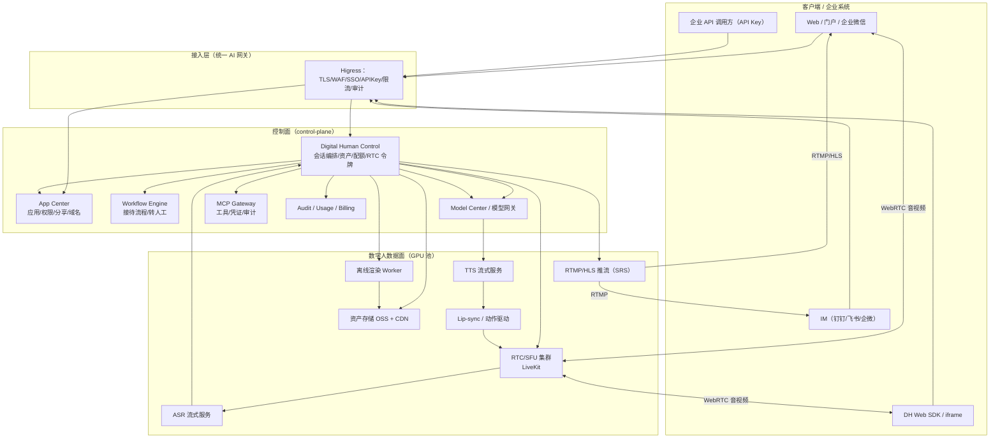
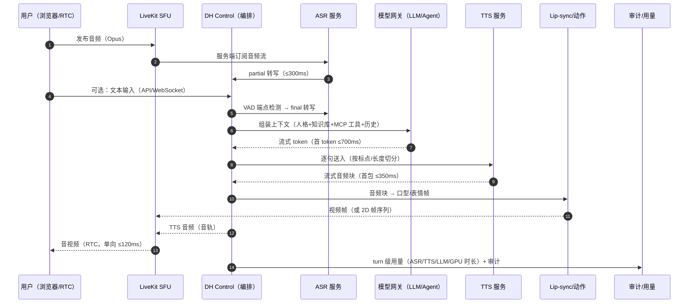
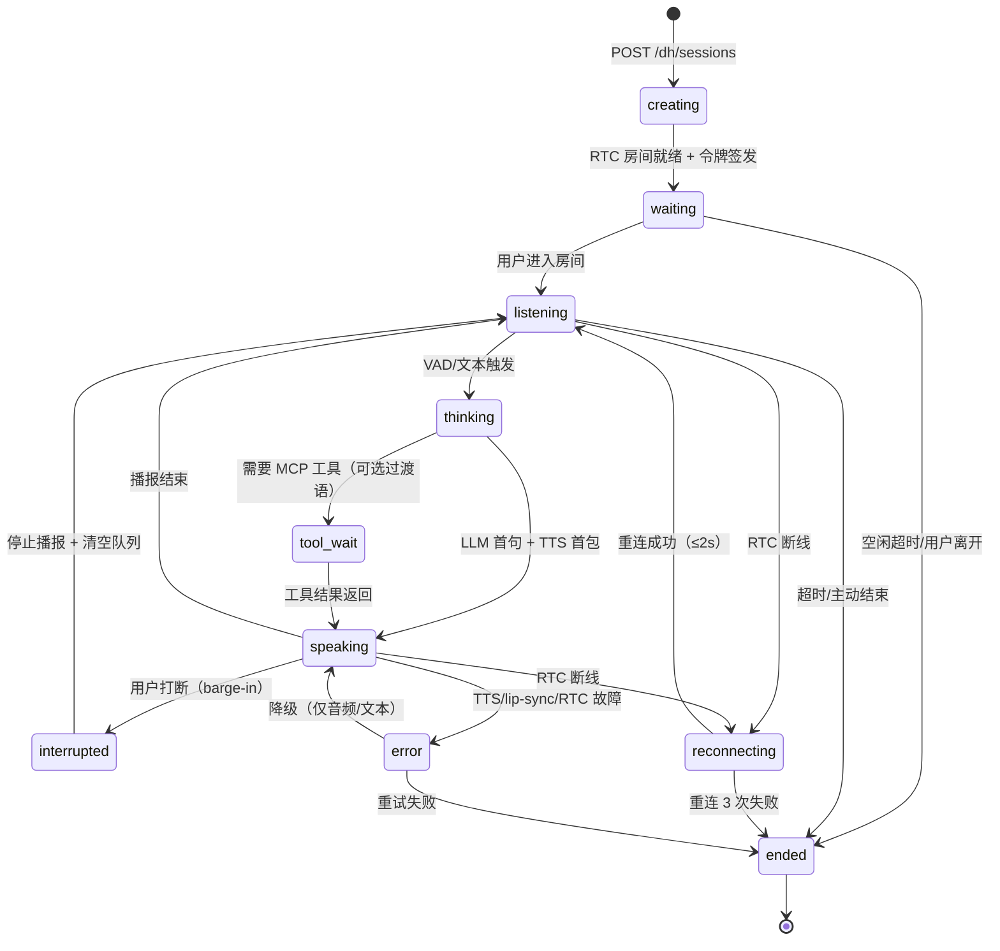
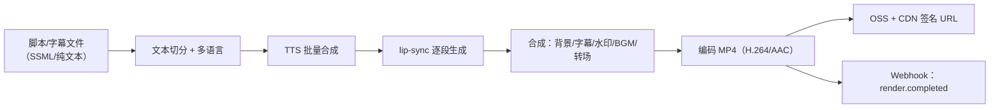

# 数字人模块详细设计（DIGITAL-HUMAN，legacy）

> **概念更正（2026-11-08）**：本文件描述的是“虚拟形象 / 音色 / RTC 音视频数字人”，属于 legacy 演示能力，**不是**企业应用内的“数字员工 / 专家小队”。
> 数字员工与专家小队见 [AGENT-WORKFORCE.md](AGENT-WORKFORCE.md)；本模块已从主控制台下线，仅保留历史设计。

- 文档 ID：A5（v3 架构战役）
- 版本：v0.7（待评审；v0.7 按 openapi 1.1.0 冻结版校准错误契约权威表述，映射不变）
- 日期：2026-11-08
- 契约权威：`docs/02-architecture/openapi.yaml` **1.1.0（`x-contract-status: frozen@1.1.0`）** 的 `ErrorReason`；`ARCH-V3 §23.4` 为设计说明（冲突以 openapi 为准）
- Owner：pm-research（主笔：产品/流程/API/数据模型）+ infra-devops（GPU/RTC/部署基础设施）
- 写作用域：`docs/02-architecture/services/`；不 commit
- 上游依据：[ARCH-V3.md](../ARCH-V3.md)（§8 数字人）、[PRODUCT-MODULE-PLAN.md](../../00-program/PRODUCT-MODULE-PLAN.md)、[BACKEND.md](BACKEND.md)（错误模型/API 风格）、[DATA-MODEL.md](../DATA-MODEL.md)（租户/RLS 约定）、[SECURITY.md](../SECURITY.md)
- 基础设施对齐：infra-devops 2026-11-08 回复（GPU/RTC/媒体/带宽/存储）；**完整部署细节与成本校准见** [`deploy/DIGITAL-HUMAN-INFRA.md`](../deploy/DIGITAL-HUMAN-INFRA.md) §2/§3/§4/§5/§6/§9（冲突时以该文档为准），网关路由见 [`deploy/AI-GATEWAY.md`](../deploy/AI-GATEWAY.md)
- 关联设计：应用中心（数字人 = App 类型）、MCP 网关（工具调用）、模型网关（LLM/TTS/ASR 供应商）、工作流（数字人接待模板）、审计/用量/配额

> **本文性质**：v0.1 为**可评审的详细设计**，不是最终实现。所有数值为**设计目标/预算**，标注 `【假设】` 的需 infra-devops 或压测确认；涉及第三方开源模型/许可的结论标注 **`许可待法务复核`**，不构成法务意见。

---

## 0. TL;DR（给评审的 10 条）

1. **产品定位**：数字人 = App Center 的第四种应用类型（`Digital Human App`），对外提供"会话/推流/嵌入"三类交付形态，对内复用模型中心、MCP 工具、知识库、工作流。
2. **三种运行档**：**实时（RTC，语音往返 ≤1.8s）**、**半实时（RTMP/HLS，2–5s）**、**离线（渲染 MP4，分钟级）**；三档共用形象/音色/人格资产与编排。
3. **实时链路**：`麦克风/文本 → VAD+ASR(流式) → LLM/Agent(流式) → TTS(流式分块) → lip-sync/动作 → RTC(SFU)`；支持**打断（barge-in）**、**逐句播报**、**工具调用中间态**（"我先查一下订单"）。
4. **形象分层**：L1 2D 卡通/照片驱动（成本最低，MVP 默认）→ L2 2D 写实 lip-sync（GPU，推荐主力）→ L3 3D/UE 级（离线渲染 + 直播，P2）；形象资产必须**授权可审计**（肖像权/生成标识）。
5. **RTC 选型（已与 infra 对齐）**：默认 **LiveKit（自建 SFU，WebRTC）** + **SRS 承接 RTMP/HLS**；RTC 走独立四层 SLB（UDP 7881/7882，TURN/TLS 443 回退），**不进 WAF**；阿里云 RTC 仅 P2 兜底（feature flag）。
6. **GPU 池（已与 infra 对齐）**：ACK 独立 GPU 节点池（A10 24GB 实时主力 / L20 48GB 高配），命名空间 `dh-infer`（实时）与 `dh-render`（离线，独立节点池+taint）；实时 **time-slicing（2–4 副本）**、离线 **MIG/独占**；≥2 AZ + PDB + autoscaler（缩容延迟 ≥10min）；并发配额按"会话槽位（slot）"限制。
7. **对外 API**：`/api/v1/dh/*`（会话/资产/渲染/Webhook）+ RTC 房间令牌 + 嵌入式 iframe/SDK；鉴权支持 **OIDC 会话、`ock_` API Key、短期 embed token**；错误沿用平台两层错误模型。
8. **与平台关系**：数字人应用复用应用中心的**权限/分享/域名/SSO/版本**；LLM 走**模型网关**、工具走 **MCP 网关**、接待流程走**工作流引擎**；平台不新增一套 IAM。
9. **7x24**：多 AZ GPU 池 + RTC 集群 + HPA/KEDA（按活跃会话）+ PDB + Watchdog；SLO：会话建立 P95 ≤2s、语音往返 P95 ≤1.8s、月度可用性 ≥99.5%。
10. **成本**：单路实时 720p 综合成本约 **¥0.10–0.20/分钟**（GPU+带宽+存储，`【假设】`详见 §13），显著低于人工坐席；离线渲染按 GPU·分钟计费。里程碑见 §14（M1 MVP 4–6 周、M2 语音+知识库、M3 直播/IM/3D、M4 规模化）。

---

## 1. 产品定义与范围

### 1.1 用户与场景

| 角色 | 场景 | 关键诉求 | 对应能力 |
| --- | --- | --- | --- |
| 企业运营/市场 | 官网/活动页数字人接待、产品讲解 | 快速上线、可嵌入、形象统一 | 嵌入 SDK/iframe、场景模板、离线渲染视频 |
| 客服负责人 | 7x24 客服数字人（售后/订单/工单） | 接知识库/CRM、转人工、留痕 | 知识库、MCP 工具（订单/CRM）、工作流转人工 |
| 培训/HR | 培训视频、合规宣导 | 批量生成、多语言、低成本 | 离线渲染、音色克隆（授权）、字幕 |
| 直播运营 | 电商/发布会虚拟主播 | RTMP 推流、低延迟、话术脚本 | RTMP 档、脚本/工作流驱动、商品卡片事件 |
| 开发者/ISV | 把数字人嵌入自有系统 | API/SDK、事件回调、多租户 | 开放 API、Webhook、API Key、iframe |
| 平台管理员 | 治理与成本 | 配额、审计、内容安全、GPU 利用率 | 配额/预算、审计、内容审核、GPU 池观测 |

### 1.2 范围边界

**In Scope（v3）**
- 数字人应用创建/配置/发布/分享（复用 App Center 权限模型）；
- 形象（L1/L2，L3 预留）、音色、人格、场景、知识库绑定；
- 实时语音/文本对话（WebRTC），半实时推流（RTMP/HLS），离线渲染（MP4）；
- 对外 REST API + Webhook + 嵌入 SDK/iframe + IM 渠道（钉钉/飞书/企微，P1/P2）；
- GPU 推理池、配额、计量、审计、内容安全、水印标识；
- 7x24 运行与可观测。

**Out of Scope（本期不做）**
- 自研 3D 引擎/渲染器（用开源或第三方引擎，平台只做编排与资产规范）；
- 通用视频剪辑/后期（离线渲染只做"数字人播报"模板）；
- 实时全双工低延迟 <500ms 的"电话级"体验（列为 M4+ 优化目标，不作为本期验收）；
- 真人换脸/任意人物克隆（仅支持**有授权**的形象与音色，禁止未授权真人克隆）；
- 平台自建 CDN（用云 CDN/OSS）。

### 1.3 成功指标（与平台指标对齐）

| 层级 | 指标 | 定义 | 目标 |
| --- | --- | --- | --- |
| 北极星（模块级） | 周成功数字人会话数（DH-WSS） | 一次会话中至少完成 1 轮有效问答且用户未立即退出 | 上线 3 个月 ≥500/周（`【假设】`） |
| 质量 | 语音往返延迟 P95 | 用户说完 → 数字人首帧语音/画面 | 实时档 ≤1.8s；半实时 ≤5s |
| 质量 | 会话完成率 | 会话正常结束/转人工 / 总会话 | ≥90% |
| 质量 | 转人工率 | 转人工会话 / 总会话 | ≤20%（客服场景） |
| 可靠性 | 会话建立成功率 | RTC 建连成功 / 请求 | ≥99%（客户端网络正常） |
| 可靠性 | 月度可用性 | 实时链路可用分钟 / 总分钟 | ≥99.5% |
| 成本 | 单会话分钟成本 | GPU+带宽+存储+模型 | ≤¥0.20/分钟（实时 720p） |
| 安全 | 未授权形象/内容事件 | 审计+人工抽检 | 0 |

---

## 2. 总体架构

### 2.1 组件图（C4 Container）

### 2.2 组件职责

| 组件 | 职责 | 归属 | 备注 |
| --- | --- | --- | --- |
| Digital Human Control（`services/dh-control`） | 会话状态机、编排（ASR→LLM→TTS→lip-sync）、RTC 令牌、资产 CRUD、配额校验、事件分发、Webhook | 平台（新服务，建议独立于 control-plane 进程，复用其鉴权/租户上下文） | 有状态编排在内存/Redis，持久化会话在 PG |
| RTC/SFU | 房间、发布/订阅、音视频转发、TURN | infra（LiveKit 自建） | 客户端 WebRTC；服务端可服务器端订阅音频做 ASR |
| ASR 服务 | 流式语音识别、VAD、端点检测、partial/final | infra/算法（Triton/ONNX） | 也可用第三方 ASR（模型网关代理） |
| TTS 服务 | 流式合成、音色、多语言、SSML 子集 | infra/算法 | 首包延迟关键 |
| Lip-sync/动作 | 音频→口型/表情/动作帧（2D 视频帧或 3D 骨骼参数） | infra/算法 | L1 可用简化口型（少 GPU），L2 用生成模型 |
| 离线渲染 Worker | 脚本→TTS→lip-sync→合成 MP4；字幕/水印/BGM | infra（K8s Job，GPU） | 可复用实时链路的模型 |
| SRS | RTMP 接收/转 HLS/转 WebRTC（可选） | infra | 直播档 |
| 资产存储 | 形象模型/音色样本/背景/渲染产物 | infra（OSS+CDN） | 签名 URL |
| App Center | 数字人作为 app.type=digital_human 的 CRUD/权限/分享/域名/版本 | 平台（已有） | 复用现有 ACL |
| Workflow Engine | 接待流程/多轮任务/转人工/审批 | 平台（见 WORKFLOW.md） | 数字人只是"交互壳"，业务编排在工作流 |
| Model Gateway | LLM/TTS/ASR 供应商统一出口、虚拟 Key、预算 | 平台（已有） | 不把供应商 Key 放到 GPU 服务 |
| MCP Gateway | 数字人调用订单/CRM/知识库工具 | 平台（已有，`mcp-hub:4104`，入口 `/v1/{orgSlug}/{serverSlug}`） | 工具级授权与审计 |

### 2.3 关键设计决策（ADR 摘要）

| ID | 决策 | 理由 | 备选与否决 |
| --- | --- | --- | --- |
| DH-ADR-01 | 数字人 = App 类型（`type=digital_human`），不新建独立"数字人应用"概念 | 复用权限/分享/域名/版本/审计，避免两套 IAM | 独立"数字人中心"：与 App Center 重复，否决 |
| DH-ADR-02 | RTC 默认自建 LiveKit，供应商抽象 | 数据可控、可私有化、成本可控；企业内网部署需要自建 | 纯阿里云 RTC：多云锁定、企业私有化不可用，P2 可插拔 |
| DH-ADR-03 | 实时链路"逐句流水线"，不做端到端整段生成 | 延迟可控、可打断、可插入工具中间态 | 整段 TTS→lip-sync：延迟高、无法打断 |
| DH-ADR-04 | lip-sync 按档位：L1 轻量 2D（MVP）+ L2 生成式 2D（主力） | 成本/质量平衡；L2 更真实但 GPU 成本高 | 直接上 3D/UE：成本与素材门槛过高，P2 |
| DH-ADR-05 | 会话状态机在控制面，媒体在数据面；**控制面故障不中断进行中的 RTC 会话** | 控制面/数据面分离（ARCH-V3 原则 2） | 全部塞控制面：单点故障 |
| DH-ADR-06 | 形象/音色必须"授权 + 标识"（可见水印 + 元数据），禁止未授权真人克隆 | 合规（深度合成标识、肖像权） | 无标识：合规风险，否决 |
| DH-ADR-07 | GPU 共享：实时走 time-slicing，离线渲染走 MIG/独占 | 实时重并发、离线重隔离 | 全 MIG：A10 切分粒度受限、成本高 |

---

## 3. 实时交互链路

### 3.1 端到端时序（语音输入 → 数字人播报）

### 3.2 延迟预算（实时档，P50/P95）

| 环节 | P50 目标 | P95 目标 | 说明/优化 |
| --- | --- | --- | --- |
| VAD 端点检测 | 150ms | 300ms | 尾静音 200–300ms 可调；支持"用户停顿即回复" |
| ASR final | 200ms | 400ms | 流式 partial 用于提前显示字幕 |
| LLM 首 token | 500ms | 900ms | 小模型兜底/语义缓存；工具调用时先播"过渡语" |
| TTS 首包 | 200ms | 350ms | 流式 TTS，按句切分，预连接 |
| lip-sync 首帧 | 80ms | 150ms | L1 口型可用音频驱动轻量模型；L2 生成式需预热 |
| RTC 单向 | 80ms | 120ms | 同区域；跨区走边缘 |
| **语音往返（说完→首帧）** | **≤1.2s** | **≤1.8s** | 不含网络抖动；抖动 >100ms 时降级"半实时" |

**延迟测量口径（QA-DH-04 关闭）**
- **起点**：ASR final（VAD 端点判定"用户说完"）时间戳；**终点**：数字人首帧音频在客户端 RTC 上**开始播放**的时间戳（客户端 SDK 埋点，服务端时间不可作终点）。
- **条件**：同区域（客户端与 RTC 同 region）、有线/5G、无丢包（<0.5%）、720p；**排除**首次建连预热（单独统计冷启动）。
- **采样**：每会话至少 3 轮，按会话加权；P50/P95 基于 ≥1,000 轮次样本；测试脚本由 qa 提供（TEST-PLAN §2 口径）。
- **真机未跑前**：本文延迟为设计预算；ACK 真机/本地 GPU 实测前记 **NOT-RUN**，不得当作已达成。
- **口径一致性**：P50 ≤1.2s / P95 ≤1.8s 与 **ADR-V3-03** 一致（原 800ms/1.5s 已作废）；architect 已确认本文件为权威口径。

### 3.3 会话状态机（DH 会话）

**关键语义**
- **打断**：停止 TTS 队列 + 丢弃未播音频 + 通知 lip-sync 清帧 + ASR 继续；`interrupted` 记审计与指标。
- **工具中间态**：`tool_wait` 时用预置过渡语（TTS 缓存）+ 状态事件；超时（默认 5s）回 `speaking` 说明失败。
- **RTC 重连**：断线进入 `reconnecting`，自动重连（≤2s/次，最多 3 次）；每次发事件 `dh.rtc.reconnect{attempt}`；3 次失败 → `ended`，页面给"重新进入/转人工"入口并保留文本回放。重连期间**不结束会话**，音频/字幕降级为文本流。
- **降级**：lip-sync 故障 → 仅音频（`dh_lipsync_failed`）；TTS 故障 → 文本 + 字幕（`dh_tts_unavailable`）；RTC 故障 → `reconnecting` → 仍失败则 `ended`（`dh_rtc_unavailable`）。降级/错误必须记录 `stage`（asr/llm/tts/lipsync/rtc）与 `retryable`。
- **错误 reason 枚举（本模块）**：`dh_rtc_unavailable`、`dh_tts_unavailable`、`dh_lipsync_failed`、`dh_session_active`、`dh_concurrency_exceeded`、`dh_gpu_budget_exceeded`、`dh_avatar_unavailable`、`dh_voice_unauthorized`、`dh_content_blocked`（均需在 `openapi.yaml` ErrorReason 增补，见 §7.6）。
- **多轮上下文**：`session_id` 维度保存最近 N 轮（默认 20，配置化），超出走摘要（LLM 小模型）避免超长。

### 3.4 知识库与人格

- **知识库**：复用平台知识库能力（或 MCP 知识检索工具）；检索策略 = 向量 + 关键词 + 业务过滤（tenant/app/kb_id）；回答必须带引用（可选展示"资料来源"）。
- **人格（Persona）**：`role`（系统提示词）、`style`（语气/长度/是否寒暄）、`boundaries`（拒答规则）、`language`、`fallback`（转人工话术）。
- **工具调用**：数字人可调用 MCP 工具（订单查询、工单创建、CRM）；工具调用前需播报过渡语，调用结果脱敏后播报；工具失败给用户可操作提示。
- **安全**：用户输入与模型输出均过**内容安全**（文本审核 + 敏感词 + 音频转写审核）；命中风险 → 拒答/转人工 + 审计。

---

## 4. 形象、音色与资产体系

### 4.1 形象档位

| 档位 | 技术路线 | 质量 | GPU | 适用 | 本期 |
| --- | --- | --- | --- | --- | --- |
| L1 2D 卡通/照片 | 静态形象 + 轻量口型/表情（2D 变形/局部驱动） | 中 | 低（CPU/轻 GPU） | 官网接待、MVP | ✅ MVP |
| L2 2D 写实 | 生成式 lip-sync（逐帧驱动） | 高 | 高（A10 起步） | 客服、品牌代言 | ✅ M1–M2 |
| L3 3D/UE 级 | 3D 模型 + 骨骼/ARKit 驱动 + 实时渲染 | 最高 | 很高 | 直播、发布会 | P2 预留 |

**L1 实现建议**：形象分层图层（身体/头/眼/嘴），音频驱动口型曲线 + 表情预设 + 待机动作；GPU 可选，MVP 可用 CPU 推理（单实例并发 ≥20 路）。
**L2 实现建议**：生成式口型（**默认 MuseTalk（MIT，依赖许可需法务复核）**；**Wav2Lip 为研究/非商用许可，禁止作为商业默认**）+ 后处理（超分/去闪烁）；单卡 A10 并发 2–4 路@720p；首帧需预热。
**L3 预留**：引擎抽象为 `AvatarRenderer` 接口（输入：音频/表情/动作参数；输出：视频帧/3D 指令），3D 引擎以 sidecar 形式接入，不锁定。

### 4.2 资产模型与规范

| 资产 | 内容 | 规范 | 存储 |
| --- | --- | --- | --- |
| Avatar（形象） | 模型文件/分层素材/预览图/授权凭证 | 版本化、分辨率 ≥1080p、帧率 25/30、背景透明可选 | OSS + CDN |
| Voice（音色） | 音色模型/样本/语言/性别/风格 | 授权克隆需书面同意；不支持未授权真人音色 | OSS + 加密 |
| Persona（人格） | 提示词/风格/边界/话术 | 版本化；变更需审计 | PG |
| Scene（场景） | 背景/布局/字幕样式/水印位/动作编排 | 模板化；可继承 | OSS+PG |
| Knowledge（知识库） | 文档/QA/URL | 复用平台知识库 | 平台既有 |
| Motion（动作库） | 待机/打招呼/思考/手势 | 按形象绑定 | OSS |

**资产生命周期**：`draft → reviewing（审核）→ approved → deprecated`；上架前必须：授权凭证齐全 + 内容安全检查 + 预览视频审核；下架后已发布应用可继续用（引用计数），新应用不可选。

### 4.3 生成与迁移

- 形象制作：平台提供**模板形象库**（可商用）；企业自带形象需上传模型/素材 + 授权书；平台不提供"任意真人照片一键克隆"（仅授权 + 审核）。
- 音色：平台预置音色 + 企业授权音色（提交样本 + 授权）；TTS 供应商可插拔（模型网关统一路由）。
- 迁移：形象/音色格式以 `manifest.json` 描述（类型、版本、依赖、入口），保证跨 GPU 服务的可移植。

---

## 5. 离线渲染管线

### 5.1 流程

### 5.2 任务规格

| 项 | 规格 |
| --- | --- |
| 输入 | 文本/SSML 子集、形象/音色/场景 ID、分辨率（720p/1080p）、字幕语言、水印 |
| 输出 | MP4（H.264+AAC，≤500MB/条），封面 PNG，字幕 SRT |
| 时长 | 单任务 ≤10 分钟视频；超长自动拆段并行 |
| 资源 | K8s Job（GPU 独占/MIG），单任务 2–10 分钟（`【假设】`，按 A10 实测） |
| 并发 | 租户级队列，默认 2 并发；批量走低优先级队列 |
| 重试 | 失败自动重试 1 次；仍失败给失败阶段（TTS/lip-sync/合成/编码） |
| 产物保留 | 30 天（可配），到期删除并审计 |
| 计费 | 按渲染 GPU·分钟 + 存储；生成量表 |

### 5.3 与实时链路复用

- 同一套 TTS/lip-sync 模型服务；离线用**批处理队列 + 独占 GPU**，实时用**低延迟队列 + time-slicing**，通过 K8s 队列/优先级隔离，避免离线任务挤占实时。
- 统一 `render_profile`（分辨率/帧率/编码/水印）避免两套参数。

---

## 6. RTC 与推流

### 6.1 实时（WebRTC）

- **拓扑**：浏览器/SDK ↔ LiveKit SFU ↔ DH 服务（服务端订阅音频做 ASR；服务端发布 TTS 音频 + lip-sync 视频轨）。
- **房间模型**：每会话一个 room（`dh-{tenant}-{session}`），发布者=数字人服务，订阅者=用户；令牌（JWT）绑定 `room/session/user/role/过期（默认 1h）`。
- **编码**：音频 Opus 48kHz；视频 VP8/H.264 720p@25fps，码率 1.5–2.5 Mbps；弱网自动降级 480p。
- **TURN**：自建 TURN（coturn/LiveKit 内置）覆盖企业 NAT；UDP 端口范围需网关/SLB 放行（待 infra 确认）。
- **多端**：同一会话可多订阅者（旁听/质检），数字人发布一路。

### 6.2 半实时（RTMP/HLS）

- 场景：直播、IM 内嵌、低交互播报。
- 链路：DH 服务生成音视频 → SRS（RTMP ingest）→ HLS/FLV 分发；或 LiveKit Ingress 输出 RTMP。
- 延迟：RTMP 播放 1–3s；HLS 3–10s（低延迟 HLS 可到 2–5s）。
- 适用：不要求打断/低延迟的场景；与实时档共用资产与话术。

### 6.3 嵌入形态

| 形态 | 说明 | 鉴权 | 适用 |
| --- | --- | --- | --- |
| **iframe** | `<iframe src="https://dh.<domain>/embed/{app}?token=...">` | 短期 embed token（≤10min，绑 app/user/domain 白名单） | 官网/门户快速接入 |
| **JS SDK** | `@opencode/dh-sdk`：初始化、加入房间、发文本/音频、事件回调 | OIDC 会话或 API Key 换 token | 深度集成（自定义 UI） |
| **REST + Webhook** | 服务端创建会话、拿推流地址、回调事件 | `ock_` API Key（scope `dh:write`） | 企业系统/IVR/机器人 |
| **IM 渠道** | 钉钉/飞书/企微机器人 → DH 会话（文本/语音消息） | 平台 IM 集成（P2） | 客服/内部助手 |

**iframe 安全**：CSP `frame-ancestors` 白名单（企业域名）；`sandbox` 最小权限；禁止第三方 Cookie 依赖；跨域通信用 `postMessage` + origin 校验。

---

## 7. 对外 API 设计

> 约定：根路径 `/api/v1`；鉴权 `Authorization: Bearer <session|ock_key|embed_token>`；租户由 token 解出；写操作支持 `Idempotency-Key`；分页 `cursor/limit`；错误沿用平台两层模型（`error.code` 16 类 + `error.reason` lower_snake，见 BACKEND §2.5）。新增领域 reason 需在 `ErrorReason` 增补（只增不改）。

### 7.1 会话

| 方法 | 路径 | 鉴权 | 说明 |
| --- | --- | --- | --- |
| POST | `/dh/sessions` | 会话/Key（`dh:write`） | 创建会话：`{app_id, avatar_id, voice_id, scene_id, mode: realtime\|rtmp\|offline, language, user_ref?, metadata?}` → `{session_id, rtc:{...}, embed_token?, expires_at, limits}`；**`Idempotency-Key` 必填：同键同 body 命中返回 200 + 原 session（不重复创建）；同键不同 body 返回 409 `idempotency_conflict`；同 app+user 未带键重复请求返回 409 `conflict` + reason `dh_session_active`（不允许隐式第二个活跃会话）** |
| GET | `/dh/sessions/{id}` | 会话/Key | 状态、开始时间、turn 计数、用量摘要 |
| POST | `/dh/sessions/{id}/input` | 会话/Key/embed | 文本输入 `{type:"text", text}` 或音频输入（RTMP/文件）`{type:"audio_url"}` |
| POST | `/dh/sessions/{id}/interrupt` | 同上 | 打断当前播报（barge-in 服务端触发） |
| POST | `/dh/sessions/{id}/end` | 同上 | 主动结束（幂等） |
| GET | `/dh/sessions/{id}/events` | 同上 | SSE：`session.state`、`asr.partial/final`、`reply.text.delta`、`audio.start/end`、`tool.call`、`error`、`usage`；`Last-Event-ID` 续传 |
| POST | `/dh/sessions/{id}/webhook-test` | `admin` | 测试回调 |

### 7.2 资产与渲染

| 方法 | 路径 | 说明 |
| --- | --- | --- |
| GET/POST/PATCH/DELETE | `/dh/avatars`、`/dh/avatars/{id}` | 形象 CRUD（`admin`/`editor`）；上传走签名 URL |
| GET/POST/PATCH/DELETE | `/dh/voices`、`/dh/voices/{id}` | 音色 CRUD；克隆需授权材料 |
| GET/POST/PATCH/DELETE | `/dh/personas`、`/dh/personas/{id}` | 人格 CRUD；版本化 |
| GET/POST | `/dh/scenes` | 场景 CRUD |
| POST | `/dh/render-jobs` | `{app_id, script, avatar_id, voice_id, scene_id, output:{resolution, subtitle, watermark}}` → `{job_id, status:"queued"}` |
| GET | `/dh/render-jobs/{id}` | 状态/进度/产物 URL（签名） |
| POST | `/dh/embed-tokens` | `{app_id, origin, ttl≤600}` → `{token}`（iframe/SDK 用） |

### 7.3 Webhook 事件

| 事件 | 触发 | 载荷要点 |
| --- | --- | --- |
| `dh.session.started` | 会话建立 | `session_id, app_id, mode, ts` |
| `dh.turn.completed` | 一轮问答完成 | `turn_id, asr_text, reply_text, audio duration, tool_calls[], cost` |
| `dh.session.ended` | 结束 | `reason (user_left/timeout/error/transferred), duration, turns, usage` |
| `dh.handoff.requested` | 转人工 | `session_id, reason, context_summary, contact?` |
| `dh.render.completed` / `.failed` | 渲染完成/失败 | `job_id, output_url? , error?` |
| `dh.error` | 链路错误 | `code, reason, stage, retryable` |

**Webhook 安全（QA-DH-05 关闭）**
- 签名串固定为 **`"{timestamp}.{raw_body}"`**（UTC 秒级时间戳，raw body 为未解析字节）；头 `X-DH-Signature: t=<ts>,v1=<hex_hmac_sha256>`。
- 验签顺序：① 解析 `t`，拒绝偏差 >300s（防重放）；② 常量时间比较 `v1`；③ 校验 `event_id` 未消费（去重表 TTL 7d）；④ 通过后才解析 JSON。
- 失败重试指数退避（1s/5s/30s/2m/10m，共 5 次）；投递记录可查；死信可重放；secret 轮换支持双 secret 重叠 24h。

### 7.4 企业集成

| 集成 | 方式 | 说明 |
| --- | --- | --- |
| SSO | OIDC（平台统一 IdP） | 控制台/嵌入用户走平台 SSO；企业门户可用 OIDC 联邦 |
| API Key | `ock_`（scope `dh:read/write/admin`） | 服务端调用；HMAC 哈希存储；可轮换/吊销 |
| Webhook | 上述事件 | 企业系统接收会话/工单/用量事件 |
| IM | 钉钉/飞书/企微机器人 | P2；文本/语音消息 → 会话；群内 @数字人 |
| 企业系统 | MCP 工具（订单/CRM/工单） | 通过 MCP 网关接入，凭证不出网关 |

### 7.5 限额与配额（双层）

- **平台层**：租户并发会话数、GPU·分钟/月、渲染分钟/月、存储 GB；
- **应用层**：单应用并发、单用户会话频率、单会话最大时长（默认 30min）、单轮最大 token。
- 超限返回 `429 rate_limited` 或 `409 quota_exceeded` + reason（如 `dh_concurrency_exceeded`、`dh_gpu_budget_exceeded`，需在 ErrorReason 增补）；支持"申请提升"。

### 7.6 错误映射（权威：`openapi.yaml` 1.1.0 `ErrorReason`）

> 两层模型：`code` 16 类通用（复用平台枚举，不新增）；`reason` 为本模块新增 lower_snake。
> **权威**：`docs/02-architecture/openapi.yaml` **1.1.0（`x-contract-status: frozen@1.1.0`）** 的 `ErrorReason` 已收录下表 10 个 `dh_*`（HTTP/code 映射与 `ARCH-V3 §23.4` 一致）；**`ARCH-V3 §23.4` 仅作设计说明，实现/测试以 openapi 1.1.0 为准**。未入 1.1.0 的新 reason 不得写入权威契约（走 1.2 backlog）。

| 场景 | HTTP | code | reason（已批准） | 用户提示 |
| --- | --- | --- | --- | --- |
| 重复创建活跃会话 | **409** | `conflict` | `dh_session_active` | "已有进行中的会话，请先结束或稍后再试" |
| 幂等键冲突 | 409 | `idempotency_conflict` | —（不新增 reason） | "请求与之前不一致，请刷新后重试" |
| 并发超限 | **429** | `rate_limited` / `quota_exceeded` | `dh_concurrency_exceeded` | "当前数字人并发已满，稍后重试或升级配额" |
| GPU 预算耗尽 | **429** | `quota_exceeded` | `dh_gpu_budget_exceeded` | "本月数字人额度已用完" |
| 形象未授权/下架 | **409** | `conflict` | `dh_avatar_unavailable` | "该形象不可用，请更换" |
| 音色克隆未授权 | **403** | `forbidden` | `dh_voice_unauthorized` | "该音色缺少授权材料" |
| RTC 建连失败 | **503** | `orchestrator_unavailable` | `dh_rtc_unavailable` | "连接失败，正在重试" |
| RTC 重连耗尽 | 200（会话事件） | — | `dh_rtc_unavailable`（`ended` 事件 reason） | "连接已断开，可重新进入或转人工" |
| TTS 故障 | **503** | `model_gateway_unavailable` | `dh_tts_unavailable` | "语音服务异常，已切换备用" |
| lip-sync 故障 | **502** | `upstream_error` | `dh_lipsync_failed` | "已降级为音频播报" |
| 内容安全拦截 | **403** | `forbidden` | `dh_content_blocked` | "该内容不符合使用规范" |
| 嵌入令牌过期/非法 | **401** | `unauthorized` | `dh_embed_token_invalid` | "嵌入链接已失效，请刷新页面" |

**ErrorReason 清单（10 个，已入 `openapi.yaml` 1.1.0 `ErrorReason`，frozen@1.1.0）**：`dh_session_active`(409)、`dh_concurrency_exceeded`(429)、`dh_gpu_budget_exceeded`(429)、`dh_avatar_unavailable`(409)、`dh_voice_unauthorized`(403)、`dh_rtc_unavailable`(503)、`dh_tts_unavailable`(503)、`dh_lipsync_failed`(502)、`dh_content_blocked`(403)、`dh_embed_token_invalid`(401)。与 `ARCH-V3 §23.4` 逐条一致（§23.4 为说明，openapi 为权威）；`code` 使用平台 16 类通用枚举。

---

## 8. 数据模型

> 约定：每表 `tenant_id`（RLS）+ `created_at/updated_at`；主键 uuid；软删除；审计表复用平台 `audit_logs`。表名前缀 `dh_`；SSOT 以 DATA-MODEL.md 增补章节为准（本文件给草案）。

| 表 | 关键字段 | 说明 |
| --- | --- | --- |
| `dh_avatars` | id, tenant_id, name, tier(L1/L2/L3), status, manifest_url, preview_url, license_ref, created_by | 形象资产 |
| `dh_avatar_versions` | id, avatar_id, version, files(jsonb), checksum, model_digest | 不可变版本 |
| `dh_voices` | id, tenant_id, name, provider, language, gender, style, clone_consent_ref, status | 音色 |
| `dh_personas` | id, tenant_id, name, system_prompt, style(jsonb), boundaries, language, version | 人格 |
| `dh_scenes` | id, tenant_id, name, background_url, layout(jsonb), subtitle_style, motion_ids[] | 场景 |
| `dh_apps`（或复用 apps + `dh_config`） | app_id, avatar_id, voice_id, persona_id, scene_id, mode_default, kb_ids[], mcp_bindings[], quota | 数字人应用配置（**建议复用 apps 表 + 1:1 `dh_app_configs` 表**，避免双主） |
| `dh_sessions` | id, tenant_id, app_id, mode, status, room, started_at, ended_at, end_reason, user_ref, usage(jsonb), cost | 会话（在线热数据，冷归档） |
| `dh_turns` | id, session_id, seq, asr_text, reply_text, audio_ms, tool_calls(jsonb), first_frame_ms, cost | 轮次（可回放/评测） |
| `dh_assets` | id, tenant_id, kind(avatar/voice/scene/render), object_key, size, mime, checksum | 对象存储登记 |
| `dh_render_jobs` | id, tenant_id, app_id, status, spec(jsonb), progress, output_asset_id, error_reason | 离线渲染任务 |
| `dh_webhooks` | id, tenant_id, app_id, url, secret_ref, events[], status | 回调配置 |
| `dh_embed_tokens` | id, app_id, token_hash, origin, expires_at, used_at | 嵌入令牌（只存哈希） |
| `dh_usage_records` | id, tenant_id, app_id, session_id, metric, value, ts | 用量（也可复用平台 usage_records + 维度） |

**保留策略**：会话/轮次热 30 天 → 冷归档 1 年（脱敏）；审计 180 天在线；渲染产物 30 天；嵌入令牌只存哈希、过期清理。

---

## 9. 与平台其他模块的关系

| 平台模块 | 关系 | 契约 |
| --- | --- | --- |
| **App Center** | 数字人是应用类型；权限/分享/域名/版本/审计复用 | `apps.type=digital_human`；分享 ACL 不变（view/use/edit）；数字人"使用"=进入会话 |
| **Model Gateway** | LLM/TTS/ASR 统一路由、虚拟 Key、预算、限流 | DH 服务不直连供应商；按 tenant/app 维度配额 |
| **MCP Gateway** | 数字人工具调用（订单/CRM/工单/知识库） | 工具级授权、凭证不出网关、调用审计；DH 只传 `app_id/session_id`；入口 `mcp-hub:4104`（`/v1/{orgSlug}/{serverSlug}`，无 `/mcp` 前缀，按 lead 端口裁决） |
| **Workflow Engine** | 接待/多轮任务/转人工/审批编排 | 数字人发起 `workflow.start`，工作流回调 `dh.session.input` 驱动话术；转人工建 `human_task`；**`render(digital_human)` 工作流节点调用 `POST /api/v1/dh/sessions`（mode=offline）或 `/dh/render-jobs`**；**DH Webhook（`dh.session.*`/`dh.handoff.requested`）→ 工作流 Trigger**（详见 [WORKFLOW.md](WORKFLOW.md) §7.5） |
| **Skill 中心** | 数字人可加载"话术/领域 Skill" | 通过工作区/Agent Runtime 或提示词资产注入 |
| **知识库** | 问答检索 | 平台知识库 API；按 app 绑定 kb |
| **评测中心** | 数字人质量评测（应答准确率/延迟/转人工率） | 用 `dh_turns` 作为数据集；离线评测 + 线上抽检 |
| **审计/计量** | 会话/工具/渲染全部计量与审计 | 审计事件 + usage_records；成本按 app/tenant 归因 |
| **控制台** | 配置/预览/发布/监控页 | web-console 新增 DH 配置页（本设计给字段与状态） |

**关键原则**：数字人模块**不重复实现 IAM/模型/工具/工作流**，只做"交互编排 + 媒体 + 资产"，其余通过平台接口复用。

---

## 10. 多租户、安全与合规

### 10.1 租户隔离

- 数据：所有 `dh_*` 表带 `tenant_id` + RLS；跨租户一律 404（D19）。
- 计算：GPU 服务按 `tenant_id` 打标 + 配额；实时会话与离线任务分队列，避免互相挤占；GPU 共享（time-slicing）时进程级隔离 + 网络策略。
- 资产：OSS 前缀 `tenant/{id}/dh/...` + 签名 URL（短 TTL）；CDN 私有回源鉴权。

### 10.2 凭证与密钥

- 供应商 Key 仅存模型网关（KMS）；DH 服务只持虚拟 Key 引用。
- 企业工具凭证仅存 MCP Gateway；数字人不接触明文。
- Webhook secret 存 KMS，签名用 HMAC；embed token 短期 + 绑定 origin。

### 10.3 内容安全与合规

- **深度合成标识**：视频/直播画面**可见水印**（"AI 生成"）+ 文件元数据标识（符合国内深度合成规定；具体法务条款 `待法务复核`）。
- **肖像权/声音权**：上传形象/音色必须提交授权书（`license_ref`），未授权不可上架；支持权利人投诉下架（72h 内处理）。
- **内容审核**：输入/输出文本过审核；音频转写后审核；涉政/涉黄/暴力/诈骗等命中即拒答 + 审计；直播档增加实时审核抽帧。
- **未成年人/敏感行业**：默认禁止医疗/金融投资建议等高风险话术；需企业承诺 + 人工审核。
- **数据保留**：会话录音/视频默认**不落盘**（仅转写文本），如需录制需显式开启 + 告知 + 保留 30 天；导出/删除遵循平台合规流程。

### 10.4 反滥用

- 会话频率限制、IP/设备风控、异常行为（高频创建/超短会话）告警；API Key 按 scope 最小化；iframe token 单次/短时。

---

## 11. 基础设施依赖（已与 infra-devops 对齐 · v0.4）

> 本节口径来自 infra-devops 2026-11-08 回复与 [`deploy/DIGITAL-HUMAN-INFRA.md`](../deploy/DIGITAL-HUMAN-INFRA.md)（§2 GPU/§3 RTC/§4 存储/§5 7x24/§6 成本/§9 GPU 配额）；**冲突时以 infra 文档为准**。

| 依赖 | 已确认口径 |
| --- | --- |
| GPU 节点池 | ACK **独立 GPU 节点池**：A10 24GB（gn7i）为实时主力、L20 48GB 为高配；NVIDIA GPU Operator + device plugin；命名空间 **`dh-infer`（实时）** 与 **`dh-render`（离线，独立节点池 + taint）** |
| GPU 共享 | 实时默认 **time-slicing**（`nvidia.com/gpu.shared` replicas 2–4，并发优先）；**MIG 仅用于离线渲染隔离档**（A10 MIG profile 有限，需真机验证）；实时链路**不建议 MIG**（显存/上下文切换抖动） |
| GPU 高可用 | GPU 节点 **≥2 AZ**，PDB；节点池 autoscaler，**缩容延迟 ≥10min** 防抖动 |
| RTC | **自建 LiveKit SFU 为默认**；RTMP 推流用 **SRS（或 LiveKit Ingress）**；企业微信/钉钉内嵌走标准 HTTPS/WSS(443) + HLS 兜底；**阿里云 RTC 仅 P2 兜底**（feature flag/环境变量切换，跨地域/弱网，需媒体数据合规确认） |
| RTC 网络 | UDP **7881/7882** + TURN/TLS **443** 回退；**RTC 流量不进 WAF**（WAF 仅 L7 HTTP），走**独立四层 SLB（支持 UDP）**+ 安全组；ACK Terway 下用 `LoadBalancer`（mixedProtocolLBService）或 hostPort |
| TTS/ASR/lip-sync | 容器化推理（Triton 或 FastAPI+ONNX/TensorRT）；指标：TTS 首包 ≤300ms、ASR partial ≤300ms、2D lip-sync ≥25fps@A10、单卡 2–4 路 720p |
| 模型选型（默认） | ASR **FunASR（Apache-2.0）**；TTS **CosyVoice（Apache-2.0，模型权重条款需法务复核）**；lip-sync **MuseTalk（MIT，依赖需法务复核）**；**Wav2Lip 禁止商业默认**（研究/非商用许可） |
| 带宽 | 720p@25fps ≈1.5–2.5 Mbps/路；100 并发 ≈250 Mbps（峰值 ×1.5 → 375 Mbps）；EIP/带宽包按 **500 Mbps 预留** |
| 存储/CDN | 形象/音色/渲染产物 OSS + CDN；离线单条 ≤500MB、保留 30 天（生命周期转低频/归档）；签名 URL 防直链；GPU 节点本地 NVMe 做模型缓存（emptyDir/本地盘），权重从 OSS 内网拉取 |
| 7x24 | 多 AZ、HPA/KEDA、PDB、GPU 节点弹性伸缩；GPU 池缩容 ≥10min 延迟 |
| 观测 | OTel → Prometheus/Loki/Grafana；GPU 指标走 **DCGM exporter** |
| 数字人入口 | 统一走 AI 网关（task-27）：`https://dh-<id>.dh.<domain>`（占位，以 `AI-GATEWAY.md` 定稿为准）；四层 RTC 另开 SLB |

### 11.1 现有制品与缺口（避免重复造轮子）

| 项 | 现状（infra 提供） | 影响 |
| --- | --- | --- |
| 本地网关 | `deploy/local/Dockerfile.local-gateway` + `deploy/local/docker-compose.yml:182-198`（端口 8080，`*.localhost` 路由） | 可先承接 `dh-*` 最小路由（HTTP/WS）；RTC 需另配四层入口 |
| GPU/RTC/媒体组件 | **当前全仓无相关 manifest**（grep 确认） | 需新建 `dh-infer`/`dh-render`/LiveKit/SRS/TURN 部署清单（infra） |
| 数字人部署清单（计划） | `DIGITAL-HUMAN-INFRA.md §7` 目录规划：`deploy/digital-human/{namespace,gpu,rtc,infer,networkpolicy,quota}` | T7 落地后 infra 给实际文件清单，回填本行（占位） |
| 压测/冒烟脚本（计划） | `scripts/verify/dh-loadtest.mjs`（env `DH_BASE_URL/CONCURRENCY/DURATION_S/SCENARIO`，输出 `{p50,p95,errors,first_frame_ms,gpu_util}`）、`scripts/verify/dh-gpu-smoke.mjs`（DCGM + 2/4 路 + TTS 首包/ASR partial/lip-sync fps）、`scripts/t7/cost-snapshot.mjs`；证据入 `docs/05-delivery/evidence/{dh,cost}/`；Runbook `docs/05-delivery/RUNBOOK.md#digital-human` | 脚本落地后替换为实际命令/输出；SLO 验证口径见 §12.4 |
| RuntimeClass | kind 无 `sandbox-runtime`；生产 GPU 用 NVIDIA GPU Operator 标准 `nvidia` RuntimeClass（无需自定义） | 数字人 GPU 服务用 `nvidia` RuntimeClass；评测沙箱的 `sandbox-runtime` 与之独立 |
| IngressClass | 本地 kind 无 IngressClass；生产安装 Higress GatewayClass | `dh-*` 路由依赖 Higress（task-27） |

### 11.2 无 GPU / 无 RTC 时的降级（DEGRADED）

本地 Docker 环境无 GPU/RTC 时：使用 **CPU 版 L1 形象 + 文本/音频文件输入 + WebSocket 音频流回放**验证编排与 API；实时 RTC 与生成式 lip-sync 不可用，标注 **DEGRADED**（与平台 v2 约定一致）；GPU 相关验收（延迟/并发/成本）在 ACK 真机或本地 GPU 环境补验。

### 11.2.1 私有化交付（lead 决策：可选，不纳入 M2 关键路径）

- **标准部署**：ACK（生产）+ 本地 Docker（开发/验证）为必交付。
- **可选私有化包**（企业内网、无公网依赖）：RTC/GPU 镜像与模型权重离线导入、离线许可证、无外网 IdP 的本地 SSO 方案、离线升级包；**不纳入 M2 关键路径**，在 M4 作为可选项交付。
- 私有化差异需在文档/产品中显式标注（DEGRADED 或 "私有化包" 标识），不得默认承诺同等体验（如无 CDN、无第三方 ASR 兜底）。

### 11.3 许可风险表与 G2 法务确认项

| 组件 | 候选 | 许可（infra 口径） | 风险 | G2 动作 |
| --- | --- | --- | --- | --- |
| ASR | FunASR | Apache-2.0 | 低（权重条款需确认） | 法务确认权重可商用 |
| TTS | CosyVoice | Apache-2.0（代码） | 权重许可需单独确认 | 法务确认模型权重条款 |
| Lip-sync | MuseTalk | MIT（依赖许可需复核） | 依赖链（如人脸检测模型）许可 | 法务审计依赖清单 |
| Lip-sync | Wav2Lip | 研究/非商用 | **禁止商业默认** | 仅在研究环境使用 |
| RTC | LiveKit | Apache-2.0 | 低 | 记录 |
| 流媒体 | SRS | MIT | 低 | 记录 |
| 推理 | Triton | BSD-3-Clause | 低 | 记录 |

---

## 12. 可观测性与 SLO

### 12.1 指标

| 类别 | 指标 | 采集 |
| --- | --- | --- |
| 会话 | 创建成功率、建连耗时 P50/P95、活跃会话数、时长分布、结束原因 | DH Control + RTC |
| 质量 | 语音往返延迟 P50/P95、首帧延迟、打断成功率、ASR 字错率（抽检）、转人工率 | DH Control + 评测 |
| 资源 | GPU 利用率、每卡并发、显存、TTS/lip-sync 队列深度、GPU 温度/降频 | DCGM/Prometheus |
| 成本 | 单会话分钟成本、GPU·分钟、带宽、存储 | 计量 |
| 安全 | 内容拦截数、未授权访问、Webhook 验签失败 | 审计 |

### 12.2 Trace 与审计

- Trace：`dh.session` → `dh.turn` → `asr/llm/tts/lipsync/tool` span；关联 `session_id/turn_id/app_id/tenant_id`。
- 审计：会话创建/结束、资产上架/下架、音色克隆、工具调用、转人工、导出/删除；参数脱敏。
- 回放：按 `session_id` 回放 turn 时间线（文本/事件/耗时；默认不含音视频）。

### 12.3 SLO

| SLO | 目标 | 告警 |
| --- | --- | --- |
| 会话建立 P95 | ≤2s | >3s 持续 5min |
| 语音往返 P95 | ≤1.8s（实时） | >2.5s 持续 10min |
| 实时链路可用性 | ≥99.5%/月 | 5xx/断连率 >1% |
| 渲染任务成功率 | ≥99% | 失败率 >2% |
| GPU 池利用率 | 60–85% | >90% 扩容；<30% 缩容建议 |

### 12.4 验证脚本与证据（与 infra `DIGITAL-HUMAN-INFRA.md §7.1` 对齐）

| 项 | 脚本/路径（计划，infra 提供） | 输出/证据 |
| --- | --- | --- |
| 并发/延迟压测 | `scripts/verify/dh-loadtest.mjs`（`DH_BASE_URL/CONCURRENCY/DURATION_S/SCENARIO`） | JSON `{p50,p95,errors,first_frame_ms,gpu_util}` → `docs/05-delivery/evidence/dh/` |
| GPU 冒烟 | `scripts/verify/dh-gpu-smoke.mjs`（DCGM + 单卡 2/4 路 + TTS 首包/ASR partial/lip-sync fps） | JSON/截图 → 同上 |
| 成本快照 | `scripts/t7/cost-snapshot.mjs`（`DescribePrice`） | `docs/05-delivery/evidence/cost/gpu-YYYYMMDD.json` |
| 运维 Runbook | `docs/05-delivery/RUNBOOK.md#digital-human`（GPU 掉卡/降频、LiveKit 房间、TURN 失败率、渲染积压） | 演练记录 |

> SLO 验证以本节脚本为准：语音往返 P95 用 `first_frame_ms` 口径（§3.2 测量定义）；GPU 利用率取 `gpu_util`；**真机脚本未跑前 SLO 记 NOT-RUN**，不得当作已达成。脚本落地后由 infra 给实际命令/输出，替换本表占位。

---

## 13. 成本模型（v0.4 已按 `DIGITAL-HUMAN-INFRA.md` §6 校准）

> 成本口径来源：infra `docs/02-architecture/deploy/DIGITAL-HUMAN-INFRA.md` §6（成本校准）；单价为 2026-11-08 本机假设，区间标 `[推断]`，T7 价格 API 复核。
> **价格证据（计划）**：T7 产出 `docs/05-delivery/evidence/cost/gpu-YYYYMMDD.json`（`DescribePrice` 快照）后，由 infra 回填 INFRA §6 并同步本文件替换 `[推断]`；当前风险 **DHI-1**（价格未复核）由 infra 跟踪。

### 13.1 单路实时会话成本（720p）

| 成本项 | 假设 | 每小时 | 每分钟 |
| --- | --- | --- | --- |
| GPU（A10 24GB，**¥7/h**；2 路/卡） | 2 路/卡 | ¥3.5/路 | ¥0.058 |
| ASR/TTS/LLM | 平台模型网关，按 token | ¥0.5–1.5 | ¥0.008–0.025 |
| 带宽（2 Mbps，¥0.8/Mbps/月摊） | — | ¥0.4 | ¥0.007 |
| RTC/存储/基础设施摊销 | — | ¥0.5 | ¥0.008 |
| **合计** | — | **¥4.9–5.9/路** | **¥0.082–0.098** |

> 加 30% 冗余/峰值 → **¥0.11–0.13/分钟**（与 infra 校准一致）；对外定价建议 ¥0.3–0.6/分钟（毛利 50–70%），或按"并发包月 + 分钟超量"（§13.4）。
> **单卡月固定**：A10 ≈ **¥5,040/月**（¥7/h × 720h）；L20 ≈ **¥12–16/h `[推断]`**（待报价）。

### 13.2 离线渲染（v0.4 修正）

| 项 | 假设 | 成本 |
| --- | --- | --- |
| 渲染速度 | A10 独占，1 分钟视频 ≈1–2 分钟 GPU（¥7/h → ¥0.117/min GPU） | **¥0.12–0.23/分钟视频** |
| 存储/CDN | ≤500MB/条，30 天 | ¥0.1–0.3/条 |
| **合计** | — | **≈¥0.2–0.5/分钟成品视频**（竞价 GPU 可再降） |

> 修正说明：v0.3 曾误写"¥7–14/分钟成品"，实际为 **¥0.12–0.23 GPU 成本/分钟视频**（GPU 分钟单价 ≈¥0.117），已按 infra 校准更正。

### 13.3 成本控制

- 空闲会话超时（默认 120s 无交互）→ 自动结束，释放 slot；
- 形象/音色缓存与 TTS 常用句缓存（问候/过渡语）降本；
- 离线任务用低优先级/竞价 GPU（可中断，重试）；
- 按租户配额 + 预算告警，避免单租户打满 GPU。

### 13.4 定价与计量（lead 决策 2026-11-08）

- **定价模式：并发包月 + 分钟超量**（混合）；不采用纯按分钟或纯席位。
- **计量项**：RTC 分钟、TTS 字符数/分钟、GPU 秒（另：离线渲染 GPU·分钟、存储 GB·天）。
- **MVP 只做计量事件**（`dh_usage_records` + 事件上报），**不做账单/支付**；账单接口留待平台计费模块（E10）统一。
- 计量事件必须可对账：每会话按 `session_id` 汇总 RTC/TTS/GPU 用量，按 `app_id/org_id` 归因；对账口径与模型网关/LiteLLM 一致（`request_id` 幂等）。

### 13.5 GPU 投入与配额计划（infra 校准）

| 阶段 | GPU 配置 | 说明 |
| --- | --- | --- |
| M2（L1 MVP） | **0 卡**（CPU 降级）/ 可选 1 卡 | lead 决策：GPU 非硬依赖，M2 不阻塞 |
| M2 末–M3 前 | **1×A10（单节点单卡，time-slicing=2）** | 联调实时语音/lip-sync；验收后扩 |
| M3 生产 | **2 节点 × 1 卡（≥2 AZ）**，A10 主力；L20 高配按需 | 支撑实时档并发；PDB + autoscaler（缩容延迟 ≥10min） |

**GPU 配额 checklist（infra §9）**：GPU 实例配额、伸缩组、500 Mbps 带宽包、四层 SLB(UDP) 白名单、GPU Operator DaemonSet 权限。

---

## 14. 里程碑与交付物

> **范围收敛（lead 决策 2026-11-08）**：**M2 只做 L1 文本/语音 MVP（演示级）**；**GPU 投入延后到 M3**，M2 不因 GPU 缺失阻塞。私有化交付包为可选，不纳入 M2 关键路径。

| 里程碑 | 周期 | 交付 | 验收 |
| --- | --- | --- | --- |
| **M0 设计** | 本轮 | 本文档 + ARCH-V3 §8 对齐 + infra 口径 | 评审 PASS（pm/architect/infra/qa） |
| **M1 接口与骨架** | 2–3 周 | 会话/资产/渲染 API 骨架 + L1 形象渲染接口 + 文本输入 + WebSocket 音频回放；本地 Docker（CPU，DEGRADED） | API 契约测试通过；本地"文本问答 + L1 形象"端到端 demo |
| **M2 L1 文本/语音 MVP（演示级）** | 4–6 周 | L1 2D 形象、流式 ASR/TTS（可选 GPU，CPU 降级可用）、WebRTC 1:1（本地/单卡）、iframe、审计/配额、**计量事件**；**GPU 非硬依赖** | 建连 P95 ≤2s；语音往返 ≤3s（MVP 放宽）；演示级验收；不阻塞 M3 |
| **M3 实时 + 离线完整交付** | 6 周 | L2 写实 lip-sync、知识库/MCP 工具、打断、离线渲染、RTMP/HLS、GPU 池（`dh-infer`/`dh-render`） | 语音往返 P95 ≤1.8s；渲染成功率 ≥99%；直播延迟 ≤3s |
| **M4 规模化与可选私有化** | 6 周+ | 多 AZ 7x24、IM 渠道、3D 预留、多形象/音色、GPU 弹性伸缩；**可选私有化交付包**（RTC/GPU 镜像私有化、无公网依赖） | 可用性 ≥99.5%；100 并发压测；单分钟成本达标 |

**每里程碑 DoD**：功能 + 自动化测试 + 压测/延迟报告 + 安全/合规检查（水印/授权/内容审核）+ 文档更新 + 可回滚。

---

## 15. 风险与开放问题

| # | 风险 | 影响 | 对策 | Owner |
| --- | --- | --- | --- | --- |
| DH-R1 | GPU 成本/容量不足 | 无法支撑并发/毛利为负 | 三档运行 + time-slicing + 配额 + 竞价 GPU；先做容量模型（infra） | infra |
| DH-R2 | 实时延迟不达标 | 体验差、客户流失 | 逐句流水线 + 区域部署 + 缓存 + 降级半实时；按 P95 验收 | pm+infra |
| DH-R3 | 开源模型许可/商用限制 | 法务风险 | `许可待法务复核`；优先 Apache/MIT 且商用明确的模型；可替换 TTS/ASR 供应商 | pm+法务 |
| DH-R4 | 形象/音色侵权/未授权克隆 | 合规/舆情 | 授权材料 + 审核 + 投诉下架 + 水印标识 | pm+qa |
| DH-R5 | 深度合成合规 | 监管风险 | 可见水印 + 元数据 + 内容审核 + 日志留存；法务确认条款 | pm+法务 |
| DH-R6 | RTC 网络（UDP/NAT）受限 | 企业内网不可用 | TURN 自建 + TCP 443 兜底 + 私有化部署方案 | infra |
| DH-R7 | GPU 多租户隔离 | 越权/资源争抢 | 进程隔离 + 配额 + 网络策略 + MIG（离线） | infra |
| DH-R8 | 控制面故障影响会话 | 会话中断 | 会话状态本地/Redis 缓冲；数据面自理；恢复后对账 | architect |
| DH-R9 | 内容安全误杀 | 体验差 | 分级策略 + 人工复核 + 白名单话术 | pm+qa |
| DH-R10 | 供应商锁定（TTS/ASR/RTC） | 迁移成本 | 抽象接口 + 可插拔；资产 manifest 标准化 | architect |

**开放问题（需 lead/用户决策）**
1. 数字人是否作为 v3 M3 必交付，还是 M2 演示级即可？（影响 GPU 投入）
2. 是否需要**私有化离线部署**（企业内网无公网）？决定 RTC/GPU 交付形态。
3. 形象/音色是平台自营库为主，还是允许企业自带？影响审核与法务流程。
4. 定价模式：按分钟/并发包月/按 GPU·分钟？影响配额与计费实现。
5. 是否允许"真人克隆"（需授权）？本期建议禁止任意真人克隆，仅支持授权模板。

---

## 16. 附录

### 16.1 术语

| 术语 | 含义 |
| --- | --- |
| Slot（会话槽位） | 一路实时数字人占用的 GPU/服务资源单位 |
| Lip-sync | 音频驱动口型（2D 帧/3D 参数） |
| Barge-in | 用户打断数字人播报 |
| Partial/Final | ASR 中间结果/最终结果 |
| time-slicing / MIG | GPU 共享方式（时间片/硬件分区） |
| DEGRADED | 平台在缺失依赖（无 GPU/RTC/ACK）时的降级运行标注 |

### 16.2 参考（外部，仅方向性，不构成事实承诺）

- LiveKit（WebRTC SFU，Apache-2.0）：<https://github.com/livekit/livekit>
- SRS（RTMP/HLS 流媒体服务器，MIT）：<https://github.com/ossrs/srs>
- FunASR（ASR，Apache-2.0）：<https://github.com/modelscope/FunASR>
- CosyVoice（TTS，Apache-2.0，模型权重条款待法务复核）：<https://github.com/FunAudioLLM/CosyVoice>
- MuseTalk（实时 lip-sync，MIT；依赖许可待法务复核）：<https://github.com/TMElyralab/MuseTalk>
- Wav2Lip（lip-sync，**研究/非商用许可，禁止商业默认**）：<https://github.com/Rudrabha/Wav2Lip>

> 上述开源项目的许可证与商用条款**必须由法务在 G2 前复核**（见 §11.3 许可风险表）；本文不将其作为选型承诺，仅列出候选。

### 16.3 变更记录

| 版本 | 日期 | 变更 |
| --- | --- | --- |
| v0.1 | 2026-11-08 | 首版：产品/架构/实时链路/资产/离线渲染/RTC/API/数据模型/平台关系/安全/基础设施/可观测/成本/里程碑/风险 |
| v0.2 | 2026-11-08 | 合入 infra-devops 确认口径：GPU 池（dh-infer/dh-render、time-slicing/MIG、2 AZ、autoscaler 10min）、RTC（LiveKit 自建、UDP 7881/7882+TURN443、四层 SLB、不进 WAF）、模型默认（FunASR/CosyVoice/MuseTalk，Wav2Lip 禁商用）、带宽 500Mbps、OSS 生命周期/NVMe 缓存、现有制品与缺口、许可风险表+G2 法务确认项、DEGRADED 降级 |
| v0.3 | 2026-11-08 | 补 lead 决策记录（§17）：M2 仅 L1 文本/语音 MVP（GPU 延后 M3）、私有化可选不纳入 M2 关键路径、定价=并发包月+分钟超量（计量项 RTC 分钟/TTS 字符/GPU 秒，MVP 只做计量事件）、Wav2Lip 仅内部验证、商用默认 MuseTalk；同步收敛 §14 里程碑与 §13.4 计量 |
| v0.4 | 2026-11-08 | 合入 infra `DIGITAL-HUMAN-INFRA.md` 与成本校准：§13 成本表（A10 ¥7/h、单卡月≈¥5,040、离线渲染修正为 ¥0.2–0.5/分钟成品、L20 推断）、新增 §13.5 GPU 投入与配额计划；§11 引用 INFRA §2/§3/§4/§5/§6/§9；补 qa 5 项（幂等语义、reconnecting 状态+reason 枚举、错误映射 HTTP 列、延迟测量口径、Webhook 签名串格式） |
| v0.5 | 2026-11-08 | 按 architect 批准的 `ARCH-V3 §23.4` 校准 §7.6 的 10 个 `dh_*` reason HTTP/code 映射（409/403/429/503/502/401）；注明 openapi 1.1.0 为唯一权威、落库前以 §23.4 为准；MCP 入口补 `mcp-hub:4104`（`/v1/{orgSlug}/{serverSlug}`，无 `/mcp` 前缀） |
| v0.6 | 2026-11-08 | 按 infra 计划补占位：§11.1 数字人部署清单（`deploy/digital-human/*`）与压测/冒烟/成本脚本（`dh-loadtest.mjs`/`dh-gpu-smoke.mjs`/`cost-snapshot.mjs`，证据路径）；新增 §12.4 验证脚本与 SLO 对齐；§13 补 T7 价格证据路径（`evidence/cost/gpu-YYYYMMDD.json`，风险 DHI-1 由 infra 跟踪） |
| v0.7 | 2026-11-08 | openapi 1.1.0 已冻结（`frozen@1.1.0`，含 10 个 `dh_*` ErrorReason）：§7.6 与头部权威表述改为"以 `openapi.yaml` 1.1.0 `ErrorReason` 为准，`ARCH-V3 §23.4` 为设计说明"；映射值不变；未入 1.1.0 的新 reason 走 1.2 backlog |

---

## 17. 决策记录（lead 裁决 2026-11-08，本模块执行口径）

| # | 决策 | 执行口径 | 影响章节 |
| --- | --- | --- | --- |
| D1 | **数字人范围** | **M2 只做 L1 文本/语音 MVP（演示级）**；半实时/完整实时 + 离线渲染放 **M3**；**GPU 投入延后到 M3，M2 不阻塞** | §14 |
| D2 | **私有化** | 先保证 **ACK + 本地 Docker 标准部署**；企业内网离线（RTC/GPU 镜像私有化、无公网依赖）作为**可选交付包**，**不纳入 M2 关键路径**（M4 可选项） | §11.2.1、§14 |
| D3 | **数字人定价** | **并发包月 + 分钟超量**混合；计量项 = **RTC 分钟、TTS 字符/分钟、GPU 秒**；**MVP 先做计量事件，不做账单**（账单留平台计费） | §13.4、§8 `dh_usage_records` |
| D4 | **模型许可** | **Wav2Lip 仅内部验证，禁止商用默认**；**商用默认 MuseTalk**（依赖许可仍需法务复核）；ASR/TTS 默认 FunASR/CosyVoice | §4.1、§11.3、§16.2 |
| D5 | **知识库/工具** | 知识库与 MCP 工具在 M3 交付（M2 可留接口占位，不阻塞 L1 MVP） | §3.4、§14 |

> 以上为 lead 已签署决策；本文其余章节如与之冲突，**以本节为准**。后续变更需 lead 重新裁决并更新本节。
