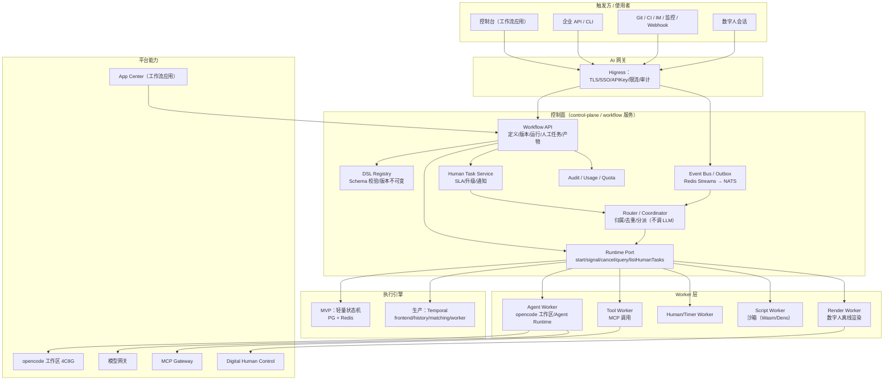
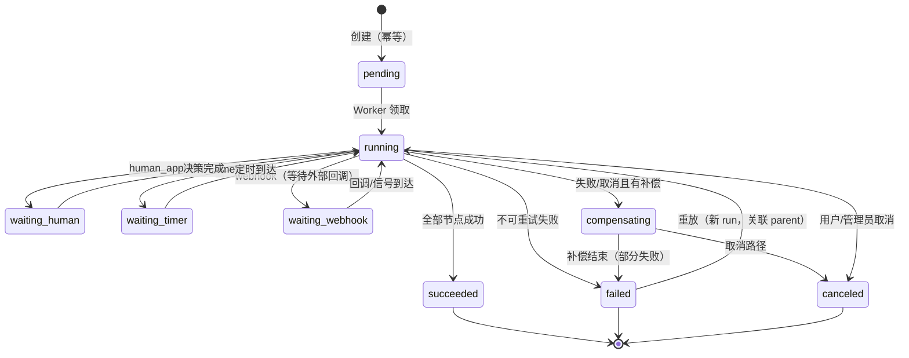
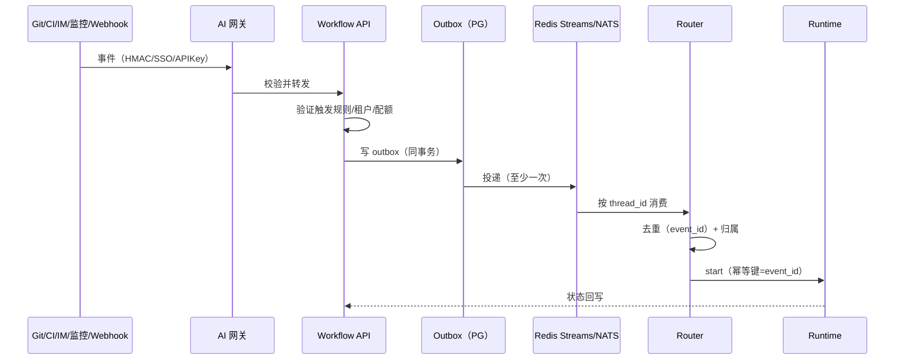
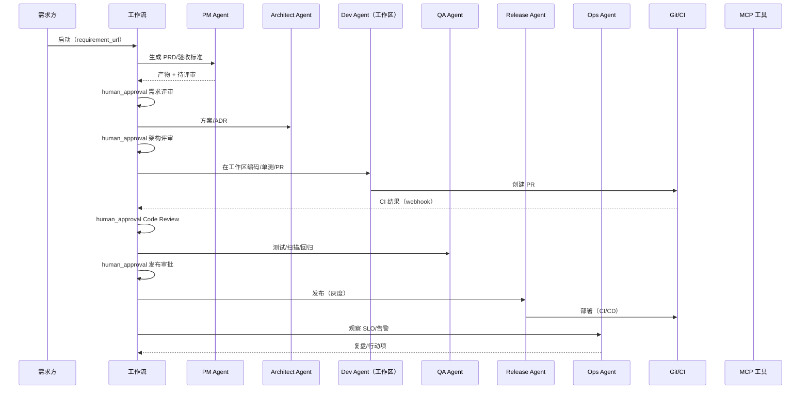
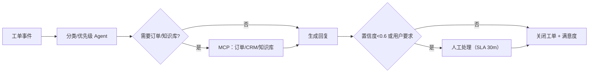
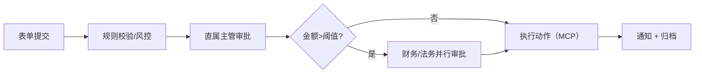
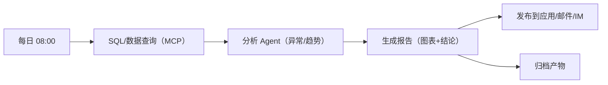
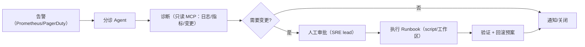
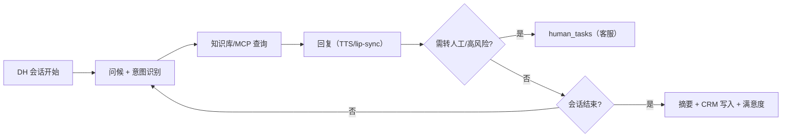
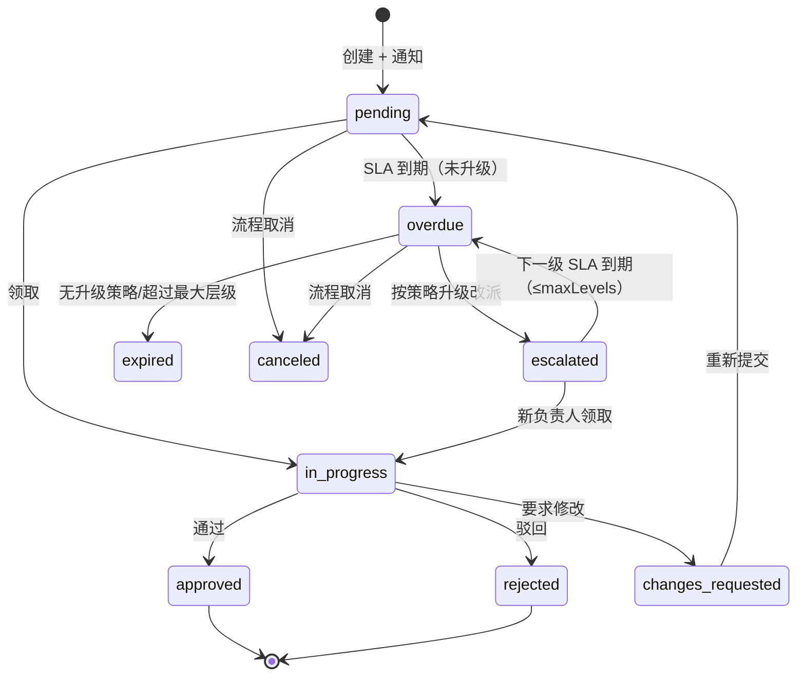

# SDLC / 通用工作流业务层详细设计（WORKFLOW）

- 文档 ID：A6（v3 架构战役）
- 版本：v0.7（待评审；v0.7 按 openapi 1.1.0 冻结版校准错误契约权威表述，映射不变）
- 日期：2026-11-08
- 契约权威：`docs/02-architecture/openapi.yaml` **1.1.0（`x-contract-status: frozen@1.1.0`）** 的 `ErrorReason`；`ARCH-V3 §23.4/§24` 为设计说明（冲突以 openapi 为准）
- Owner：pm-research（主笔：业务/流程/DSL/模板/API）+ architect（引擎与执行语义，见 `../adr/ADR-V3-04-workflow-engine.md`）
- 写作用域：`docs/02-architecture/services/`；不 commit
- 上游依据：[ARCH-V3.md](../ARCH-V3.md)（§7 Super-agent 映射、§9 工作流）、[PRODUCT-MODULE-PLAN.md](../../00-program/PRODUCT-MODULE-PLAN.md)、[BACKEND.md](BACKEND.md)（错误模型/API 风格）、[DATA-MODEL.md](../DATA-MODEL.md)（租户/RLS）、[SECURITY.md](../SECURITY.md)
- 引擎权威：**`docs/02-architecture/adr/ADR-V3-04-workflow-engine.md`**（architect 撰写中；冲突时以 ADR 为准，本文引用其结论）
- 关联：应用中心（工作流 = App 类型）、MCP 网关（工具节点）、工作区（开发类节点 Worker）、数字人（接待模板）、审计/配额/审批中心

> **本文性质**：v0.2 为可评审详细设计。DSL 规范归 pm（本文）；执行语义/引擎/持久化归 architect（ADR-V3-04）；数值指标为设计目标，标注 `【假设】` 的待压测/评审确认。

---

## 0. TL;DR（给评审的 12 条）

1. **定位**：工作流是 v3 的**业务编排层**，不是"SDLC 专用"。SDLC 只是内置模板之一；同一 DSL 支撑客服、审批、数据分析、运维值班、数字人接待。
2. **DSL v1**：YAML + JSON Schema + semver，**10 类节点**：`agent / mcp_tool / human_approval / condition / parallel / subworkflow / timer / webhook / script / render(digital_human)`；版本**不可变**，实例绑定 `dsl_version_id`。
3. **执行模型**：实例状态机 `pending → running → waiting_human|waiting_timer → succeeded|failed|canceled|compensating`；节点级重试/超时/补偿；**Saga 逆序补偿**；死信 + 人工任务兜底。
4. **引擎策略（architect 已确认）**：**生产 Temporal（ACK 自建、RDS PG16、单 namespace + platform-system）+ MVP 轻量状态机（PG+Redis）**；两者实现**同一 Runtime Port 接口**，DSL/实例元数据同表，保证平滑迁移。
5. **硬约束**：workflow definition **必须确定性**（无网络/无 LLM/无随机/无时钟）；副作用全走 Activity；**每个 Activity 幂等**（`idempotency_key={workflow_id}/{run_id}/{activity_id}/{attempt}`）；有副作用 Activity 必配补偿。
6. **事件驱动**：Trigger 来自 Webhook/定时/IM/Git/CI/应用事件；**事件信封版本化 + at-least-once + 按 `event_id` 幂等消费 + 分区键 `thread_id` 保序**；MVP Redis Streams（`MAXLEN`≈100 万），生产 NATS JetStream（>5k/s 或跨地域再评估 Kafka）；关键 Trigger 用 **outbox** 表。
7. **Super-agent 映射**：Router = 控制面协调器（只做归属/去重/分派，**不调 LLM、不持上下文**）；Worker = opencode 工作区 / Agent Runtime / Activity Worker；Trigger = 事件总线；Thread 订阅直通 = `thread_id` 事件直投；Watchdog = 独立巡检 Agent（第一阶段**只读诊断+告警**，仅允许"重启/重连"白名单动作）。
8. **SDLC 模板**：需求→设计→开发→测试→发布→运维 6 阶段，每阶段定义 Agent 角色、**门禁（人工/自动）**、产物（PRD/ADR/PR/测试报告/发布单/事故报告）、Git/CI/MCP 集成；开发类节点在 opencode 工作区执行，**平台不复制工作区状态**。
9. **人工介入**：**统一 `human_tasks` 表**（App/Collab/发布门禁/工作流共用），字段含 `assignee_type/assignee_id/sla_due_at/escalation_policy/decision/comment/attachments`；超时按 SLA 升级（child workflow 或 timer）。
10. **7x24**：Runtime API 99.9%、执行成功率 ≥99.5%、Worker 按队列 KEDA 扩缩、死信重放、DB/Temporal 故障降级（触发缓冲、只读状态页）。
11. **成本**：Temporal 组件小集群（≈4C8G 级）+ PG；按 1,000 runs/日估算月成本 `【假设】` 见 §15；MVP 轻量引擎成本近 0，但需承担自研维护。
12. **里程碑**：M0 设计评审 → M1 DSL+Runtime Port+轻量引擎+SDLC 骨架（本地可跑）→ M2 Temporal+完整 SDLC 门禁+Git/CI → M3 5 个通用模板+数字人接待 → M4 规模化/7x24/压测。

---

## 1. 定位、范围与指标

### 1.1 为什么需要工作流层

v3 平台已有「工作区 + 四中心 + MCP + 应用」，但**跨步骤、跨系统、跨时间的业务**没有归属：
- SDLC 需要"需求→设计→开发→测试→发布→运维"的**门禁与产物追踪**；
- 客服/审批/运维需要**人工介入 + 超时升级 + 审计**；
- 数字人接待需要"对话 → 工单/CRM → 转人工"的**编排**；
- Super-agent 的 Router/Worker 需要一个**持久化、可回放**的执行底座。

工作流层的职责：**把 Agent、工具、人、时间、事件编排成可审计、可重试、可回放的业务流程**，对外表现为"工作流应用"（App Center 的 `workflow` 类型）。

### 1.2 角色与场景

| 角色 | 场景 | 诉求 |
| --- | --- | --- |
| 研发团队 | SDLC：需求→发布 | 门禁不遗漏、产物可追溯、失败可恢复 |
| 客服/运营 | 工单、退款审批、活动审核 | 人工节点清楚、SLA 可视、可转交 |
| 数据团队 | 定时取数→分析→报告 | 定时/事件触发、失败重试、产物分发 |
| SRE | 告警→诊断→修复/升级 | 值班表、静默、审批、回滚 |
| 数字人运营 | 接待→转人工 | 与数字人会话联动、话术驱动 |
| 平台管理员 | 治理 | 配额、审计、DSL 版本、权限 |

### 1.3 范围边界

**In Scope（v3）**
- DSL v1（10 类节点、变量、错误/重试/补偿、版本）；
- 运行时（Runtime Port + 轻量引擎 + Temporal 适配）、触发（手动/定时/Webhook/IM/Git/CI/事件）、人工任务、产物管理；
- SDLC 模板 + 5 个通用模板（客服工单/审批/数据分析/运维值班/数字人接待）；
- 对外 API/Webhook、App Center 集成（工作流应用）、审计/配额/可观测；
- 7x24 可靠性设计与降级。

**Out of Scope（本期不做）**
- 通用 BPMN 2.0 全兼容（只做我们需要的 10 类节点；BPMN 导入列为 P2）；
- 可视化拖拽编辑器的完整实现（本期 API/DSL 优先，UI 由 web-console 之后承接）；
- 任意代码执行平台（`script` 节点是受限沙箱，不是通用 FaaS）；
- 跨地域多活（单地域多 AZ）；
- 计费系统本身（只做用量/配额，账单接口复用平台）。

### 1.4 指标

| 层级 | 指标 | 定义 | 目标 |
| --- | --- | --- | --- |
| 北极星（模块级） | 周成功工作流运行数（WFR） | 状态 `succeeded` 的 run 数/周 | 上线 3 个月 ≥1,000/周 `【假设】` |
| 质量 | 运行成功率 | succeeded / (succeeded+failed) | ≥99.5% |
| 质量 | 人工任务及时率 | 在 SLA 内完成 / 全部 | ≥95% |
| 效率 | 端到端时长 P95 | 按模板类型分别统计 | SDLC 需求→发布 ≤5 工作日 `【假设】` |
| 可靠性 | 引擎可用性 | Runtime API 可用分钟/总分钟 | ≥99.9% |
| 可靠性 | 重放成功率 | 死信重放成功 / 重放总数 | ≥99% |
| 成本 | 单 run 成本 | 引擎+Worker+模型+工具 | 可观测，SDLC 单需求 ≤¥50 `【假设】` |

---

## 2. 总体架构

### 2.1 组件图（C4 Container）



### 2.2 组件职责

| 组件 | 职责 | 归属 |
| --- | --- | --- |
| Workflow API | 定义/版本 CRUD、运行启动/查询/取消/重放、人工任务、产物、触发器管理；对外 `/api/v1/workflows*` | 平台（建议独立服务 `services/workflow`，复用 control-plane 鉴权） |
| DSL Registry | JSON Schema 校验、semver、不可变版本、模板市场（内置/组织私有） | 平台 |
| Router / Coordinator | 新任务归属、去重（幂等键）、分派到 Runtime；**不调 LLM、不持会话上下文** | 平台 |
| Runtime Port | 统一抽象：`start/signal/cancel/query/listHumanTasks/completeHumanTask/replay`；MVP 与 Temporal 两实现 | architect 定接口，平台实现 |
| 轻量引擎（MVP） | PG 状态机 + Redis 队列/延时集合；SKIP LOCKED 调度；步骤重试；同表元数据 | 平台 |
| Temporal（生产） | Workflow/Activity/Signal/Timer/Child Workflow；history 即审计与回放 | infra 部署 |
| Event Bus | Trigger 事件投递；outbox 发件箱；消费组与幂等 | 平台/infra |
| Human Task Service | 任务创建/分派/提醒/SLA 升级/决策落库；与审批中心共用 | 平台 |
| Worker 层 | 按能力分 **6 个 task queue**：`wf-agent`（工作区）、`wf-tool`（MCP，入口 `mcp-hub:4104`，`/v1/{orgSlug}/{serverSlug}`，按 lead 端口裁决无 `/mcp` 前缀）、`wf-human`（人工/通知）、`wf-timer`（定时/SLA）、`wf-script`（沙箱）、`wf-render`（数字人渲染）；平台任务用 `wf-platform`（platform-system namespace） | 平台/infra |
| Agent Worker | 通过工作区 API/SDK 驱动 opencode 执行开发类节点；产物回写 Git/PR | platform-backend + workspace |
| Artifact Store | 产物登记（Git 引用/OSS/App 版本/测试报告），签名 URL | 平台 |
| 审计/配额 | 每次状态变更/工具调用/人工决策审计；配额与预算 | 平台 |

### 2.3 关键设计决策（D-WF，非独立 ADR；ADR 唯一权威见下）

> **ADR 唯一权威**：`../adr/ADR-V3-04-workflow-engine.md`（architect）。本节为**设计决策摘要（D-WF）**，用于评审速览；与 ADR 冲突时**以 ADR 为准**，本文不另立 ADR 体系。

| ID | 设计决策 | 理由 | ADR 对应 |
| --- | --- | --- | --- |
| D-WF-01 | Runtime Port 抽象 + 双实现（轻量/Temporal） | MVP 快速落地、生产获得持久化/回放；避免"迁移口号" | ADR-V3-04「决策」 |
| D-WF-02 | DSL 与实例元数据同一套表 | 迁移只换执行器，不换数据 | 「5) 持久化表」 |
| D-WF-03 | workflow definition 确定性 + Activity 幂等 + Saga 补偿 | Temporal 重放成立、失败可恢复 | 「4) 执行语义」 |
| D-WF-04 | 单 namespace + `tenant_id` search attribute + `platform-system` 第二 namespace | 隔离与运维成本平衡；平台任务不受租户故障影响 | 「2) 租户隔离」 |
| D-WF-05 | Temporal 自建 ACK + RDS PG16（不用 Temporal Cloud） | 数据驻留/合规；P2 再评估 Cloud | 「1) 引擎与部署形态」 |
| D-WF-06 | 事件总线 Redis Streams MVP → NATS JetStream 生产 | footprint/运维成本；Kafka 留作超大规模 | 「3) 触发与事件总线」 |
| D-WF-07 | 统一 `human_tasks` 表（跨 App/Collab/发布/工作流） | 避免每个中心一套审批 | 「4) 执行语义」「5) 持久化表」 |
| D-WF-08 | 开发类节点只引用工作区/产物，不复制工作区状态 | 与 ARCHITECTURE 原则一致 | 「6) 与现有系统集成」 |

---

## 3. 工作流 DSL v1

### 3.1 设计原则

1. **声明式优先**：DSL 描述"做什么/依赖什么"，不描述"如何调度"；执行由 Runtime 决定。
2. **可校验**：JSON Schema 强校验；节点输入输出 schema 可选声明。
3. **确定性**：DSL 本身不含"代码逻辑"（`condition` 只做受限表达式；`script` 是受限沙箱节点）。
4. **不可变版本**：发布后的版本不可修改；修改 = 新版本（semver），实例绑定启动时的版本。
5. **租户安全**：DSL 节点只能引用**已授权的** MCP/模型/应用/工作区；凭证通过 `secret_ref` 引用，DSL 中禁止明文密钥。
6. **可观测**：每个节点有 `id`，状态/输入输出摘要/耗时/重试次数入库，支持回放。

### 3.2 顶层结构

```yaml
apiVersion: workflow.opencode.cloud/v1
kind: Workflow
metadata:
  name: sdlc-feature-delivery
  displayName: 需求到发布（SDLC）
  version: 1.2.0            # semver，发布后不可变
  tenantId: org_xxx          # 创建时由服务端填充，禁止客户端伪造
  labels: { category: sdlc, owner: team-platform }
spec:
  description: 从需求到发布的端到端流程
  inputs:
    type: object
    required: [requirement_url]
    properties:
      requirement_url: { type: string, format: uri }
      repo: { type: string }
      env: { type: string, enum: [staging, prod] }
  outputs:
    type: object
    properties:
      release_url: { type: string }
      artifacts: { type: array, items: { type: string } }
  timeout: 30d                # 与 Temporal WorkflowExecutionTimeout 对齐（≤30d）
  concurrency:
    key: "${inputs.repo}"     # 同 repo 串行
    limit: 1
  defaults:
    node:
      retry: { maxAttempts: 3, backoff: { base: 2s, factor: 2, jitter: true } }
      timeout: 30m
  permissions:
    mcp: [github, jira, ci]
    models: [default-coding]
    workspaces: [requester]
  nodes: [...]
```

### 3.3 节点类型（10 类）

| 类型 | 用途 | 关键字段 | 执行位置 | 幂等要求 |
| --- | --- | --- | --- | --- |
| `agent` | 调用 Agent（opencode 工作区/Agent Runtime）完成推理/编码/分析 | `prompt`/`skill_refs`/`mcp_bindings`/`model_ref`/`workspace_ref`/`output_schema` | Agent Worker（工作区） | 由 Activity 幂等键保证；外部副作用（Git push/PR）需幂等 |
| `mcp_tool` | 调 MCP 工具（GitHub/Jira/CRM/DB/监控） | `server`/`tool`/`args`（表达式）/`result_schema` | Tool Worker（MCP 网关） | 工具侧幂等键；查询类天然幂等 |
| `human_approval` | 人工审批/确认/填写 | `assignee`(user/role/team)/`title`/`form`/`sla`/`escalation` | Human Worker + `human_tasks` | 决策幂等（task_id + decision） |
| `condition` | 条件分支 | `cases: [{when, next}]`/`else`；受限表达式 | 引擎内联 | 纯函数，天然幂等 |
| `parallel` | 并行分支 | `branches`/`join: all\|any\|n_of_m`/`fail_fast` | 引擎内联（child/activity 并行） | 子分支各自幂等 |
| `subworkflow` | 调用子流程 | `workflow_ref`/`version`/`inputs` | 引擎（Child Workflow） | 子流程 run 幂等键 |
| `timer` | 延时/等待 | `duration`/`until`/`cron`（定时触发用 trigger） | 引擎 Timer | 定时器幂等 |
| `webhook` | 等待外部回调 | `path`/`secret_ref`/`timeout`/`expected` | 引擎（Signal） | 回调去重键 |
| `script` | 受限脚本（数据转换/校验） | `runtime: deno\|wasm`/`code_ref`/`timeout`/`resources`/`network: none` | Script Worker（沙箱） | 纯函数优先；有副作用需声明 |
| `render` | 数字人视频/音频渲染 | `app_id`/`script`/`avatar`/`voice`/`output` | Render Worker（GPU） | `render_job_id` 幂等 |

> 新增节点类型必须走 DSL 版本演进（v1.x 只加可选能力；破坏性变更升 v2）。

### 3.4 节点通用结构

```yaml
- id: review_arch
  type: human_approval
  name: 架构评审
  needs: [design_adr]                      # DAG 依赖（可多个）
  when: "${steps.design_adr.output.needs_review}"   # 可选条件
  input:
    title: "架构评审：${inputs.requirement_url}"
    form:
      type: object
      properties:
        decision: { type: string, enum: [approve, reject, changes] }
        comment: { type: string, maxLength: 2000 }
  assignee: { type: role, value: architect }
  sla: { due: 24h, escalateTo: { type: role, value: team_owner } }
  retry: { maxAttempts: 1 }
  timeout: 72h
  onError: fail                             # fail | continue | route:<node_id>
  outputSchema:
    type: object
    properties: { decision: { type: string }, comment: { type: string } }
```

### 3.5 变量与表达式

| 语法 | 含义 | 示例 |
| --- | --- | --- |
| `${inputs.x}` | 运行输入 | `${inputs.repo}` |
| `${steps.<id>.output.<field>}` | 前置节点输出 | `${steps.create_pr.output.pr_url}` |
| `${steps.<id>.status}` | 节点状态 | `succeeded/failed/skipped` |
| `${run.id}` / `${run.tenantId}` | 运行元数据（只读） | 审计关联 |
| `${secrets.<ref>}` | **仅允许传给 mcp_tool/agent 的凭证引用**（服务端解析，不落 DSL 日志） | `secret_ref: github_token` |
| `${env.<name>}` | 平台环境（只读白名单，如 region） | `${env.region}` |

**限制**：表达式只支持字段访问、比较、布尔组合、`contains/length` 等**白名单函数**；**禁止**任意代码、文件系统、网络、随机数、当前时间（时间由 `timer` 节点/`run.startedAt` 提供）。

### 3.6 错误处理、重试与补偿

| 机制 | 语义 |
| --- | --- |
| `retry` | `maxAttempts`（默认 3）、`backoff`（指数 + jitter）、`nonRetryable`（错误码列表，如 `validation_failed`、`precondition_failed`） |
| `timeout` | 节点级/流程级；超时 → `failed`（可 `onError` 路由到补偿或人工） |
| `onError` | `fail`（默认）/`continue`（记录并继续）/`route:<node>`（转补偿/人工） |
| `compensation` | 每个有副作用的节点可声明 `compensate: <node_id 或 subworkflow>`；流程失败/取消时**逆序执行**已成功节点的补偿（Saga） |
| 死信 | 重试耗尽/补偿失败 → `workflow_dead_letters` + 创建 `human_tasks`（类型 `dead_letter`）；支持重放 |
| 取消 | 级联：取消子流程、opencode session、MCP 调用（尽力）、发布/部署；执行补偿（若声明） |
| 幂等 | Activity 幂等键 `{workflow_id}/{run_id}/{activity_id}/{attempt}`；外部 API 需带幂等键（GitHub PR 创建用 head/base 去重、发布用 release_id） |

### 3.7 版本与兼容

- 版本不可变：`workflow_versions` 一行一版本，`dsl` JSONB + `dsl_sha256`；实例 `dsl_version_id` 固定。
- 升级：仅对 `waiting_human/waiting_webhook/waiting_timer` 的实例提供显式"迁移"操作（需审批 + 审计），运行中实例不热切换；新实例默认新版本。
- 弃用：`deprecated` 标记 + 通知；已启动实例按原版本跑完。
- DSL 兼容策略：v1.x 只做**加法**（新可选字段/新节点类型按能力开关）；破坏性变更 = v2 + 迁移工具。

**版本兼容矩阵（WF-QA-06 关闭）**

| 场景 | 允许？ | 行为 |
| --- | --- | --- |
| 旧实例（v1.0）跑在新 Runtime（支持 v1.4） | ✅ | Runtime 按实例 `dsl_version_id` 解析；未知字段**忽略但记录** `dsl_unknown_field` 告警；执行语义按 v1.0 |
| 新实例（v1.4）跑在旧 Runtime（仅支持 v1.0） | ❌ | 启动前校验 `minRuntimeVersion`（DSL 顶层字段）；不满足返回 `precondition_failed` + `wf_dsl_incompatible`，不落 run |
| 新实例使用新节点类型/新必填字段 | ❌（旧 Runtime） | 同上；校验器按目标 Runtime 能力集校验 |
| v2 DSL（破坏性） | ❌（v1 Runtime） | 拒绝；需升级 Runtime 或使用迁移工具降级 |
| 实例迁移到新 DSL 版本 | 仅显式 | 审批 + 审计；只允许 `waiting_*`；迁移前做 dry-run（校验 + 差异报告） |

**校验器行为（`node packages/schema/scripts/validate-workflow.mjs <file>`；服务端/CLI 复用同一实现）**：① Schema 校验（结构/必填/类型）；② DAG 校验（无环、`needs` 引用存在、`compensate` 引用存在）；③ 版本兼容校验（`minRuntimeVersion`）；④ 表达式白名单校验；⑤ 权限引用校验（MCP/模型/工作区/应用是否已授权）。**任一失败不落库**。

### 3.8 完整示例（通用客服工单）

> **与机器可校验版本同步（V3-WF-001）**：权威示例为 `packages/schema/examples/cs-ticket.json`（已通过 `node packages/schema/scripts/validate-workflow.mjs`）；下方 YAML 与其语义一致（补 `model_ref`、`needs`、`compensate`/`reopen`）。

```yaml
apiVersion: workflow.opencode.cloud/v1
kind: Workflow
metadata: { name: cs-ticket-triage, version: 1.0.0, displayName: 客服工单分诊 }
spec:
  minRuntimeVersion: "1.0.0"
  trigger:
    webhook: { path: /hooks/cs-ticket, secret_ref: cs_webhook_secret }
  inputs:
    type: object
    required: [ticket_id, content]
    properties: { ticket_id: {type: string}, content: {type: string} }
  outputs: { type: object, properties: { closed: {type: boolean} } }
  permissions:
    mcp: [crm, kb]
    models: [default-fast, default-coding]
    workspaces: []
    apps: []
  nodes:
    - id: classify
      type: agent
      name: 工单分类
      model_ref: default-fast
      input:
        prompt: "你是客服分类器。判断工单类型与优先级：${inputs.content}"
        output_schema: { type: object, properties: { category: {type: string}, priority: {type: string} } }
    - id: check_order
      type: mcp_tool
      name: 查订单
      needs: [classify]
      when: "${steps.classify.output.category} == 'order'"
      input: { server: crm, tool: order.lookup, args: { ticket_id: "${inputs.ticket_id}" } }
    - id: answer
      type: agent
      name: 生成答复
      needs: [classify, check_order]
      model_ref: default-coding
      input:
        prompt: "基于知识库与订单结果回答用户：${inputs.content}；订单：${steps.check_order.output}"
        mcp_bindings: [kb.search]
    - id: need_human
      type: condition
      name: 是否需要人工
      needs: [answer]
      cases:
        - when: "${steps.answer.output.confidence} < 0.6"
          next: handoff
      else: close
    - id: handoff
      type: human_approval
      name: 转人工
      input: { title: "转人工：${inputs.ticket_id}", form: { type: object, properties: { reply: {type: string} } } }
      assignee: { type: team, value: cs-oncall }
      sla: { due: 30m, escalateTo: { type: role, value: cs_lead } }
    - id: close
      type: mcp_tool
      name: 关闭工单
      needs: [answer, handoff]
      input: { server: crm, tool: ticket.close, args: { ticket_id: "${inputs.ticket_id}", reply: "${steps.answer.output.reply}" } }
      compensate: reopen
      retry: { maxAttempts: 3, backoff: { base: 1s, factor: 2, jitter: true } }
    - id: reopen
      type: mcp_tool
      name: 重开工单（补偿）
      input: { server: crm, tool: ticket.reopen, args: { ticket_id: "${inputs.ticket_id}" } }
```

### 3.9 校验规则与 DSL Schema 文件（WF-QA-01 关闭）

**Schema 文件与产物（已落地，V3-WF-001 关闭）**
- 权威 Schema：`packages/schema/schemas/workflow-v1.json`（已落盘；含 10 类节点约束、retry/compensate、trigger、permissions、inputs/outputs、`minRuntimeVersion`）。
- 权威示例：`packages/schema/examples/cs-ticket.json`（通过校验）。
- 校验器：`node packages/schema/scripts/validate-workflow.mjs`（零依赖，含 DAG/引用语义检查，退出码门禁）；`bun run --cwd packages/schema validate`；服务端 `POST /workflows/validate` 复用同一实现。
- 测试：`bun test packages/schema/test/workflow-schema.test.mjs`（**7 pass**：正例 + 反例）；后续加节点类型必须走 v1.x 加法 + Schema 版本演进（不得破坏 v1）。
- `dsl_sha256` 固定版本内容；CI 校验 schema/类型/示例三者一致。
- **本地实测证据（2026-11-08，pm 复核）**：`node packages/schema/scripts/validate-workflow.mjs packages/schema/examples/cs-ticket.json` → **PASS**（4 条 `compensate` 建议告警，非阻断：agent/mcp_tool 建议声明补偿）；`bun test packages/schema/test/workflow-schema.test.mjs` → **7 pass / 0 fail / 13 expect**。告警策略：模板/生产流程建议强制 compensate，示例仅告警。

**Schema 之外的强校验（必须实现，返回带 `path` 的错误列表）**

| 规则 | 说明 | 错误 reason |
| --- | --- | --- |
| `id` 唯一 | 节点 id 全流程唯一 | `wf_dsl_invalid` |
| DAG 无环 | `needs` 构成有向无环图；`condition.next`/`parallel` 分支不得成环 | `wf_dsl_invalid` |
| 引用存在 | `needs`/`compensate`/`subworkflow.workflow_ref` 必须存在 | `wf_dsl_invalid` |
| 补偿配对 | 声明 `compensate` 的节点必须有对应补偿节点；有副作用节点（mcp_tool/script/render/agent 写操作）**必须**声明补偿（否则 lint 告警，生产模板强制） | `wf_dsl_invalid` |
| 变量作用域 | `${steps.x}` 只能引用**可达的前置节点** | `wf_dsl_invalid` |
| 表达式白名单 | 只允许字段访问/比较/布尔/`contains/length`；禁止函数调用、赋值、网络、时间、随机 | `wf_dsl_invalid` |
| 凭证 | 只允许 `secret_ref`，禁止明文密钥/Token（正则扫描 `sk-`/`Bearer` 等） | `wf_dsl_invalid` |
| 权限引用 | `mcp`/`models`/`workspaces`/`apps` 必须在 `permissions` 声明且已授权 | `wf_dsl_invalid` |
| 超时/重试边界 | `retry.maxAttempts ≤10`、`timeout ≤30d`、`backoff ≥1s` | `wf_dsl_invalid` |
| 节点必填字段 | 按类型（见下表） | `wf_dsl_invalid` |

**节点必填字段（Schema `oneOf` 约束）**

| 节点 | 必填 | 可选/约束 |
| --- | --- | --- |
| `agent` | `input.prompt`（或 `input.prompt_ref`）、`model_ref` | `workspace_ref`、`skill_refs[]`、`mcp_bindings[]`、`output_schema`；`timeout ≤2h` |
| `mcp_tool` | `input.server`、`input.tool` | `input.args`（表达式）、`result_schema`；工具必须在已发布版本清单内 |
| `human_approval` | `input.title`、`assignee` | `input.form`、`sla`、`outputSchema`；`assignee.type ∈ user/role/team` |
| `condition` | `cases[]`（≥1，每项 `when`+`next`）或 `when`+`then/else` | `else` 节点必须存在 |
| `parallel` | `branches[]`（≥2） | `join ∈ all/any/n_of_m`（n_of_m 需 `n`）、`fail_fast` |
| `subworkflow` | `workflow_ref`、`version` | `inputs`；子流程必须已发布且版本兼容 |
| `timer` | `duration` 或 `until` | `onTimeout ∈ fail/route` |
| `webhook` | `path`、`secret_ref` | `timeout`（默认 24h）、`expected` |
| `script` | `runtime ∈ deno/wasm`、`code_ref` | `timeout ≤5m`、`resources`、`network`（默认 none，只允许白名单） |
| `render` | `app_id`、`script` 或 `script_ref` | `avatar`、`voice`、`output`；`app.type=digital_human` |

---

## 4. 运行时与持久化引擎

### 4.1 Runtime Port（唯一执行抽象）

> architect 硬约束：MVP 与生产**必须共用同一接口**，并跑同一套契约测试。以下为草案签名，最终以 ADR-V3-04 为准。

```ts
export interface WorkflowRuntimePort {
  /** 启动实例（幂等：同一 idempotencyKey 返回同一 run） */
  start(defVersionId: string, input: unknown, opts: {
    idempotencyKey: string; tenantId: string; orgId: string;
    triggeredBy: TriggerRef; timeout?: string;
  }): Promise<RunRef>;

  /** 发送信号（人工决策/外部回调/子流程完成） */
  signal(runId: string, name: string, payload: unknown): Promise<void>;

  /** 取消（级联到子 run/工作区/MCP/部署） */
  cancel(runId: string, reason: string): Promise<void>;

  /** 查询状态（含 steps/human tasks/artifacts 摘要） */
  query(runId: string): Promise<RunState>;

  /** 人工任务 */
  listHumanTasks(filter: HumanTaskFilter): Promise<Page<HumanTask>>;
  completeHumanTask(taskId: string, decision: HumanDecision): Promise<void>;

  /** 回放/重放（基于 workflow_events，不依赖引擎；ADR-V3-04 采纳） */
  replay(runId: string, fromSeq?: number): Promise<RunRef>;
}
```

**契约测试**（两实现都必须通过）：启动幂等、信号重复投递不重复生效、取消级联、超时触发、人工任务重复决策拒绝、回放后状态一致、租户越权 404。

**错误语义（WF-QA-02 关闭）**

| 调用 | 场景 | 返回 |
| --- | --- | --- |
| `start` | 同 `idempotencyKey` 同 body | 200 + 原 `RunRef`（`Idempotency-Replayed: true`） |
| `start` | 同 Key 不同 body | 409 `idempotency_conflict` |
| `signal` | run 不存在/跨租户 | 404 `not_found` + reason `wf_run_not_found`（不泄露存在性） |
| `signal` | run 已结束/已取消 | 409 `conflict` + reason `wf_run_not_active`（`details.state` 给当前状态） |
| `signal` | 信号名不在白名单/重复信号 | 400 `validation_failed` + reason `wf_signal_invalid`；重复信号按 `signal_id` 幂等丢弃（非错误） |
| `completeHumanTask` | task 不存在/跨租户 | 404 `wf_task_not_found` |
| `completeHumanTask` | 已决策（重复提交） | 409 `conflict` + reason `wf_task_already_decided`（`details.decided_by/at`） |
| `completeHumanTask` | task 已过期/已取消 | 409 `precondition_failed` + reason `wf_task_not_active` |
| `cancel` | run 不存在 | 404 `wf_run_not_found` |
| `cancel` | run 已结束/已取消 | 200（幂等，返回当前状态；`details.noop=true`） |
| `replay` | 原 run 仍为 `running/waiting_*` | 409 `precondition_failed` + reason `wf_replay_conflict`（需先取消） |
| `query` | run 不存在/跨租户 | 404 `wf_run_not_found` |

> 所有错误遵循平台两层模型（`error.code` 16 类 + `error.reason`），`reason` 需 architect 增补见 §9.4；`details` 可含 `state/decided_by/decided_at` 等上下文。

### 4.2 引擎选型（architect 已确认）

| 维度 | MVP：轻量状态机（PG+Redis） | 生产：Temporal（ACK 自建） |
| --- | --- | --- |
| 状态存储 | `workflow_instances/steps`（PG） | Temporal history（RDS PG16）+ 业务表镜像 |
| 调度 | Redis Streams/List + `SKIP LOCKED` | matching/history + task queues |
| 重试/超时 | 自研调度器（ZSET 延时）+ 节点状态机 | 原生 RetryPolicy/Timer |
| 人工任务 | `human_tasks` + Signal 表 | Signal + `human_tasks` 镜像 |
| 回放 | 事件表回放（有限） | history 全量重放 |
| 运维成本 | 低（无新组件） | 中（8+ Pod、PG schema、备份） |
| 适用 | 本地 Docker、单租户验证、M1 | 生产 7x24、多租户、长流程（≤30d） |

**部署形态（见 `adr/ADR-V3-04-workflow-engine.md`「1) 引擎与部署形态」；architect 口径）**：自建在 ACK（不用 Temporal Cloud；P2 可评估）；持久化 **RDS PostgreSQL 16**（官方支持；超 5k workflow/s 再评估 Cassandra）；**PG 标准 visibility**（不上 Elasticsearch；复杂查询走业务表 `workflow_instances`）；组件 **frontend×3 / history×3 / matching×3 / worker×4**，PDB + 独立 DB schema + 每日备份；**mTLS + 仅内网**。
**关键配置**：`WorkflowExecutionTimeout` 显式设置（SDLC 长流程 ≤30d，超长用 Continue-As-New）；`WorkflowIdReusePolicy=AllowDuplicateFailedOnly`；`WorkflowId = wf:{tenant}:{run_id}`。
**namespace**：租户流程一个 namespace；**平台任务（Watchdog/计费汇总/清理）放第二个 namespace `platform-system`**，与租户限流/故障隔离。
**安全边界**：`tenant_id` search attribute **不是安全边界**；visible 查询只能经控制面 API 代理（前端不可直连 Temporal visibility）；payload 禁止放密钥，凭证用 `secret_ref`。

### 4.3 实例状态机



**状态语义**
- `waiting_human`：节点状态 + `human_task` 未决；SLA 计时中；超时升级见 §8.2。
- `waiting_timer`：`timer` 等待；超时默认 `failed`（可配置 `onTimeout: fail|route`）；事件 `workflow.timer.fired`。
- `waiting_webhook`：`webhook` 等待外部回调（与 timer 区分：**webhook 由外部信号唤醒，timer 由时间唤醒**）；超时默认 `failed`；事件 `workflow.webhook.received` / `workflow.webhook.timeout`。
- `compensating`：逆序执行补偿；补偿失败 → 发 `workflow.compensation_failed` 事件 + 创建 `human_tasks(source=dead_letter)` + 继续逆序其余补偿，最终 run=`failed`（不引入单独状态，避免状态爆炸；由 human task 承载人工处置）。
- `failed` 可重放：创建**新 run**（`parent_run_id` 关联），不修改原 history（审计不可变）。

### 4.4 事件总线与 Trigger



**事件信封（版本化）**
```json
{
  "event_id": "evt_01H...",
  "type": "git.pull_request.opened",
  "version": 1,
  "tenant_id": "org_x",
  "thread_id": "repo:acme/api#pr:123",
  "occurred_at": "2026-11-08T12:00:00Z",
  "trigger_id": "trg_...",
  "trace_id": "...",
  "payload": { "...": "脱敏后的业务字段" }
}
```
**要求（architect）**：at-least-once + 消费端按 `event_id` 幂等（去重表 TTL 7d）；分区键 `thread_id` 保序；Redis Streams 设 `MAXLEN`≈100 万 + 消费组 + 积压告警；超 5k events/s 或跨地域上 NATS JetStream（Kafka 仅在更大规模/多地域）；关键 Trigger 用 **outbox**（同事务写，投递确认后标记），禁止"发后不管"。

**触发类型**：手动（控制台/API）、定时（cron，带时区）、Webhook（HMAC + 时间戳防重放）、IM（钉钉/飞书/企微，P2）、Git/CI（PR/检查/流水线）、平台事件（应用发布/评测完成/MCP 变更/告警）、数字人会话事件（接待/转人工）。

### 4.5 并发、限流与配额

- 实例并发：`concurrency.key`（如 repo/app/用户）+ `limit`，同键串行（`limit=1` 时同一 repo 同时只允许一个 run）。
- **跨租户隔离与公平**：租户配额独立计算；调度按租户 **加权轮询/公平队列**（单租户突发不饿死其他租户）；单租户最多占用 Worker 池 `maxTenantShare`（默认 50%，可配）。
- **超限行为（明确语义）**：租户并发达上限 → **默认排队**（`queued`，`maxWait` 默认 10min）；超过 `maxWait` 或被显式配置 `onOverflow: reject` → 429 `rate_limited` + reason `wf_concurrency_exceeded`；**不静默丢弃**，排队位置与预计等待在 API/控制台可见。
- 节点并发：`parallel` 分支上限（默认 10）；Agent Worker 受工作区配额约束。
- 租户配额：并发 run 数、每日 run 数、节点调用数、GPU 渲染分钟；超限 429 `rate_limited` / 409 `quota_exceeded` + reason（`wf_concurrency_exceeded`、`wf_quota_exceeded`）。
- 优先级：`priority: high|normal|low`；低优先级走独立 task queue（`wf-agent-low`），避免挤占生产；高优先级仅限管理员/系统 Trigger。

---

## 5. 与 DeepSeek Super-agent 架构映射

> 参考：双层 Router/Worker、事件 Trigger、Thread 订阅直通、异步 ReAct Loop、存算分离、外部 Watchdog（ARCH-V3 §7）。

| Super-agent 概念 | 本设计实现 | 约束 |
| --- | --- | --- |
| **Router 层** | 控制面 Router/Coordinator + Temporal Workflow 分派 | **只做归属/去重/分派**；不调 LLM、不持会话上下文；状态落 `workflow_instances`，避免 Router 成瓶颈 |
| **Worker 层** | opencode 工作区（Agent Worker）+ Activity Worker（工具/脚本/渲染） | 上下文隔离；Worker 无状态，状态在引擎/DB |
| **事件 Trigger** | 事件总线 + 触发规则（Webhook/定时/IM/Git/CI/告警） | 事件信封版本化 + 幂等消费 + outbox |
| **Thread 订阅直通** | `thread_id` 分区事件直投对应 Worker/run | 不经过 Router 轮询；Router 只处理"新任务" |
| **异步 ReAct Loop** | Agent 节点内部由 opencode 异步执行（工具/PTY），平台侧事件驱动等待 | 不把长 LLM 调用塞进 workflow definition（确定性约束） |
| **存算分离** | 会话/运行状态在控制面 DB；执行在工作区 Pod/Worker（可漂移） | 工作区故障 → run 重试/迁移；不复制工作区状态 |
| **外部 Watchdog** | 独立巡检 Agent（platform-system namespace）：卡死/超时/积压/成本异常 | 第一阶段**只读诊断+告警**；自动修复仅允许"重启/重连"白名单动作 + 审计 |
| **多信道** | Web 控制台、IM、API/Webhook、数字人会话 | 同一 run 多渠道可观测 |

**Router 事件流**：`Trigger → 去重 → 归属（tenant/app/repo）→ 启动 run → Worker 执行 → 事件回传 → Router 落状态 → 通知`。

---

## 6. SDLC 模板（内置）

### 6.1 阶段与门禁

| 阶段 | Agent 角色 | 输入 | 关键动作 | 门禁（类型/标准） | 产物 | 集成 |
| --- | --- | --- | --- | --- | --- | --- |
| S1 需求 | PM Agent | 需求链接/描述 | 澄清问题、生成 PRD、验收标准、影响面 | **人工**：需求评审通过（owner/PM）；**自动**：PRD 模板完整性 | PRD.md、验收标准 | Jira/Issue（MCP）、知识库 |
| S2 设计 | Architect Agent | PRD、代码库 | 方案对比、ADR、API/数据模型草案、风险 | **人工**：架构评审（architect）；**自动**：ADR 必填字段、契约向后兼容检查 | ADR、API 草案、数据模型 | Git、openapi 校验、MCP（repo） |
| S3 开发 | Dev Agent（opencode 工作区） | 设计、任务拆分 | 编码、单测、PR、自测 | **自动**：lint/type/test/覆盖率阈值；**人工**：Code Review（≥1 人） | 代码、PR、单测报告 | Git/PR（MCP）、CI、工作区 4C8G |
| S4 测试 | QA Agent + 评测中心 | 构建产物、测试计划 | 集成/E2E/性能/安全扫描；回归 | **自动**：E2E 通过率 ≥阈值、SAST/依赖扫描无 P0/P1；**人工**：测试负责人签核 | 测试报告、扫描报告、覆盖率 | CI、评测中心、gVisor 沙箱 |
| S5 发布 | Release Agent | 测试报告、发布单 | 变更说明、灰度计划、发布/回滚演练 | **人工**：发布审批（owner+运维）；**自动**：变更窗口/冻结期检查、镜像签名 | 发布单、release notes、镜像 digest | CI/CD、Argo CD、ACR |
| S6 运维 | Watchdog/Ops Agent | 监控告警、SLO | 诊断、止血、复盘、行动项 | **人工**：P0 事故复盘签核；**自动**：SLO 达标/回归验证 | 事故报告、行动项 | 监控（MCP）、值班表、工单 |

**门禁通用规则**
- 人工门禁统一 `human_approval` + `human_tasks`；决策=approve/reject/changes；驳回回退到指定节点（`route`）。
- 自动门禁失败：默认可重试 1 次；仍失败 → 失败并通知（严重级别按模板配置）。
- 门禁证据（产物/报告/链接）挂 `workflow_artifacts`，审计可追溯。
- 冻结期：S5 受平台"变更窗口"策略约束（可配置）。

### 6.2 SDLC 序列图



### 6.3 产物与追溯

| 产物 | 存储 | 追溯键 |
| --- | --- | --- |
| PRD / 验收标准 | Git（docs 目录）或知识库 | `run_id` + 文件路径 + commit |
| ADR / API 草案 | Git | 同上 |
| 代码 / PR | Git 平台 | `pr_url` + `head_sha` |
| 测试/扫描报告 | OSS（签名 URL） | `artifact_id` + checksum |
| 发布单 / release notes | App Center + Git tag | `release_id` + 镜像 digest |
| 事故报告 / 行动项 | 工单系统 + 知识库 | `incident_id` |

**门禁证据链**：每个门禁决策记录 `decision/comment/attachments/decided_by/decided_at`；发布单必须引用 S4 报告与 S3 PR；审计提供"一键追溯"（run → steps → artifacts）。

### 6.4 开发类节点与 opencode 集成

- **一个阶段的开发工作**在 **opencode 工作区**执行（建议：复用发起人的 4C8G 工作区；或为团队创建"流水线工作区"，按需拉起/回收）。
- 平台通过工作区 API/SDK：创建 session → 下发任务（prompt + 上下文 + 允许的工具）→ 等待完成 → 收集产物（diff/PR 链接/测试输出）。
- **不复制工作区状态**：工作流只存 `workspace_ref`、session id、产物引用；工作区销毁后 run 仍可追溯但不可重跑该节点（重放需重新拉起）。
- 安全：工作区按最小权限；Git push 用短期 token（MCP 签发）；禁止工作流持有长期凭证。

---

## 7. 通用模板（不局限 SDLC）

### 7.1 客服工单（触发：Webhook/IM）


关键点：分类失败降级到人工；人工超时升级到组长；关闭前必须记录处理摘要；与数字人接待共享"转人工"任务表。

### 7.2 审批（触发：表单/API）


关键点：并行审批 `join=all`；超时升级（timer + 改派）；驳回终止/退回；执行动作幂等（同一审批单只执行一次）；审计含审批链。

### 7.3 数据分析（触发：定时）


关键点：数据源凭证用 `secret_ref`；查询超时/降级；报告版本化；异常数据人工复核节点（可选）。

### 7.4 运维值班（触发：告警）


关键点：只读诊断优先；变更必须人工审批；`script` 节点只允许白名单命令/镜像；执行后自动验证；事故复盘自动生成。

### 7.5 数字人接待（与 DIGITAL-HUMAN.md 联动）


关键点：工作流驱动话术与业务动作，数字人只是"交互壳"；转人工时携带上下文摘要；会话/工具调用审计；高风险话术拦截。

**与 DIGITAL-HUMAN 的接口契约（ARCH-WF P3 收口）**
- `render` 节点（`type=render`，`app.type=digital_human`）→ `POST /api/v1/dh/sessions`（mode=offline）或 `POST /api/v1/dh/render-jobs`；返回 `session_id`/`job_id`，工作流通过事件/轮询等待完成。
- 数字人会话事件 → 工作流 Trigger：`dh.session.started`、`dh.turn.completed`、`dh.handoff.requested`、`dh.session.ended`（见 [DIGITAL-HUMAN.md](DIGITAL-HUMAN.md) §7.3）经 AI 网关 → 事件总线 → `POST /workflow-runs` 或 `signal`。
- 延迟口径：数字人实时语音往返 **P50 ≤1.2s / P95 ≤1.8s**（以 [DIGITAL-HUMAN.md](DIGITAL-HUMAN.md):212 与 ADR-V3-03 为准；原 800ms/1.5s 作废），工作流不得把该延迟算入自身 SLO。
- 转人工：工作流创建 `human_tasks(source=workflow)`；数字人侧会话进入 `waiting_human` 对应状态。

### 7.6 模板治理

- 模板 = 预置 `workflow_definitions`（`is_template=true`、`category`），组织可"另存为"新版本；平台模板由能力中心维护、审核后上架。
- 模板需附：说明、输入示例、SLA、依赖 MCP/模型/工作区、成本预估；上架前跑"模板冒烟"（用 mock 输入跑通全流程）。

---

## 8. 人工任务与审批

### 8.1 统一 `human_tasks` 表（architect 已确认）

| 字段 | 类型 | 说明 |
| --- | --- | --- |
| `id` | uuid | 主键 |
| `org_id` / `tenant_id` | uuid | 租户隔离（RLS） |
| `source` | enum | `workflow`/`app_collab`/`release_gate`/`skill_review`/`mcp_review`/`dead_letter` |
| `workflow_instance_id` / `step_id` | uuid/null | 工作流来源 |
| `title` / `description` | text | 展示 |
| `payload` | jsonb | 表单/上下文（脱敏，禁止密钥） |
| `assignee_type` | enum | `user`/`role`/`team` |
| `assignee_id` | string | 用户/角色/团队 ID |
| `sla_due_at` | timestamptz | 截止 |
| `escalation_policy` | jsonb | `{after: "2h", to: {type, value}, maxLevels: 2}` |
| `status` | enum | `pending`/`in_progress`/`overdue`/`escalated`/`approved`/`rejected`/`changes_requested`/`expired`/`canceled`（**`overdue`=超 SLA 未升级；`escalated`=已按策略升级改派**） |
| `escalation_level` | int | 当前升级层级（0 起，≤maxLevels） |
| `signal_id` | text | 决策幂等键（重复决策 409） |
| `decision` / `comment` / `attachments` | jsonb/text/jsonb | 决策与证据（OSS 引用） |
| `decided_by` / `decided_at` | uuid/timestamptz | 谁/何时 |
| `idempotency_key` | text | 重复决策拒绝 |

### 8.2 生命周期与 SLA



- **SLA / 升级机制**：默认 24h（模板可配）；到期由**引擎 timer / 独立 SLA Worker（同一 `workflow.step.timer` 机制）**触发 `overdue` + 事件 `wf.human_task.sla_breached`；有 `escalation_policy` 则升级到 `escalated`（改派 `escalation_policy.to`，发 `wf.human_task.escalated`），最多 `maxLevels`（默认 2）；仍无决策按模板 `onSlaExpired: fail|auto_approve`（默认 fail；**auto_approve 仅允许低风险模板并需管理员开启**）。
- **幂等决策**：`completeHumanTask` 带 `signal_id`；重复提交返回 409 `wf_task_already_decided`（见 §4.1），不重复执行后续节点。
- **通知**：站内 + 邮件（P0）；IM（P1/P2）；提醒节奏：创建/到期前 1h/到期/SLA 升级。
- **分派**：角色/团队 → 抢单（claim）；用户 → 直接指派；支持转交/委派（审计）。
- **超时与流程关系**：`overdue`/`escalated` 属于**任务级**状态，工作流实例仍为 `waiting_human`；任务 `expired`/`canceled` 时发信号使 run 进入失败或路由（按 `onSlaExpired`/`onError`）。

### 8.3 与审批中心/协同的复用

- App 发布门禁、应用协同 patch 审批、Skill/MCP 上架审核**全部写入同一 `human_tasks` 表**（`source` 区分），统一列表/通知/SLA/审计。
- 审批结果通过 `signal` 回工作流；非工作流来源（如 App 发布）由对应服务订阅/查询。

---

## 9. 对外 API

> 根路径 `/api/v1`；鉴权：OIDC 会话 / `ock_` API Key（scope `wf:read/write/admin`）；写操作 `Idempotency-Key`；分页 `cursor/limit`；错误两层模型（新增 reason 见 §9.4）。

### 9.1 定义与版本

| 方法 | 路径 | 说明 |
| --- | --- | --- |
| GET | `/workflows` | 列表（分类/模板/组织） |
| POST | `/workflows` | 创建定义（草稿） |
| GET | `/workflows/{id}` | 详情（含最新版本） |
| PUT | `/workflows/{id}/versions` | 创建新版本（校验通过才落库，semver 唯一） |
| GET | `/workflows/{id}/versions/{version}` | 版本详情（DSL） |
| POST | `/workflows/{id}/versions/{version}/publish` | 发布（审核后；不可变） |
| POST | `/workflows/{id}/versions/{version}/deprecate` | 弃用 |
| POST | `/workflows/validate` | 仅校验 DSL（不落库） |
| POST | `/workflows/{id}/clone` | 另存为（模板/组织） |

### 9.2 运行与触发

| 方法 | 路径 | 说明 |
| --- | --- | --- |
| POST | `/workflow-runs` | 启动：`{workflow_id, version, inputs, trigger?}` → `{run_id, status}`（幂等键） |
| GET | `/workflow-runs` | 列表（状态/时间/租户/应用过滤） |
| GET | `/workflow-runs/{id}` | 状态 + steps + artifacts + human tasks 摘要 |
| GET | `/workflow-runs/{id}/events` | SSE 事件流（`Last-Event-ID` 续传） |
| POST | `/workflow-runs/{id}/signal` | 发送信号（外部回调/人工决策，白名单） |
| POST | `/workflow-runs/{id}/cancel` | 取消（级联） |
| POST | `/workflow-runs/{id}/replay` | 死信/失败重放（新 run，审计） |
| GET | `/workflow-runs/{id}/artifacts` | 产物列表 |
| POST | `/workflow-triggers` | 创建触发器（webhook/定时/Git/IM） |
| GET/DELETE | `/workflow-triggers/{id}` | 查询/删除；返回 webhook URL + secret 掩码 |

### 9.3 人工任务与产物

| 方法 | 路径 | 说明 |
| --- | --- | --- |
| GET | `/human-tasks` | 我的/我团队的待办（分派/状态/来源过滤） |
| POST | `/human-tasks/{id}/claim` | 领取 |
| POST | `/human-tasks/{id}/decision` | `{decision, comment, attachments[]}`（幂等） |
| POST | `/human-tasks/{id}/transfer` | 转交/委派（审计） |
| GET | `/workflow-artifacts/{id}` | 产物元数据 + 签名下载 URL |

### 9.4 错误 reason（权威：`openapi.yaml` 1.1.0 `ErrorReason`）

| 场景 | HTTP | code | reason |
| --- | --- | --- | --- |
| DSL 校验失败 | **400** | `validation_failed` | `wf_dsl_invalid` |
| 版本不可变/冲突 | **409** | `conflict` | `wf_version_immutable` |
| 版本不存在/未发布 | 404 / 412 | `not_found` / `precondition_failed` | `wf_version_not_published` |
| run 不存在/跨租户 | **404** | `not_found` | `wf_run_not_found` |
| 启动幂等冲突 | 409 | `idempotency_conflict` | —（不新增 reason） |
| 触发签名/规则无效 | **400** | `validation_failed` | `wf_trigger_invalid` |
| 租户并发/配额 | **429** | `rate_limited` / `quota_exceeded` | `wf_concurrency_exceeded`、`wf_quota_exceeded` |
| 节点失败（重试耗尽） | **500** | `internal_error` / `upstream_error` | `wf_node_failed` |
| 人工任务超时 | **409** | `precondition_failed`（可重试/升级） | `wf_human_task_expired` |
| 人工任务已决策（重复） | 409 | `conflict` | `wf_task_already_decided` |
| 人工任务不存在/跨租户 | 404 | `not_found` | `wf_task_not_found` |
| 人工任务已取消/过期 | 412 | `precondition_failed` | `wf_task_not_active` |
| run 已非活跃（取消后 signal） | 409 | `conflict` | `wf_run_not_active` |
| 信号非法/重复名 | 400 | `validation_failed` | `wf_signal_invalid` |
| 重放冲突（原 run 未结束） | 412 | `precondition_failed` | `wf_replay_conflict` |
| DSL 与目标 Runtime 不兼容 | 412 | `precondition_failed` | `wf_dsl_incompatible` |
| 脚本被沙箱拒绝 | **403** | `forbidden` | `wf_script_denied` |
| 补偿失败 | **500** | `internal_error` | `wf_compensation_failed` |

> **权威说明**：命名规范 `wf_` 前缀 + lower_snake；**唯一权威在 `docs/02-architecture/openapi.yaml` 1.1.0 `ErrorReason`（`x-contract-status: frozen@1.1.0`）**，本表 10 个 `wf_*` 已收录且 HTTP 映射与之一致（`ARCH-V3 §23.4/§24` 为设计说明）。`code` 复用平台 16 类，不新增；未入 1.1.0 的新 reason 不得写入权威契约（走 1.2 backlog，见 `OPENAPI-1.1-PLAN.md §9`）。

---

## 10. 数据模型

> **权威已合并（ARCH-WF P2 关闭）**：`workflow_*`/`human_tasks`/`workflow_dead_letters` 已由 architect 并入 **`DATA-MODEL.md §3.11`「工作流与人工任务表（10 张）」（表总数 36→46，约 `DATA-MODEL.md:595` 起）**；每表带 `org_id`/RLS/保留期/索引。**以 DATA-MODEL §3.11 为准**；本节保留字段说明供实现参考。关键约束（同 DATA-MODEL）：`workflow_versions.dsl` **不可变**；`workflow_events` 为**回放权威**（`replay` 只读此表，不依赖 Temporal）；`human_tasks` 为**跨中心唯一审批表**（App/协同/发布/工作流/数字人共用，`scope` 区分来源）。

| 表 | 关键字段 | 说明 |
| --- | --- | --- |
| `workflow_definitions` | id, org_id, name, display_name, category, is_template, status, created_by | 定义（逻辑名） |
| `workflow_versions` | id, definition_id, version(semver), dsl(jsonb), dsl_sha256, schema_version, status(draft/published/deprecated), published_at | 不可变版本 |
| `workflow_instances` | id, org_id, definition_id, version_id, status, trigger_type, trigger_ref, inputs(jsonb), outputs(jsonb), started_at, ended_at, parent_run_id, timeout_at | 运行实例（业务可查，Temporal 之外的镜像） |
| `workflow_steps` | id, run_id, node_id, node_type, status, attempt, input_digest, output(jsonb), error_code, error_reason, started_at, ended_at, duration_ms, cost | 节点状态（回放/审计） |
| `human_tasks` | 见 §8.1 | 统一人工任务 |
| `workflow_artifacts` | id, run_id, step_id, kind, uri, checksum, size, retention, created_at | 产物登记 |
| `workflow_events` | id, org_id, run_id, event_id, type, version, payload(jsonb), occurred_at, published_at | outbox + 事件日志（≥30d 热，冷归档） |
| `workflow_triggers` | id, org_id, workflow_id, type(webhook/cron/git/im/alert), config(jsonb), secret_ref, enabled, last_fired_at | 触发器 |
| `workflow_dead_letters` | id, run_id, step_id, reason, payload, status(open/replayed/ignored), replay_run_id | 死信 |
| `workflow_usage` | id, org_id, run_id, metric, value, ts | 用量；可复用平台 `usage_records`（DATA-MODEL 未单列时以此为准） |

**保留策略**：实例/步骤热 90 天 → 冷归档 2 年；事件 30 天热（可按审计要求延长）；死信 180 天；产物按类型（测试报告 180 天、发布单长期引用 Git）。

---

## 11. 与平台其他模块的关系

| 模块 | 关系 | 契约 |
| --- | --- | --- |
| **App Center** | 工作流应用 = `apps.type=workflow`，暴露"运行入口/表单/结果页"；权限/分享复用 | 应用详情可"运行工作流"；run 绑定 app_id；分享 ACL 不变 |
| **opencode 工作区** | 开发类节点 Worker；4C8G 隔离 | 工作区 API/SDK；不复制状态；workspace_ref 引用 |
| **MCP 网关** | `mcp_tool` 节点与 Agent 工具 | 工具级授权/凭证/审计；工作流只传 app_id/run_id |
| **模型网关** | Agent 节点 LLM；TTS/ASR（数字人模板） | 虚拟 Key/预算/限流；按 run 计量 |
| **Skill 中心** | Agent 节点可挂载 Skill | 版本化 Skill 引用；评测通过才可上架 |
| **评测中心** | 测试阶段/Agent 质量 | 评测任务可由工作流触发；报告作为门禁证据 |
| **数字人** | 接待模板 + render 节点 | `dh.session` 事件驱动；转人工用 `human_tasks` |
| **审批中心** | 共用 `human_tasks` | 统一列表/通知/SLA |
| **审计/计量** | 状态变更/工具/人工决策全审计；run 级成本 | 审计 180d；用量按 org/app/run |
| **控制台** | 工作流列表/详情/人工待办/运行图 | web-console 承接 UI；API 已定义 |

---

## 12. 7x24 与可靠性

### 12.1 SLO

| SLO | 目标 | 告警 |
| --- | --- | --- |
| Workflow API 可用性 | ≥99.9%/月 | 5xx >0.5% 持续 5min |
| run 成功率 | ≥99.5% | 失败率 >1% 持续 15min |
| 启动 P95 | ≤1s（不含节点执行） | >2s 持续 5min |
| 人工任务及时率 | ≥95% | <90% 持续 1h |
| 事件积压 | <10k（P95 延迟 <30s） | 积压 >50k 或延迟 >2min |
| 死信率 | <0.1% | >0.5% |

### 12.2 高可用与扩缩

- 控制面/Workflow API 多副本（≥3）+ HPA；Temporal 组件按 architect 规格多副本 + PDB；PG 主备（RDS 高可用）。
- Worker 按 task queue 深度 **KEDA** 扩缩；Agent Worker 受工作区配额约束（不能无限扩）。
- 事件总线：Redis 集群/哨兵；NATS JetStream 3 副本（生产）。
- 定时器/触发：Temporal Timer 或调度器；cron 带时区与 DST 处理；错过的触发按策略补跑（默认不补，防止风暴；可配置补 1 次）。

**infra 补充约束（infra-devops 评审 2026-11-08，须落实到部署清单）**

| # | 约束 | 落点 |
| --- | --- | --- |
| 1 | **Temporal UI/admin-tools 不公网暴露**：内网 + SSO（经 AI 网关/控制面代理） | 部署清单、安全基线 |
| 2 | 所有 Temporal 组件给 **limits（建议 2× requests）** + HPA | 资源清单 |
| 3 | **KEDA 只用于 SDK task worker**（`wf-agent` 等），**不要**扩 Temporal internal worker（frontend/history/matching） | KEDA ScaledObject |
| 4 | PG **独立 schema**、ESSD **IOPS ≥5k**、开启 **PITR**；**history shard 数一次定（默认 4，后不可改）** | RDS/部署 |
| 5 | PDB/拓扑分布：frontend/history/matching **minAvailable ≥2**，跨 AZ 反亲和 | PDB/拓扑约束 |
| 6 | 事件缓冲/死信**有界** + **backpressure**；Temporal 故障时降级到 **outbox** 续投（不丢、可重放） | 事件总线/降级 |
| 7 | **真机压测**：1,000 runs/日 + 100 并发 run + 故障演练（kill frontend/history、PG failover、worker 全挂） | G-V3 门禁 |

**压测/演练口径（与 infra `DIGITAL-HUMAN-INFRA.md §7.1` 对齐）**
- 工作流侧计划脚本 `scripts/verify/wf-loadtest.mjs`：env `WF_BASE_URL/CONCURRENCY/DURATION_S/SCENARIO`，输出 `{runs_started,runs_succeeded,p50,p95,errors,queue_lag}`；**render 节点复用** `scripts/verify/dh-loadtest.mjs` 与 `dh-gpu-smoke.mjs`（GPU/TTS/lip-sync 指标）。
- 证据入 `docs/05-delivery/evidence/wf/`（命令 + raw 输出 + 截图）；SLO 对齐本文件 §12.1（run 成功率 ≥99.5%、启动 P95 ≤1s、事件积压 <10k）。
- 演练项：kill frontend/history、PG failover、worker 全挂、Redis 故障（PG 轮询降级）、Temporal 故障（outbox 续投 + 恢复对账）；每项记录 RTO/RPO 与告警是否触发。

### 12.3 故障与降级

| 故障 | 影响 | 降级 |
| --- | --- | --- |
| Temporal 故障 | 新 run 无法调度；进行中 run 暂停 | API 只读 + 触发事件缓冲（outbox/Streams）；恢复后继续；状态页提示 |
| PG 故障 | 读走缓存/只读；写 503 | 控制面降级；恢复后对账；run 状态以 Temporal history 为准 |
| Redis 故障 | 队列/缓存不可用 | 降级为 PG 轮询调度（性能降）；触发积压 |
| Worker 全挂 | run 卡 running | Watchdog 检测 → 告警 + 重启；超时按策略 failed/重试 |
| MCP 网关故障 | 工具节点失败 | 重试 + 降级（跳过/人工），记录 DEGRADED |
| 工作区故障 | Agent 节点失败 | 重试/迁移工作区；不复制状态则重跑该节点 |
| 事件重复/乱序 | 重复执行风险 | `event_id` 去重 + `thread_id` 保序 + 幂等 Activity |

### 12.4 Watchdog（Super-agent 外部巡检）

- 巡检项：run 卡死（running 超节点超时无心跳）、事件积压、死信堆积、人工任务超 SLA、Worker 不健康、成本异常、Temporal 组件异常。
- 动作：第一阶段**只读诊断 + 告警 + 建议**；自动修复白名单：重启 Worker、重连、重放死信（需审计 + 阈值）；**不做**自动改业务数据/自动审批。
- 部署：`platform-system` namespace，独立 task queue；巡检本身用工作流实现（可审计）。

---

## 13. 可观测与审计

### 13.1 指标

| 类别 | 指标 |
| --- | --- |
| 运行 | 启动数/成功/失败/取消、成功率、时长 P50/P95/P99、按模板/租户 |
| 节点 | 各类型执行次数/失败率/重试次数/耗时/成本 |
| 人工 | 待办数、SLA 及时率、升级次数、平均决策时长 |
| 事件 | 投递量、消费延迟、积压、去重命中、outbox 未投递 |
| 引擎 | Temporal task queue backlog、workflow task 超时、history size |
| 成本 | 单 run 成本（模型/工具/GPU/引擎）、按租户/模板 |

### 13.2 Trace 与审计

- Trace：`workflow.run` → `step.<node_type>` → `agent/mcp/llm/render` span；关联 `run_id/step_id/tenant_id/app_id`；Temporal history 可深链。
- 审计事件：定义创建/发布/弃用、run 启动/取消/重放、人工决策、产物访问、触发器变更、DSL 变更；参数脱敏。
- 回放：Temporal history 全量回放（权限限制）；MVP 用 steps/events 时间线回放；回放不重放副作用（除非显式 replay）。

---

## 14. 安全

| 风险 | 对策 |
| --- | --- |
| DSL 注入（表达式/脚本） | 表达式白名单函数；`script` 沙箱（Deno/Wasm，禁网、CPU/内存/超时限制、镜像白名单）；禁止 shell |
| 跨租户数据 | 全表 RLS + `org_id`；跨租户 404；Temporal search attribute 不作安全边界，visibility 仅经控制面 |
| 凭证泄露 | DSL 只允许 `secret_ref`；凭证在 MCP/模型网关注入；payload 禁密钥；日志脱敏 |
| 越权触发 | 触发器需租户鉴权 + HMAC/签名；API Key scope 最小化；run 只能被授权主体查询 |
| 工作区滥用 | Agent 节点最小工具集；工作区网络策略；产物写回经审批/扫描 |
| 供应链/脚本 | 沙箱镜像签名 + 扫描；脚本仓库审核；禁止 `latest` |
| Webhook 伪造/重放 | HMAC-SHA256 + 时间戳（5min）+ 事件 ID 去重；IP 允许列表（可选） |
| 审批绕过 | 门禁在引擎侧强制执行（节点不可跳过）；审计 + 告警 |
| 数据保留 | 按类型保留/删除；导出/删除遵循平台合规流程 |

---

## 15. 成本与容量（`【假设】`，待压测/评审）

### 15.1 Temporal 自建资源

| 组件 | 副本 | 规格 | 小计 |
| --- | --- | --- | --- |
| frontend | 3 | 0.5C/1G | 1.5C/3G |
| history | 3 | 0.5C/1.5G | 1.5C/4.5G |
| matching | 3 | 0.5C/1G | 1.5C/3G |
| worker（internal） | 4 | 0.5C/1G | 2C/4G |
| **合计** | 13 Pod | — | **≈6.5C/14.5G** + RDS PG16（现有实例复用）+ 备份存储 |

按 ACK 单价估算 ≈¥1,500–2,500/月（不含 PG）；`【假设】`，infra 校准（infra 已复核：6.5C/14.5G 与表内加总一致，¥1.5–2.5k/月可接受）。

**部署资源补充（infra 评审）**：Temporal UI/admin-tools 需额外 1–2 个 Pod（内网+SSO，不公网）；所有组件 `limits` 建议 = 2× requests；PG 用独立 schema + ESSD IOPS≥5k + PITR；history shard 默认 **4**（创建后不可改）。

### 15.2 规模估算（1,000 runs/日）

| 项 | 假设 | 月成本 |
| --- | --- | --- |
| 引擎基础设施 | 上述 | ¥1.5–2.5k |
| Worker（Agent 复用工作区） | 已有 4C8G 成本，不重复计 | — |
| 事件/存储 | 1k runs × 50 events × 1KB ≈ 50MB/日 | <¥100 |
| 模型/工具 | 按 run 平均 20k tokens + 5 次工具 | 按模型网关计量 |
| **合计（不含模型）** | — | **≈¥2–3k/月** |

### 15.3 成本控制

- 低优先级 run 用独立队列（可延迟）；空闲 Worker 缩容到 0（KEDA）。
- 事件保留分层（30d 热/冷归档）；history 保留按 Temporal 策略 + 归档。
- Agent 节点预算上限（token/工具调用），超限失败并通知。
- 模板级成本预估：启动前展示"预计成本"，超阈值需确认。

---

## 16. 里程碑与交付

> **范围收敛（lead 决策 2026-11-08）**：**M2 = WF 轻量引擎 + SDLC 骨架 + DH L1 MVP**；Temporal 生产引擎、Git/CI 完整集成、通用模板后移；模板市场**先组织私有**。

| 里程碑 | 周期 | 交付 | 验收 |
| --- | --- | --- | --- |
| **M0 设计** | 本轮 | 本文档 + ADR-V3-04 引用 + DSL Schema 草案 | 评审 PASS（pm/architect/qa） |
| **M1 DSL 与骨架** | 2–3 周 | DSL v1 + JSON Schema + Runtime Port 接口 + 状态机骨架 + 人工任务模型（可本地跑最小流程） | DSL 校验器通过；Port 契约测试（MVP 实现）通过 |
| **M2 轻量引擎 + SDLC 骨架 + DH L1 MVP** | 4–6 周 | **轻量引擎（PG+Redis）** + 人机节点 + SDLC 骨架（需求→评审→开发→评审→发布审批）+ 与 **DH L1 MVP** 的接待流程联调；本地 Docker 可跑 | 2 个模板端到端（SDLC 骨架 + 数字人接待简版）；契约测试通过；本地演示 |
| **M3 Temporal 生产引擎 + Git/CI** | 4–5 周 | Temporal 接入（ACK 自建）+ 事件总线/outbox + **GitHub + 阿里云云效** 集成 + 死信/重放 + 完整 SDLC 门禁 | run 成功率 ≥99.5%；重放验证；100 并发 run 压测 |
| **M4 通用模板 + 组织私有市场** | 3–4 周 | 客服/审批/数据分析/运维值班/数字人接待 5 模板 + **模板市场（组织私有 + 审核）**；7x24（多 AZ/PDB/KEDA/Watchdog）+ 成本看板 + IM | 5 模板冒烟通过；SLO 达标；故障演练通过 |

**DoD**：DSL Schema 校验 + 契约测试 + 模板冒烟 + 压测/故障演练 + 审计/安全自查 + 文档 + 可回滚。

---

## 17. 风险与开放问题

| # | 风险 | 影响 | 对策 | Owner |
| --- | --- | --- | --- | --- |
| WF-R1 | Temporal 运维复杂度 | 部署/升级/备份成本 | 自建标准化 Helm + Runbook + 备份演练；MVP 轻量引擎兜底 | infra |
| WF-R2 | DSL 过早复杂化 | 学习成本/实现膨胀 | 10 类节点收敛；v1.x 只加可选；模板先行 | pm |
| WF-R3 | 长流程（SDLC 30d）history 膨胀 | 性能/存储 | Continue-As-New + 分段 + 事件摘要；history 归档 | architect |
| WF-R4 | 人工任务漏办 | 流程卡住 | SLA 升级 + 提醒 + Watchdog + 看板 | pm |
| WF-R5 | 副作用不可逆/补偿缺失 | 数据不一致 | 有副作用节点强制声明补偿（Schema 校验）；幂等键 | architect |
| WF-R6 | 脚本节点被滥用 | 安全 | 沙箱 + 禁网 + 白名单 + 审计 | qa |
| WF-R7 | 事件风暴/重复 | 资源打满/重复执行 | 幂等 + 限流 + 积压告警 + 触发去重 | infra |
| WF-R8 | 与工作区强耦合 | 工作区故障阻塞流程 | 重试/迁移 + 非开发节点不依赖工作区 | platform |
| WF-R9 | 模板质量参差 | 用户踩坑 | 模板审核 + 冒烟 + 版本化 + 反馈 | pm |
| WF-R10 | 计费/配额归属不清 | 成本争议 | run 级成本归因到 org/app/user；配额 | pm+platform |

**开放问题**
1. 工作流应用对最终用户暴露到什么程度？（仅表单/结果页，还是可视化运行图？）
2. 是否需要"模板市场"跨组织共享（平台公开），还是先组织私有？
3. 人工审批的移动端/IM 内审批优先级（P1 还是 P2）？
4. SDLC 是否强制接入企业 Git/CI（GitHub/GitLab/Jenkins/云效）？首批支持哪两个？
5. Watchdog 自动修复的边界（只重启/重连，还是允许自动回滚发布）？
6. 工作流语言是否要支持 BPMN 导入（P2）？

---

## 18. 附录

### 18.1 DSL JSON Schema 片段（节选）

> **已落地（2026-11-08，V3-WF-001 关闭）**：权威文件 `packages/schema/schemas/workflow-v1.json`（完整 schema，含 10 类节点 `if/then` 约束、retry/compensation、trigger、permissions 等）；示例 `packages/schema/examples/cs-ticket.json`；校验器 `packages/schema/scripts/validate-workflow.mjs`（`node packages/schema/scripts/validate-workflow.mjs`，退出码门禁；`bun run --cwd packages/schema validate`）；测试 `packages/schema/test/workflow-schema.test.mjs`（正例 + 反例）。以下仅为节选。

```json
{
  "$id": "https://opencode.cloud/schemas/workflow-v1.json",
  "type": "object",
  "required": ["apiVersion", "kind", "metadata", "spec"],
  "properties": {
    "apiVersion": { "const": "workflow.opencode.cloud/v1" },
    "kind": { "const": "Workflow" },
    "metadata": {
      "type": "object",
      "required": ["name", "version"],
      "properties": {
        "name": { "type": "string", "pattern": "^[a-z][a-z0-9-]{2,62}$" },
        "version": { "type": "string", "pattern": "^\\d+\\.\\d+\\.\\d+$" }
      }
    },
    "spec": {
      "type": "object",
      "required": ["nodes"],
      "properties": {
        "nodes": {
          "type": "array",
          "minItems": 1,
          "items": {
            "type": "object",
            "required": ["id", "type"],
            "properties": {
              "id": { "type": "string", "pattern": "^[a-z][a-z0-9_]{1,62}$" },
              "type": {
                "enum": ["agent", "mcp_tool", "human_approval", "condition", "parallel",
                         "subworkflow", "timer", "webhook", "script", "render"]
              },
              "needs": { "type": "array", "items": { "type": "string" } },
              "when": { "type": "string" },
              "retry": { "type": "object" },
              "timeout": { "type": "string" },
              "onError": { "type": "string" },
              "compensate": { "type": "string" }
            }
          }
        }
      }
    }
  }
}
```

### 18.2 术语

| 术语 | 含义 |
| --- | --- |
| Run / Instance | 一次工作流执行 |
| Node / Step | DSL 节点 / 实例化后的步骤 |
| Gate | 门禁（人工/自动） |
| Saga | 失败时逆序补偿的分布式事务模式 |
| Outbox | 同事务写事件、异步投递的发件箱模式 |
| Continue-As-New | Temporal 长流程续跑机制 |
| Task Queue | Temporal Worker 拉取任务的队列（按能力分） |
| Watchdog | 外部巡检 Agent（只读诊断+有限自愈） |
| DEGRADED | 缺失依赖时的降级运行标注 |

### 18.3 引用

- 引擎权威：`../adr/ADR-V3-04-workflow-engine.md`（architect；写完补章节号）
- 总体架构：`../ARCH-V3.md` §7/§9
- 数字人联动：[DIGITAL-HUMAN.md](DIGITAL-HUMAN.md)
- 错误模型：[BACKEND.md](BACKEND.md) §2.5
- 数据模型：[DATA-MODEL.md](../DATA-MODEL.md)
- Temporal 官方文档：<https://docs.temporal.io/>（外部参考，不构成选型承诺）

### 18.4 变更记录

| 版本 | 日期 | 变更 |
| --- | --- | --- |
| v0.1 | 2026-11-08 | 首版：定位/DSL/运行时/Super-agent 映射/SDLC/通用模板/人工任务/API/数据模型/7x24/安全/成本/里程碑 |
| v0.2 | 2026-11-08 | 合入 architect 口径：Runtime Port 唯一抽象、确定性/幂等/Saga 硬约束、Temporal 自建 ACK+RDS PG16+PG visibility+双 namespace+组件规格+超时/复用策略、事件总线 Redis Streams→NATS JetStream+outbox+MAXLEN+分区键、Router 不调 LLM、Watchdog 只读优先、10 类节点（含 render）、`human_tasks` 统一表与字段、持久化表 8 张、新增错误 reason |
| v0.3 | 2026-11-08 | 补 lead 决策记录（§19）：M2=WF 轻量引擎+SDLC 骨架+DH L1 MVP、SDLC 首批 Git/CI=GitHub+阿里云云效、模板市场先组织私有、Temporal 生产后移 M3；同步收敛 §16 里程碑 |
| v0.4 | 2026-11-08 | 合入 architect 一致性评审 5 项修正：WF-ADR→D-WF（ADR 唯一权威引用）、task queue 冻结 6+1（wf-agent/tool/human/timer/script/render + wf-platform）、Runtime Port replay 改 `replay(runId, fromSeq?)`、§10 表并入 DATA-MODEL 说明、§7.5 与 DIGITAL-HUMAN 接口契约与延迟口径（P95 ≤1.8s）；合入 infra 7 项部署约束（Temporal UI 内网+SSO、limits 2×+HPA、KEDA 只扩 SDK worker、PG schema/ESSD 5k/PITR/history shard=4、PDB minAvailable≥2、有界缓冲+backpressure、真机压测）；合入 qa 6 项（§3.9 Schema/校验规则、§4.1 错误语义、§4.3 waiting_webhook/compensation 事件、§8 人工任务 SLA 状态机、§4.5 租户公平/超限、§3.7 版本兼容矩阵）；§9.4 HTTP 映射按 openapi 1.1.0 |
| v0.5 | 2026-11-08 | A6 收口：§10 改为"以 DATA-MODEL §3.11 为准（10 张表、36→46、org_id/RLS/保留期已并入）"，删除"待并入"措辞，补 `workflow_versions.dsl` 不可变 / `workflow_events` 回放权威 / `human_tasks` 跨中心唯一审批表约束；§12.2 补压测/演练脚本口径（`wf-loadtest.mjs` + 复用 `dh-loadtest.mjs`、证据路径、故障演练项） |
| v0.6 | 2026-11-08 | 同步 V3-WF-001：§3.8 示例与 `packages/schema/examples/cs-ticket.json` 对齐（补 `model_ref`/`needs`/`compensate`/`reopen`）；§3.9 改为已落地的权威 Schema/示例/校验器/测试（7 pass）；§3.7 校验器命令改为 `validate-workflow.mjs`；§18.1 保留已落地说明 |
| v0.7 | 2026-11-08 | openapi 1.1.0 冻结（`frozen@1.1.0`）：§9.4 与头部权威表述改为"以 openapi 1.1.0 `ErrorReason` 为准，ARCH-V3 §23.4/§24 为说明"；10 个 `wf_*` 已收录、HTTP 映射不变；未入 1.1.0 的新 reason 走 1.2 backlog |

---

## 19. 决策记录（lead 裁决 2026-11-08，本模块执行口径）

| # | 决策 | 执行口径 | 影响章节 |
| --- | --- | --- | --- |
| D1 | **M2 范围** | **M2 = WF 轻量引擎 + SDLC 骨架 + DH L1 MVP**；Temporal 生产引擎、完整 Git/CI、通用模板后移 M3/M4；不等待全部评审即可按此范围执行 | §16 |
| D2 | **SDLC 首批 Git/CI** | **GitHub + 阿里云云效**（GitLab 第二批）；理由：当前仓库在 GitHub、目标客户阿里云生态；`mcp_tool` 节点首批实现 GitHub 与云效 API/Webhook | §6.1、§6.2、§9.2 |
| D3 | **模板市场** | **先组织私有**（org 内共享 + 审核），**公开市场放 M4 之后**；模板上架需冒烟 + 审核 | §7.6、§16 |
| D4 | **数字人定价（render 节点计量）** | **并发包月 + 分钟超量**；计量项 = **RTC 分钟、TTS 字符/分钟、GPU 秒**；MVP 只做计量事件，不做账单；`render` 节点按 GPU·分钟计入 | §10 `workflow_usage`、§15 |
| D5 | **私有化** | ACK + 本地 Docker 为标准交付；企业内网离线（含工作流引擎与模型/工具依赖）为**可选交付包**，不纳入 M2 关键路径 | §12、§16 |
| D6 | **模型许可（数字人接待模板依赖）** | **Wav2Lip 仅内部验证，禁止商用默认**；**商用默认 MuseTalk**（依赖许可法务复核）；接待模板只用合规默认模型 | §7.5、§14 |

> 以上为 lead 已签署决策；本文其余章节如与之冲突，**以本节为准**。后续变更需 lead 重新裁决并更新本节。