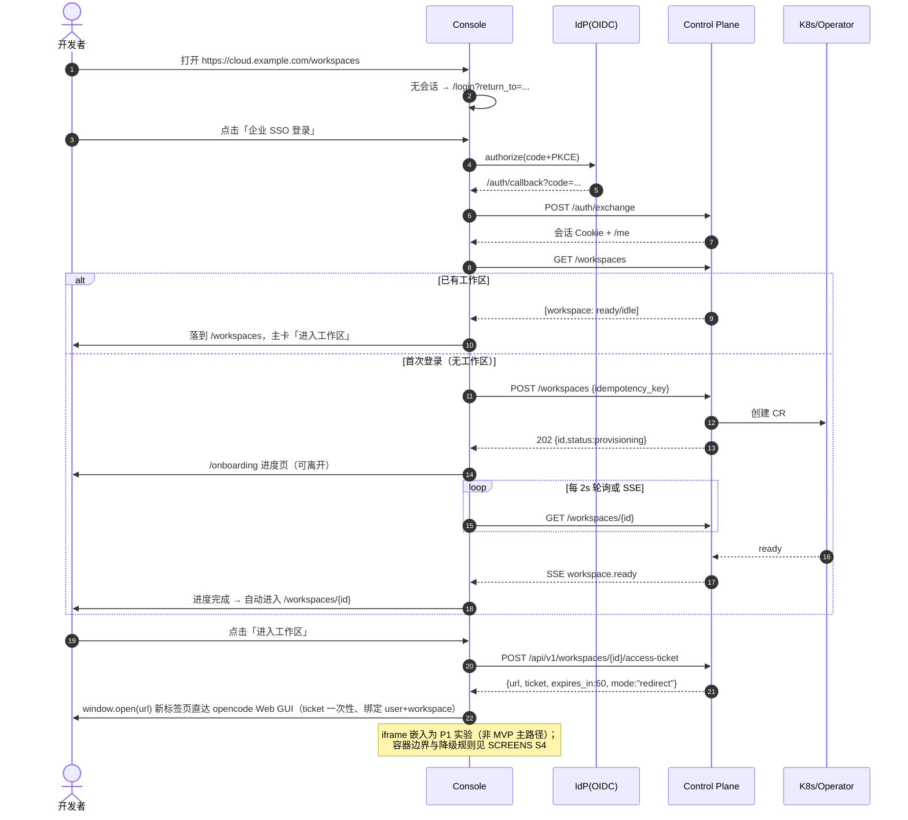

# OpenDream Cloud 信息架构（IA v1）

- 版本：v1.3（2026-11-04 G3 行动项关闭）
- Owner：`web-console`
- 状态：**G3 PASS-WITH-ACTIONS（已签署）**；A-G3-2…5 已关闭，进入 G4 实现
- 上游依据：[PLAN.md](../00-program/PLAN.md) · [REVIEW-GATES.md](../00-program/REVIEW-GATES.md) · [OPENCODE-BASELINE.md](../00-program/OPENCODE-BASELINE.md) · [ROLES.md](../00-program/ROLES.md)
- 契约依据：`docs/02-architecture/openapi.yaml`（**已落盘：73 paths / 106 ops / 233 schemas，以文件为准**）。本文已对齐：错误码通用小写下划线 + `error.reason`、分页默认无 total、工作区 9 态与 SSE、**进入工作区主路径为新标签页**、`public` 跨租户可见、API 路径 uuid、金额/token 字符串与整数、销毁 5min 冷却、快照 30 天恢复。
- 配套文档：[DESIGN-SYSTEM.md](DESIGN-SYSTEM.md) · [SCREENS.md](SCREENS.md) · [prototype/index.html](prototype/index.html)
- 配套文档：[DESIGN-SYSTEM.md](DESIGN-SYSTEM.md) · [SCREENS.md](SCREENS.md) · [prototype/index.html](prototype/index.html)

> 阅读顺序建议：§2 站点地图 → §3 导航 → §5 关键流程 → §6 异常态规范 → §8 点击预算。SCREENS.md 是本文每一条流程的页面级落地。

---

## 0. 设计目标与原则

### 0.1 一句话体验目标

> **打开浏览器 → 最多两次点击进入 4C8G 工作区；能力（模型/Skill/MCP）即取即用；发布与分享像发链接一样简单；任何等待、失败、无权都看得懂、有出路。**

### 0.2 七条 IA 原则

| # | 原则 | 落地方式（可检查） |
|---|------|--------------------|
| P1 | **工作区是家，中心是货架** | 登录后默认落地 `/workspaces`；任意中心页面顶部都有「回到工作区」；工作区详情承载状态/设置/最近会话，**进入 opencode 主路径为新标签页直达**（architect 契约），嵌入模式为 P1 实验（见 SCREENS S4 容器边界） |
| P2 | **进度可见、可离开、可重试** | 拉起/构建/部署/评测等长任务一律进入「任务抽屉」，离开页面不中断，完成后 Toast + 通知中心 |
| P3 | **默认安全，权限可见** | 受限功能「隐藏而非灰化」；分享面板实时显示"谁以什么权限能做什么"；破坏性操作二次确认 |
| P4 | **数据密度高但不拥挤** | 列表默认 20 行/页，支持紧凑密度；管理页提供批量操作；详情页右侧抽屉承载低频操作 |
| P5 | **同一状态全站一致** | 工作区状态、应用状态、权限角色、错误码在各页面复用同一套 badge/文案/颜色（见 §6） |
| P6 | **中英双语、暗亮双主题对等** | 默认 zh-CN；所有文案走 i18n key；暗色不是"反色"，按设计系统重新定阶 |
| P7 | **没有死路** | 每个页面至少有一条主 CTA + 一条逃生路径（返回/切角色/找管理员/重试/看文档） |

### 0.3 平台边界（来自 PLAN 与被 Lead 确认的 G0 裁决）

- `public` 分享 = **平台内已登录用户可见**；互联网免登录访问为**禁止项**（安全红线）。
- 工作区默认**退出不销毁**；显式销毁需二次确认 + 冷却期；可选「闲置休眠（保留 PVC）」默认关闭。
- 移动端原生 App Out of Scope；控制台响应式范围见 §3.6。

---

## 1. 角色与能力矩阵

### 1.1 六类控制台角色

| 角色 | 说明 | 主入口 | 控制台可见范围 |
|------|------|--------|----------------|
| 开发者 `member` | 企业工程师，日常使用工作区 | `/workspaces` | 自己的工作区、可用模型、Skill/MCP 目录、自己的应用、自己用量、个人设置 |
| 团队负责人 `team_owner` | 管团队预算与能力准入 | `/usage` | 团队范围成员/工作区/用量/预算、团队 Skill/MCP 审批、团队审计 |
| 平台管理员 `org_admin` | 租户最高权限 | `/settings/org` | 全组织资源、模型策略、成员与角色、审计、审批、配额 |
| 能力作者 `author` | 发布 Skill/MCP/应用（叠加角色，非独立身份） | `/skills?tab=mine` | 自己的草稿/版本/评测/统计、上架状态 |
| 应用使用者 `app_user` | 通过分享链接使用应用 | `/a/{slug}` | 应用门户（SSO 后），控制台内仅「应用 → 与我共享」 |
| 平台运营 `platform_admin` | 部署/运维/治理（P1） | `/admin` | 全平台：组织、用户、工作区、模型供应商、健康、全局审计 |

> 权限实现：`RBAC` 角色 + 资源级 `ACL`（应用分享、Skill 私有可见性）。前端只做**显隐与拦截提示**，最终以服务端 403 为准（前端不得成为安全边界）。

### 1.2 功能 × 角色矩阵

图例：`●` 完整可用 · `○` 只读/有限 · `－` 不可见 · `审` 需审批

| 功能 / 角色 | member | team_owner | org_admin | author | app_user | platform_admin |
|---|---|---|---|---|---|---|
| 我的工作区（进入/使用） | ● | ● | ● | ● | － | ○ |
| 工作区销毁/快照/休眠 | ●（自己的） | ●（团队） | ●（组织） | ● | － | ● |
| 模型目录 / 切换默认模型 | ● 可用集合 | ● + 团队策略 | ● + 策略管理 | ● | － | ● |
| 模型供应商 / 密钥 / 预算 | － | ○ 团队预算 | ● | － | － | ● |
| Skill 浏览 / 安装 | ● | ● | ● | ● | － | ● |
| Skill 上传 / 发布 | ● | ● | ● | ● | － | ● |
| Skill 审核上架 | － | 审（团队） | ● | － | － | ● |
| 评测运行 / 看报告 | ● | ● | ● | ● | － | ● |
| 应用创建 / 构建 / 部署 | ● | ● | ● | ● | － | ● |
| 分享设置（含权限授予） | ●（自己的应用） | ●（团队） | ●（组织） | ● | － | ● |
| 应用使用门户 | ○（被分享时） | ○ | ○ | ○ | ● | ○ |
| MCP 目录 / 绑定 | ● | ● | ● | ● | － | ● |
| MCP 注册 / 凭证托管 | － | 审 | ● | ●（自己的） | － | ● |
| 用量（自己） | ● | ● | ● | ● | － | ● |
| 用量（团队/组织）+ 导出 | － | ● | ● | － | － | ● |
| 审计日志 | － | ○ 团队 | ● | － | － | ● |
| 组织/成员/角色管理 | － | ○ 成员 | ● | － | － | ● |
| 审批中心 | － | ● 团队 | ● | ○ 自己提交的 | － | ● |
| 运营后台 `/admin` | － | － | － | － | － | ● |
| 个人设置 / API Key | ● | ● | ● | ● | ○ 仅资料 | ● |

### 1.3 应用分享角色（ACL）

| 角色 | 能做 | 不能做 |
|------|------|--------|
| `view` | 打开应用、查看界面与只读结果 | 提交输入、触发运行、改配置 |
| `use` | 使用应用（提交 prompt/表单、触发运行） | 改应用配置、分享、看构建日志 |
| `edit` | 改配置、重新构建/部署、管理分享与域名 | 删除应用所有权（仅 owner/org_admin） |

> `owner` 恒为创建者；`org_admin` 可接管。前端权限徽标组件见 DESIGN-SYSTEM §8.9。

---

## 2. 站点地图

### 2.1 站点地图（Mermaid）

```mermaid
graph TD
  ROOT["OpenDream Cloud"] --> AUTH["认证<br/>/login · /auth/callback · /auth/error"]
  ROOT --> CONSOLE["控制台外壳 /"]

  CONSOLE --> W["工作区 /workspaces"]
  W --> W1["工作区列表 /workspaces"]
  W --> W2["工作区详情（控制台状态页）<br/>/workspaces/:id"]
  W --> W2B["opencode Web GUI（新标签页直达）<br/>https://w-&lt;id&gt;.ws.&lt;domain&gt;/"]
  W --> W3["工作区设置 /workspaces/:id/settings<br/>销毁 · 快照 · 休眠 · 资源"]

  CONSOLE --> CAP["能力中心"]
  CAP --> SK["Skill 中心 /skills"]
  SK --> SK1["Skill 详情 /skills/:slug"]
  SK --> SK2["上传/编辑 /skills/new · /skills/:slug/edit"]
  SK --> SK3["版本与评测准入 /skills/:slug/versions"]
  CAP --> EV["评测中心 /evals"]
  EV --> EV1["运行详情 /evals/runs/:id"]
  EV --> EV2["评测报告 /evals/runs/:id/report"]
  EV --> EV3["数据集 /evals/datasets"]
  CAP --> AP["应用中心 /apps"]
  AP --> AP1["应用详情 /apps/:id"]
  AP --> AP2["创建向导 /apps/new"]
  AP --> AP3["分享设置 /apps/:id/share"]
  AP --> AP4["版本与日志 /apps/:id/deployments · /apps/:id/logs"]
  CAP --> MC["MCP 中心 /mcp"]
  MC --> MC1["MCP 详情 /mcp/:id"]
  MC --> MC2["注册 /mcp/new"]

  CONSOLE --> GOV["治理"]
  GOV --> MD["模型中心 /models"]
  MD --> MD1["模型详情 /models/:id"]
  MD --> MD2["模型策略 /models/policies"]
  MD --> MD3["供应商 /models/providers"]
  MD --> MD4["密钥与 BYOK /models/keys"]
  GOV --> US["用量 /usage"]
  GOV --> AU["审计 /audit"]
  GOV --> APV["审批中心 /approvals"]
  GOV --> SET["设置 /settings"]
  SET --> SET1["个人资料 /settings/profile"]
  SET --> SET2["安全与 API Key /settings/security · /settings/api-keys"]
  SET --> SET3["组织与成员 /settings/org"]
  SET --> SET4["通知 /settings/notifications"]
  SET --> SET5["外观与语言 /settings/appearance"]

  ROOT --> ADM["平台运营（P1）<br/>/admin"]
  ADM --> ADM1["用户 /admin/users"]
  ADM --> ADM2["组织 /admin/orgs"]
  ADM --> ADM3["工作区 /admin/workspaces"]
  ADM --> ADM4["模型供应商 /admin/providers"]
  ADM --> ADM5["健康与容量 /admin/health"]
  ADM --> ADM6["全局审计 /admin/audit"]

  ROOT --> PORTAL["应用门户（SSO）<br/>/a/:slug · /a/:slug/403"]
  ROOT --> ERR["系统页 /403 · /404 · /500 · /maintenance"]
```



### 2.2 路由清单（含优先级与空态策略）

| 路由 | 页面 | 优先级 | 主要角色 | 首屏数据 | 空态类型 |
|------|------|--------|----------|----------|----------|
| `/login` | 登录（SSO） | P0 | 全部 | 无 | 登录失败/IdP 错误 |
| `/auth/callback` | OIDC 回调中转 | P0 | 全部 | 无 | 授权码失效/state 不匹配 |
| `/onboarding` | 首次登录欢迎 + 自动拉起 | P0 | 全部 | `/me` | 拉起失败 |
| `/workspaces` | 工作区列表 | P0 | member+ | `/workspaces` | 首次无工作区（自动创建中/失败/配额） |
| `/workspaces/:id` | 工作区详情（状态/最近会话/事件；进入 GUI 走新标签页） | P0 | owner+ | `/workspaces/:id`、`/access-ticket` | 拉起中/失败/无权/被销毁 |
| `https://w-<id>.ws.<domain>/` | opencode Web GUI（新标签页，平台网关换票） | P0 | owner+ | opencode 自带 | opencode 自带 401/错误 |
| `/workspaces/:id/settings` | 工作区设置 | P1 | owner+ | 同上 | — |
| `/models` | 模型中心（目录） | P0 | member+ | `/models` | 无可用模型（管理员未配置） |
| `/models/policies` | 模型策略 | P1 | team_owner+ | `/model-policies` | 无策略（继承默认） |
| `/models/providers` | 供应商与健康 | P1 | org_admin | `/providers` | 无供应商 |
| `/models/keys` | BYOK / 密钥 | P2 | org_admin | `/provider-keys` | 无 BYOK |
| `/skills` | Skill 中心 | P0 | member+ | `/skills` | 无 Skill / 无搜索结果 / 审核中 |
| `/skills/:slug` | Skill 详情 | P0 | member+ | `/skills/:slug` | 无权限（组织私有） |
| `/skills/new` | 上传 Skill | P1 | author | — | 校验失败 |
| `/evals` | 评测中心（运行列表） | P0 | member+ | `/eval-runs` | 无运行 / 无数据集 |
| `/evals/new` | 新建评测 | P1 | member+ | `/eval-datasets`、`/skills` | 无数据集 |
| `/evals/runs/:id` | 运行详情（实时） | P0 | member+ | `/eval-runs/:id` | 运行中/失败/取消 |
| `/evals/runs/:id/report` | 评测报告 | P0 | member+ | `/eval-runs/:id/report` | 报告未生成 |
| `/apps` | 应用中心 | P0 | member+ | `/apps` | 无应用 / 筛选无结果 |
| `/apps/new` | 创建应用向导 | P0 | member+ | `/workspaces`、`/apps/templates` | 无工作区可发布 |
| `/apps/:id` | 应用详情 | P0 | owner+ | `/apps/:id` | 部署中/失败/未部署 |
| `/apps/:id/share` | 分享设置 | P0 | owner+ | `/apps/:id/shares` | 无分享（仅自己） |
| `/apps/:id/logs` | 构建与运行日志 | P1 | owner+ | `/apps/:id/deployments/:d/logs` | 日志为空/构建未开始 |
| `/mcp` | MCP 中心 | P0 | member+ | `/mcp-servers` | 无 MCP / 无权限 |
| `/mcp/:id` | MCP 详情 | P1 | member+ | `/mcp-servers/:id` | 探活失败 |
| `/mcp/new` | 注册 MCP | P1 | author+ | — | 校验/探活失败 |
| `/usage` | 用量 | P0 | member+ | `/usage/summary` | 区间无数据 |
| `/audit` | 审计 | P0 | team_owner+ | `/audit-logs` | 无记录/无权限 |
| `/approvals` | 审批中心 | P1 | team_owner+ | `/approvals` | 无待审 |
| `/settings/*` | 设置 | P0/P1 | 全部 | `/me`、`/orgs/:id/members` | — |
| `/a/:slug` | 应用门户 | P0 | app_user | `/apps/public/:slug` | 403/404/应用休眠 |
| `/admin/*` | 平台运营 | P1 | platform_admin | 各资源 | 各自空态 |

### 2.3 全局键位与深链接

- **⌘K / Ctrl+K** 命令面板：跳页面、搜工作区/Skill/应用/MCP、执行动作（新建评测、进入工作区、复制分享链接、切主题）。
- **`?`** 键盘快捷键help；**`g` 前缀跳转**：`g w` 工作区、`g s` Skill、`g e` 评测、`g a` 应用、`g m` MCP、`g u` 用量。
- 所有列表筛选/分页/排序写入 URL query（可分享、可刷新保持）；详情页 Tab 写 `?tab=`。
- 浏览器返回必须回到上一页的滚动位置与筛选状态（React Query cache + `scrollRestoration`）。

---

## 3. 全局导航与外壳

### 3.1 外壳布局（桌面 ≥1280）

```
┌──────────────────────────────────────────────────────────────────────────────────────────┐
│ ⬢ OC Cloud  [组织: 星云科技 ▾]        🔍 搜索或跳转 ⌘K          [工作区: 就绪 ●] [🌙] [🔔 2] [头像 ▾] │ 56px 顶栏
├──────────┬───────────────────────────────────────────────────────────────────────────────┤
│ 工作     │  面包屑：工作区 / oc-7f3a                                                      │ 40px
│ ▸ 工作区 │ ┌───────────────────────────────────────────────────────────────────────────┐ │
│ 能力     │ │  页面标题 + 描述 + 主 CTA                                    [次要操作 ▾] │ │
│ ▸ Skill  │ ├───────────────────────────────────────────────────────────────────────────┤ │
│ ▸ 评测   │ │  Tabs / 筛选条                                                             │ │
│ ▸ 应用   │ ├───────────────────────────────────────────────────────────────────────────┤ │
│ ▸ MCP    │ │                                                                           │ │
│ 治理     │ │  内容区（12 列栅格，max-width 1440，页边距 24/32）                          │ │
│ ▸ 模型   │ │                                                                           │ │
│ ▸ 用量   │ │                                                                           │ │
│ ▸ 审计   │ │                                                                           │ │
│ ▸ 审批   │ │                                                                           │ │
│ ▸ 设置   │ └───────────────────────────────────────────────────────────────────────────┘ │
└──────────┴───────────────────────────────────────────────────────────────────────────────┘
   240px 侧栏（可折叠 64px）            内容区（≥1280）
```

- 侧栏顶部是**工作区快捷卡**：显示当前工作区状态（starting/ready/idle/error）+ 一键进入；无工作区时显示「创建/自动拉起中」。
- 侧栏分组标题不可点击；分组可折叠；折叠状态持久化。
- 顶栏右侧「工作区状态 chip」是全局唯一状态入口：点击展开 Popover（进入工作区 / 查看事件 / 重试 / 联系管理员）。
- 通知中心：构建完成、评测完成、分享被访问、配额 80%/100%、审批结果、工作区异常。
- 头像菜单：个人资料、API Key、外观与语言、帮助文档、登出（登出不销毁工作区，明确文案）。

### 3.2 导航分组与显隐规则

| 分组 | 菜单 | 显示条件 | 徽标 |
|------|------|----------|------|
| 工作 | 工作区 | 全部登录用户 | 状态点（ready 绿/idle 灰/error 红） |
| 能力 | Skill / 评测 / 应用 / MCP | 全部登录用户 | 待审数（负责人）、运行中数 |
| 治理 | 模型 / 用量 / 审计 / 审批 / 设置 | 按 §1.2 显隐（审计仅负责人+） | 配额超限/待审批红点 |
| 平台 | 运营后台 | `platform_admin` | 告警数 |

**显隐 ≠ 安全**：隐藏仅减少噪音，越权访问统一 403 页面（§6.6）。

### 3.3 面包屑与页面层级

- 层级最多 3 级：`分组 / 列表 / 实体`。详情页面包屑末级可下拉切换同级实体。
- 实体详情页提供「上一个/下一个」快捷（列表顺序）。

### 3.4 全局搜索 / 命令面板

| 分组 | 示例 | 动作 |
|------|------|------|
| 页面 | 「审计」「模型策略」 | 跳转 |
| 工作区 | `oc-7f3a`、`支付重构` | 进入（含状态） |
| Skill | `code-review` | 详情 / 安装 |
| 应用 | `发票助手` | 详情 / 分享 / 打开 |
| MCP | `github` | 详情 / 绑定 |
| 操作 | 「新建评测」「复制分享链接」「切换暗色」 | 执行 |

规则：输入即搜（debounce 200ms），空输入展示最近访问 + 推荐操作；无结果给「用关键词创建 Skill/应用」出口；结果以 `role=option` 可键盘上下选择，`aria-activedescendant`。

### 3.5 页面模板（所有页面复用）

| 模板 | 用途 | 结构 |
|------|------|------|
| `ListPage` | 中心列表 | 标题区 + 筛选条 + 表格/卡片 + 批量栏 + 分页 |
| `DetailPage` | 实体详情 | 头部摘要 + Tabs + 内容 + 右抽屉（编辑/危险操作） |
| `WizardPage` | 创建向导 | 左侧步骤条 + 右侧表单 + 底部固定操作栏（上一步/下一步/取消） |
| `WorkspaceShell` | 工作区状态页（MVP 无 iframe） | 极简顶栏（返回/状态/打开工作区/更多）+ 状态/最近会话/事件；P1 嵌入模式下追加 iframe 容器 |
| `PortalPage` | 应用门户 | 应用品牌头 + 应用 iframe/内容 + 权限提示 + 页脚 |
| `ErrorPage` | 403/404/500/维护 | 插画 + 标题 + 解释 + 1 主 CTA + 1 次 CTA |

### 3.6 响应式与外壳行为

| 断点 | 外壳 | 表格 | 工作区嵌入 |
|------|------|------|------------|
| `<640` (xs) | 顶部栏 + 底部 Tab 5 项 | 卡片列表 | 不支持，提示"请在桌面打开" |
| `640–1023` (sm/md) | 侧栏抽屉（汉堡） | 卡片列表 | 提示全屏/新窗口打开 |
| `1024–1279` (lg) | 侧栏折叠为图标 (64px) | 表格横向滚动 | 可用（最小 1024） |
| `1280–1535` (xl) | 完整侧栏 240px | 完整表格 | 最佳 |
| `≥1536` (2xl) | 完整侧栏 + 内容 max 1440 | 完整表格 + 右侧信息栏 | 最佳 |

> 控制台是桌面优先产品：<1024 仅保证只读浏览与轻量操作（PLAN R8.7 已由 Lead 确认该范围）。

---

## 4. 角色视角

### 4.1 开发者（member）— "回到我的工作区"

- 首页：`/workspaces`；默认首屏 1 个主卡（我的工作区）+ 最近使用 Skill/应用。
- 高频路径：进入工作区 → 继续上次会话；浏览 Skill → 安装；创建应用 → 分享。
- 弱化：治理菜单（只保留"模型（可用集合）"与"用量（自己）"）。
- 关键文案："关闭浏览器不会销毁工作区，下次回来继续。"

### 4.2 团队负责人（team_owner）— "预算与准入"

- 首页：`/usage?range=this_month&scope=team`（带工作区盘点卡片）。
- 高频：看团队用量/预算 → 审批 Skill/MCP → 调整模型策略 → 抽查审计。
- 通知重点：预算 80%、异常调用、审批待办。
- 危险动作：接管/销毁团队工作区需二次确认并写审计原因。

### 4.3 平台管理员（org_admin）— "治理与安全"

- 首页：`/admin/health`（P1）或 `/usage?scope=org`。
- 高频：成员与角色、模型策略、配额、审计、审批。
- 强调：所有跨用户操作必须填写原因（审计字段 `reason`，≥8 字）。

### 4.4 能力作者（author）— "生产 → 评测 → 上架 → 数据"

- 首页：`/skills?tab=mine`（带 DRAFT/IN_REVIEW/PUBLISHED 分组）。
- 主流程：上传版本 → 触发基线评测 → 提交审核 → 上架 → 看安装/调用/评分。
- 强调：评测未通过时发布按钮禁用并显示"去评测"。

### 4.5 应用使用者（app_user）— "点开就能用"

- 入口：分享链接 `/a/{slug}`（或邮件/IM 卡片）。
- 若未登录：跳 SSO，回跳原链接；无权限：403 门户页（显示应用名、申请权限 CTA、返回）。
- 一次会话内不出现任何控制台导航，避免误入后台。

---

## 5. 关键流程

> 图例：`【页面】` 页面/状态；`→` 跳转；`↳` 异步/旁路；`!` 异常分支。

### F1 登录 → 自动拉起工作区 → 进入

**触发**：访问任意控制台 URL 且未登录。
**前置**：OIDC IdP 可用；组织已开通；工作区配额未超。



> **契约对齐（architect 2026-11-04）**：主路径 = 新标签页直达 `https://w-<id>.ws.<domain>/`；每次进入重新换票（`ticket` 一次性 60s）；iframe 不作为 MVP 主路径（上游整页 SPA，键盘焦点/快捷键冲突，Q2 再实验）。控制台保留 `/workspaces/:id` 状态页与嵌入容器设计（P1），不复制 opencode UI。

**步骤与反馈**

| # | 用户动作 | 系统反馈 | 可离开 | 异常分支 |
|---|----------|----------|--------|----------|
| 1 | 打开控制台 | 1s 内出现登录页；URL 保留 `return_to` | — | IdP 不可达 → 登录页内错误卡（重试/联系管理员/状态页） |
| 2 | 点「企业 SSO 登录」 | 按钮 loading + 新窗口/跳转 | 是 | state 不匹配 → `/auth/error?code=STATE_MISMATCH` |
| 3 | 回到 `/onboarding` | 展示三步进度：账号已就绪 → 工作区创建中 → 进入工作区 | 是（"稍后继续"） | 超 90s → 进入"较慢"文案 + 查看事件 |
| 4 | 工作区 ready | Toast「工作区已就绪」+ 主 CTA 进入 | — | 失败 → 分诊卡（见下） |
| 5 | 进入工作区 | 新标签页打开 GUI；当前页显示「已在新标签页打开」+ 再次打开 | — | ticket 过期/换取失败 → 同 URL 重试；被拦截弹窗 → 同页跳转兜底 |
| 6 | 自动拉起失败 | 分诊：资源不足 / 镜像拉取失败 / 配额超限 / 未知 | — | 重试（指数退避，最多手动 3 次）；配额→申请提升；持续失败→复制诊断 ID 联系管理员 |

**成功标准**：登录 p95 ≤3s；从点击 SSO 到可交互 p95 ≤90s（PLAN R3.2/R3.9）；进度页离开率不影响最终成功率（后台继续并通知）。

**埋点**：`auth_start`、`auth_success`、`auth_fail{code}`、`workspace_provision_start`、`provision_progress{elapsed}`、`provision_success{elapsed}`、`provision_fail{reason}`、`workspace_enter{source}`。

---

### F2 工作区日常使用 & 回来（退出不销毁）

1. `/workspaces` 主卡显示上次活动时间、状态、资源（4C8G）与「继续上次会话」。
2. 点进入 → `ready` 直接换票并新标签页打开；`idle` 是 ready 子态（无活动 ≥15min、资源常驻），**直接进入，无需唤醒**；`stopped`（已休眠）：先 `POST /api/v1/workspaces/{id}/start`，显示"正在唤醒（约 20s）"→ 换票打开。
3. 关闭浏览器/登出：Toast 明示「工作区保留中，下次继续」；**不做销毁**。
4. 24h 后回来：数据与进程仍在（PLAN R3.3）；若启用闲置休眠：`idle` 超阈值 → `stopping` → `stopped`，进入时唤醒并提示"从休眠恢复约 20s"。
5. 仅用户在 `/workspaces/:id/settings` 显式销毁：输入工作区名确认 → **冷却默认 5min（可配 5–1440，期间可撤销）** → 执行销毁 → 系统先创建快照再删除（个人不可直接删 PVC）→ 显示销毁进度；PVC 默认保留 24h（可配）。

**异常**：会话过期 → 回登录并 `return_to` 回原页面；工作区已被管理员销毁 → `410 GONE` 页面（说明原因、创建新工作区、审计链接）。

---

### F3 Skill：发现 → 安装 → 使用

```
/skills 列表（搜索/分类/排序/权限标签）
  → 详情（README、版本、权限声明、评测结论、安装量、评分）
  → 安装抽屉：选择范围（仅我 / 项目 / 工作区）→ 展示将获得的工具与网络权限 → 确认
  → 状态：installing（≤2min）→ installed（opencode 内可见）
  → 在对话中调用；统计 +1
```

**异常**：权限超出用户可授予范围 → 禁用安装并显示「需管理员审批」→ 提交审批；版本被下架 → 提示已安装版本仍可用/升级；评测未通过 → 仅作者与自己可用（标记"未通过准入"）。

---

### F4 Skill 创作：上传 → 评测准入 → 审核 → 上架

1. `/skills/new`：上传 `.zip` 或填写 Git 仓库 → 前端校验 `SKILL.md` frontmatter（name/description/version/权限声明）→ 服务端静态扫描（危险命令/网络白名单/签名）。
2. 保存草稿 → 版本列表显示 `DRAFT`。
3. 「提交准入评测」：跳 `/evals/new?skill_id=...&preset=skill-baseline` → 运行 → 报告。
4. 通过 → 「提交审核」→ `IN_REVIEW`；审核人（负责人）在 `/approvals` 通过/驳回（附理由）。
5. 发布 → `PUBLISHED`（组织私有/平台公开由权限决定）→ 可安装。
6. 回滚：版本列表选历史版本「设为最新」→ 调用 `POST /api/v1/skills/{skillId}/versions/{versionId}/publish`；需重过准入评测或管理员豁免（openapi 无独立 rollback 端点，见 G2 评审项）。

---

### F5 评测：运行 → 报告 → 对比

```
/evals（运行列表：状态/通过率/耗时/成本）
  → /evals/new：选择被测对象（Skill/模型/应用）+ 数据集 + 评分器 + 超时/资源 + 网络策略（默认禁网）
  → 创建 202 → 运行详情（实时进度、用例级结果流、可取消）
  → 完成 → 报告（通过率、耗时 P50/P95、token/成本、失败用例聚类、LLM-judge 理由）
  → 「与基线对比」选择历史运行 → 差异表（Δ通过率、Δ成本、回归用例）
  → 分享报告链接（只读，需登录） / 导出 CSV/JSON
```

**异常**：沙箱资源不足 → 排队中（显示位次）；超时 → 标记 `TIMEOUT` 且不吞结果；评测失败 → 显示失败阶段（镜像/数据/执行/评分）；报告未生成 → 骨架 + 预计时间。

---

### F6 应用：创建 → 构建 → 部署 → 分享 → 使用

```
/apps/new（向导）
  1 选择来源：从工作区（MVP）；模板 / Git 仓库（P2，不在本期验收）
  2 选择工作区 + 入口（package.json script / Dockerfile / 静态目录）+ 构建上下文
  3 配置：应用名、slug、运行时模板（Node/Python/静态）、环境变量（引用密钥，不落明文）、资源固定 1C2G（只读展示）
  4 预览摘要 → 创建 → 构建（BuildKit 日志流）→ 部署 → 域名（自动 *.apps.example.com）
/apps/:id → 状态：building → deploying → running / failed
  分享：/apps/:id/share → 范围（仅自己/组织/指定用户/团队/平台内公开）+ 角色（view/use/edit）→ 保存 ≤5s 生效
  使用者：/a/:slug → SSO → 权限校验 → 应用
```

**异常**：构建失败 → 日志定位（最后 200 行 + 错误摘要 + 重试）；部署失败 → 回滚上一版本；域名证书未就绪 → "签发中 ≤10min"；未授权访问 → 403 门户（申请权限）；应用休眠 → 唤醒页。

---

### F7 MCP：注册 → 探活 → 绑定 → 调用 → 审计

```
/mcp → 企业目录（分类/搜索/可见性标签/健康状态）
  → 详情（工具列表、权限、示例、健康历史）
  → 绑定：范围（我的工作区/项目/应用）+ 凭证（平台托管 / 我的 OAuth）
  → opencode 配置注入（≤30s）→ 对话中工具可用
  → 调用 → Hub 代理 → 审计日志（脱敏参数）
异常：探活失败（禁用绑定/显示原因）；凭证过期（一键重新授权）；MCP 超时（降级提示 + 重试建议；不阻塞会话）；越权调用（403 + 告警）
```

---

### F8 用量 / 配额 → 超限 → 申请

```
/usage：区间（今日/7天/30天/自定义，最长跨度 90 天）+ 维度（用户/工作区/模型/天）
  → 概览卡：请求数/token 输入输出/成本（USD，decimal string）/配额使用率（进度条）
  → 明细表（可按模型/工作区下钻）+ 导出 CSV（异步任务 → 通知下载）
  → 配额达 80%：黄条提示；100%：请求拦截 429，顶部红条 + 申请提升
  → 申请提升：填写目标额度与理由 → 审批中心 → 通过后生效
```

**异常**：无数据（区间空，给"换个区间"）；计量延迟（显示"数据更新于 HH:mm，延迟 ≤5min"）；导出超时 → 后台任务 + 通知；配额查询失败 → 保留上次缓存并标注。

---

### F9 审计检索与导出

- 入口 `/audit`（team_owner+）。筛选：时间（默认近 7 天；单次查询最大跨度 90 天；数据留存 180 天，可分两段查）、操作者、动作、资源类型/ID、结果（成功/失败）。
- 列表字段：时间、操作者、动作、资源、结果、来源 IP（脱敏展示）、`request_id`。
- 详情抽屉：原始事件 JSON（密钥字段脱敏）、关联资源跳转、复制 `request_id`。
- 导出 CSV：≤10 万行同步，超过走后台任务；导出行为本身写审计。

**异常**：无权限 → 403 页并说明"需要团队负责人及以上"；时间区间超限 → 表单校验；数据延迟 → 提示最近同步时间。

---

### F10 显式销毁工作区（破坏性）

```
/settings → 危险区「销毁工作区」
  → 对话框：说明"代码/会话按 PVC 策略处理" + 输入工作区名（精确匹配）
  → 系统自动创建快照后删除（个人不可直接删 PVC）→ 提交
  → 状态 deleting（30s–2min）→ deleted（列表移除/审计记录）
  → 冷却默认 5min（可配 5–1440，期间可撤销）：列表显示「已销毁 · 撤销」
```

**异常**：销毁中失败 → 部分资源残留，显示"联系管理员"并附诊断 ID；有运行中的评测/构建引用该工作区 → 阻断并列出引用；销毁后 30 天内可从快照恢复（工作区详情 → 恢复入口，需审计）。

---

## 6. 全局状态与异常规范

### 6.1 状态矩阵（每个页面必须实现，G3 检查项）

| 状态 | 触发 | 表现 | 主 CTA | 次 CTA |
|------|------|------|--------|--------|
| Loading（首屏） | 首次请求 | 骨架屏（保持布局，禁止 spinner 空白页） | — | — |
| Loading（局部） | 翻页/筛选/刷新 | 表格遮罩 + 顶部进度条；保留旧数据 | — | 取消（耗时>3s） |
| Empty（真空） | 请求成功但 0 条 | 插画 + 一句解释 + 主 CTA（如"创建应用"） | 创建 | 看文档 |
| Empty（筛选） | 有数据但筛选无结果 | 小插画 + "未找到匹配项" | 清除筛选 | — |
| Error（可重试） | 5xx/网络 | 内联错误卡 + request_id + 重试 | 重试 | 联系管理员/状态页 |
| Error（不可重试） | 4xx 业务 | 解释 + 解决路径 | 按业务 | 返回 |
| No Permission | 403 | 403 页：缺什么权限、谁能给、如何申请 | 申请权限/联系管理员 | 返回 |
| Quota Exceeded | 429 / QUOTA_EXCEEDED | 配额卡：已用/上限、重置时间、申请入口 | 申请提升 | 查看用量 |
| Provision Failed | 工作区 error | 分诊卡：原因分类 + 诊断 ID + 重试 | 重试 | 联系管理员 |
| Session Expired | 401 | 全局 Dialog + 自动跳登录，保留 return_to | 重新登录 | — |
| Offline | 网络断开 | 顶部黄条 + 离线只读；恢复自动重连 | 重试 | — |
| Maintenance | 503 + 维护头 | 全屏维护页（预计恢复时间/状态页） | 刷新 | 状态页 |
| Partial Failure | 部分模块 5xx | 模块级错误卡，其余可用 | 重试模块 | — |

### 6.2 状态枚举（全站统一 · 待与 openapi 对齐）

| 域 | 枚举 | UI 文案（zh / en） | 颜色 |
|----|------|-------------------|------|
| 工作区 | `provisioning` | 创建中 / Provisioning | 蓝（脉冲） |
| 工作区 | `starting` | 启动中 / Starting | 蓝 |
| 工作区 | `ready` | 就绪 / Ready | 绿 |
| 工作区 | `idle` | 空闲 / Idle（**ready 子态**：无活动 ≥30min（可配），资源常驻，可直接进入） | 绿描边/灰点 |
| 工作区 | `stopping` | 休眠中 / Stopping | 橙（短态） |
| 工作区 | `stopped` | 已休眠 / Sleeping（Pod=0，PVC 保留，需唤醒） | 灰（可唤醒） |
| 工作区 | `error` | 异常 / Error（带 `error.reason`） | 红 |
| 工作区 | `deleting` | 销毁中 / Deleting | 橙 |
| 工作区 | `deleted` | 已销毁 / Deleted | 灰（删除线） |
| 应用 | `building` `deploying` `running` `failed` `suspended` | 构建中/部署中/运行中/失败/已休眠 | 蓝/蓝/绿/红/灰 |
| 评测 | `queued` `running` `succeeded` `failed` `canceled` `timeout` | 排队中/运行中/已通过/失败/已取消/超时 | 灰/蓝/绿/红/灰/橙 |
| Skill 版本 | `draft`（UI 细分 scanning/evaluating） `in_review` `published` `deprecated` `blocked`（UI 按 reason 细分 scan_failed/rejected/gate_blocked） | 草稿/扫描中/评测中/审核中/已上架/已下架/已阻断 | 灰/蓝/橙/绿/灰/红 |
| MCP | 生命周期 `draft` `pending_review` `published` `disabled`；健康 `healthy` `degraded` `down` `unknown` | 未知/健康/降级/不可用（生命周期另示） | 灰/绿/橙/红 |
| 分享 | （无记录）`org` `users` `public` | 仅自己 / 组织 / 指定对象 / 平台内公开（跨租户、需登录） | — |

> 所有枚举值以 `openapi.yaml` 为准（architect 2026-11-04 已确认工作区 9 态语义：`idle` 为 `ready` 子态；任意阶段可进 `error`）。SSE 事件类型 `workspace.status_changed`；`Last-Event-ID` 断点续传；轮询兜底用列表 `ETag/If-None-Match`。
> **Skill 状态差异（G2 评审项）**：openapi `SkillStatus` 仅 5 态，无 `scanning/scan_failed/evaluating/rejected`；UI 需要"扫描中/评测中/驳回"进度。建议 openapi 增 `validation_status`/`evaluation_status` 或扩展枚举，否则 G3 只能把 `draft`/`blocked` 笼统展示。
> **金额与 token**：`cost_usd` 为 decimal string，`tokens` 为整数（含 `input/output/reasoning/cache_read/cache_write`），前端不得用浮点累加展示。

### 6.2.1 分享范围语义（architect 定稿）

| `scope` | 可见范围 | 是否需 SSO | 说明 |
|---------|----------|-----------|------|
| （无 share 记录） | 仅 owner | 是 | UI 显示"仅自己"；API 无 `private` 枚举 |
| `org` | 本组织全体成员 | 是 | 组织内公开 |
| `users` | 指定 user/team | 是 | 白名单；`subject_type`+`subject_id` 必填 |
| `public` | **平台内已登录用户（含其他租户）可发现/使用** | 是 | 匿名互联网访问禁止；可配 `expires_at` + 审计 |

### 6.3 错误码 → 体验映射

| HTTP | code（architect 定稿枚举） | 用户看到 | 处理 |
|------|------------------------------|----------|------|
| 400 | `validation_failed` | 字段级错误 + 汇总条 | 定位首个错误字段 |
| 401 | `unauthorized` | 重新登录 Dialog | 保留 return_to |
| 403 | `forbidden` | 403 页/模块卡 | 申请权限 |
| 404 | `not_found` | 404 页（含资源类型） | 返回列表 |
| 409 | `conflict` | "状态已变化，请刷新" | 刷新/重试 |
| 412 | `precondition_failed` | "数据已被他人修改" | 重新加载（ETag/If-Match） |
| 422 | `validation_failed`（业务分支） | 业务错误卡（如扫描未过） | 修复后重试 |
| 429 | `quota_exceeded` / `rate_limited` | 配额卡 / 限流提示（重试倒计时） | 申请/等待 |
| 500 | `internal_error` | 错误卡 + request_id | 重试/联系 |
| 503 | `orchestrator_unavailable` / `model_gateway_unavailable` / `database_unavailable` | 维护页/降级提示 | 状态页 |

> 响应头 `X-Request-Id` 与 `error.request_id` 同值，便于用户复制后串联日志；SSE/日志同源。
> **两层错误模型（architect 定稿）**：`error.code` 只放 16 个通用分类（`conflict/forbidden/precondition_failed/quota_exceeded/...`），用于**通用处理**（401 跳登录、429 退避、503 维护页）；领域原因放 `error.reason`（如 `ws_launch_timeout`、`gate_blocked`、`workspace_not_ready`、`share_link_expired`），**UI 的可操作文案按 `reason` 分支**，不要按 `code` 写死。
> 写接口统一支持 `Idempotency-Key`；重复提交返回同一资源并带 `Idempotency-Replayed: true`，前端重试**复用同一 key**。

错误卡统一展示：**发生了什么（人话）→ 可能原因 → 下一步 → request_id（可复制）**。禁止把后端堆栈直接展示给最终用户（可折叠"技术详情"）。

### 6.4 空态文案规范（示例）

| 场景 | 标题 | 描述 | 主 CTA |
|------|------|------|--------|
| 无工作区（首次，创建中） | 正在为你准备云端工作区 | 预计 30–90 秒，可先去看看 Skill 中心 | 查看进度 |
| 无工作区（创建失败） | 工作区创建失败 | 资源紧张或镜像拉取失败，可重试 | 重试创建 |
| 无 Skill | 还没有可用的 Skill | Skill 能扩展 opencode 的工具与流程；也可以上传自己的 | 上传 Skill / 浏览模板 |
| 无评测 | 还没有评测运行 | 为 Skill 建立质量基线，通过后才能上架 | 新建评测 |
| 无应用 | 从工作区发布第一个应用 | 选择入口与模板，1C2G 运行，链接即域名 | 创建应用 |
| 无 MCP | 还没有绑定 MCP | 绑定企业 MCP 后，opencode 可直接调用其工具 | 浏览目录 |
| 无用量 | 该区间没有用量 | 换个时间区间，或确认模型是否已被调用 | 换区间 |
| 无审计 | 没有匹配的审计记录 | 调整筛选条件或时间范围 | 清除筛选 |

### 6.5 加载与长任务规范

- 首屏 <1s：骨架；1–3s：骨架 + "正在加载"；>3s：出现取消/反馈入口；>10s：提示"仍在处理，可稍后回来"。
- 长任务（拉起/构建/部署/评测/导出）：**后台任务模型**，进入全局「任务中心」（顶栏铃铛旁图标），离开页面不中断，完成后 Toast + 通知。
- SSE（控制面）：`GET /api/v1/events`，`Last-Event-ID` 断点续传；事件类型如 `workspace.status_changed`、`eval.progress`、`app.build.log`、`notification.created`。断线指数退避重连（1s/2s/4s/8s，上限 30s），显示"实时连接中断，正在重连"；期间降级为 10s 轮询（列表用 `ETag/If-None-Match`）。
- 注意：控制面 SSE 与工作区内部 opencode 的 `/api/event` 是两条独立通道，不得混用；工作区内部连接状态由嵌入页/新标签页自行处理（控制台仅展示外层状态）。
- 分页：`?cursor=&limit=`（默认 20，max 100），响应 `{items, next_cursor}`；**默认无 `total`**，UI 只显示"加载更多/下一页"，仅 `?include_total=true` 时展示总数与页码。
- 所有进度页必须显示：阶段名、已完成/总数（可估时）、已用时间、可离开提示。

### 6.6 权限与配额的人话表达

- 403 页三段式：**你需要什么**（"团队负责人角色"）→ **谁能给**（"联系 张伟（org_admin）"或"在设置 → 成员 中申请"）→ **你能做什么**（返回/查看我能访问的资源）。
- 配额超限：给出具体数字（"本月 token 已用 12.4M / 12M，11 月 1 日重置"）+ 申请入口 + 预算负责人。
- 不显示"你无权访问"四个字了事；不暴露他人资源是否存在（统一 403 而非 404 泄露）。

---

## 7. 关键线框（文字 + ASCII）

### 7.1 登录 `/login`

```
┌────────────────────────────────────────────────────────────────────┐
│                                                                    │
│   ⬢ OpenDream Cloud                          [中文 ▾]   [帮助]      │
│                                                                    │
│        ┌──────────────────────────────────────────────┐            │
│        │  让你的 AI 工程云工作室，随浏览器而来         │            │
│        │  4C8G 云端工作区 · 统一模型 · Skill/MCP · 应用│            │
│        │                                              │            │
│        │  [  使用企业账号登录（SSO）  ]                │            │
│        │  ──────────── 或 ────────────                │            │
│        │  [ 使用 API Key 登录（CLI/SDK） ]             │            │
│        │                                              │            │
│        │  ⚠ 登录失败：身份提供方返回错误（AADSTS50020）│            │
│        │     [重试] [联系管理员]                       │            │
│        └──────────────────────────────────────────────┘            │
│   隐私政策 · 服务条款 · 状态页                     v1.0.0          │
└────────────────────────────────────────────────────────────────────┘
```

要点：单主 CTA；登录失败内联不跳页；SSO 按钮 loading 防重复；`return_to` 白名单防开放重定向；暗色自动跟随系统、可手动切换。

### 7.2 首次登录 / 自动拉起 `/onboarding`

```
┌────────────────────────────────────────────────────────────────────┐
│  欢迎，李雷                                     [稍后继续 →]       │
│                                                                    │
│   ✓ 账号已就绪        星云科技 · 开发者                            │
│   ● 正在创建工作区    4C8G · 独立存储 · 预计还需 40 秒   [查看事件] │
│   ○ 进入工作区                                                     │
│                                                                    │
│   [██████████████░░░░░░]  68%   已用 1 分 12 秒                     │
│                                                                    │
│   创建过程中你可以先： [浏览 Skill 中心] [查看我的模型]             │
│                                                                    │
│   ── 遇到问题？ ─────────────────────────────────────────────────   │
│   [重试创建]  [复制诊断 ID]  [联系管理员]                           │
└────────────────────────────────────────────────────────────────────┘
```

进度失败态：标题变为"工作区创建失败"，原因分类（资源不足/镜像失败/配额/超时/未知）+ 诊断 ID + 重试（最多 3 次手动）+ "联系管理员"（预填诊断 ID）。

### 7.3 工作区列表 `/workspaces`

```
┌─────────────────────────────────────────────────────────────────────────────┐
│ 工作区                                             [+ 新建工作区（P2）]     │
│ 你的云端 opencode 工作区，关闭浏览器不会销毁                                │
├─────────────────────────────────────────────────────────────────────────────┤
│ ┌─────────────────────────────────────────────────────────────────────────┐ │
│ │ ● 就绪    oc-7f3a · 支付重构                          [ 进入工作区 → ]  │ │
│ │ 4C8G · 独立 PVC 20Gi · 最近活动 2 分钟前                                │ │
│ │ 已装 Skill 4 · 已绑 MCP 2 · 上次会话「修复登录超时」                    │ │
│ │ [设置] [快照] [更多 ▾]                                                  │ │
│ └─────────────────────────────────────────────────────────────────────────┘ │
│                                                                             │
│ ── 未启用（默认不创建）─────────────────────────────────────────────────────│
│ ┌─────────────────────────────────────────────────────────────────────────┐ │
│ │  还没有第二个工作区？团队允许后可以多开（当前配额 1/1）。  [申请配额]   │ │
│ └─────────────────────────────────────────────────────────────────────────┘ │
└─────────────────────────────────────────────────────────────────────────────┘
```

异常态：创建中（卡片骨架 + 进度）、失败（红卡 + 分诊 + 重试）、配额满（灰卡 + 申请提升）、已销毁（删除线 + 撤销/新建）。

### 7.4 工作区详情（MVP：状态页；P1：嵌入模式）`/workspaces/:id`

**MVP 主路径（architect 定稿）**：控制台不承载 opencode UI；点「打开工作区」→ 换 ticket → **新标签页**直达 `https://w-<id>.ws.<domain>/`。详情页负责状态、最近会话、事件、设置入口与失败分诊。

```
┌──────────────────────────────────────────────────────────────────────────────┐
│ ← 工作区  ● 就绪（idle）  oc-7f3a · 支付重构       [打开工作区 ↗] [更多 ▾]   │ 48px
├──────────────────────────────────────────────────────────────────────────────┤
│ 4C8G · PVC 20Gi · 最近活动 2 分钟前 · 上次会话「修复登录超时」                │
│ ┌ 状态 ─────────────┐ ┌ 最近会话 ─────────────┐ ┌ 事件 ───────────────────┐ │
│ │ 就绪 · SSE 已连接 │ │ 修复登录超时 · 2h 前   │ │ 09:12 启动完成           │ │
│ │ 可用操作：打开    │ │ [继续上次会话 ↗]       │ │ 09:10 配置下发完成       │ │
│ └───────────────────┘ └───────────────────────┘ └─────────────────────────┘ │
│ [打开工作区（新标签页）]  [设置] [快照] [查看全部事件]                        │
└──────────────────────────────────────────────────────────────────────────────┘
```

**P1 嵌入模式（feature flag `console.embedWorkspace`，默认关）**：预留 iframe 容器，边界规则如下（不复制 opencode UI）：

1. 控制台**不复制**会话/文件/终端 UI；iframe 仅是 P1 可选入口；控制台负责外层状态、权限、生命周期与降级。
2. ticket 必须一次性 + 短 TTL；iframe `sandbox` 最小权限；`postMessage` 仅 `oc:ping` / `oc:fullscreen`，校验 origin。
3. 加载失败三级降级：静默重换 ticket 1 次 → 「在新标签页打开」（同一 URL）→ 诊断 ID + 联系管理员。
4. 嵌入页隐藏控制台侧栏，避免双导航；返回键回 `/workspaces`；离开页面不断开会话、不销毁工作区。
5. 兼容性前置检查：第三方 Cookie / CSP frame-ancestors / 键盘焦点冲突；任一不满足则默认走新标签页。
6. 长连接状态由 opencode 自身处理；控制台不代理其 SSE，只展示外层状态条。

### 7.5 中心通用列表（Skill/评测/应用/MCP 共用模板）

```
┌──────────────────────────────────────────────────────────────────────────────┐
│ Skill 中心                                        [上传 Skill] [管理我的 ▾] │
│ 扩展 opencode 的工具与工作流 · 通过评测才能上架                             │
├──────────────────────────────────────────────────────────────────────────────┤
│ [🔍 搜索名称/标签/作者]  [分类 ▾] [可见性 ▾] [排序: 热门 ▾]   视图: 卡片|表 │
├──────────────────────────────────────────────────────────────────────────────┤
│ ┌──────────────┐ ┌──────────────┐ ┌──────────────┐                        │
│ │ code-review  │ │ test-gen     │ │ api-design   │                        │
│ │ ★4.8 · 1.2k装│ │ ★4.5 · 860装 │ │ 组织私有      │                        │
│ │ [已安装]     │ │ [安装]       │ │ [申请访问]   │                        │
│ └──────────────┘ └──────────────┘ └──────────────┘                        │
│                                                          [1] 2 3 … 12  >    │
└──────────────────────────────────────────────────────────────────────────────┘
```

### 7.6 分享设置 `/apps/:id/share`

```
┌──────────────────────────────────────────────────────────────────────────────┐
│ 分享「发票助手」                                                      [关闭] │
│ https://cloud.example.com/a/invoice-helper        [复制链接] [二维码]       │
├──────────────────────────────────────────────────────────────────────────────┤
│ 访问范围   ( ) 仅自己   (•) 组织内（需登录）   ( ) 指定用户/团队  ( ) 平台内公开│
│            ⓘ 所有范围都需 SSO；公开仅限平台内已登录用户（可跨租户发现），      │
│              互联网免登录访问已禁用；公开可设有效期并全程审计                 │
├──────────────────────────────────────────────────────────────────────────────┤
│ 权限成员                                                          [+ 添加]  │
│ ┌──────────────────────────────────────────────────────────────────────────┐ │
│ │ 张伟（zhangwei@…）    团队负责人   [使用 use ▾]  [移除]                  │ │
│ │ 李雷（lilei@…）       开发者       [查看 view ▾] [移除]                  │ │
│ │ 产品设计组（team:design）          [编辑 edit ▾] [移除]                  │ │
│ └──────────────────────────────────────────────────────────────────────────┘ │
│ 预览：组织内成员可见（人数仅管理员可见）；其中 2 人/1 组有额外权限              │
│ 链接失效时间：[永不 ▾]   允许下载产物：[关]                                  │
│                                                  [取消]  [保存并生效 ≤5s]    │
└──────────────────────────────────────────────────────────────────────────────┘
```

### 7.7 用量 `/usage`

```
┌──────────────────────────────────────────────────────────────────────────────┐
│ 用量与配额            [今日|7天|本月|自定义]   [维度: 用户 ▾]   [导出 CSV]  │
├──────────────────────────────────────────────────────────────────────────────┤
│ ┌────────────┐ ┌────────────┐ ┌────────────┐ ┌────────────────────────────┐ │
│ │ 请求数     │ │ Token      │ │ 成本（USD）│ │ 配额  ████████░░ 78%       │ │
│ │ 128.4k     │ │ 12.4M      │ │ $86.20     │ │ 9.36M / 12M · 11-01 重置   │ │
│ └────────────┘ └────────────┘ └────────────┘ └────────────────────────────┘ │
│ 趋势图（请求/token 双轴，可切模型堆叠）                                     │
│ 明细表：模型 | 请求 | 输入token | 输出token | 成本USD | 占比 | 操作(下钻)   │
│ 数据更新于 09:35（延迟 ≤5min）· 单次查询跨度 ≤90 天          [加载更多]      │
└──────────────────────────────────────────────────────────────────────────────┘
```

---

## 8. 导航与体验度量的可验收定义

### 8.1 点击预算表（替换 PLAN R8.1「3 次点击」的可测口径）

> 计数规则：从**任意控制台页面**出发，点击/按键次数（含菜单展开），打开新页面算 1 次；表单填写不计；⌘K 直接跳转算 1 次。

| 任务 | 最大点击数 | 路径（最优） | 验收方式 |
|------|------------|--------------|----------|
| 进入工作区 | 1（侧栏快捷卡）/ 2（列表） | 侧栏工作区卡 | Playwright 计数 |
| 查看本月用量 | 1 | ⌘K → 输入"用量" | Playwright |
| 安装一个 Skill | 3 | Skill → 详情 → 安装 | Playwright |
| 分享应用给指定同事 | 4 | 应用 → 分享 → 添加成员 → 保存 | Playwright |
| 创建应用 | 2 | 应用中心 → 创建 | Playwright |
| 查看某次评测报告 | 2 | 评测 → 报告 | Playwright |
| 绑定 MCP | 3 | MCP → 详情 → 绑定 | Playwright |
| 新建 API Key | 3 | 头像菜单「API Key」→ 新建 → 确认（确认点击计入预算） | Playwright |
| 找到最近一次构建日志 | 3 | 应用 → 版本 → 日志 | Playwright |
| 导出审计 | 3 | 审计 → 筛选 → 导出 | Playwright |

> **与 PRD 口径对齐（lead 裁决）**：核心任务 ≤3 次点击；**分享应用给指定同事为例外，允许 4 次（权限预览不可省）**；API Key 的"确认"点击计入预算，故为 3 次（头像菜单直达 API Key，不绕设置页）。

### 8.2 IA 验收清单（对应 G3）

- [x] 站点地图覆盖工作区/模型/Skill/评测/应用/MCP/用量/审计/设置/审批/运营后台
- [x] 5 类角色 + 平台管理员均有独立视角与可见范围
- [x] 10 条关键流程（F1–F10）含触发/步骤/异常/成功标准/埋点
- [x] 12 类全局状态（含空态/加载/错误/无权限/配额/拉起失败/离线/维护/部分失败）有表现与出路
- [x] 每个页面至少 1 主 CTA + 1 逃生路径
- [x] 点击预算表可测
- [x] 与 architect 的 openapi 首批定稿对齐（6 项契约 + 2 条硬约束，见 A1–A6/A11）

### 8.3 埋点总表（节选）

| 事件 | 时机 | 属性 |
|------|------|------|
| `page_view` | 路由变化 | route、role、theme、lang |
| `nav_click` | 导航点击 | item、collapsed |
| `search_open` / `search_select` | ⌘K | query_len、result_type |
| `workspace_enter` | 进入工作区 | workspace_id、status、source |
| `provision_fail` | 拉起失败 | reason、elapsed、retry_count |
| `share_save` | 保存分享 | scope、role_counts、duration_ms |
| `app_open` | 应用门户打开 | app_id、via、result |
| `quota_banner_view` / `quota_upgrade_click` | 配额提示 | usage_pct |
| `export_request` | 导出 | type、rows、async |
| `error_view` | 错误卡 | route、code、request_id |

---

## 9. 待对齐 / 开放问题（持续更新）

| # | 事项 | 当前假设 | 影响 | Owner | 状态 |
|---|------|----------|------|-------|------|
| A1 | `openapi.yaml` 落盘状态 | 已落盘（73 paths / 106 ops / 233 schemas）；以文件为准 | 字段/枚举可能微调 | architect | ✅ 已对齐主体（G3 契约 6 处 P1 已按 openapi 修正） |
| A2 | 工作区状态语义 | 9 态；`idle` 为 `ready` 子态（无活动 ≥30min 可配、资源常驻）；`stopping`；`error.reason` 分诊 | 状态徽标/分诊 | architect + platform-backend | ✅ 已定稿 |
| A3 | 工作区进入方式 | **新标签页直达**（ticket 一次性 60s）；iframe 为 **P2 实验、默认关闭**（MVP 不做嵌入承诺） | 容器边界 | architect + infra | ✅ 已定稿（MVP redirect） |
| A4 | 主键形态 | API 路径统一 uuid `id`；`slug` 唯一约束 `(org_id, slug)`；Skill 用 by-slug 解析端点 | URL 设计 | architect | ✅ 已定稿 |
| A5 | 分页/错误/幂等 | `{error:{code,message,details,request_id}}`；小写下划线 code；cursor 分页默认无 `total`；`Idempotency-Key` | 全局组件 | architect | ✅ 已定稿 |
| A6 | 事件推送 | 控制面 SSE `GET /api/v1/events` + `Last-Event-ID`；轮询兜底（ETag）；与工作区内部 `/api/event` 分离 | 长任务体验 | architect | ✅ 已定稿 |
| A7 | 审批范围 | **配额提升审批=P0**（PRD E10-02）；**Skill 上架审批=P0**；MCP 注册审批=P1；域名=管理员直接操作 + 审计（不做审批） | 导航与页面 | pm-research | ✅ G3 口径已落 |
| A12 | G3 契约 6 处 P1（providers/state/start/install/slug/share） | 已按 openapi 全部修正（SCREENS S3/S4/S6/S7/S8/S12/S14） | G4 联调 | web-console | ✅ closed（A-G3-5） |
| A8 | 通知渠道 | 站内 + 邮件（MVP）；IM（P2） | 设置项 | pm-research | 开放问题 |
| A9 | 公开 Skill 的审核 SLA | 未定；UI 显示"预计 1 个工作日" | 文案 | pm-research | 开放问题 |
| A10 | 审计字段与脱敏规则 | 参数脱敏白名单由 SECURITY.md 定 | 审计详情 | architect + qa | 待对齐 |
| A11 | `public` 可见范围 | 平台内已登录用户（含其他租户）可发现/使用；匿名禁止 | 分享 UI | architect | ✅ 已定稿 |

---

## 10. 变更记录

| 版本 | 日期 | 变更 | 作者 |
|------|------|------|------|
| v1.0 | 2026-11-04 | 初版：站点地图、导航、角色视角、F1–F10 流程、12 类异常态、点击预算、待对齐清单 | web-console |
| v1.1 | 2026-11-04 | 与 architect 契约对齐：错误码通用小写下划线 + `error.reason` 领域原因、X-Request-Id、分页默认无 total、工作区 9 态（idle 为 ready 子态）、SSE 断点续传、**进入工作区主路径改为新标签页（iframe 降为 P1）**、`public` 跨租户可见、uuid 主键/slug 唯一约束、金额/token 字符串与整数口径、审计/用量跨度 90 天 | web-console |
| v1.2 | 2026-11-04 | 按 G3 评审（pm-research）修订：销毁冷却 5min（可配 5–1440）、系统先快照后删且个人不可删 PVC、进入工作区改 `/start`+ticket、Skill/MCP 枚举对齐 openapi 并标差异、应用来源模板/Git 降 P2、审批范围改为配额 P0/Skill P0、分享点击预算保持 4 次（lead 裁决） | web-console |
| v1.3 | 2026-11-04 | G3 PASS-WITH-ACTIONS 后关闭 A-G3-2…5：idle 阈值改 30min（可配）、iframe 改 P2 默认关、API Key 点击改 3 次（确认计入）、补快照 30 天恢复、G3 契约 6 处 P1（provider 路径/state 参数/start/install/slug/share）修正、openapi 落盘计数更新 | web-console |
