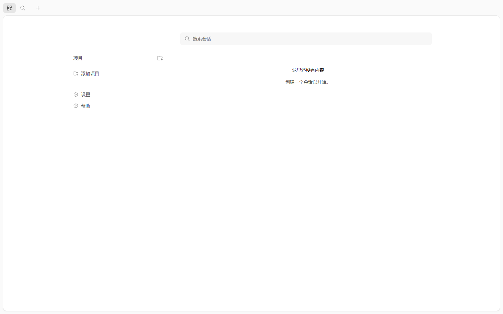

# 真实 ACK 部署验证（2026-11-04/05）

> 使用用户提供的 kubeconfig（`D:\Ragharness\KubeConfig`）在真实阿里云 ACK 集群完成首次 opencode 工作区部署。
> 本文只记录实际执行与观测到的结果；未执行/失败项明确标注。

## 1. 集群事实

| 项 | 值 |
| --- | --- |
| Kubernetes | `v1.37.1-aliyun.1`（ACK） |
| 节点 | 3 台：`ecs.c7.2xlarge`(8C/15.8G) + 2×`ecs.g7.xlarge`(4C/16G) |
| 地域 | cn-hangzhou（可用区 j） |
| 存储类 | `alicloud-disk-essd` 等（CSI 正常） |
| Ingress / RuntimeClass | **无** IngressClass、无 RuntimeClass（gVisor/Kata 未提供） |
| 已有命名空间 | 未改动 `ragharness` / `ragharness-infra` |

## 2. 执行步骤（可复现）

```bash
# 0) 客户端（本机无 kubectl -> 下载官方 v1.37.2）
#    https://dl.k8s.io/release/v1.37.2/bin/windows/amd64/kubectl.exe

# 1) CRD + 命名空间
kubectl apply -f deploy/kind/10-crd.yaml
kubectl create namespace ws-org-demo
kubectl create namespace opencode-gateway
kubectl -n ws-org-demo create secret generic demo-ws-auth \
  --from-literal=OPENCODE_SERVER_PASSWORD='Demo-Pass-9f3c'

# 2) Operator（本机运行，使用用户 kubeconfig；生产应改为 in-cluster Deployment）
GOOS=windows go build -o tools/workspace-operator.exe ./services/workspace-operator
KUBECONFIG=D:\Ragharness\KubeConfig WORKSPACE_DOMAIN=example.com \
  tools/workspace-operator.exe --leader-elect=false \
  --metrics-bind-address=:18080 --health-probe-bind-address=:18081

# 3) 工作区 CR（4C8G，运行 opencode 2.2.5）
kubectl apply -f deploy/samples/demo-workspace.yaml

# 4) 访问（无 Ingress 时用 port-forward）
kubectl -n ws-org-demo port-forward svc/demo-ws 14097:4096
curl -u opencode:Demo-Pass-9f3c http://127.0.0.1:14097/api/info
```

## 3. 实测结果

| 检查 | 结果 | 证据 |
| --- | --- | --- |
| CR 状态 | `demo-ws` → **Ready** | `kubectl get ow` |
| Pod | `1/1 Running`，0 重启 | `demo-ws-5fd4cdfd96-*` |
| 资源 | **requests = limits = 4 CPU / 8Gi / 2Gi ephemeral**，**QoS Guaranteed** | pod JSON |
| 调度 | 8C 节点 `cn-hangzhou.10.5.107.42` | pod `spec.nodeName` |
| 镜像 | `docker.m.daocloud.io/oven/bun:1.4.4`（Docker Hub 不可达，使用 DaoCloud 镜像） | pod spec |
| opencode | **v2.2.5**（pod 内 npm 镜像安装，`/usr/local/bin` 只读 → 装到 home） | `opencode --version` |
| 服务 | `GET /api/info` 200；无认证 401 | curl |
| OpenAPI | 138 paths | `/openapi.json` |
| Web UI | 200 + 登录后进入项目页 | `docs/05-delivery/evidence/ack/workspace-ui.png` |
| 退出不销毁 | 删除 Pod 后 operator 36s 内重建，CR 保持 Ready | 实测 |
| 持久化 | **未验证（DEGRADED）**：阿里云账号余额不足，ESSD PVC 无法创建 | PVC event `InvalidAccountStatus.NotEnoughBalance` |

Web UI 截图：



## 3.5 平台组件已全部进入集群（in-cluster）

在 `opencode-system` 命名空间以 **ConfigMap 源码 + 公共运行时镜像内构建/安装** 的方式部署（无需自建镜像仓库）：

| 组件 | 镜像 | 状态 | 说明 |
| --- | --- | --- | --- |
| control-plane | `oven/bun:1.4.4` | **1/1 Running** | ConfigMap 源码 → `bun install`（npmmirror）→ SQLite（emptyDir）→ :4000 |
| workspace-operator | `golang:1.24` | **1/1 Running** | ConfigMap 源码 → `go build`（goproxy.cn）→ 运行（in-cluster RBAC） |
| skill-center | `oven/bun:1.4.4` | **1/1 Running** | :4101，`/healthz` 200 |
| eval-center | `oven/bun:1.4.4` | **1/1 Running** | :4102 |
| app-center | `oven/bun:1.4.4` | **1/1 Running** | :4103 |
| mcp-hub | `oven/bun:1.4.4` | **1/1 Running** | :4104 |
| demo-ws 工作区 | `oven/bun:1.4.4` | **1/1 Running** | opencode 2.2.5，4C8G Guaranteed |

部署命令：

```bash
# 生成 ConfigMap（从仓库源码）
python scripts/ack/package-configmaps.py
kubectl apply -f deploy/ack/operator-src-configmap.yaml
kubectl apply -f deploy/ack/control-plane-src-configmap.yaml
kubectl apply -f deploy/ack/{skill,eval,app,mcp-hub}...  # 见 deploy/ack/*.yaml
kubectl apply -f deploy/ack/operator-incluster.yaml
kubectl apply -f deploy/ack/control-plane-incluster.yaml
kubectl apply -f deploy/ack/centers-incluster.yaml

# 验证
kubectl -n opencode-system get pods
kubectl -n opencode-system port-forward svc/control-plane 14098:4000
bun scripts/smoke-api.ts http://127.0.0.1:14098   # 17/17 PASS（Mock Provisioner）
```

实测：in-cluster 控制面健康 200、dev-login/工作区/票据/审计冒烟 **17/17 PASS**；四中心 `/healthz` 200；Operator 在集群内完成 Pod 重建（删除工作区 Pod 后 31s 恢复）。

> 注意：这些 Pod 是 **demo 形态**——源码/构建发生在 Pod 启动时（首次 3–5 分钟）、SQLite 落 emptyDir、无 PG/Redis/TLS/Ingress。生产必须换成预构建镜像 + PG/Redis + Ingress + SSO，见 DEPLOYMENT.md。

## 4. 与设计的偏差 / 限制（必须知晓）

1. **PVC 未验证**：账号余额不足导致云盘无法开通，演示改用 `persistence.mode: emptyDir`（**数据不持久**）；生产必须用 PVC（`mode: pvc` + ESSD）并验证快照。
2. **Operator 运行在集群外**（本机 Go 进程，使用 admin kubeconfig）；生产应构建镜像并以 Deployment + RBAC/SAN 运行。
3. **运行时镜像未预构建**：演示用公共 `oven/bun` 镜像 + 启动时从 `registry.npmmirror.com` 安装 `@opencode/cli@2.2.5`（约 10s）；生产应使用 `deploy/docker/workspace` 预构建镜像并锁定 digest。
4. **NetworkPolicy 被临时删除**：工作区安装 npm 包需要公网出口，而 operator 生成的是默认拒绝策略；生产应由 egress-proxy 白名单放行。
5. **节点 taint 调整**：唯一 8C 节点是系统节点池（`CriticalAddonsOnly` taint），为演示移除；生产应使用独立 workspace 节点池与容忍。
6. **无 Ingress/SSO**：集群无 IngressClass，演示用 `kubectl port-forward`；真实域名/证书/SSO 未验证。
7. **未验证**：OOMKilled、PVC 持久化/快照、gVisor/Kata 逃逸、真实 OIDC、LiteLLM、应用构建。

## 5. 清理（如不再需要）

```bash
kubectl -n ws-org-demo delete ow demo-ws --wait=false
kubectl -n ws-org-demo delete deploy,svc,netpol --all
kubectl -n ws-org-demo delete secret demo-ws-auth
kubectl delete namespace ws-org-demo opencode-gateway
kubectl delete crd opencodeworkspaces.workspace.opencode.cloud
# 恢复系统节点 taint（演示时移除过）
kubectl taint node cn-hangzhou.10.5.107.42 CriticalAddonsOnly=true:NoSchedule
```
